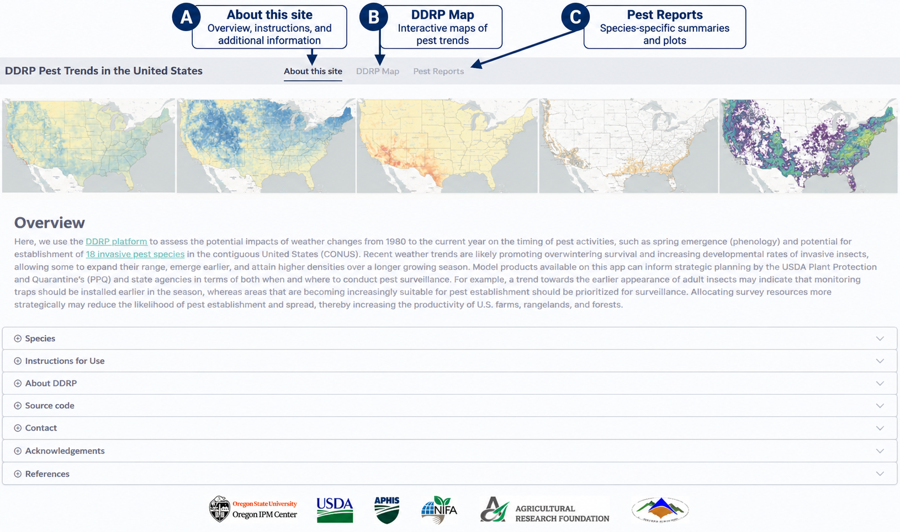
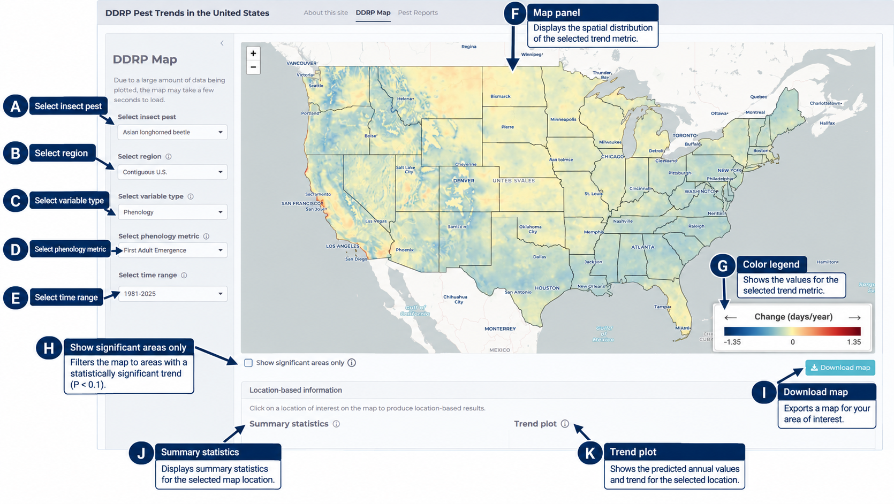
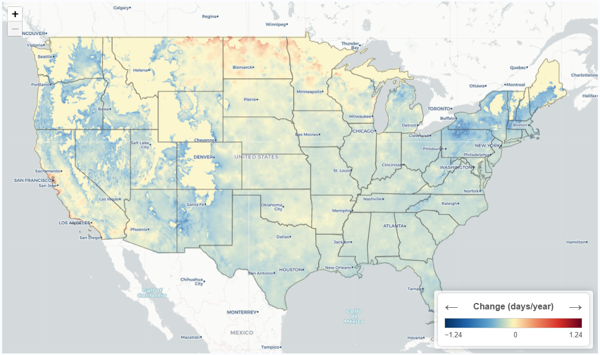
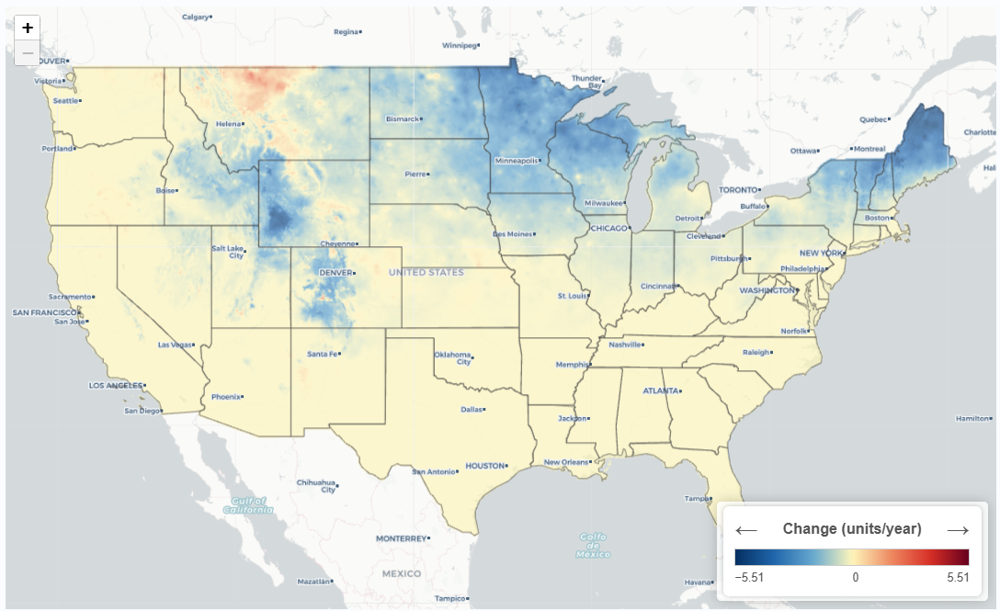
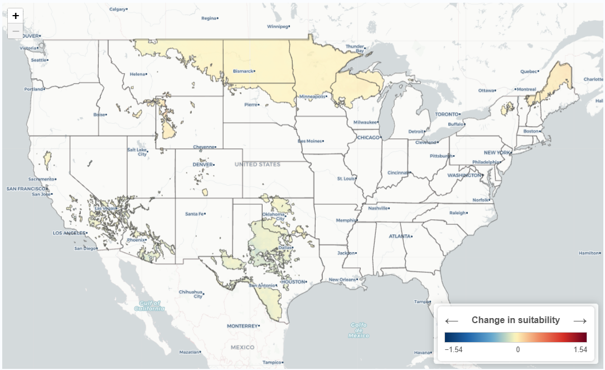
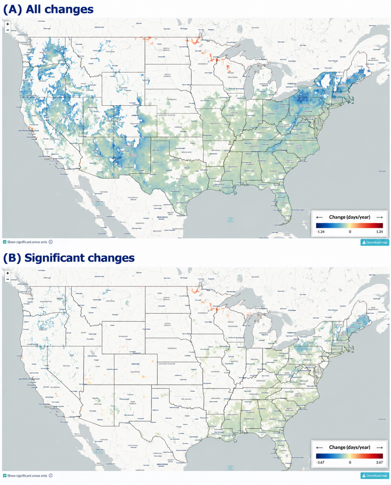
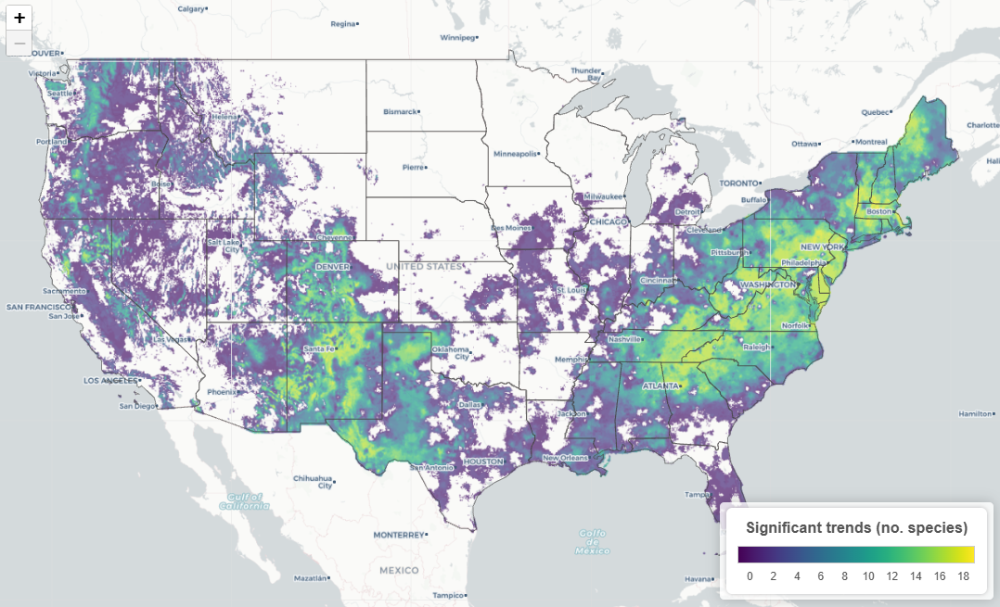
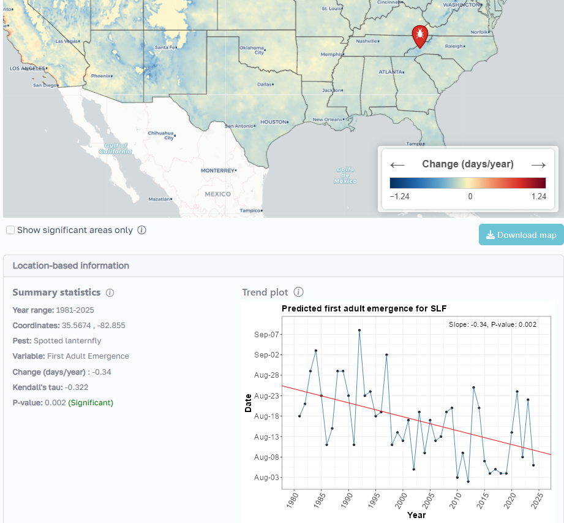
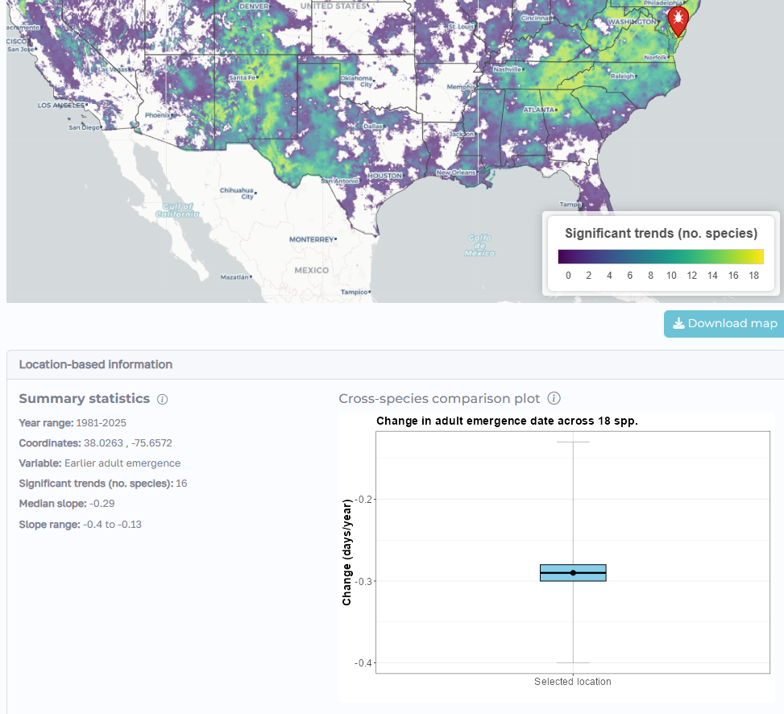

## Purpose

The Degree-Day, Establishment Risk, and Phenological (DDRP) Pest Trends web app was developed by modelers at the Oregon Integrated Pest Management Center at Oregon State University. It provides interactive maps and location-specific plots for exploring trends in predicted pest phenology and climate stress across the contiguous United States (CONUS). 

The app currently provides model outputs for 18 invasive pest species (Table 1). It can help users explore where predicted pest activity and climate stress have changed over time. The results can inform further investigation, monitoring, and management planning, but should be interpreted in the context of the underlying models. For more information about individual species and how results may be applied to management, visit the **Pest Reports** page and consult the report for the species of interest. The full report provides additional details about the study objectives, modeling methods, and analyses underlying the results.

\vspace{1em}

```{r, echo=FALSE}
#| tbl-cap: "**Table 1.** Invasive pest species with completed DDRP models. As of 2026, five are present in the CONUS, 12 are designated as National Priority Pests, six were formerly on the list, and two are Federal Program Pests. Links to real-time forecasts, spreadsheet analyses, technical reports, and peer-reviewed publications associated with each species model are available at <https://uspest.org/DDRP>."
#| tbl-pos: H
library(kableExtra)
# Species list
data <- read.csv("./tutorial/species_table.csv")
# Display the table
knitr::kable(data, escape = FALSE) %>%
  kable_styling(font_size = 10) %>%
  column_spec(1, width = "4cm", italic = TRUE) %>%
  column_spec(2, width = "5cm") %>%
  column_spec(3:5, width = "2.5cm") %>%
  row_spec(0, bold = TRUE)
```

## Requirements

The app requires an internet connection and a device with a web browser. It is designed to adjust to different screen sizes and can be used on a desktop computer, laptop, tablet, or smartphone. Common browsers include Google Chrome, Mozilla Firefox, and Microsoft Edge. Open the web app at <https://riskmaps.oregonstate.edu/DDRP_pest_trends/>.

## Getting started

When you open the DDRP Pest Trends web app, the landing page introduces the application, its purpose, and the pest species with DDRP models (Fig. 1). Review this information to understand the scope of the app, the types of pest trends you can explore.

```{r}
#| echo: false
#| out-width: 100%
#| fig-align: center
#| fig-cap: "**Figure 1.** DDRP Pest Trends landing page. Letters identify the three main subpages: (A) About this site, (B) DDRP Map, and (C) Pest Reports. The landing page provides an overview of the application, tutorial, source code, contact information, and additional resources." 

```

From the landing page, navigate to the **DDRP Map** page to explore the model outputs. The map displays using the default selections, with the available controls located on the left side of the interface (Fig. 2). Use these controls to select a pest species, geographic region, variable type, trend metric, and time range. The map, summary statistics, and location-specific plots update according to your selections.

```{r}
#| echo: false
#| out-width: 100%
#| fig-align: center
#| fig-cap: "**Figure 2.** Overview of the DDRP Pest Trends interface. Letters identify the main controls and outputs: (A) insect pest selection, (B) geographic region, (C) variable type, (D) phenology metric, (E) time range, (F) map panel, (G) color legend, (H) significance filter, (I) map download, (J) location-specific summary statistics, and (K) location-specific trend plot. The significance filter displays only areas with statistically significant trends (P < 0.1)."

```

## Menu panel: Select map options

### Pest species

Use the `Select insect pest` dropdown menu to choose an individual species or `All species (comparison)` (Fig. 2A). When an individual species is selected, you can examine trends in its phenology, climate stress, or suitability. For species-specific context, including map interpretation and management implications, see the corresponding report on the **Pest Reports** page. 

When `All species (comparison)` is selected, you can identify areas where trends are consistent across the 18 species, including earlier predicted pest activities and increasing climatic suitability. The full report on the **Pest Reports** page describes spatial patterns observed across species and provides further interpretation of these results.

### Region

Use the `Select region` dropdown menu to choose the geographic area displayed on the map (Fig. 2B). Selecting a state zooms the map to that area. The default selection is the CONUS.

### Variable type

Choose the type of information to display using the `Select variable type` dropdown menu (Fig. 2C):

- **Phenology** describes the predicted timing of pest life-cycle events.
- **Climate stress** describes predicted temperature-related stress that may affect pest survival.
- **Suitability** describes predicted climatic suitability, defined as areas not excluded by temperature-related stress.

### Phenology metric

This dropdown menu appears when `Phenology` is selected (Fig. 2D).

- **First Adult Emergence:** The predicted timing of first adult emergence.
- **First Egg Hatch:** The predicted timing of first egg hatch.

### Climate variable

This dropdown menu appears when `Climate stress` is selected (Fig. 2D).

- **Cold Stress:** Displays trends in predicted cold stress.
- **Heat Stress:** Displays trends in predicted heat stress.

### Suitability

Climatic suitability represents potential pest establishment based on temperature-related stress. 

### Time range

Use the `Select time range` dropdown menu to choose the period used for trend analysis (Fig. 2E).

- **1981–2025:** The the entire 44-year period.
- **2001–2025:** The recent 24-year period.

## Map panel: Explore trend maps

### Viewing and interpreting trend maps

#### Individual species

Each map for an individual species shows the spatial distribution of the selected trend metric across the chosen region (Fig. 2F). In the legend, Sen's slope measures the amount and direction of change per year (Fig. 2G). It is expressed in days per year for phenology or units per year for cold and heat stress. Values near zero indicate little estimated change, positive values indicate an increase over time, and negative values indicate a decrease. For phenology, negative values indicate earlier predicted events, whereas positive values indicate later predicted events (Fig. 3). For climate stress, negative values indicate decreasing stress, while positive values indicate increasing stress (Fig. 4). 

```{r}
#| echo: false
#| out-width: 100%
#| fig-align: center
#| fig-cap: "**Figure 3.** Changes (days/year) in predicted first adult emergence for spotted lanternfly across the CONUS over the entire 44-year period (1981–2025)."

```

```{r}
#| echo: false
#| out-width: 100%
#| fig-align: center
#| fig-cap: "**Figure 4.** Changes (units/year) in predicted cold stress for spotted lanternfly across the CONUS over the entire 44-year period (1981–2025)."

```

Decreasing cold stress may increase climatic suitability for a pest and its potential for establishment, whereas increasing heat stress may decrease suitability (Fig. 5). Changes in suitability were assessed using a cumulative link model based on DDRP’s three temperature-stress exclusion categories: no exclusion (0), moderate exclusion (−1), and severe exclusion (−2). Positive coefficients indicate a shift toward higher suitability (0), whereas negative coefficients indicate a shift toward lower suitability (−2). To view only areas with statistically significant changes, select the `Show significant areas only` checkbox.

```{r}
#| echo: false
#| out-width: 100%
#| fig-align: center
#| fig-cap: "**Figure 5.** Changes in predicted climatic suitability for spotted lanternfly across the CONUS over the entire 44-year period (1981–2025)."

```

Comparing maps produced for the 1981–2025 and 2001–2025 periods helps distinguish long-term trends from more recent changes (Fig. 6). Consider the direction and magnitude of trends, the geographic extent of statistically significant changes, and the consistency of patterns between periods. Differences may reflect changes in climate patterns, interannual variability, or statistical power and do not, on their own, identify the causes of observed trends.

```{r}
#| echo: false
#| out-width: 85%
#| fig-align: center
#| fig-cap: "**Figure 6.** Trends in predicted first adult emergence of spotted lanternfly across the CONUS over the entire 44-year period (1981-2025) for (A) all trends and (B) statistically significant trends only (P < 0.1). Negative values indicate earlier predicted emergence, whereas positive values indicate later predicted emergence."

```

#### All species (comparison)

Outputs from trend analyses for the 18 species were combined to identify areas where pests consistently exhibited earlier first adult emergence and first egg hatch, decreasing cold stress, and increasing heat stress. Spatial descriptive statistics were calculated across species, including the mean and variance in the magnitude of change and the frequency of statistically significant increasing versus decreasing trends.

In Figure 7, the map shows the geographic distribution of agreement among 18 invasive pest species in significant trends toward earlier predicted dates of first adult emergence across the CONUS during the 44-year period (1981–2025). Higher values indicate locations where more species exhibited statistically significant advances in predicted adult emergence, highlighting regions where earlier seasonal pest activity is a consistent cross-species pattern.

```{r}
#| echo: false
#| out-width: 85%
#| fig-align: center
#| fig-cap: "**Figure 7.** Cross-species comparison of significant trends in predicted dates of first adult emergence across the CONUS over the entire 44-year period (1981-2025). Colors indicate the number of species exhibiting statistically significant trends (P < 0.1) toward earlier first adult emergence at each location."

```

### Downloading maps

Use the `Download map` button to export a map for your area of interest (Fig. 2I). Before exporting, select the desired pest species, variable, region, time range, and other display options. Exporting a map may take several seconds and, in some cases, nearly a half-minute to complete. Please allow time for the export process to finish.

## Location-based information

### Individual species

The `Summary statistics` panel for individual species provides information about trends at the selected location for the selected pest species and variable (Figs. 2J and 8). Content in this panel appears after a location is selected by clicking on the map. The summary statistics include:

- **Change (days/year or units/year)**: Sen’s slope estimates the rate and direction of change over time. Positive values indicate an increase, while negative values indicate a decrease. 

- **Trend direction and strength**: Kendall’s tau (τ) indicates the direction and strength of a monotonic trend. Positive values indicate an upward trend, negative values indicate a downward trend, and values near 0 indicate a weak or absent monotonic trend.  

- **P-value**: The Mann–Kendall test assesses whether a monotonic trend is statistically significant. A P-value < 0.1 indicates a statistically significant trend.

```{r}
#| echo: false
#| out-width: 70%
#| fig-align: center
#| fig-cap: "**Figure 8.** Location-based summary statistics and time-series plot of trends in predicted first adult emergence for spotted lanternfly at a selected location in North Carolina over the entire 44-year period (1981-2025). Summary statistics include the estimated rate of change in emergence date (days/year), the direction and strength of trend (Kendall’s tau), and the associated P-value. The time-series plot shows annual predicted emergence dates and the fitted linear trend; a negative slope indicates a shift toward earlier predicted emergence."

```

Selecting a location also produces a plot showing predicted values over time at that location (Fig. 2K). Use the `Download plot` button to export the plot. The time-series plot includes:

- **Predicted values:** The model-predicted value for each year at the selected location.
- **Red line:** The estimated linear trend (slope) over time.
- **P-value:** An indication of the statistical significance of the trend.

Missing points in the plot should not automatically be interpreted as missing weather observations. For the selected event, they may reflect the model's assessment that conditions were unsuitable for the event to occur.

#### All species (comparison)

For the cross-species comparison, selecting a location displays summary statistics describing the number of species with significant trends and the magnitude of change in phenology or climate stress at that location (Fig. 9):

- **Significant trends (no. species)**: Number of species with significant trends at the selected location.
- **Median slope**: The median rate of change across the 18 species, expressed in days per year for phenology or units per year for climate stress.
- **Slope range**: The minimum and maximum rates of change across species, indicating the variability in trend magnitude and direction.

The comparison plot summarizes these trends, with the black point indicating the median slope, the blue bar representing the median ± standard error, and gray error bars showing the minimum-to-maximum slope range (Fig. 9). Negative slopes indicate earlier predicted phenological events or decreasing climate stress, whereas positive slopes indicate later phenological events or increasing climate stress. The range of slopes helps users assess the variability in trends among species at the selected location.

```{r}
#| echo: false
#| out-width: 70%
#| fig-align: center
#| fig-cap: "**Figure 9.** Location-based summary statistics and comparison plot for first adult emergence across 18 invasive pest species over the entire 44-year period (1981-2025). The map shows the number of species exhibiting statistically significant trends toward earlier predicted adult emergence at the selected location in Maryland."

```

## Using results for pest management

Consult the full report, including species-specific reports, on the **Pest Reports** page for guidance on applying results to pest management. Before making management decisions:

- Consider the direction and magnitude of the trend, not only statistical significance.
- Interpret predictions in the context of local conditions and other relevant information.
- Use model outputs as decision-support information, not as direct observations of pest abundance or confirmation of establishment.

## Important considerations

- **Model predictions are not direct observations.** The results reflect predictions from the underlying DDRP models and their associated assumptions, rather than direct observations of pest activity or establishment risk. The observed trends do not, on their own, establish the causes of the predicted changes.
- **Statistical significance is not the same as practical importance.** A small trend can be statistically significant, and a large estimated trend may not be statistically significant.
- **Missing points have a specific interpretation.** In the time-series plots, they indicate conditions unsuitable for the selected event to occur.
- **Results depend on the selected settings.** Confirm the pest, variable type, metric, region, and time range before interpreting results.
- **Temperature-driven trends do not account for all factors influencing pest dynamics.** The models are driven by temperature, so the mapped trends reflect changes in temperature and their effects on predicted pest phenology and climate stress. However, the maps do not capture the effects of other factors that may influence pest activity, survival, or establishment.

## Contact

For questions about the DDRP Pest Trends app, assistance with the app, or reports of technical issues, contact [Dr. Brittany Barker](mailto:brittany.barker@oregonstate.edu) at the Oregon Integrated Pest Management Center at Oregon State University.

## Acknowledgements

Some figures were prepared with assistance from ChatGPT (OpenAI) for labeling and layout only. All underlying map data and visualizations were unchanged.