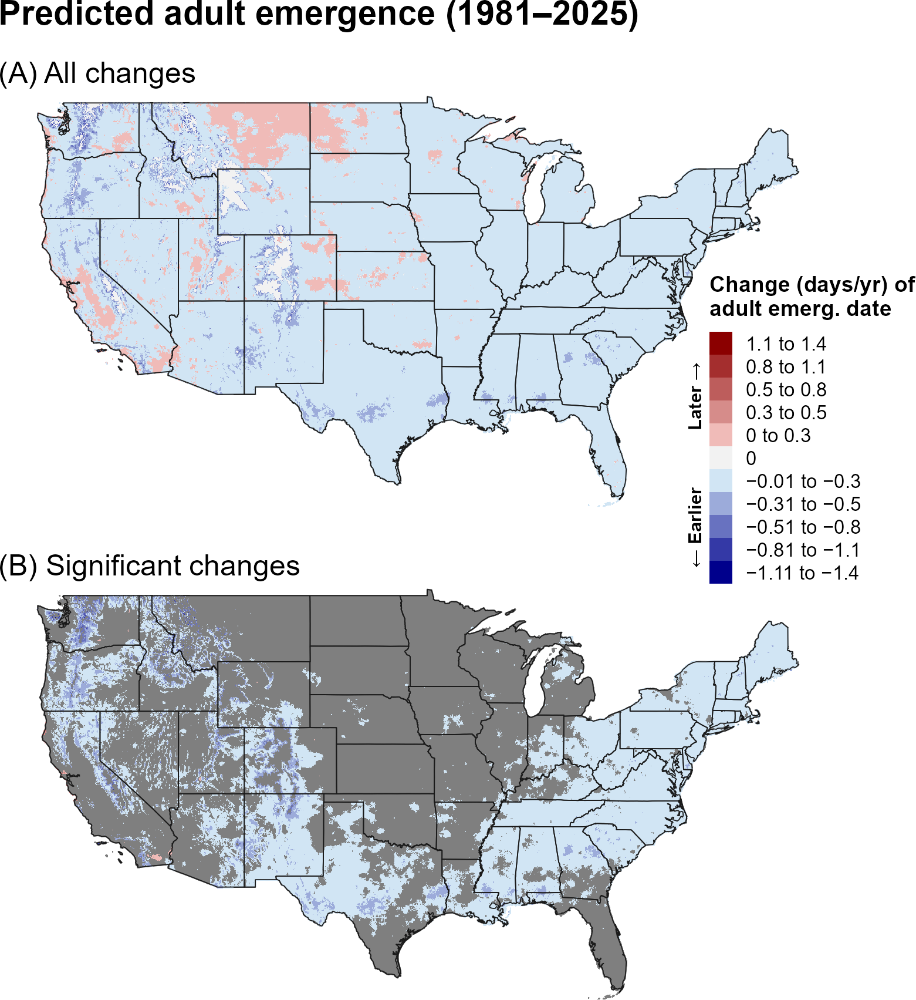
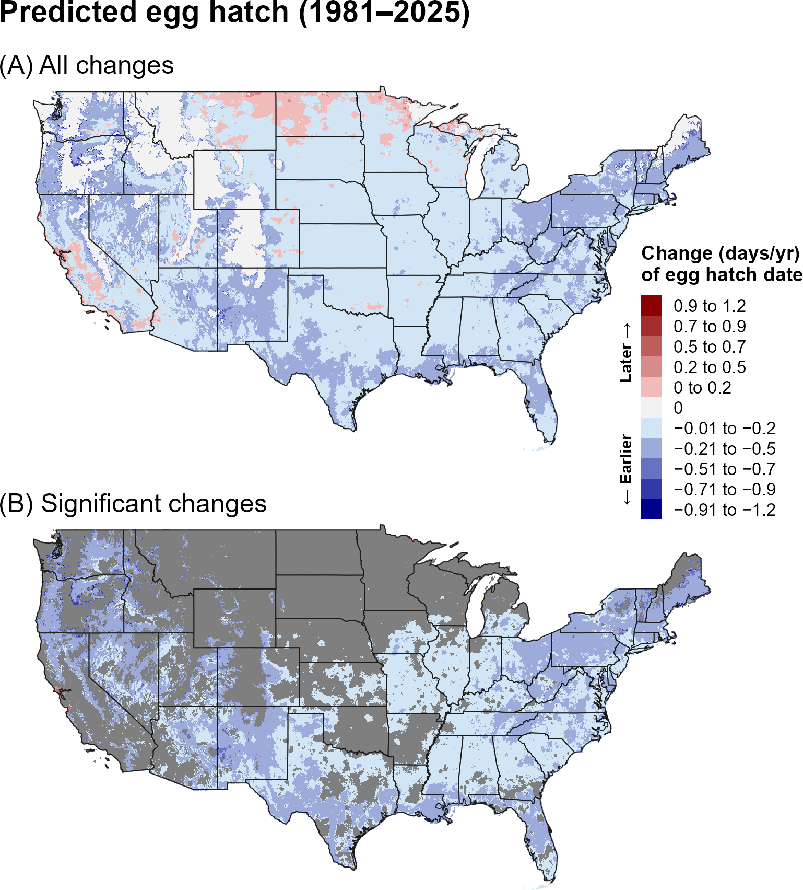
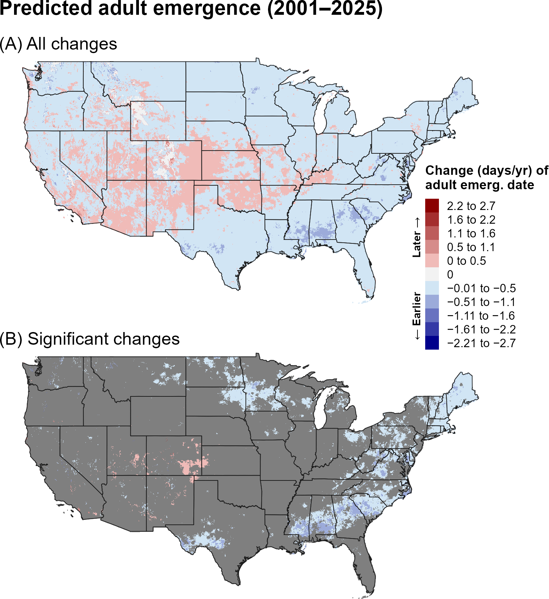
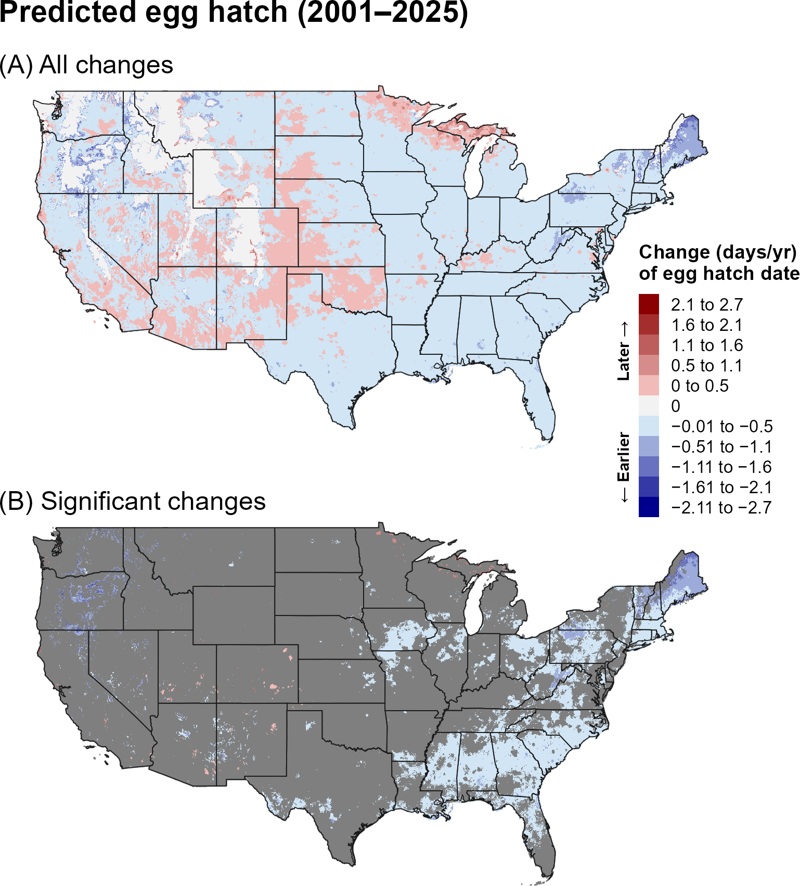
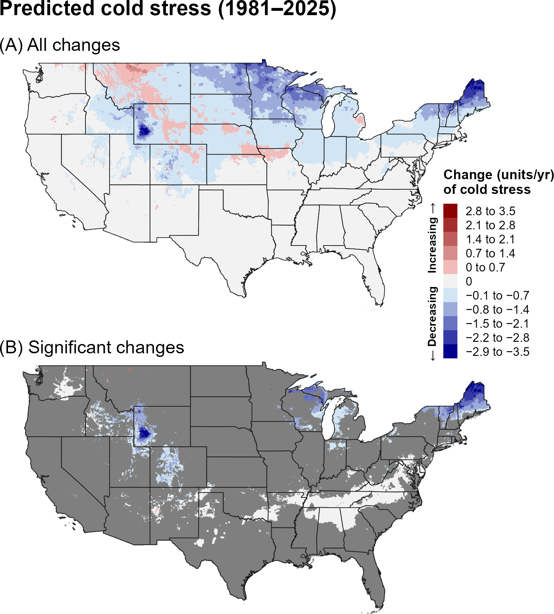
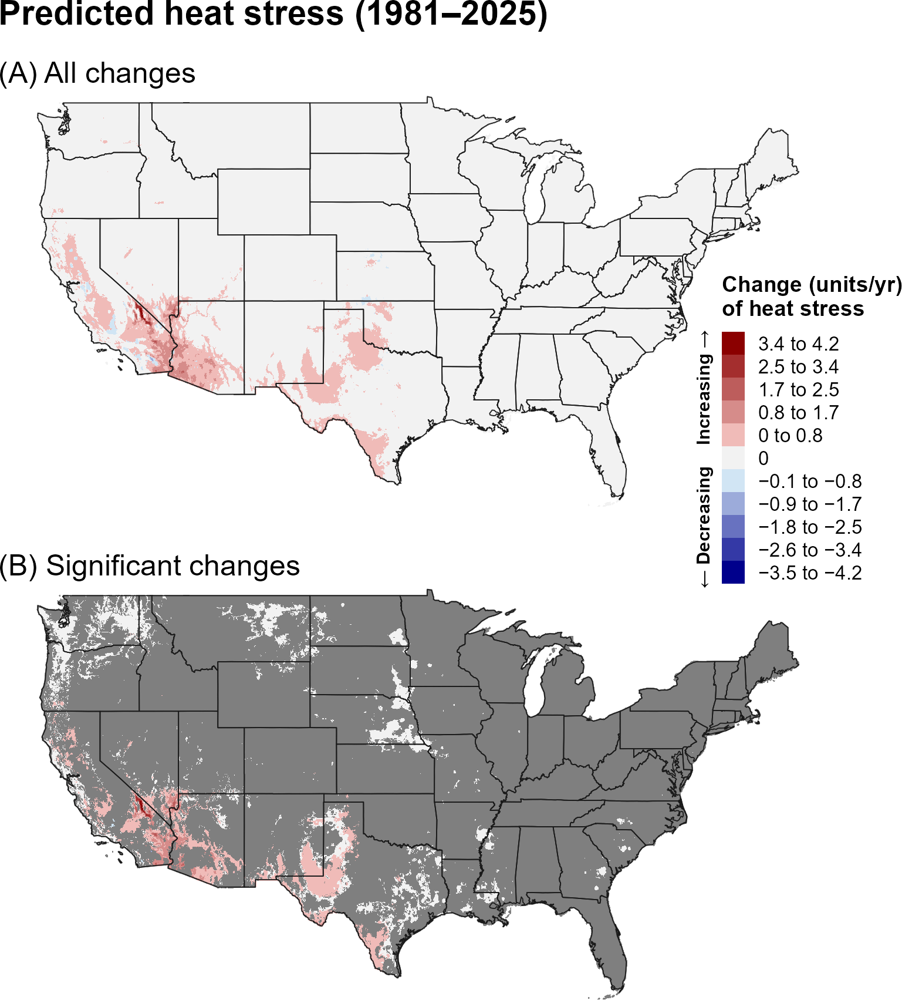
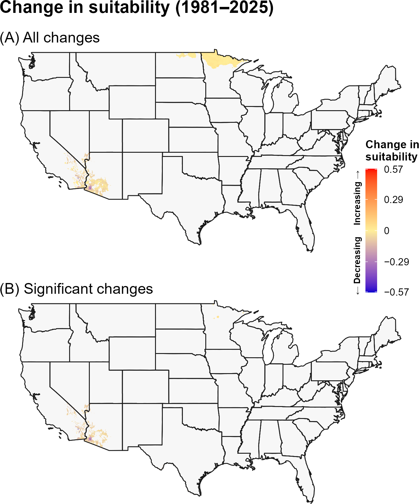
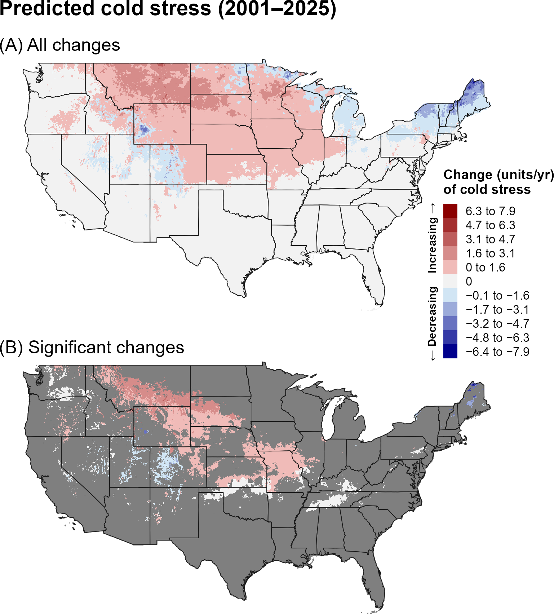
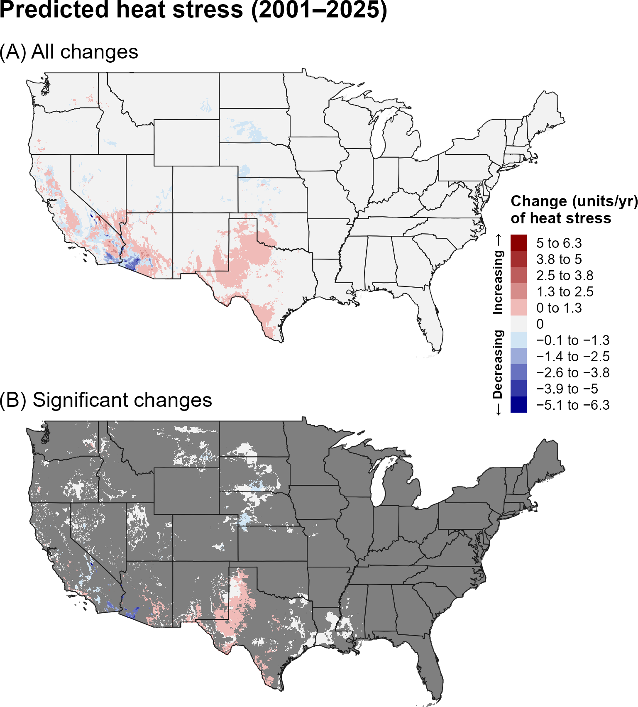
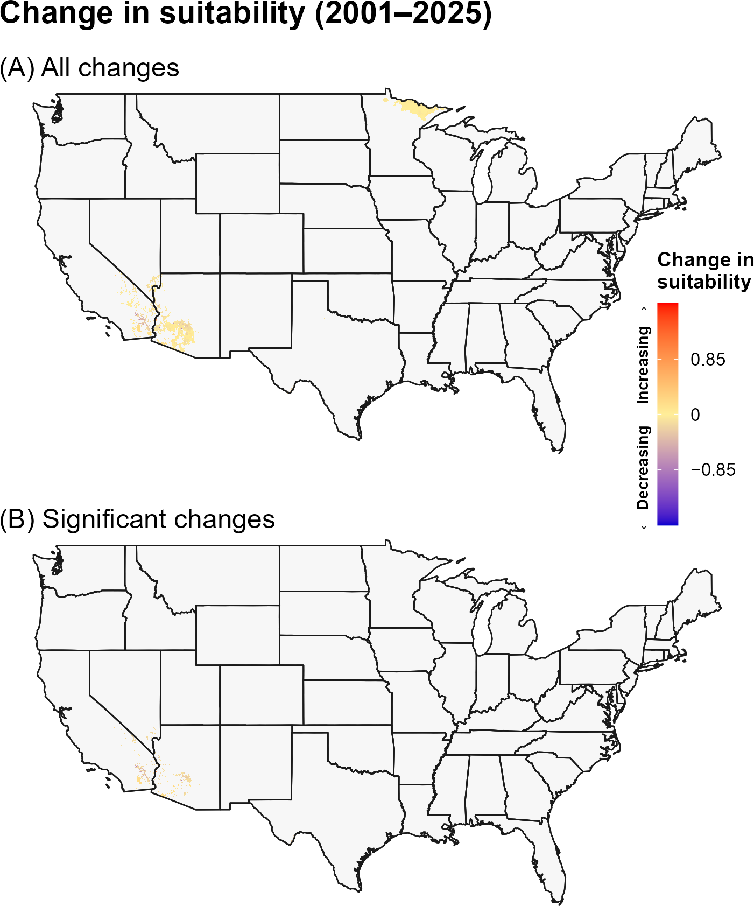

:::: {.content-visible when-format="html"}
::: {style="text-align: left;"}
[Download ALB report as PDF](ALB/ALB.pdf){.btn .btn-primary}
:::
::::

## **1A. Introduction** {.unlisted}

The Asian longhorned beetle (ALB), *Anoplophora glabripennis* Motschulsky (Coleoptera: Cerambycidae), is a wood-eating pest native to the Korean peninsula and eastern China. In the United States, the beetle was first discovered on Long Island, NY, in 1996, where it likely arrived via wood packaging from China (`\hyperref[ref-haack-hoebeke-1996]{Haack and Hoebeke 1996}`{=latex}`<a href="#ref-haack-hoebeke-1996">Haack and Hoebeke 1996</a>`{=html}). The pest spread to several sites in the eastern United States and Canada but has since been eradicated in Illinois, New Jersey, New York City, Boston, and Canada (`\hyperref[ref-coyle-2021]{Coyle et al. 2021}`{=latex}`<a href="#ref-coyle-2021">Coyle et al. 2021</a>`{=html}, `\hyperref[ref-eppo-2019]{EPPO 2019}`{=latex}`<a href="#ref-eppo-2019">EPPO 2019</a>`{=html}). However, infestations currently persist in central Long Island, NY; Worcester County, MA; Clermont County, OH; and Charleston County, SC (`\hyperref[ref-coyle-2021]{Coyle et al. 2021}`{=latex}`<a href="#ref-coyle-2021">Coyle et al. 2021</a>`{=html}, `\hyperref[ref-usda-aphis-2025]{USDA-APHIS 2025}`{=latex}`<a href="#ref-usda-aphis-2025">USDA-APHIS 2025</a>`{=html}). ALB is a major threat to the maple hardwood lumber and sugar maple syrup industries, as well as tourism associated with fall colors in maple trees (`\hyperref[ref-smith-wu-2008]{Smith and Wu 2008}`{=latex}`<a href="#ref-smith-wu-2008">Smith and Wu 2008</a>`{=html}). The cost of a complete infestation of all urban areas in the United States has been estimated at \$669 billion (`\hyperref[ref-nowak-2001]{Nowak et al. 2001}`{=latex}`<a href="#ref-nowak-2001">Nowak et al. 2001</a>`{=html}).

An estimated 30-35% of trees in the eastern United States are species commonly attacked by ALB (`\hyperref[ref-nowak-2001]{Nowak et al. 2001}`{=latex}`<a href="#ref-nowak-2001">Nowak et al. 2001</a>`{=html}, `\hyperref[ref-smith-wu-2008]{Smith and Wu 2008}`{=latex}`<a href="#ref-smith-wu-2008">Smith and Wu 2008</a>`{=html}). The pest can complete its lifecycle on *Acer*, *Aesculus*, *Albizia julibrissin*, *Betula*, *Cercidiphyllum*, *Elaeagnus angustifolia*, *Fraxinus*, *Platanus*, *Populus*, *Salix*, *Sorbus aucuparia* and *Ulmus* species (`\hyperref[ref-van-der-gaag-loomans-2014]{van der Gaag and Loomans 2014}`{=latex}`<a href="#ref-van-der-gaag-loomans-2014">van der Gaag and Loomans 2014</a>`{=html}). However, preferred genera in North America are *Acer* and *Ulmus*, compared to *Populus* and *Salix* in China (`\hyperref[ref-hu-2009]{Hu et al. 2009}`{=latex}`<a href="#ref-hu-2009">Hu et al. 2009</a>`{=html}, `\hyperref[ref-van-der-gaag-loomans-2014]{van der Gaag and Loomans 2014}`{=latex}`<a href="#ref-van-der-gaag-loomans-2014">van der Gaag and Loomans 2014</a>`{=html}). Following oviposition under the bark of host trees, larvae feed in the cambial region before burrowing into the inner xylem and heartwood (`\hyperref[ref-haack-hoebeke-1996]{Haack and Hoebeke 1996}`{=latex}`<a href="#ref-haack-hoebeke-1996">Haack and Hoebeke 1996</a>`{=html}, `\hyperref[ref-haack-2006]{Haack 2006}`{=latex}`<a href="#ref-haack-2006">Haack 2006</a>`{=html}). ALB may overwinter as an egg, larva, or pupa, though typically as an egg or larva, before emerging from round exit holes as adults (`\hyperref[ref-haack-hoebeke-1996]{Haack and Hoebeke 1996}`{=latex}`<a href="#ref-haack-hoebeke-1996">Haack and Hoebeke 1996</a>`{=html}, `\hyperref[ref-haack-2006]{Haack 2006}`{=latex}`<a href="#ref-haack-2006">Haack 2006</a>`{=html}, `\hyperref[ref-herard-2009]{Herard et al. 2009}`{=latex}`<a href="#ref-herard-2009">Herard et al. 2009</a>`{=html}, `\hyperref[ref-faccoli-2015]{Faccoli et al. 2015}`{=latex}`<a href="#ref-faccoli-2015">Faccoli et al. 2015</a>`{=html}, `\hyperref[ref-trotter-keena-2016]{Trotter and Keena 2016}`{=latex}`<a href="#ref-trotter-keena-2016">Trotter and Keena 2016</a>`{=html}). Diapause termination requires a chilling period, and larvae may be freeze tolerant (`\hyperref[ref-roden-2008]{Roden et al. 2008}`{=latex}`<a href="#ref-roden-2008">Roden et al. 2008</a>`{=html}, `\hyperref[ref-torson-2021]{Torson et al. 2021}`{=latex}`<a href="#ref-torson-2021">Torson et al. 2021</a>`{=html}).

A model for ALB developed for the Degree-Day, establishment Risk, and Phenological event mapping system (DDRP) is operationalized to produce near real-time forecasts for the contiguous United States (CONUS) at <https://uspest.org/DDRP>. The full set of model parameters for ALB, including developmental temperature thresholds, degree-day requirements for individual life stages, and climate stress thresholds and limits, are available at USPest.org (`\hyperref[ref-coop-2018]{Coop 2018}`{=latex}`<a href="#ref-coop-2018">Coop 2018</a>`{=html}).

## **1B. Results** {.unlisted}

### **i. Phenology**

#### **Entire period: 1981--2025**

Significant trends in predicted first adult emergence and egg hatch for ALB over the entire 44-year period (1981–2025) were predominantly negative, indicating that these phenological events shifted earlier over time (@fig-alb-emergence, @fig-alb-egg-hatch). Significant advances were concentrated across large portions of the eastern United States, with additional localized areas along the Pacific coast, in the South, and at higher elevations of the interior West. In these regions, predicted adult emergence and egg hatch decreased by approximately 0.01–0.8 days per year, with some of the largest declines occurring at higher elevations in the West.

```{r}
#| echo: false
#| out-width: 70%
#| fig-align: center
#| fig-cap: "Changes (days/year) in predicted dates of first adult emergence for ALB across the CONUS over the entire 44-year period (1981–2025). Maps show (A) all changes and (B) statistically significant changes (P < 0.1); areas shown in gray are not statistically significant."
#| label: fig-alb-emergence

```

```{r}
#| echo: false
#| out-width: 70%
#| fig-align: center
#| fig-cap: "Changes (days/year) in predicted dates of first egg hatch for ALB across the CONUS over the entire 44-year period (1981–2025). Maps show (A) all changes and (B) statistically significant changes (P < 0.1); areas shown in gray are not statistically significant."
#| label: fig-alb-egg-hatch

```

#### **Recent period: 2001--2025**

Trends in predictions of first adult emergence and egg hatch for ALB during the recent 24-year period (2001–2025) were generally consistent with those observed over the 44-year period, although changes were smaller in magnitude and less spatially extensive (@fig-alb-emergence-recent, @fig-alb-egg-hatch-recent). For example, significantly earlier adult emergence and egg hatch were predicted primarily in parts of the eastern United States, with only isolated areas of significant change elsewhere in the CONUS.

```{r}
#| echo: false
#| out-width: 70%
#| fig-align: center
#| fig-cap: "Changes (days/year) in predicted dates of first adult emergence for ALB across the CONUS over the recent 24-year period (2001–2025). Maps depict the trend in predicted dates, significance of the trend (P-value), and change in predicted dates (days/year). Maps show (A) all changes and (B) statistically significant changes (P < 0.1); areas shown in gray are not statistically significant."
#| label: fig-alb-emergence-recent

```

```{r}
#| echo: false
#| out-width: 70%
#| fig-align: center
#| fig-cap: "Changes (days/year) in predicted dates of first egg hatch for ALB across the CONUS over the recent 24-year period (2001–2025). Maps show (A) all changes and (B) statistically significant changes (P < 0.1); areas shown in gray are not statistically significant."
#| label: fig-alb-egg-hatch-recent

```

### **ii. Climatic suitability**

#### **Entire period: 1981--2025**

Significant trends in predicted cold stress for ALB over the full 44-year period (1981–2025) were predominantly negative (@fig-alb-cold-stress), indicating a general decrease in cold stress over time. In contrast, significant trends in heat stress were largely positive across portions of the Southwest, indicating increasing heat stress (@fig-alb-heat-stress). When annual accumulated stress units exceed limits specified in DDRP models, climatic suitability may change. Consistent with these trends, suitability for ALB increased in parts of the Midwest, including Minnesota and North Dakota, but decreased in southern California and adjacent desert regions (@fig-alb-suitability). However, only some of these changes were statistically significant, suggesting that shifts in climatic suitability were spatially limited.

```{r}
#| echo: false
#| out-width: 70%
#| fig-align: center
#| fig-cap: "Changes (units/year) in predicted cold stress for ALB across the CONUS over the entire 44-year period (1981–2025). Maps show (A) all changes and (B) statistically significant changes (P < 0.1); areas shown in gray are not statistically significant. Areas shown as 0 in (B) had significant trends but very small changes."
#| label: fig-alb-cold-stress

```

```{r}
#| echo: false
#| out-width: 70%
#| fig-align: center
#| fig-cap: "Changes (units/year) in predicted heat stress for ALB across the CONUS over the entire 44-year period (1981–2025). Maps show (A) all changes and (B) statistically significant changes (P < 0.1); areas shown in gray are not statistically significant. Areas shown as 0 in (B) had significant trends but very small changes."
#| label: fig-alb-heat-stress

```

```{r}
#| echo: false
#| out-width: 70%
#| fig-align: center
#| fig-cap: "Changes in predicted climatic suitability for ALB across the CONUS over the 44-year period (1981–2025). Suitability is defined as areas not excluded by cold and heat stress. Positive changes (warmer colors) indicate an increased likelihood of establishment, whereas negative changes (cooler colors) indicate a decreased likelihood of establishment."
#| label: fig-alb-suitability

```

#### **Recent period: 2001--2025**

Statistically significant trends in predicted heat and cold stress for ALB over the recent 24-year period (2001–2025) were more spatially limited than those observed over the entire 1981–2025 period (@fig-alb-cold-stress-recent, @fig-alb-heat-stress-recent). Areas with significant increases in heat stress were generally consistent with those identified for the entire period, whereas several areas with significant decreases in cold stress over 1981–2025 showed no significant trend during 2001–2025. Additionally, parts of the Midwest and Rocky Mountains exhibited significant increases in cold stress, although the magnitude of these changes was small. Consistent with these patterns, fewer areas with significant changes in climatic suitability were identified, indicating that the predicted likelihood of establishment was relatively stable during the recent recent period (@fig-alb-suitability-recent).

```{r}
#| echo: false
#| out-width: 70%
#| fig-align: center
#| fig-cap: "Changes (units/year) in predicted cold stress for ALB across the CONUS over the recent 24-year period (2001–2025). Maps show (A) all changes and (B) statistically significant changes (P < 0.1); areas shown in gray are not statistically significant. Areas shown as 0 in (B) had significant trends but very small changes."
#| label: fig-alb-cold-stress-recent

```

```{r}
#| echo: false
#| out-width: 70%
#| fig-align: center
#| fig-cap: "Changes (units/year) in predicted heat stress for ALB across the CONUS over the recent 24-year period (2001–2025). Maps show (A) all changes and (B) statistically significant changes (P < 0.1); areas shown in gray are not statistically significant. Areas shown as 0 in (B) had significant trends but very small changes."
#| label: fig-alb-heat-stress-recent

```

```{r}
#| echo: false
#| out-width: 70%
#| fig-align: center
#| fig-cap: "Changes in predicted climatic suitability for ALB across CONUS over the recent 24-year period (2001–2025). Suitability is defined as areas not excluded by cold and heat stress. Positive changes (warmer colors) indicate an increased likelihood of establishment, whereas negative changes (cooler colors) indicate a decreased likelihood of establishment."
#| label: fig-alb-suitability-recent

```

## **1C. Discussion** {.unlisted}

Predictions of phenology and climatic suitability for ALB show clear, directional changes, with the strongest and most spatially extensive signals emerging over the entire 44-year period (1981–2025). Predicted adult emergence and egg hatch occurred progressively earlier across large portions of CONUS, averaging 0.01–0.5 days earlier per year, which suggests that surveyors and other management staff in these areas may want to ensure that materials are prepared earlier in the season. Faster development under warmer conditions could also enable ALB to achieve more rapid population growth, increase its damage potential, and shorten or eliminate the pupal hold period, potentially increasing the likelihood of multiple generations per year (`\hyperref[ref-schmitt-2025a]{Schmitt et al. 2025a}`{=latex}`<a href="#ref-schmitt-2025a">Schmitt et al. 2025a</a>`{=html},`\hyperref[ref-schmitt-2025b]{b}`{=latex}`<a href="#ref-schmitt-2025b">b</a>`{=html}).

Declines in predicted cold stress across northern and high-elevation regions—including parts of the Northeast and Midwest—may indicate increasing potential for overwinter survival in ALB. These regions may be especially vulnerable because of the high abundance of preferred host species for ALB, particularly maple (`\hyperref[ref-smith-wu-2008]{Smith and Wu 2008}`{=latex}`<a href="#ref-smith-wu-2008">Smith and Wu 2008</a>`{=html}; `\hyperref[ref-berland-elliott-2014]{Berland and Elliot 2014}`{=latex}`<a href="#ref-berland-elliott-2014">Berland and Elliot 2014</a>`{=html}). Thus, surveyors and managers may want to increase the prioritization of areas such as northern New England and Michigan. Although significant increases in heat stress—and corresponding reductions in establishment risk—are predicted for the hottest parts of the Southwest, risk in this region is likely already constrained by the relatively low density of hardwood forests.

The stronger and more significant trends in predicted phenology and climate stress over the entire 44-year period may reflect both the larger sample size, which can reduce noise and improve detection of directional patterns, and differences in the underlying climate trends between the two time periods. In particular, the recent 24-year period may capture climate variability or regional trends that differ from those observed over the longer 44-year period. For example, increases in predicted cold stress in parts of the north-central United States may reflect this region's departure from the broader warming pattern during the more recent period, with some areas experiencing cooler conditions relative to the preceding years (`\hyperref[ref-ncei-2021]{NCEI 2021}`{=latex}`<a href="#ref-ncei-2021">NCEI 2021</a>`{=html}).

\vspace{1.5em}

## **1D. References** {.unlisted}

\begingroup
\setlength{\parindent}{-0.5in}
\setlength{\leftskip}{0.5in}

\noindent

<span id="ref-berland-elliott-2014"></span>
\phantomsection\label{ref-berland-elliott-2014}

Berland, A., and G. P. Elliott. 2014. Unexpected connections between residential urban forest diversity and vulnerability to two invasive beetles. Landscape Ecology 29:141--152.

<span id="ref-coop-2018"></span>
\phantomsection\label{ref-coop-2018}

Coop, L. 2018. IPPC model analysis summary: Asian longhorned beetle phenology (degree-day) model. Developed for Animal and Plant Health Inspection Service (APHIS) -- Plant Protection and Quarantine (PPQ) -- Cooperative Agricultural Pest Survey (CAPS) -- Center for Plant Health Science and Technology (CPHST). Vs. 1.1 (12/17/2018). Available online: [[https://uspest.org/wea/ALB_model_v11.pdf]{.underline}](https://uspest.org/wea/ALB_model_v11.pdf) (accessed 17 March 2026).

<span id="ref-coyle-2021"></span>
\phantomsection\label{ref-coyle-2021}

Coyle, D. R., R. T. Trotter, M. S. Bean, and S. E. Pfister. 2021. First recorded Asian longhorned beetle (Coleoptera: Cerambycidae) infestation in the southern United States. Journal of Integrated Pest Management 12:10.

<span id="ref-ding-2025"></span>
\phantomsection\label{ref-ding-2025}

Ding, W., H. Li, C. Wen, and J. Wen. 2025. The ecological niche of two invasive species, Asian longhorned beetle and its host Russian olive, has been affected by invasion and climate change. Entomologia Generalis 45:105--116.

<span id="ref-eppo-2019"></span>
\phantomsection\label{ref-eppo-2019}

EPPO. 2019. *Anoplophora glabripennis*. EPPO datasheets on pests recommended for regulation. Available online: [[https://gd.eppo.int/]{.underline}](https://gd.eppo.int/taxon/CHILSU) (accessed 10 December 2025).

<span id="ref-faccoli-2015"></span>
\phantomsection\label{ref-faccoli-2015}

Faccoli, M., R. Favaro, M. T. Smith, and J. Wu. 2015. Life history of the Asian longhorn beetle *Anoplophora glabripennis* (Coleoptera Cerambycidae) in southern Europe. Agricultural and Forest Entomology 17:188--196.

<span id="ref-van-der-gaag-loomans-2014"></span>
\phantomsection\label{ref-van-der-gaag-loomans-2014}

van der Gaag, D. J., and A. J. M. Loomans. 2014. Host plants of *Anoplophora glabripennis*, a review. EPPO Bulletin 44:518--528.

<span id="ref-haack-2006"></span>
\phantomsection\label{ref-haack-2006}

Haack, R. A. 2006. Exotic bark-and wood-boring Coleoptera in the United States: recent establishments and interceptions. Canadian Journal of Forest Research 36:269--288.

<span id="ref-haack-hoebeke-1996"></span>
\phantomsection\label{ref-haack-hoebeke-1996}
Haack, R., and E. R. Hoebeke. 1996. *Anoplophora glabripennis*: A new tree infesting exotic cerambycid invades New York. Newsletter of the Michigan Entomological Society 41:411--413.

<span id="ref-herard-2009"></span>
\phantomsection\label{ref-herard-2009}

Herard, F., M. Maspero, N. Ramualde, C. Jucker, M. Colombo, M. Ciampitti, and B. Cavagna. 2009. *Anoplophora glabripennis*-Eradication programme in Italy (April 2009). EPPO.

<span id="ref-hu-2009"></span>
\phantomsection\label{ref-hu-2009}

Hu, J., S. Angeli, S. Schuetz, Y. Luo, and A. E. Hajek. 2009. Ecology and management of exotic and endemic Asian longhorned beetle *Anoplophora glabripennis*. Agricultural and Forest Entomology 11:359--375.

<span id="ref-huang-2021"></span>
\phantomsection\label{ref-huang-2021}

Huang, J., X. Lu, H. Liu, and S. Zong. 2021. The driving forces of *Anoplophora glabripennis* have spatial spillover effects. Forests 12:1678.

<span id="ref-li-wu-1993"></span>
\phantomsection\label{ref-li-wu-1993}

Li W, and C. Wu. 1993. Species, distributions, and host plants of the longhorned beetles injuring poplars. Chapter 2 in Integrated management of longhorned beetles damaging poplar trees. China Forest Press, Beijing, China (in Standard Chinese).

<span id="ref-kappel-2017"></span>
\phantomsection\label{ref-kappel-2017}

Kappel, A. P., R. T. Trotter, M. A. Keena, J. Rogan, and C. A. Williams. 2017. Mapping of the Asian longhorned beetle's time to maturity and risk to invasion at contiguous United States extent. Biological Invasions 19:1999--2013.

<span id="ref-ncei-2021"></span>
\phantomsection\label{ref-ncei-2021}

National Centers for Environmental Information (NCEI). 2021. U.S. Climate Normals. National Oceanic and Atmospheric Administration, National Centers for Environmental Information. Available online: <https://www.ncei.noaa.gov/products/land-based-station/us-climate-normals> (accessed 7 October 2026).

<span id="ref-nowak-2001"></span>
\phantomsection\label{ref-nowak-2001}

Nowak, D. J., J. E. Pasek, R. A. Sequeira, D. E. Crane, and V. C. Mastro. 2001. Potential effect of *Anoplophora glabripennis* (Coleoptera: Cerambycidae) on urban trees in the United States. Journal of Economic Entomology 94:116--122.

<span id="ref-roden-2008"></span>
\phantomsection\label{ref-roden-2008}

Roden, D. B., R. A. Haack, M. A. Keena, D. W. McKenney, F. D. Beall, and P. M. Roden. 2008. Potential Northern Distribution of Asian Longhorned Beetle in North America. Pages 65--67 *in* K. McManus and K. Gottschalk, editors. 2008 USDA Research Forum on Invasive Species, General Technical Report NRS-P-36. U.S. Department of Agriculture, Forest Service, Northern Research Station, Newtown Square, PA.

<span id="ref-schmitt-2025a"></span>
\phantomsection\label{ref-schmitt-2025a}

Schmitt, L. R., R. T. Trotter III, and D. R. Coyle. 2025a. Validating a variable-instar, climate-based phenology model for the Asian longhorned beetle (Coleoptera: Cerambycidae) using field data from South Carolina. Environmental Entomology 54:710--717.

<span id="ref-schmitt-2025b"></span>
\phantomsection\label{ref-schmitt-2025b}

Schmitt, L. R., R. T. Trotter III, C. J. Bishop, K. E. Crout, S. E. Pfister, and D. R. Coyle. 2025b. Phenology and voltinism of the Asian longhorned beetle (Coleoptera: Cerambycidae) in South Carolina, United States. Environmental Entomology 54:367--377.

<span id="ref-smith-wu-2008"></span>
\phantomsection\label{ref-smith-wu-2008}

Smith, M., and J. Wu. 2008. Asian longhorned beetle: renewed threat to northeastern USA and implications worldwide. International Pest Control 50:311--316.

<span id="ref-torson-2021"></span>
\phantomsection\label{ref-torson-2021}

Torson, A. S., M. Lei Zhang, A. J. Smith, L. Mohammad, K. Ong, D. Doucet, A. D. Roe, and B. J. Sinclair. 2021. Dormancy in laboratory-reared Asian longhorned beetles, *Anoplophora glabripennis*. Journal of Insect Physiology 130:104179.

<span id="ref-trotter-keena-2016"></span>
\phantomsection\label{ref-trotter-keena-2016}

Trotter, R. T., and M. A. Keena. 2016. A variable-instar climate-driven individual beetle-based phenology model for the invasive Asian longhorned beetle (Coleoptera: Cerambycidae). Environmental Entomology 45:1360--1370.

<span id="ref-usda-aphis-2025"></span>
\phantomsection\label{ref-usda-aphis-2025}

USDA-APIHS. 2025, July 10. Asian Longhorned Beetle. U.S. Department of Agriculture, Animal and Plant Health Inspection Service. Available online: <https://www.aphis.usda.gov/plant-pests-diseases/alb> (accessed 10 December 2025).

<span id="ref-wang-2022"></span>
\phantomsection\label{ref-wang-2022}

Wang, Y., D. O. Hessen, H. Samset, and F. Stordal. 2022. Remote sensing of environment evaluating global and regional land warming trends in the past decades with both MODIS and ERA5-Land land surface temperature data. Remote Sensing of Environment 280:113181.

\par
\endgroup
