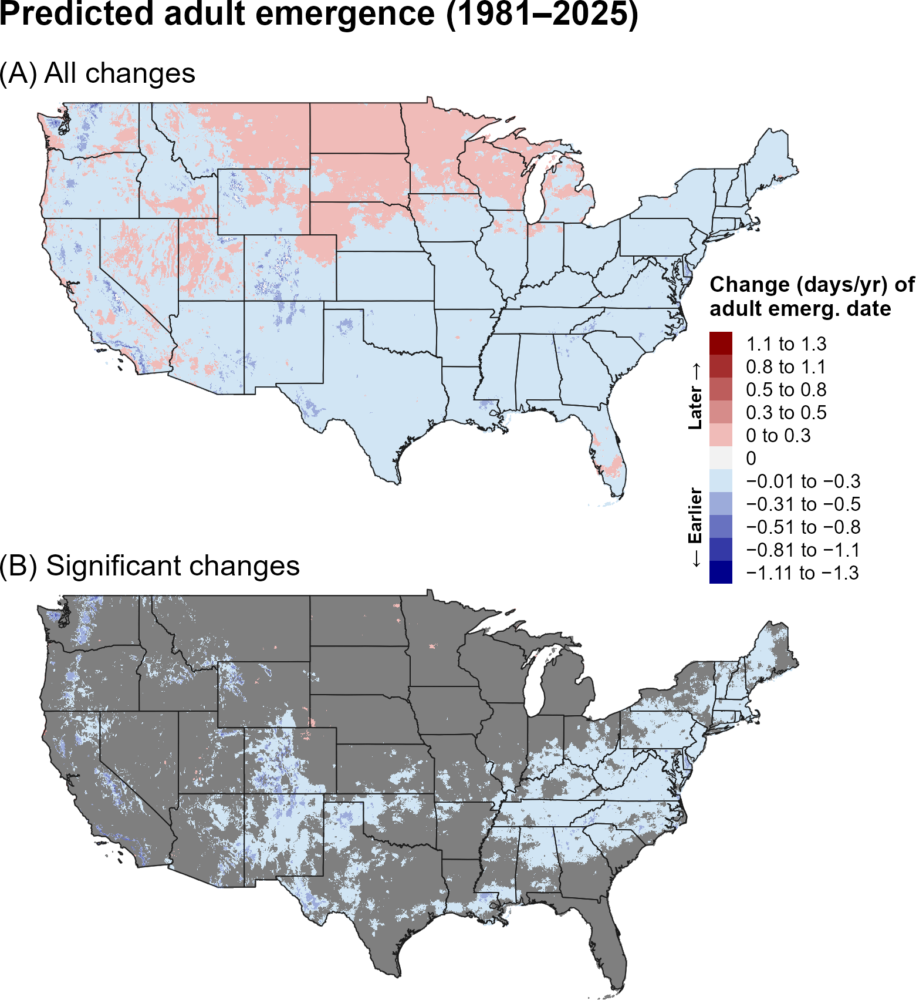
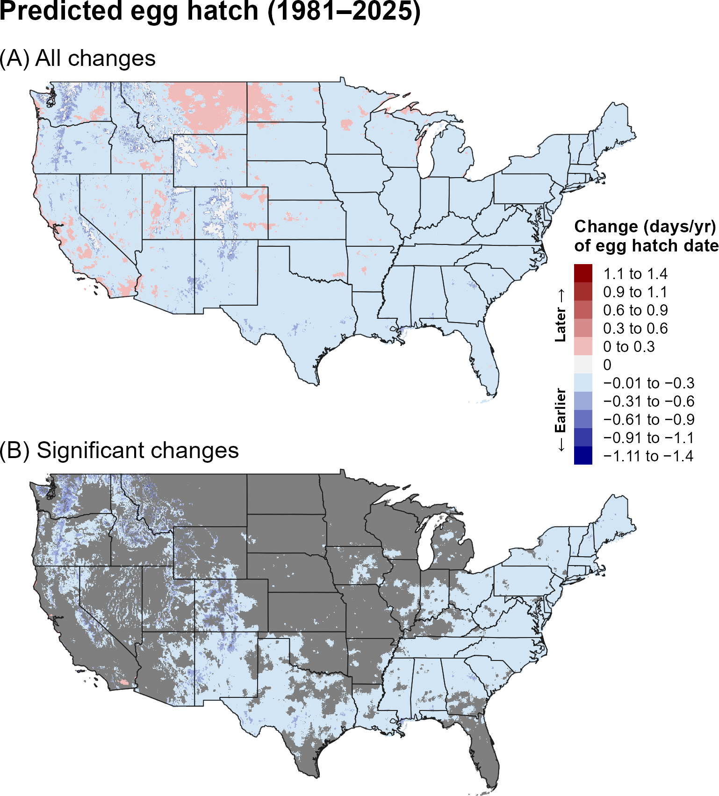
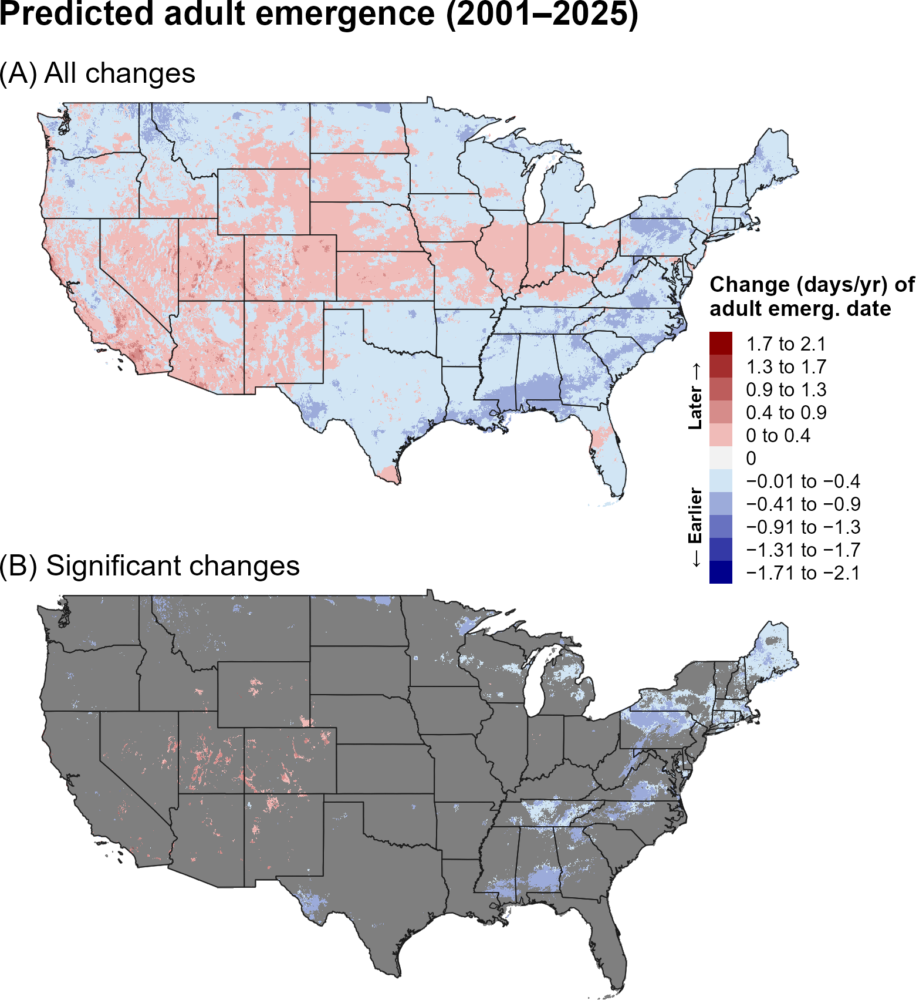
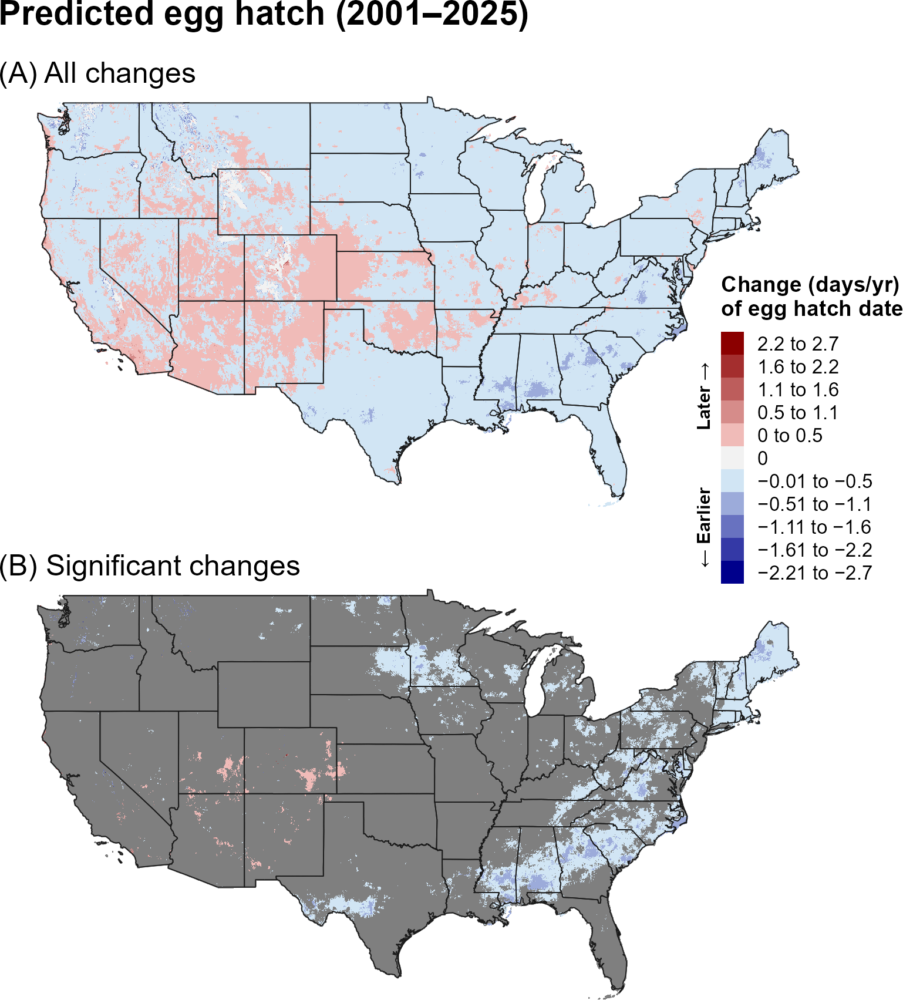
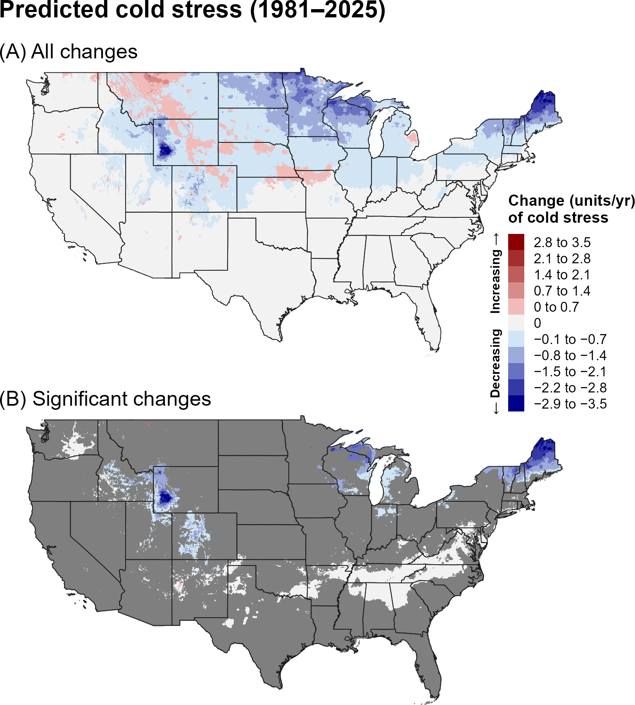
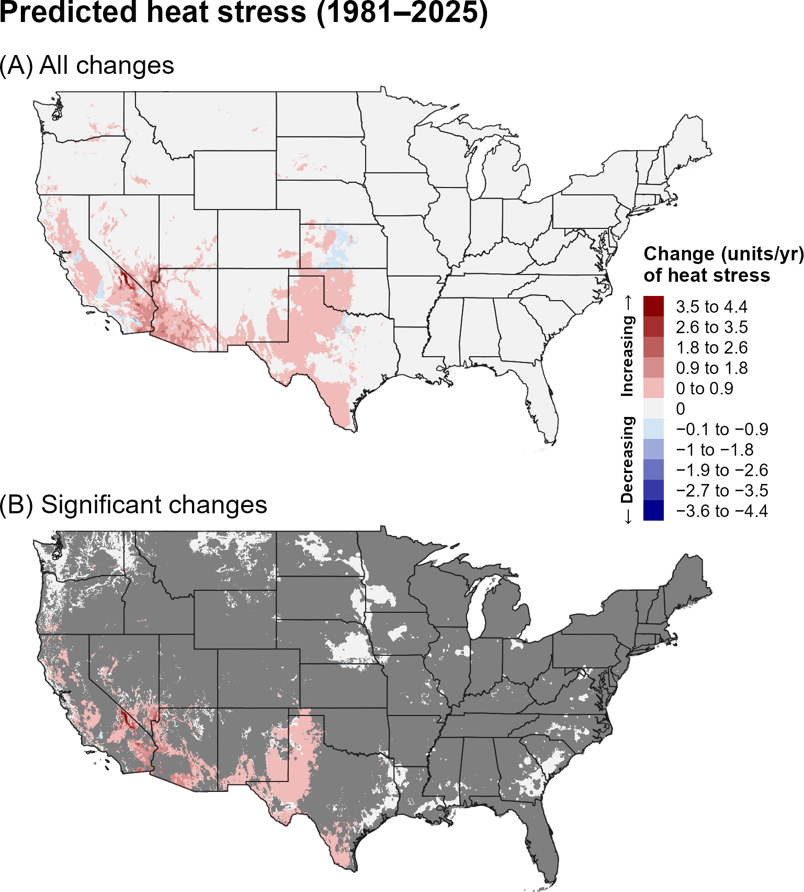
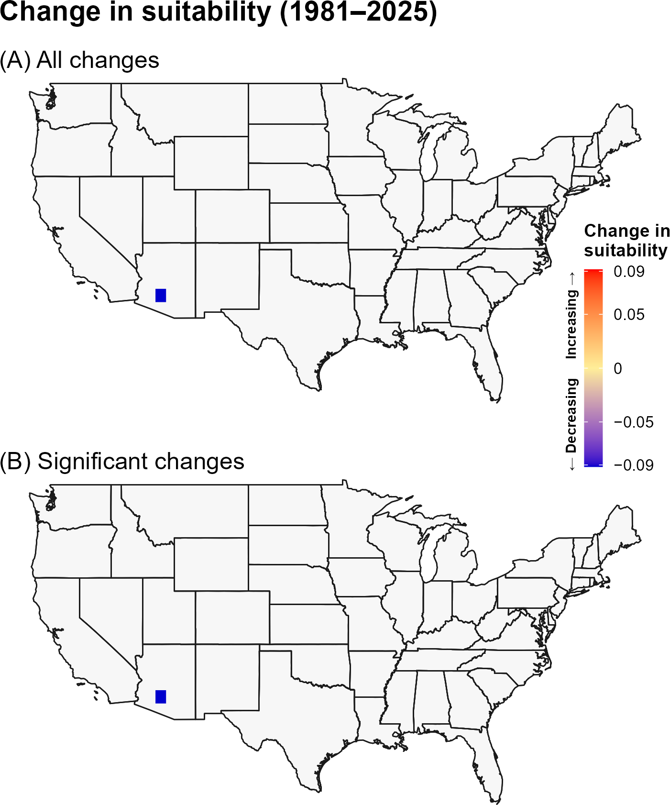
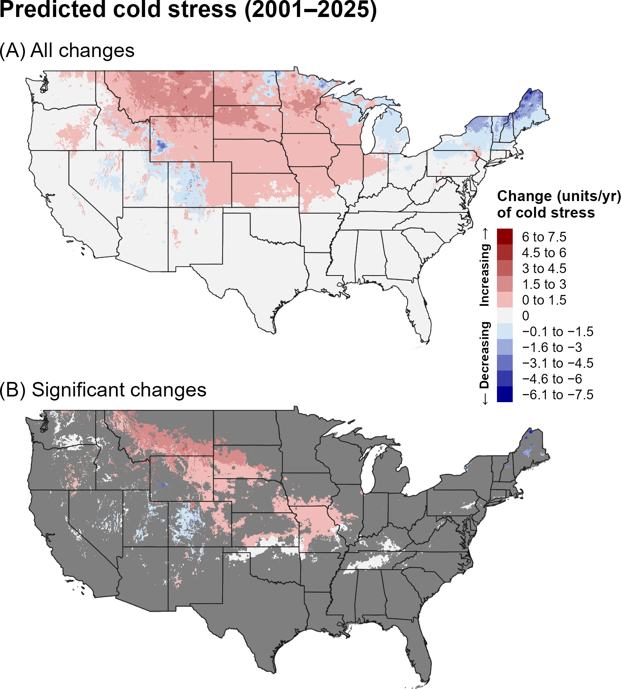
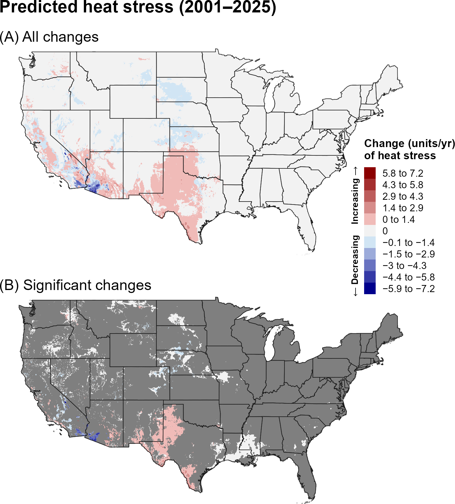
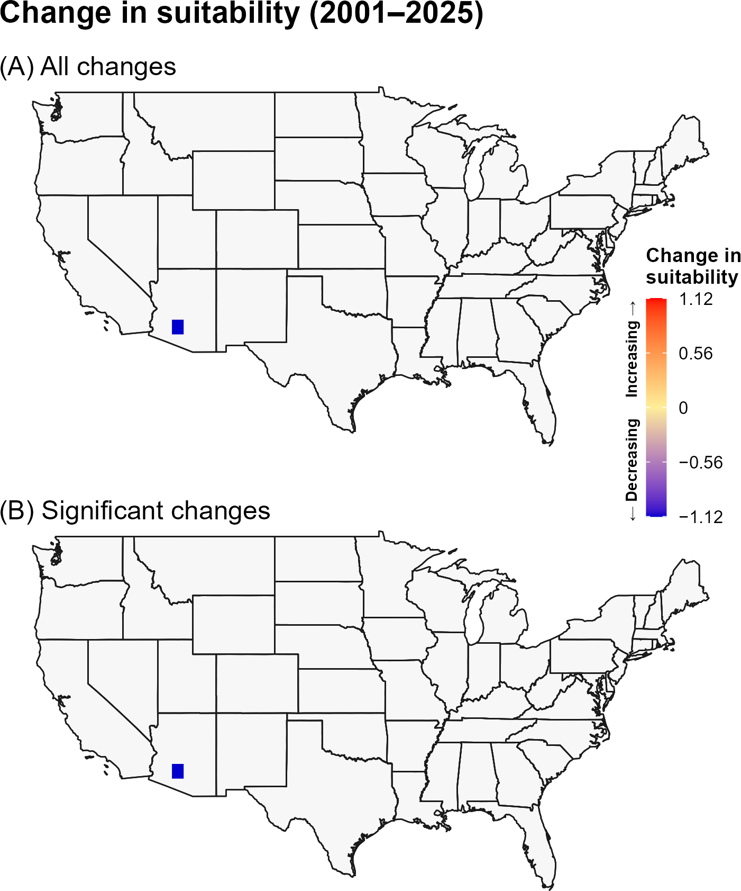

:::: {.content-visible when-format="html"}
::: {style="text-align: left;"}
[Download report as PDF](ASRB.pdf){.btn .btn-primary}
:::
::::

## **2A. Introduction** {.unlisted}

The Asiatic rice borer (ASRB), *Chilo suppressalis* Walker (Lepidoptera: Crambidae), is a stem borer and major pest of rice and other grasses, including water oat, sorghum, millet, and corn, throughout Asia, Oceania, the Middle East, and Europe (`\hyperref[ref-caps-2025]{CAPS 2025}`{=latex}`<a href="#ref-caps-2025">CAPS 2025</a>`{=html}, `\hyperref[ref-meng-2008]{Meng et al. 2008}`{=latex}`<a href="#ref-meng-2008">Meng et al. 2008</a>`{=html}). ASRB larvae cause major damage to rice crops by severing panicles or the vascular system of tillers, leading to white earheads and dead hearts (`\hyperref[ref-kiritani-iwao-1967]{Kiritani and Iwao 1967}`{=latex}`<a href="#ref-kiritani-iwao-1967">Kiritani and Iwao 1967</a>`{=html}, `\hyperref[ref-muralidharan-pasalu-2006]{Muralidharan and Pasalu 2006}`{=latex}`<a href="#ref-muralidharan-pasalu-2006">Muralidharan and Pasalu 2006</a>`{=html}, `\hyperref[ref-chen-2014]{Chen et al. 2014}`{=latex}`<a href="#ref-chen-2014">Chen et al. 2014</a>`{=html}, `\hyperref[ref-eppo-2019]{EPPO 2019}`{=latex}`<a href="#ref-eppo-2019">EPPO 2019</a>`{=html}). Larvae can cause substantial economic losses, with reports of 20% yield loss under some conditions (`\hyperref[ref-rahman-2004]{Rahman et al. 2004}`{=latex}`<a href="#ref-rahman-2004">Rahman et al. 2004</a>`{=html}). The pest is present in Hawaii and is frequently intercepted at United States ports of entry (`\hyperref[ref-solis-2006]{Solis 2006}`{=latex}`<a href="#ref-solis-2006">Solis 2006</a>`{=html}). With the United States rice industry valued at over USD 6 billion in 2025 (`\hyperref[ref-childs-2025]{Childs 2025}`{=latex}`<a href="#ref-childs-2025">Childs 2025</a>`{=html}), yield reductions resulting from ASRB could cause significant economic damage to rice-producing regions.

A model for ASRB developed for the Degree-Day, establishment Risk, and Phenological event mapping system (DDRP) is operationalized to produce near real-time forecasts for the contiguous United States (CONUS) at <https://uspest.org/DDRP>. The full set of model parameters for ASRB, including developmental temperature thresholds, degree-day requirements for individual life stages, and climate stress thresholds and limits, are available at USPest.org (`\hyperref[ref-coop-barker-2020]{Coop and Barker 2020}`{=latex}`<a href="#ref-coop-barker-2020">Coop and Barker 2020</a>`{=html}).

## **2B. Results** {.unlisted}

### **i. Phenology**

#### **Entire period: 1981--2025**

Trends in predicted first adult emergence and egg hatch for ASRB over the 44-year period (1981–2025) were predominantly negative, indicating that both phenological events shifted earlier over time. Earlier phenology was spatially extensive, occurring across much of the CONUS, although trends toward later phenology occurred in portions of the northern interior and western United States (@fig-asrb-emergence, @fig-asrb-egg-hatch). Statistically significant trends were more spatially restricted, occurring primarily in the East, the South, and higher elevations of the West. Within these regions, predicted adult emergence and egg hatch shifted earlier by approximately 0.01–0.5 days per year, with some of the largest shifts occurring at higher elevations in the West. Only a few small, isolated areas exhibited significant trends towards later phenology. 

```{r}
#| echo: false
#| out-width: 70%
#| fig-align: center
#| fig-cap: "Changes (days/year) in predicted dates of first adult emergence for ASRB across the CONUS over the entire 44-year period (1981–2025). Maps show (A) all changes and (B) statistically significant changes (P < 0.1); areas shown in gray are not statistically significant."
#| label: fig-asrb-emergence

```

```{r}
#| echo: false
#| out-width: 70%
#| fig-align: center
#| fig-cap: "Changes (days/year) in predicted dates of first egg hatch for ASRB across the CONUS over the entire 44-year period (1981–2025). Maps show (A) all changes and (B) statistically significant changes (P < 0.1); areas shown in gray are not statistically significant."
#| label: fig-asrb-egg-hatch

```

#### **Recent period: 2001--2025**

Trends in predictions of first adult emergence and egg hatch for ASRB over the recent 24-year period (2001–2025) were partially consistent with those observed over the 1981–2025 period. In the eastern United States, significant trends towards earlier phenology were larger in magnitude but less spatially extensive (@fig-asrb-emergence-recent, @fig-asrb-egg-hatch-recent), whereas most trends in the West were not significant. In contrast to the longer-term trends, isolated areas of the interior West, primarily in the southern Intermountain West, showed trends toward later phenological events. 

```{r}
#| echo: false
#| out-width: 70%
#| fig-align: center
#| fig-cap: "Changes (days/year) in predicted dates of first adult emergence for ASRB across the CONUS over the recent 24-year period (2001–2025). Maps show (A) all changes and (B) statistically significant changes (P < 0.1); areas shown in gray are not statistically significant."
#| label: fig-asrb-emergence-recent

```

```{r}
#| echo: false
#| out-width: 70%
#| fig-align: center
#| fig-cap: "Changes (days/year) in predicted dates of first egg hatch for ASRB across the CONUS over the recent 24-year period (2001–2025). Maps show (A) all changes and (B) statistically significant changes (P < 0.1); areas shown in gray are not statistically significant."
#| label: fig-asrb-egg-hatch-recent

```

### **ii. Climatic suitability**

#### **Entire period: 1981--2025**

Over the entire 44-year period (1981–2025), predicted cold stress for ASRB decreased significantly across the northern United States, including portions of the Great Lakes region and northeastern United States, as well as parts of the Rocky Mountains (@fig-asrb-cold-stress). When annual accumulated stress units exceed limits specified in DDRP models, climatic suitability may change. However, changes in stress units for ASRB did not correspond to widespread shifts in suitability; only a small area of Arizona showed a significant decrease in predicted suitability (@fig-asrb-suitability).

```{r}
#| echo: false
#| out-width: 70%
#| fig-align: center
#| fig-cap: "Changes (units/year) in predicted cold stress for ASRB across the CONUS over the entire 44-year period (1981–2025). Maps show (A) all changes and (B) statistically significant changes (P < 0.1); areas shown in gray are not statistically significant. Areas shown as 0 in (B) had significant trends but very small changes."
#| label: fig-asrb-cold-stress

```

```{r}
#| echo: false
#| out-width: 70%
#| fig-align: center
#| fig-cap: "Changes (units/year) in predicted heat stress for ASRB across the CONUS over the entire 44-year period (1981–2025). Maps show (A) all changes and (B) statistically significant changes (P < 0.1); areas shown in gray are not statistically significant. Areas shown as 0 in (B) had significant trends but very small changes."
#| label: fig-asrb-heat-stress

```

```{r}
#| echo: false
#| out-width: 70%
#| fig-align: center
#| fig-cap: "Changes in predicted climatic suitability for ASRB across the CONUS over the 44-year period (1981–2025). Suitability is defined as areas not excluded by cold and heat stress. Positive changes (warmer colors) indicate an increased likelihood of establishment, whereas negative changes (cooler colors) indicate a decreased likelihood of establishment."
#| label: fig-asrb-suitability

```

#### **Recent period: 2001--2025**

Many areas that exhibited significant decreases in cold stress for ASRB over 1981–2025 no longer showed significant trends during the recent period, while significant increases in predicted cold stress emerged across portions of the northern and central Great Plains (@fig-asrb-cold-stress-recent). Significant increases in heat stress were more localized to the Southwest, whereas parts of California showed significant decreases (@fig-asrb-heat-stress-recent). As in the 1981–2025 analysis, significant changes in climatic suitability were limited to a small area of Arizona (@fig-asrb-suitability-recent), indicating that predicted establishment suitability remained relatively stable across most of the CONUS.

```{r}
#| echo: false
#| out-width: 70%
#| fig-align: center
#| fig-cap: "Changes (units/year) in predicted cold stress for ASRB across the CONUS over the recent 24-year period (2001–2025). Maps show (A) all changes and (B) statistically significant changes (P < 0.1); areas shown in gray are not statistically significant. Areas shown as 0 in (B) had significant trends but very small changes."
#| label: fig-asrb-cold-stress-recent

```

```{r}
#| echo: false
#| out-width: 70%
#| fig-align: center
#| fig-cap: "Changes (units/year) in predicted heat stress for ASRB across the CONUS over the recent 24-year period (2001–2025). Maps show (A) all changes and (B) statistically significant changes (P < 0.1); areas shown in gray are not statistically significant. Areas shown as 0 in (B) had significant trends but very small changes."
#| label: fig-asrb-heat-stress-recent

```

```{r}
#| echo: false
#| out-width: 70%
#| fig-align: center
#| fig-cap: "Changes in predicted climatic suitability for ASRB across the CONUS over the recent 24-year period (2001–2025). Suitability is defined as areas not excluded by cold and heat stress. Positive changes (warmer colors) indicate an increased likelihood of establishment, whereas negative changes (cooler colors) indicate a decreased likelihood of establishment."
#| label: fig-asrb-suitability-recent

```

## **2C. Discussion** {.unlisted}

Although ASRB is not established in the CONUS, understanding predicted changes in phenology can inform surveillance planning. In areas with earlier phenological events, predicted dates shifted earlier by approximately 0.01–0.5 days per year, suggesting that surveillance materials may need to be deployed earlier in the season. The southern United States warrants particular attention because it includes major rice-producing states, such as Louisiana, Texas, and Arkansas, where surveillance could help detect potential introductions into areas with suitable host crops.

Although warmer growing-season temperatures can advance ASRB emergence and increase voltinism, temperature effects on development and overwintering are context dependent. ASRB is univoltine in cooler parts of its native range, such as northern Japan, where shortening day lengths serve as the primary environmental cue for larvae to enter winter diapause. In contrast, populations in warmer regions, including Taiwan, can complete 5–6 generations annually and typically lack diapause (`\hyperref[ref-kiritani-iwao-1967]{Kiritani and Iwao 1967}`{=latex}`<a href="#ref-kiritani-iwao-1967">Kiritani and Iwao 1967</a>`{=html}, `\hyperref[ref-ramoneda-roig-1993]{Ramoneda and Roig 1993}`{=latex}`<a href="#ref-ramoneda-roig-1993">Ramoneda and Roig 1993</a>`{=html}, `\hyperref[ref-tsumuki-1994]{Tsumuki et al. 1994}`{=latex}`<a href="#ref-tsumuki-1994">Tsumuki et al. 1994</a>`{=html}). Genetic differentiation among ASRB populations in China is also associated with geographic variation in voltinism (`\hyperref[ref-meng-2008]{Meng et al. 2008}`{=latex}`<a href="#ref-meng-2008">Meng et al. 2008</a>`{=html}). Warmer growing-season temperatures have been linked to earlier emergence and spring flight, increased voltinism (`\hyperref[ref-lee-2014]{Lee 2014}`{=latex}`<a href="#ref-lee-2014">Lee 2014</a>`{=html}), and greater pupal weight and fecundity (`\hyperref[ref-fu-2016]{Fu et al. 2016}`{=latex}`<a href="#ref-fu-2016">Fu et al. 2016</a>`{=html}, `\hyperref[ref-huang-2018]{Huang et al. 2018}`{=latex}`<a href="#ref-huang-2018">Huang et al. 2018</a>`{=html}). However, experimental studies found that warmer winter temperatures (10 °C versus 1 and 5 °C) reduced pupation rates, pupal weight, and post-diapause reproductive potential (`\hyperref[ref-xiao-2017]{Xiao et al. 2017}`{=latex}`<a href="#ref-xiao-2017">Xiao et al. 2017</a>`{=html}). Collectively, these findings suggest that the effects of temperature on ASRB development and population dynamics depend on seasonal conditions and geographic context, underscoring the importance of considering both phenological shifts and climatic suitability when prioritizing surveillance.

The climate-stress maps showed regional changes in both cold and heat stress, but these changes produced little statistically significant change in predicted climatic suitability. This distinction is important because changes in individual stress variables do not necessarily translate into changes in establishment likelihood when the modeled conditions remain within the suitable range. Decreasing cold stress in portions of the northern United States and could reduce a temperature-related limitation on establishment, whereas increasing heat stress in parts of the Southwest and California could impose greater climatic constraints. However, because the climatic-suitability maps showed very few significant changes, these stress trends did not translate into widespread changes in predicted establishment likelihood.

The stronger and more spatially extensive trends in predicted phenology and climate stress over the entire 44-year period may reflect both the larger sample size, which can reduce noise and improve detection of directional patterns, and differences in the underlying climate trends between the two time periods. In particular, the recent 24-year period may capture climate variability or regional trends that differ from those observed over the longer 44-year period. Thus, differences between the two periods should be interpreted as reflecting both long-term climate trends and shorter-term regional variability.

## **2D. References** {.unlisted}

\begingroup
\setlength{\parindent}{-0.5in}
\setlength{\leftskip}{0.5in}

\noindent

<span id="ref-chen-2014"></span>
\phantomsection\label{ref-chen-2014}

Chen, R. Z., M. G. Klein, C. F. Sheng, Q. Y. Li, Y. Li, L. B. Li, and X. Hung. 2014. Mating disruption or mass trapping, compared with chemical insecticides, for suppression of *Chilo suppressalis* (Lepidoptera: Crambidae) in Northeastern China. Journal of Economic Entomology 107:1828–1838.

<span id="ref-childs-2025"></span>
\phantomsection\label{ref-childs-2025}

Childs, N. 2025. Rice Outlook: August 2025. United States Department of Agriculture, Economic Research Service, RCS-25G. August 14, 2025. Available at: https://www.ers.usda.gov/media/10743/rcs-25g.pdf?v=71521 (accessed 3 September 2026).

<span id="ref-coop-barker-2020"></span>
\phantomsection\label{ref-coop-barker-2020}

Coop, L., and B. S. Barker. 2020. Phenology/degree-day model analysis: Asiatic rice borer (). Prepared for Animal and Plant Health Inspection Service (APHIS) – Plant Protection and Quarantine (PPQ). Available at: https://uspest.org/wea/Chilo_suppressalis_model.pdf (accessed 21 July 2025).

<span id="ref-caps-2025"></span>
\phantomsection\label{ref-caps-2025}

Cooperative Agricultural Pest Survey (CAPS). 2025. CPHST Pest Datasheet for *Chilo suppressalis*. USDA-APHIS-PPQ-CPHST. Available at: https://caps.ceris.purdue.edu/wp-content/uploads/2025/07/Chilo-suppressalis_v1.pdf (accessed 21 July 2025).

<span id="ref-eppo-2019"></span>
\phantomsection\label{ref-eppo-2019}

EPPO. 2019. *Chilo suppressalis*. EPPO datasheets on pests recommended for regulation. Available at: https://gd.eppo.int/ (accessed 21 July 2025).

<span id="ref-fu-2016"></span>
\phantomsection\label{ref-fu-2016}

Fu, D. M., H. M. He, C. Zou, H. J. Xiao, and F. Sen Xue. 2016. Life-history responses of the rice stem borer *Chilo suppressalis* to temperature change: Breaking the temperature–size rule. Journal of Thermal Biology 61:115–118.

<span id="ref-kiritani-iwao-1967"></span>
\phantomsection\label{ref-kiritani-iwao-1967}

Kiritani, K., and S. Iwao. 1967. The Biology and Life Cycle of *Chilo suppressalis* (Walker) and *Tryporyza* (Schoenobius) *incertulas* (Walker) in temperate-climate areas. Pages 45–101 in The Major Insect Pests of the Rice Plant, Proceedings of a Symposium at The International Rice Research Institute, September, 1964. John Hopkins Press, Baltimore, Maryland.

<span id="ref-lee-2014"></span>
\phantomsection\label{ref-lee-2014}

Lee, H. 2014. Prediction of phenological changes of *Chilo suppressalis* (Walker) (Lepidoptera: Pyralidae) under global warming. Masters thesis, Seoul National University, Seoul, South Korea.

<span id="ref-meng-2008"></span>
\phantomsection\label{ref-meng-2008}

Meng, X. F., M. Shi, and X. X. Chen. 2008. Population genetic structure of *Chilo suppressalis* (Walker) (Lepidoptera: Crambidae): Strong subdivision in China inferred from microsatellite markers and mtDNA gene sequences. Molecular Ecology 17:2880–2897.

<span id="ref-muralidharan-pasalu-2006"></span>
\phantomsection\label{ref-muralidharan-pasalu-2006}

Muralidharan, K., and I. C. Pasalu. 2006. Assessments of crop losses in rice ecosystems due to stem borer damage (Lepidoptera: Pyralidae). Crop Protection 25:409–417.

<span id="ref-rahman-2004"></span>
\phantomsection\label{ref-rahman-2004}

Rahman, M. T., M. Khalequzzaman, and M. A. R. Khan. 2004. Assessment of infestation and yield loss by stem borers on variety of rice. Journal of Asia-Pacific Entomology 7:89–95.

<span id="ref-ramoneda-roig-1993"></span>
\phantomsection\label{ref-ramoneda-roig-1993}

Ramoneda, J., and J. Roig. 1993. Characteristics of the larval development of the rice stem borer, *Chilo suppressalis* Walker (Lepidoptera: Crambidae) in the Ebro Delta (Northeastern Spain). Applied Entomology and Zoology 28:267–273.

<span id="ref-tsumuki-1994"></span>
\phantomsection\label{ref-tsumuki-1994}

Tsumuki, H., T. Take, K. Kanehisa, T. Saito, and Y. Chu. 1994. Effect of temperature on the development and voltinism of the rice stem borer, *Chilo suppressalis*. European Journal of Entomology 91:447–479.

<span id="ref-xiao-2017"></span>
\phantomsection\label{ref-xiao-2017}

Xiao, H., J. Chen, L. Chen, C. Chen, and S. Wu. 2017. Exposure to mild temperatures decreases overwintering larval survival and post-diapause reproductive potential in the rice stem borer *Chilo suppressalis*. Journal of Pest Science 90:117–125.

<span id="ref-huang-2018"></span>
\phantomsection\label{ref-huang-2018}

Huang, X., L. Xiao, H. He, and F. Xue. 2018. Effect of rearing conditions on the correlation between larval development time and pupal weight of the rice stem borer, *Chilo suppressalis*. Ecology and Evolution 8:12694–12701.

<span id="ref-solis-2006"></span>
\phantomsection\label{ref-solis-2006}

Solis, M. A. 2006. Key to Selected Pyraloidea (Lepidoptera) Larvae Intercepted at United States Ports of Entry: Revision of Pyraloidea in "Keys to Some Frequently Intercepted Lepidopterous Larvae" by Weisman 1986. Agricultural Research Service, United States Department of Agriculture.

\par
\endgroup