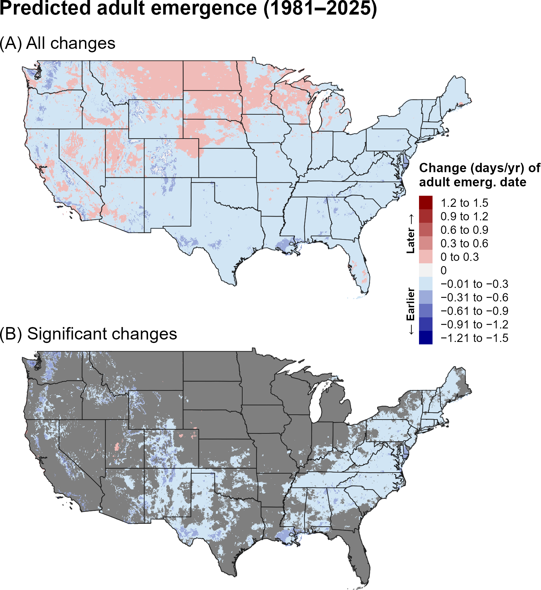
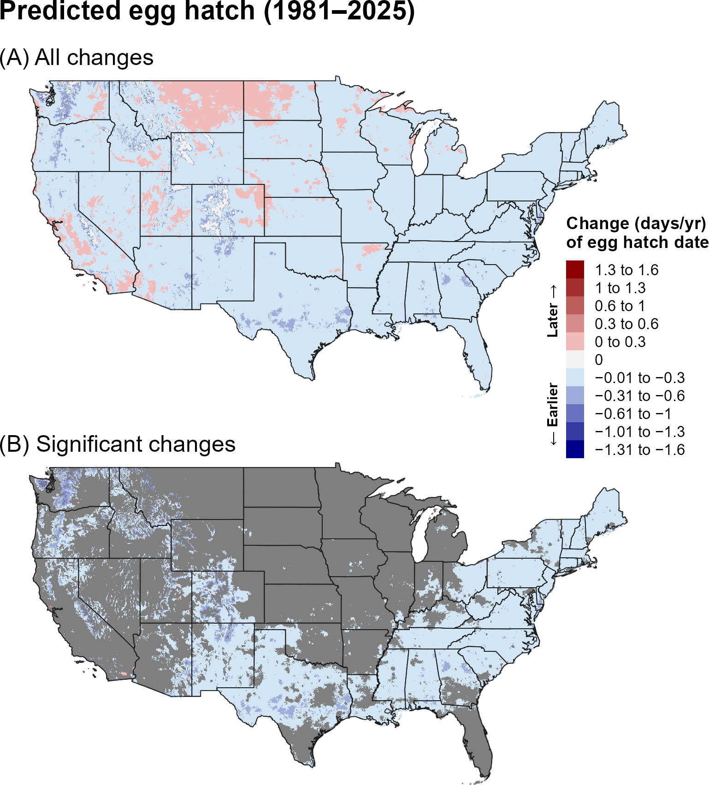
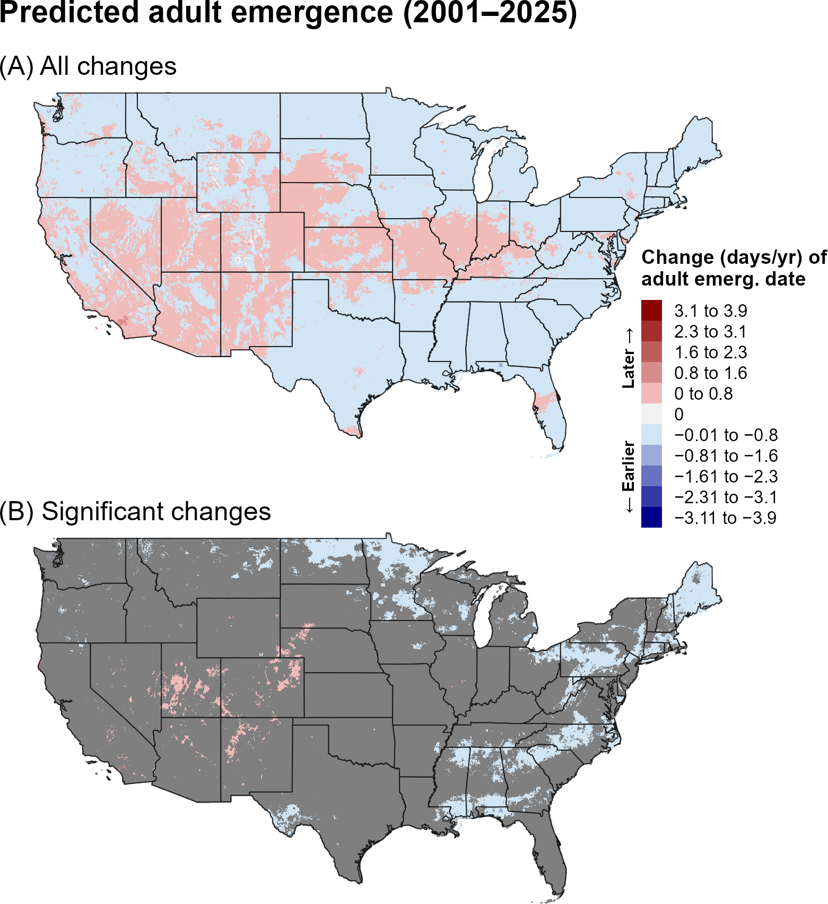
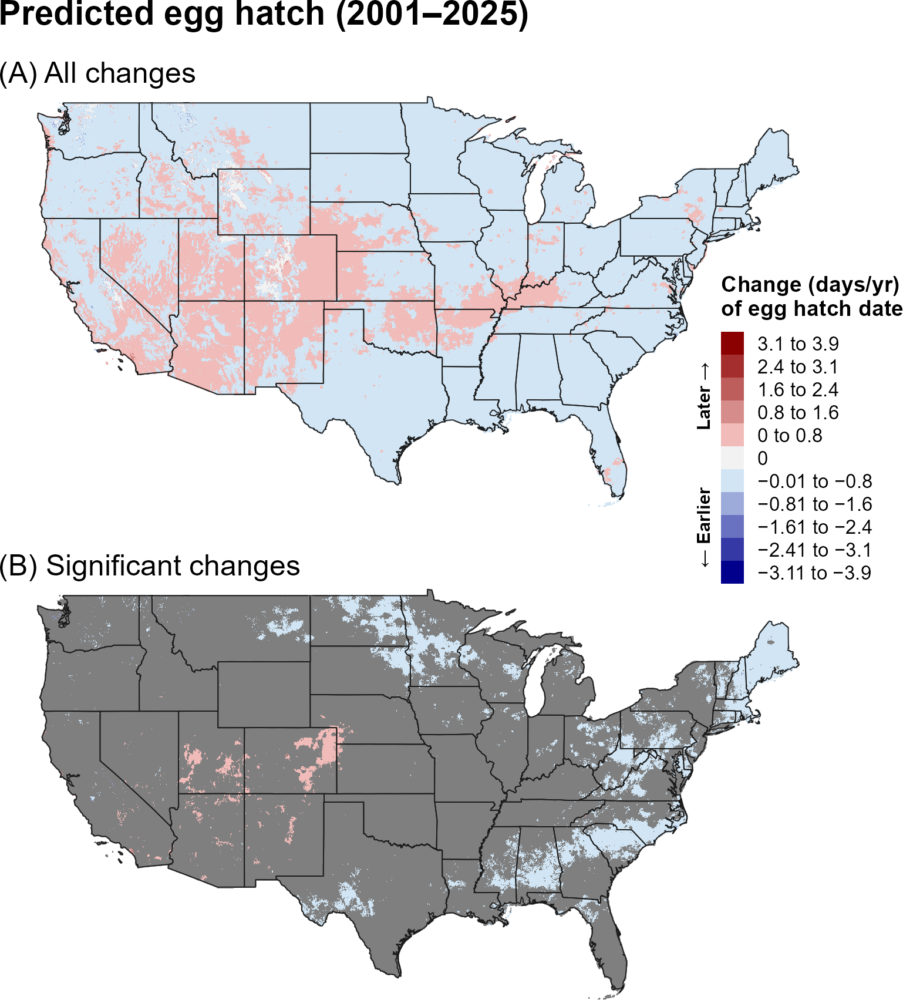
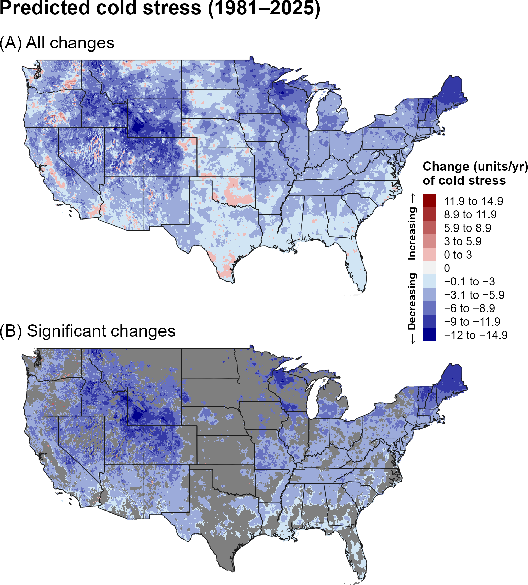
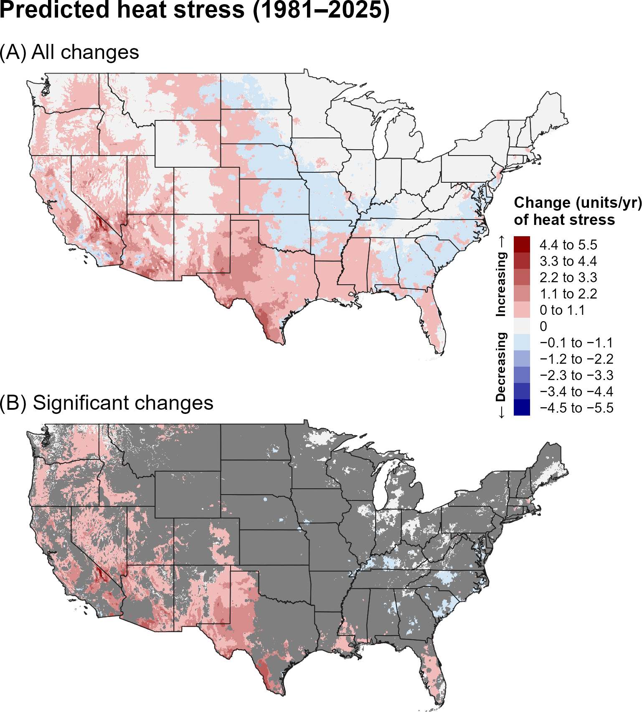
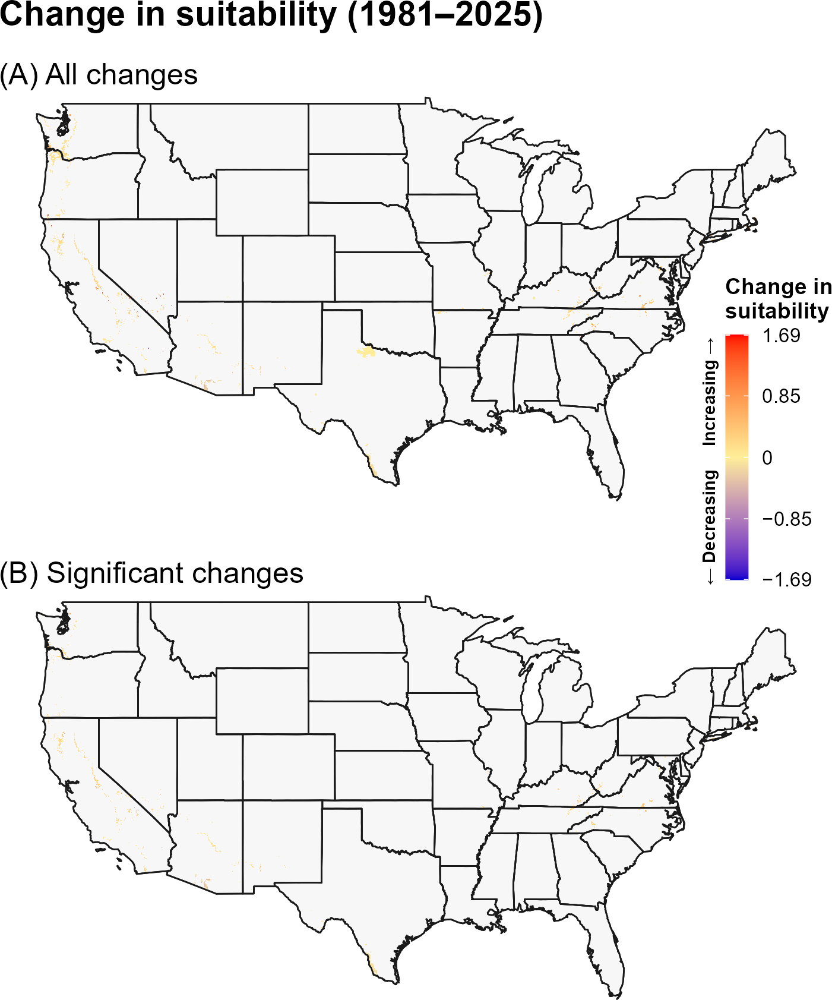
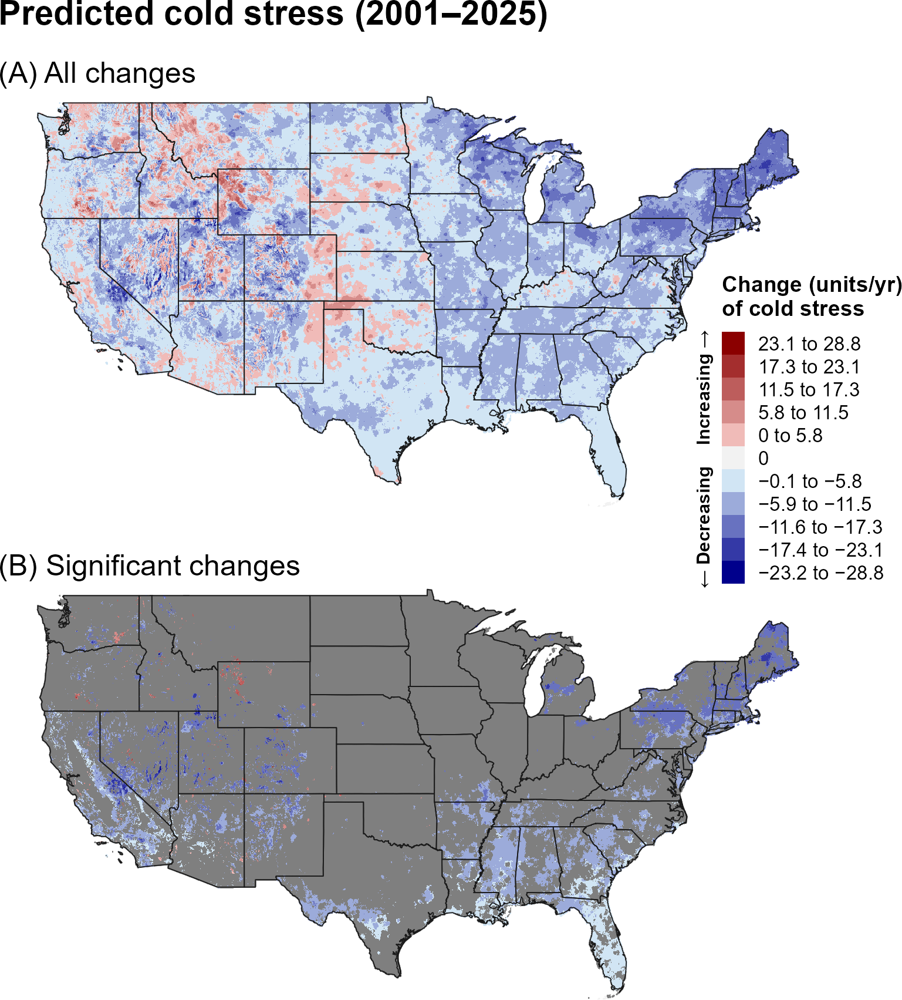
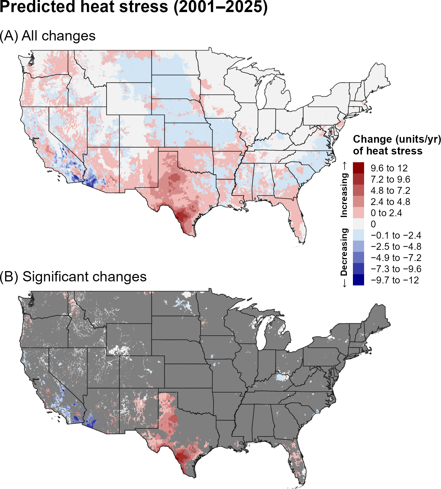
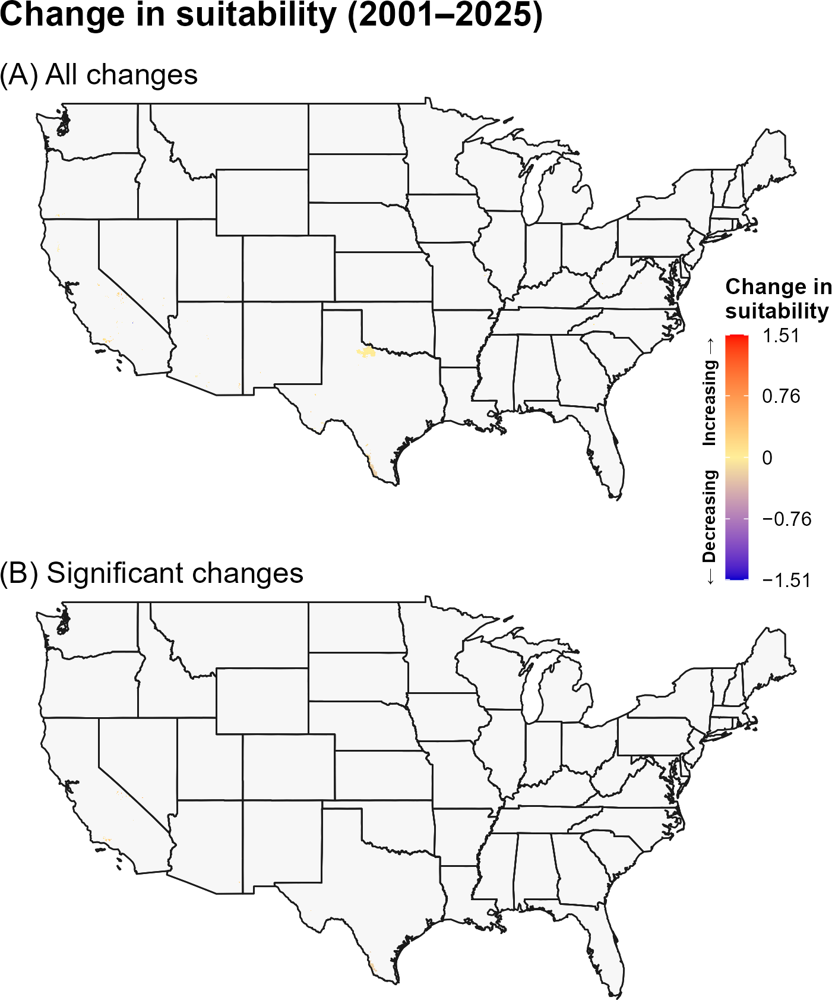

:::: {.content-visible when-format="html"}
::: {style="text-align: left;"}
[Download report as PDF](CGN.pdf){.btn .btn-primary}
:::
::::

## **3A. Introduction** {.unlisted}

Native to the Mediterranean region, the honeydew moth, *Cryptoblabes gnidiella* (CGN) (Lepidoptera: Pyralidae), can act as both a primary and secondary pest of numerous economically important crops, including avocado, citrus, corn, cotton, grape, loquat, pomegranate, rice, and wheat throughout Asia, Oceania, the Middle East, and Europe (`\hyperref[ref-silva-mexia-1999]{Silva and Mexia 1999}`{=latex}`<a href="#ref-silva-mexia-1999">Silva and Mexia 1999</a>`{=html}, `\hyperref[ref-molet-2013]{Molet 2013}`{=latex}`<a href="#ref-molet-2013">Molet 2013</a>`{=html}). It is commonly associated with coccoids and pseudococcids, which produce honeydew that serves as a food source for its larvae, although it can also directly damage the fruit of certain host plants (`\hyperref[ref-avidov-gothilf-1960]{Avidov and Gothilf 1960}`{=latex}`<a href="#ref-avidov-gothilf-1960">Avidov and Gothilf 1960</a>`{=html}, `\hyperref[ref-yehuda-1991]{Yehuda et al. 1991}`{=latex}`<a href="#ref-yehuda-1991">Yehuda et al. 1991</a>`{=html}, `\hyperref[ref-silva-mexia-1999]{Silva and Mexia 1999}`{=latex}`<a href="#ref-silva-mexia-1999">Silva and Mexia 1999</a>`{=html}, `\hyperref[ref-molet-2013]{Molet 2013}`{=latex}`<a href="#ref-molet-2013">Molet 2013</a>`{=html}). The species has spread widely across southern Europe, parts of Africa, and several regions worldwide, including Brazil, Fiji, India, Malaysia, New Zealand, Uruguay, and Hawaii in the United States (`\hyperref[ref-eppo-2025]{EPPO 2025}`{=latex}`<a href="#ref-eppo-2025">EPPO 2025</a>`{=html}, `\hyperref[ref-molet-2013]{Molet 2013}`{=latex}`<a href="#ref-molet-2013">Molet 2013</a>`{=html}). Although it has not become established in the contiguous United States (CONUS), it is frequently intercepted at ports of entry, often originating from countries where its establishment has not been documented (`\hyperref[ref-molet-2013]{Molet 2013}`{=latex}`<a href="#ref-molet-2013">Molet 2013</a>`{=html}, `\hyperref[ref-velez-gavilan-2023]{Velez-Gavilan 2023}`{=latex}`<a href="#ref-velez-gavilan-2023">Velez-Gavilan 2023</a>`{=html}).

A model for CGN developed for the Degree-Day, establishment Risk, and Phenological event mapping system (DDRP) is operationalized to produce near real-time forecasts for the CONUS at <https://uspest.org/DDRP>. The full set of model parameters for CGN, including developmental temperature thresholds, degree-day requirements for individual life stages, and climate stress thresholds and limits, are available at USPest.org (`\hyperref[ref-barker-coop-2019]{Barker and Coop 2019}`{=latex}`<a href="#ref-barker-coop-2019">Barker and Coop 2019</a>`{=html}). 

## **3B. Results** {.unlisted}

### **i. Phenology**

#### **Entire period: 1981--2025**

Trends in predicted first adult emergence and egg hatch for CGN over the 44-year period (1981–2025) were predominantly negative, indicating that both phenological events shifted earlier over time. Earlier phenology was spatially extensive, occurring across most of the CONUS (@fig-cgn-emergence, @fig-cgn-egg-hatch). Statistically significant trends were more spatially restricted, occurring primarily in portions of the southern and eastern United States and in scattered areas of the West. Within these regions, predicted adult emergence and egg hatch shifted earlier by approximately 0.01–0.8 days per year, with some of the largest shifts occurring at higher elevations in the West. Trends toward later phenology occurred in a some isolated areas of the West but most were not statistically significant. 

```{r}
#| echo: false
#| out-width: 70%
#| fig-align: center
#| fig-cap: "Changes (days/year) in predicted dates of first adult emergence for CGN across the CONUS over the entire 44-year period (1981–2025). Maps show (A) all changes and (B) statistically significant changes (P < 0.1); areas shown in gray are not statistically significant."
#| label: fig-cgn-emergence

```

```{r}
#| echo: false
#| out-width: 70%
#| fig-align: center
#| fig-cap: "Changes (days/year) in predicted dates of first egg hatch for CGN across the CONUS over the entire 44-year period (1981–2025). Maps show (A) all changes and (B) statistically significant changes (P < 0.1); areas shown in gray are not statistically significant."
#| label: fig-cgn-egg-hatch

```

#### **Recent period: 2001--2025**

Trends in predictions of first adult emergence and egg hatch for CGN over the recent 24-year period (2001–2025) were partially consistent with those observed over the 1981–2025 period. Significant trends towards earlier phenology were similar in magnitude but less spatially extensive, occurring predominantly in parts of the upper Midwest, Northeast, and Southeast (@fig-cgn-emergence-recent, @fig-cgn-egg-hatch-recent). In contrast, areas exhibiting trends toward later phenological events were somewhat larger and more spatially extensive across the West.

```{r}
#| echo: false
#| out-width: 70%
#| fig-align: center
#| fig-cap: "Changes (days/year) in predicted dates of first adult emergence for CGN across the CONUS over the recent 24-year period (2001–2025). Maps show (A) all changes and (B) statistically significant changes (P < 0.1); areas shown in gray are not statistically significant."
#| label: fig-cgn-emergence-recent

```

```{r}
#| echo: false
#| out-width: 70%
#| fig-align: center
#| fig-cap: "Changes (days/year) in predicted dates of first egg hatch for CGN across the CONUS over the recent 24-year period (2001–2025). Maps show (A) all changes and (B) statistically significant changes (P < 0.1); areas shown in gray are not statistically significant."
#| label: fig-cgn-egg-hatch-recent

```

### **ii. Climatic suitability**

#### **Entire period: 1981--2025**

Over the entire 44-year period (1981–2025), predicted cold stress for CGN decreased across broad portions of the CONUS, with the strongest changes occurring in the Northeast, upper Midwest, and Intermountain West (@fig-cgn-cold-stress). However, trends across the Great Plains and South were generally smaller and mostly nonsignificant. Predicted heat stress increased across much of the West, southern Great Plains, and parts of the Southeast, although significant trends were concentrated primarily in the West (@fig-cgn-heat-stress). However, changes in stress units for CGN did not correspond to significant shifts in climatic suitability across the CONUS (@fig-cgn-suitability), indicating that accumulated stress generally remained within the limits defining CGN's climatic suitability.

```{r}
#| echo: false
#| out-width: 70%
#| fig-align: center
#| fig-cap: "Changes (units/year) in predicted cold stress for CGN across the CONUS over the entire 44-year period (1981–2025). Maps show (A) all changes and (B) statistically significant changes (P < 0.1); areas shown in gray are not statistically significant. Areas shown as 0 in (B) had significant trends but very small changes."
#| label: fig-cgn-cold-stress

```

```{r}
#| echo: false
#| out-width: 70%
#| fig-align: center
#| fig-cap: "Changes (units/year) in predicted heat stress for CGN across the CONUS over the entire 44-year period (1981–2025). Maps show (A) all changes and (B) statistically significant changes (P < 0.1); areas shown in gray are not statistically significant. Areas shown as 0 in (B) had significant trends but very small changes."
#| label: fig-cgn-heat-stress

```

```{r}
#| echo: false
#| out-width: 70%
#| fig-align: center
#| fig-cap: "Changes in predicted climatic suitability for CGN across the CONUS over the 44-year period (1981–2025). Suitability is defined as areas not excluded by cold and heat stress. Positive changes (warmer colors) indicate an increased likelihood of establishment, whereas negative changes (cooler colors) indicate a decreased likelihood of establishment."
#| label: fig-cgn-suitability

```

#### **Recent period: 2001--2025**

Many areas that exhibited significant decreases in cold stress for CGN over 1981–2025 no longer showed significant trends during the recent period. These areas were concentrated in scattered patches across the East and South and at higher elevations in the West (@fig-cgn-cold-stress-recent). Significant increases in predicted cold stress occurred in a few small, isolated areas of the West. Significant increases in heat stress were concentrated in the South, particularly Texas, whereas parts of California showed significant decreases (@fig-cgn-heat-stress-recent). As in the 1981–2025 analysis, changes in cold and heat stress did not produce significant changes in climatic suitability (@fig-cgn-suitability-recent).

```{r}
#| echo: false
#| out-width: 70%
#| fig-align: center
#| fig-cap: "Changes (units/year) in predicted cold stress for CGN across the CONUS over the recent 24-year period (2001–2025). Maps show (A) all changes and (B) statistically significant changes (P < 0.1); areas shown in gray are not statistically significant. Areas shown as 0 in (B) had significant trends but very small changes."
#| label: fig-cgn-cold-stress-recent

```

```{r}
#| echo: false
#| out-width: 70%
#| fig-align: center
#| fig-cap: "Changes (units/year) in predicted heat stress for CGN across the CONUS over the recent 24-year period (2001–2025). Maps show (A) all changes and (B) statistically significant changes (P < 0.1); areas shown in gray are not statistically significant. Areas shown as 0 in (B) had significant trends but very small changes."
#| label: fig-cgn-heat-stress-recent

```

```{r}
#| echo: false
#| out-width: 70%
#| fig-align: center
#| fig-cap: "Changes in predicted climatic suitability for CGN across the CONUS over the recent 24-year period (2001–2025). Suitability is defined as areas not excluded by cold and heat stress. Positive changes (warmer colors) indicate an increased likelihood of establishment, whereas negative changes (cooler colors) indicate a decreased likelihood of establishment."
#| label: fig-cgn-suitability-recent

```

## **3C. Discussion** {.unlisted}

Although CGN is not established in the CONUS, understanding predicted changes in phenology can inform surveillance planning. In areas exhibiting significant trends toward earlier phenology, predicted dates shifted earlier by approximately 0.01–0.8 days per year, suggesting that surveillance materials may need to be deployed earlier in the season. Surveillance efforts may be particularly important where these trends overlap with major host-fruit production areas, including those supporting intensive cultivation of grapes, citrus, pomegranates, and avocados. Such areas include parts of the West and South, particularly California and Texas, as well as portions of the Gulf Coast.

Earlier adult emergence and egg hatch could potentially allow CGN to complete more generations per year, increasing pest pressure and associated crop damage. CGN lacks a true winter diapause and can complete multiple generations under warm conditions (`\hyperref[ref-avidov-gothilf-1960]{Avidov and Gothilf 1960}`{=latex}`<a href="#ref-avidov-gothilf-1960">Avidov and Gothilf 1960</a>`{=html}, `\hyperref[ref-molet-2013]{Molet 2013}`{=latex}`<a href="#ref-molet-2013">Molet 2013</a>`{=html}, `\hyperref[ref-lucchi-2019]{Lucchi et al. 2019}`{=latex}`<a href="#ref-lucchi-2019">Lucchi et al. 2019</a>`{=html}). The number of generations completed annually therefore depends partly on whether local environmental conditions permit continued development throughout the growing season. CGN can complete as many as nine generations annually in the warmest parts of its range, such as northeastern Brazil (`\hyperref[ref-ringenberg-2005]{Ringenberg et al. 2005}`{=latex}`<a href="#ref-ringenberg-2005">Ringenberg et al. 2005</a>`{=html}, `\hyperref[ref-ioriatti-2012]{Ioriatti et al. 2012}`{=latex}`<a href="#ref-ioriatti-2012">Ioriatti et al. 2012</a>`{=html}, `\hyperref[ref-molet-2013]{Molet 2013}`{=latex}`<a href="#ref-molet-2013">Molet 2013</a>`{=html}, `\hyperref[ref-ozturk-2018]{Öztürk 2018}`{=latex}`<a href="#ref-ozturk-2018">Öztürk 2018</a>`{=html}, `\hyperref[ref-lucchi-2019]{Lucchi et al. 2019}`{=latex}`<a href="#ref-lucchi-2019">Lucchi et al. 2019</a>`{=html}, `\hyperref[ref-corbetta-2025]{Corbetta et al. 2025}`{=latex}`<a href="#ref-corbetta-2025">Corbetta et al. 2025</a>`{=html}). DDRP predictions indicate that CGN may complete at least one generation annually and up to eight generations in the South within climatically suitable areas (`\hyperref[ref-barker-coop-2019]{Barker and Coop 2019}`{=latex}`<a href="#ref-barker-coop-2019">Barker and Coop 2019</a>`{=html}). These findings underscore the importance of interpreting regional trends in predicted phenology alongside climatic suitability and the potential for multiple generations, which together determine the timing and duration of seasonal CGN activity.

The climate-stress trend maps showed broad changes in both cold and heat stress, but these changes translated into statistically significant shifts in predicted climatic suitability for ECW in only a few isolated areas of California and the Southwest. The contrast between widespread climate-stress trends and limited suitability changes suggests that the modeled climatic limits remain sufficiently broad that changes in individual stress variables do not necessarily alter establishment potential. Previous modeling studies for CGN identified suitable environments for the pest throughout the South and Midwest, as well as along the West Coast, whereas cold temperatures would likely exclude the pest from colder regions, including the Intermountain West and latitudes north of *ca.* 41° N in the East (`\hyperref[ref-barker-coop-2019]{Barker and Coop 2019}`{=latex}`<a href="#ref-barker-coop-2019">Barker and Coop 2019</a>`{=html}, `\hyperref[ref-zumbado-2023]{Zumbado-Ulate et al. 2023}`{=latex}`<a href="#ref-zumbado-2023">Zumbado-Ulate et al. 2023</a>`{=html}). The results of this study suggest that these areas have remained suitable for CGN establishment over the study periods. However, a recent modeling study predicted increasing climatic suitability for CGN in the Mediterranean region, with suitable conditions shifting northward along the region’s northern margins. These findings highlight the need for further investigation into potential shifts in CGN establishment risk across the CONUS (`\hyperref[ref-rossi-2026]{Rossi et al. 2026}`{=latex}`<a href="#ref-rossi-2026">Rossi et al. 2026</a>`{=html}).

The stronger and more spatially extensive trends in predicted phenology and climate stress over the entire 44-year period may reflect both the larger sample size, which can reduce noise and improve detection of directional patterns, and differences in the underlying climate trends between the two time periods. In particular, the recent 24-year period may capture climate variability or regional trends that differ from those observed over the longer 44-year period. Thus, differences between the two periods should be interpreted as reflecting both long-term climate trends and shorter-term regional variability.

## **3D. References** {.unlisted}

\begingroup
\setlength{\parindent}{-0.5in}
\setlength{\leftskip}{0.5in}

\noindent

<span id="ref-avidov-gothilf-1960"></span>
\phantomsection\label{ref-avidov-gothilf-1960}

Avidov, Z., and S. Gothilf. 1960. Observations on the honeydew moth (*Cryptoblabes gnidiella* Milliere) in Israel. Ktavim: Records of the Agricultural Research Station 10:109–124.

<span id="ref-barker-coop-2019"></span>
\phantomsection\label{ref-barker-coop-2019}

Barker, B. S., and L. Coop. 2019. Honeydew moth, *Cryptoblabes gnidiella*. Phenology/degree-day and climate suitability model analysis for USPEST.ORG. Prepared for Animal and Plant Health Inspection Service (APHIS) – Plant Protection and Quarantine (PPQ). Vs. 1.0 (12/9/2019). Available online: <https://uspest.org/CAPS/Cryptoblabes_gnidiella_white_paper.pdf> (accessed 21 July 2025).

<span id="ref-corbetta-2025"></span>
\phantomsection\label{ref-corbetta-2025}

Corbetta, M., G. Benelli, R. Ricciardi, V. Rossi, and A. Lucchi. 2025. Adaptation of a physiologically based demographic model for predicting the phenology of *Cryptoblabes gnidiella* with validation in Italian vineyards. Journal of Pest Science:1–14.

<span id="ref-eppo-2025"></span>
\phantomsection\label{ref-eppo-2025}

EPPO. 2025. *Cryptoblabes gnidiella*. EPPO datasheets on pests recommended for regulation. Available online: <https://gd.eppo.int/> (accessed 11 August 2025).

<span id="ref-ioriatti-2012"></span>
\phantomsection\label{ref-ioriatti-2012}

Ioriatti, C., A. Lucchi, and L. G. Varela. 2012. Grape Berry Moths in Western European Vineyards and Their Recent Movement into the New World. Pages 339–359 in N. J. Bostanian, C. Vincent, and R. Isaacs, editors. Arthropod Management in Vineyards: Pests, Approaches, and Future Directions. Springer, Dordrecht.

<span id="ref-lucchi-2019"></span>
\phantomsection\label{ref-lucchi-2019}

Lucchi, A., R. Ricciardi, G. Benelli, and B. Bagnoli. 2019. What do we really know on the harmfulness of *Cryptoblabes gnidiella* (Millière) to grapevine? From ecology to pest management. Phytoparasitica:1–15.

<span id="ref-molet-2013"></span>
\phantomsection\label{ref-molet-2013}

Molet, T. 2013. CPHST Pest Datasheet for *Cryptoblabes gnidiella*. USDA-APHIS-PPQ-CPHST  (updated 29 July 2016). Available online: <https://caps.ceris.purdue.edu/wp-content/uploads/2025/07/Cryptoblabes-gnidiella_CPHST-Pest-Datasheet_2014.pdf> (accessed 4 August 2025).

<span id="ref-ozturk-2018"></span>
\phantomsection\label{ref-ozturk-2018}

Öztürk, N. 2018. Creating a degree-day model of honeydew moth [*Cryptoblabes gnidiella* (Mill., 1867) (Lepidoptera: Pyralidae)] in pomegranate orchards. Turkish Journal of Entomology 42:53–62.

<span id="ref-ringenberg-2005"></span>
\phantomsection\label{ref-ringenberg-2005}

Ringenberg, R., M. Botton, M. S. Garcia, and A. Nondillo. 2005. Biologia comparada e exigências térmicas de *Cryptoblabes gnidiella* em dieta artificial. Pesquisa Agropecuária Brasileira 40:1059–1065.

<span id="ref-rossi-2026"></span>
\phantomsection\label{ref-rossi-2026}

Rossi J, Streito J, Ipekdal K, Constant N. 2026. Climate change reshapes suitable areas for the honeydew moth *Cryptoblabes gnidiella* in the Mediterranean. Climate Change Ecology 12:100121.

<span id="ref-silva-mexia-1999"></span>
\phantomsection\label{ref-silva-mexia-1999}

Silva, E. B., and A. Mexia. 1999. The pest complex *Cryptoblabes gnidiella* (Milliére) (Lepidoptera: Pyralidae) and Planococcus citri (Risso) (Homoptera: Pseudococcidae) on sweet orange groves (Citrus sinensis (L.) Osbeck) in Portugal: Interspecific association. Boletín de sanidad vegetal 25:89–98.

<span id="ref-velez-gavilan-2023"></span>
\phantomsection\label{ref-velez-gavilan-2023}

Velez-Gavilan, J. 2023. *Cryptoblabes gnidiella* (honeydew moth). CABI Compendium. Available online: <https://doi.org/10.1079/cabicompendium.16381> (accessed 11 August 2025).

<span id="ref-yehuda-1991"></span>
\phantomsection\label{ref-yehuda-1991}

Yehuda, S. Ben, M. Wyoski, and D. Rosen. 1991. Phenology of the honeydew moth, *Cryptoblabes gnidiella* (Milliere) (Lepidoptera: Pyralidae), on avocado in Israel. Israel Journal of Entomology XXV–XXVI:149–160.

<span id="ref-zumbado-2023"></span>
\phantomsection\label{ref-zumbado-2023}
Zumbado-Ulate H, Schartel TE, Simmons GS, Daugherty MP. 2023. Assessing the risk of invasion by a vineyard moth pest guild. NeoBiota 86:169–191. 

\par
\endgroup