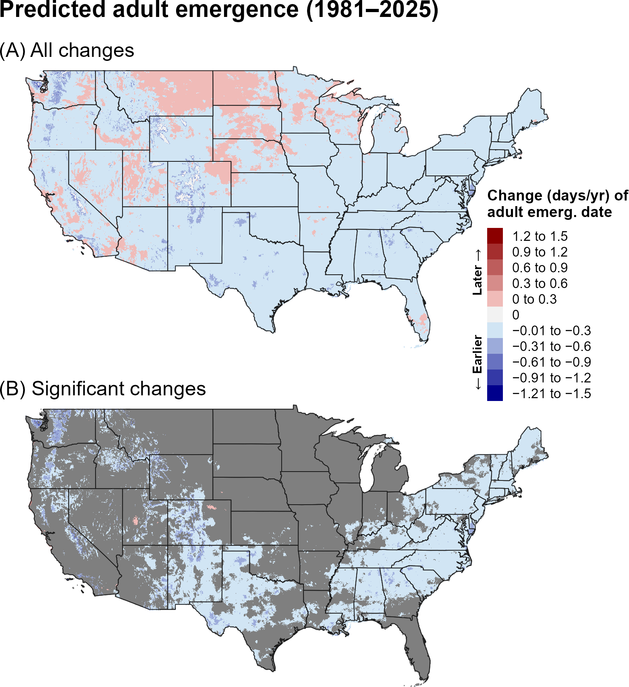
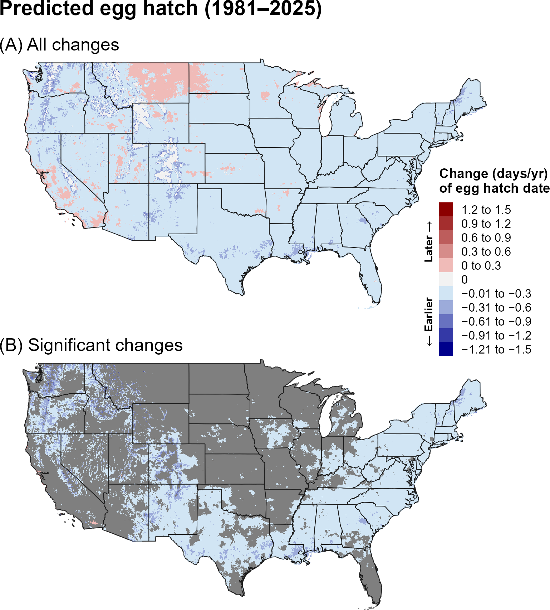
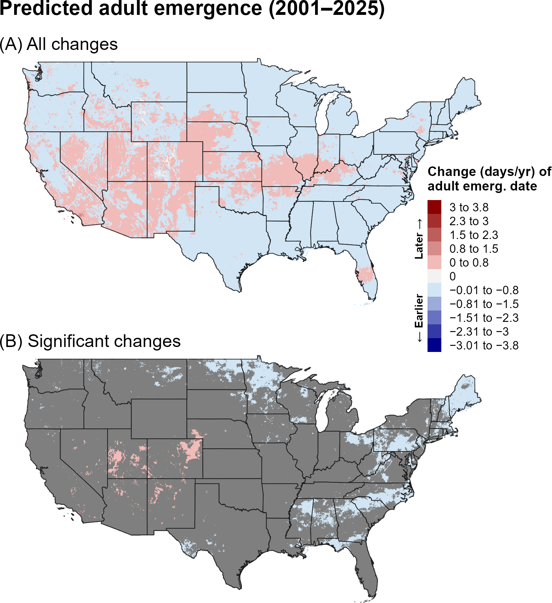
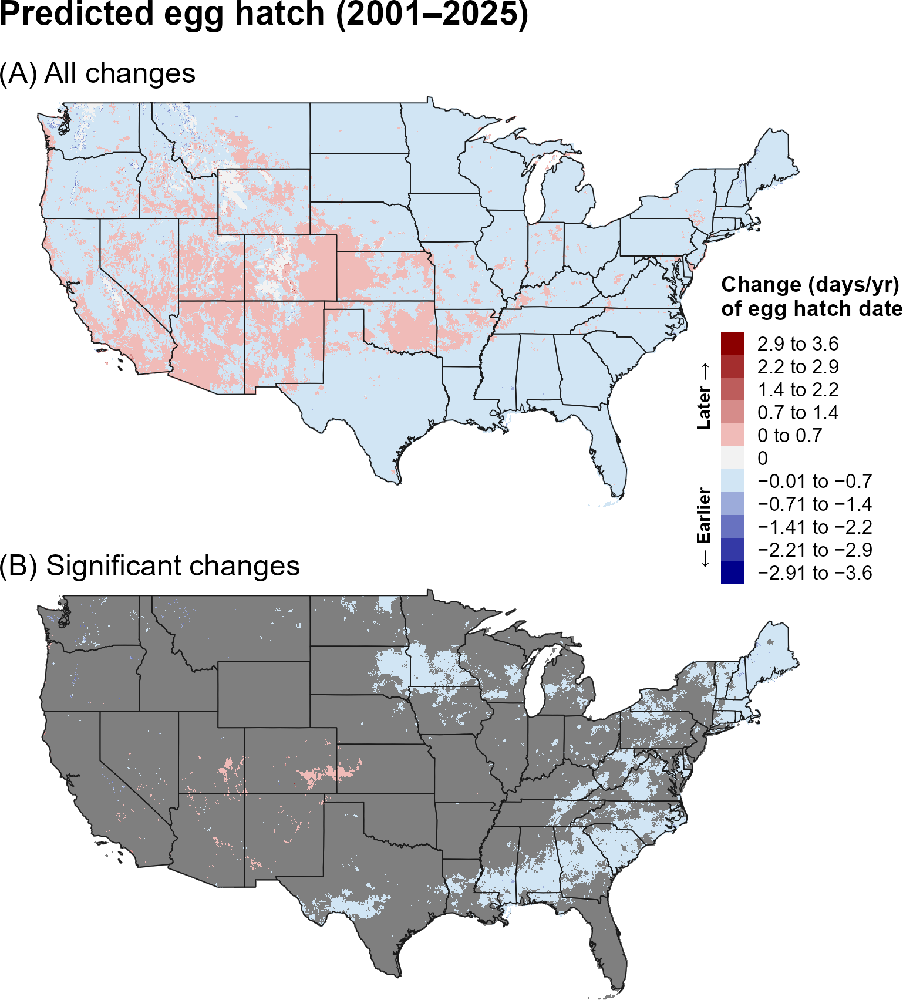
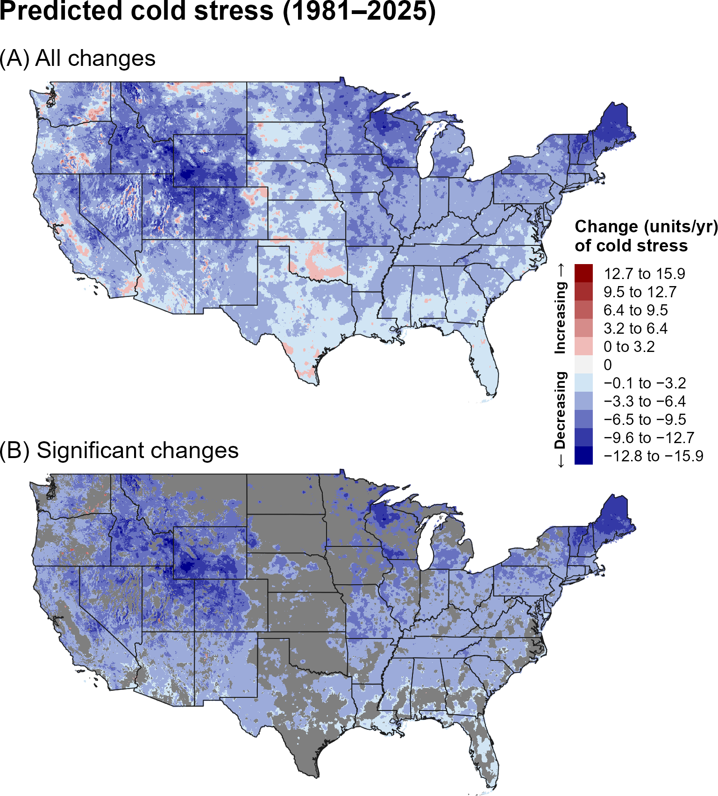
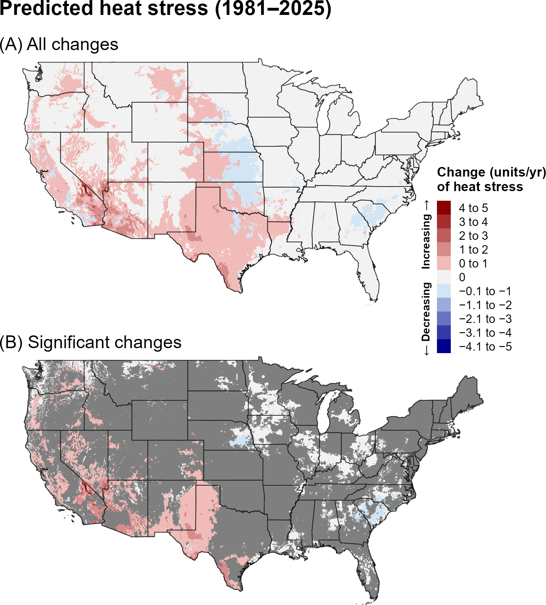
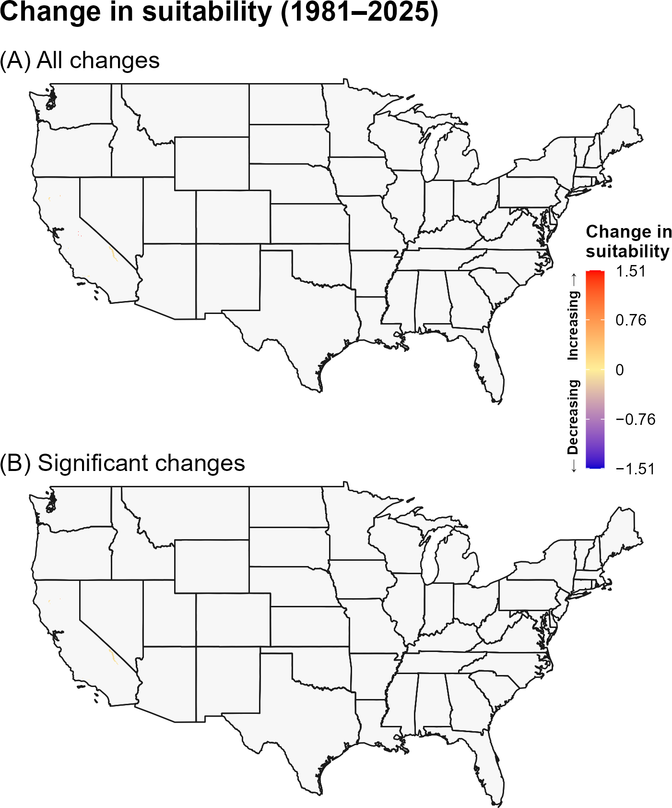
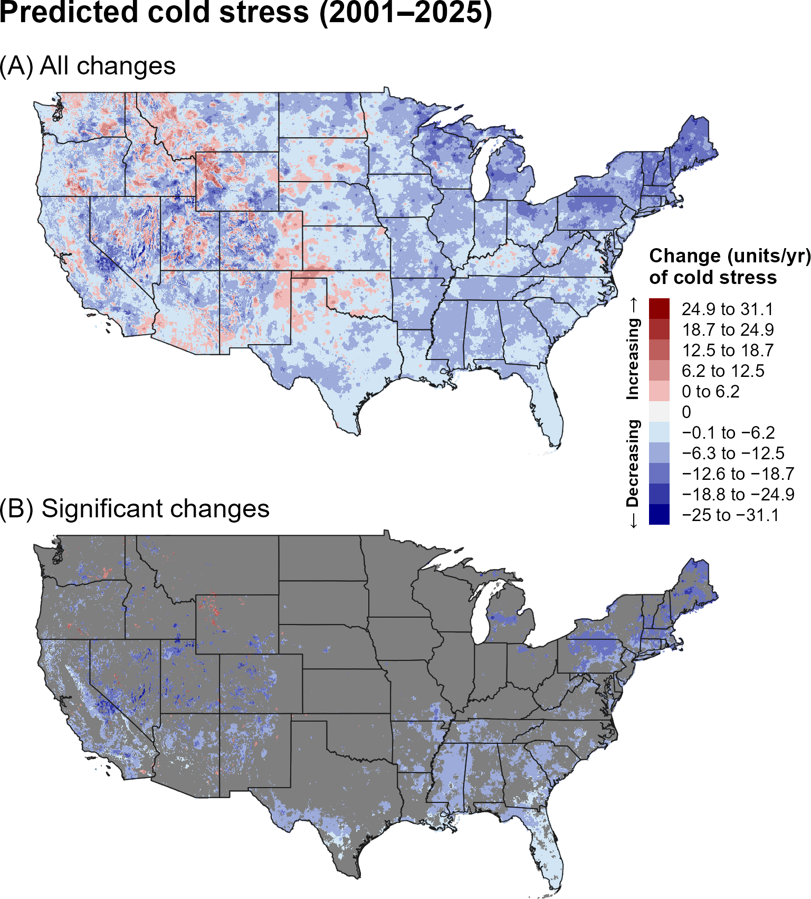
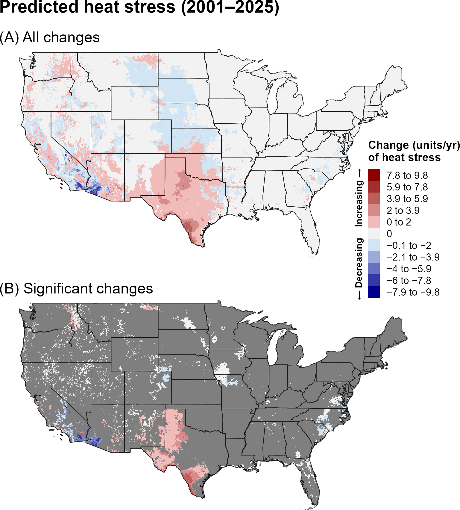
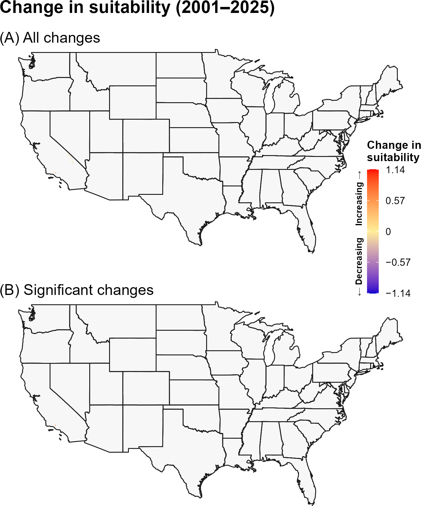

:::: {.content-visible when-format="html"}
::: {style="text-align: left;"}
[Download report as PDF](ECW/ECW.pdf){.btn .btn-primary}
:::
::::

## **5A. Introduction** {.unlisted}

The Egyptian cottonworm (ECW), *Spodoptera littoralis* Boisduval (Lepidoptera: Noctuidae), is a highly destructive and polyphagous moth distributed across southern Europe, the Mediterranean Basin, the Middle East, Africa, China, and India (`\hyperref[ref-eppo-2025]{EPPO 2025}`{=latex}`<a href="#ref-eppo-2025">EPPO 2025</a>`{=html}). With a host range spanning more than 80 plant species in over 40 families, it is a major pest of crops such as cotton, maize, potato, sugarcane, soybeans, vegetables, and wheat (`\hyperref[ref-cabi-2022]{CABI 2022}`{=latex}`<a href="#ref-cabi-2022">CABI 2022</a>`{=html}). The larval stage, which consists of six instars, causes significant damage through extensive defoliation, as well as by attacking growing points and mining or cutting stems (`\hyperref[ref-baker-miller-1974]{Baker and Miller 1974}`{=latex}`<a href="#ref-baker-miller-1974">Baker and Miller 1974</a>`{=html}, `\hyperref[ref-efsa-2015]{EFSA 2015}`{=latex}`<a href="#ref-efsa-2015">EFSA 2015</a>`{=html}, `\hyperref[ref-cabi-2022]{CABI 2022}`{=latex}`<a href="#ref-cabi-2022">CABI 2022</a>`{=html}). Although ECW is not established in the United States, it has been intercepted multiple times at United States ports of entry (`\hyperref[ref-ellis-2004]{Ellis 2004}`{=latex}`<a href="#ref-ellis-2004">Ellis 2004</a>`{=html}).

A model for ECW developed for the Degree-Day, establishment Risk, and Phenological event mapping system (DDRP) is operationalized to produce near real-time forecasts for the contiguous United States (CONUS) at <https://uspest.org/DDRP>. The full set of model parameters for EDW, including developmental temperature thresholds, degree-day requirements for individual life stages, and climate stress thresholds and limits, are available at USPest.org (`\hyperref[ref-barker-coop-2021]{Barker and Coop 2021}`{=latex}`<a href="#ref-barker-coop-2021">Barker and Coop 2021</a>`{=html}). 


## **5B. Results** {.unlisted}

### **i. Phenology**

#### **Entire period: 1981--2025**

Trends in predicted first adult emergence and egg hatch for ECW over the 44-year period (1981–2025) were predominantly negative, indicating that both phenological events shifted earlier over time (@fig-ecw-emergence, @fig-ecw-egg-hatch). Earlier phenology was predicted across much of the East and South, as well as higher-elevation areas of the West. Statistically significant trends were more spatially restricted, occurring primarily in portions of the East and scattered areas of the Intermountain West. Within these regions, predicted adult emergence and egg hatch shifted earlier by approximately 0.01–0.6 days per year, with some of the largest shifts occurring at higher elevations in the Intermountain West. Trends toward later phenology occurred in a some isolated areas of the West but most were not statistically significant. 

```{r}
#| echo: false
#| out-width: 70%
#| fig-align: center
#| fig-cap: "Changes (days/year) in predicted dates of first adult emergence for ECW across the CONUS over the entire 44-year period (1981–2025). Maps show (A) all changes and (B) statistically significant changes (P < 0.1); areas shown in gray are not statistically significant."
#| label: fig-ecw-emergence

```

```{r}
#| echo: false
#| out-width: 70%
#| fig-align: center
#| fig-cap: "Changes (days/year) in predicted dates of first egg hatch for ECW across the CONUS over the entire 44-year period (1981–2025). Maps show (A) all changes and (B) statistically significant changes (P < 0.1); areas shown in gray are not statistically significant."
#| label: fig-ecw-egg-hatch

```

#### **Recent period: 2001--2025**

Trends in predictions of first adult emergence and egg hatch for ECW over the recent 24-year period (2001–2025) were partially consistent with those observed over the 1981–2025 period. Significant trends towards earlier phenology were similar in magnitude but less spatially extensive, occurring predominantly in parts of the East and Upper Midwest (@fig-ecw-emergence-recent, @fig-ecw-egg-hatch-recent). In contrast, areas exhibiting trends toward later phenological events were somewhat larger and more spatially extensive across the West.

```{r}
#| echo: false
#| out-width: 70%
#| fig-align: center
#| fig-cap: "Changes (days/year) in predicted dates of first adult emergence for ECW across the CONUS over the recent 24-year period (2001–2025). Maps show (A) all changes and (B) statistically significant changes (P < 0.1); areas shown in gray are not statistically significant."
#| label: fig-ecw-emergence-recent

```

```{r}
#| echo: false
#| out-width: 70%
#| fig-align: center
#| fig-cap: "Changes (days/year) in predicted dates of first egg hatch for ECW across the CONUS over the recent 24-year period (2001–2025). Maps show (A) all changes and (B) statistically significant changes (P < 0.1); areas shown in gray are not statistically significant."
#| label: fig-ecw-egg-hatch-recent

```

### **ii. Climatic suitability**

#### **Entire period: 1981--2025**

Over the entire 44-year period (1981–2025), predicted cold stress for ECW decreased across broad portions of the CONUS, with the strongest changes occurring in the Northeast, Upper Midwest, and Intermountain West (@fig-ecw-cold-stress). However, trends across the Midwest and South were generally smaller and mostly nonsignificant. Predicted heat stress increased across much of the West and Great Plains, although significant trends were concentrated primarily in the West (@fig-ecw-heat-stress). When annual accumulated stress units exceed limits specified in DDRP models, climatic suitability may change. However, changes in stress units for ECW did not correspond to widespread shifts in suitability; only a few small areas in California showed significant decreases in predicted suitability (@fig-ecw-suitability).

```{r}
#| echo: false
#| out-width: 70%
#| fig-align: center
#| fig-cap: "Changes (units/year) in predicted cold stress for ECW across the CONUS over the entire 44-year period (1981–2025). Maps show (A) all changes and (B) statistically significant changes (P < 0.1); areas shown in gray are not statistically significant. Areas shown as 0 in (B) had significant trends but very small changes."
#| label: fig-ecw-cold-stress

```

```{r}
#| echo: false
#| out-width: 70%
#| fig-align: center
#| fig-cap: "Changes (units/year) in predicted heat stress for ECW across the CONUS over the entire 44-year period (1981–2025). Maps show (A) all changes and (B) statistically significant changes (P < 0.1); areas shown in gray are not statistically significant. Areas shown as 0 in (B) had significant trends but very small changes."
#| label: fig-ecw-heat-stress

```

```{r}
#| echo: false
#| out-width: 70%
#| fig-align: center
#| fig-cap: "Changes in predicted climatic suitability for ECW across the CONUS over the 44-year period (1981–2025). Suitability is defined as areas not excluded by cold and heat stress. Positive changes (warmer colors) indicate an increased likelihood of establishment, whereas negative changes (cooler colors) indicate a decreased likelihood of establishment."
#| label: fig-ecw-suitability

```

#### **Recent period: 2001--2025**

Many areas that exhibited significant decreases in cold stress for ECW over 1981–2025 no longer showed significant trends during the recent period. These areas were concentrated in scattered patches across the East and South and at higher elevations in the West (@fig-ecw-cold-stress-recent). Significant increases in predicted cold stress occurred in a few small, isolated areas of the West. Significant increases in heat stress were concentrated in the South, particularly Texas, whereas parts of California showed significant decreases (@fig-ecw-heat-stress-recent). As in the 1981–2025 analysis, changes in cold and heat stress produced very few significant changes in climatic suitability (@fig-ecw-suitability-recent).

```{r}
#| echo: false
#| out-width: 70%
#| fig-align: center
#| fig-cap: "Changes (units/year) in predicted cold stress for ECW across the CONUS over the recent 24-year period (2001–2025). Maps show (A) all changes and (B) statistically significant changes (P < 0.1); areas shown in gray are not statistically significant. Areas shown as 0 in (B) had significant trends but very small changes."
#| label: fig-ecw-cold-stress-recent

```

```{r}
#| echo: false
#| out-width: 70%
#| fig-align: center
#| fig-cap: "Changes (units/year) in predicted heat stress for ECW across the CONUS over the recent 24-year period (2001–2025). Maps show (A) all changes and (B) statistically significant changes (P < 0.1); areas shown in gray are not statistically significant. Areas shown as 0 in (B) had significant trends but very small changes."
#| label: fig-ecw-heat-stress-recent

```

```{r}
#| echo: false
#| out-width: 70%
#| fig-align: center
#| fig-cap: "Changes in predicted climatic suitability for ECW across the CONUS over the recent 24-year period (2001–2025). Suitability is defined as areas not excluded by cold and heat stress. Positive changes (warmer colors) indicate an increased likelihood of establishment, whereas negative changes (cooler colors) indicate a decreased likelihood of establishment."
#| label: fig-ecw-suitability-recent

```

## **5C. Discussion** {.unlisted}

Although ECW is not established in the CONUS, understanding predicted changes in phenology can inform surveillance planning. In areas exhibiting significant trends toward earlier phenology, predicted dates shifted earlier by approximately 0.01–0.6 days per year, suggesting that surveillance materials may need to be deployed earlier in the season. Surveillance may be particularly important where these trends overlap with major host production areas, including extensive commercial cotton acreage and intensive fruit and vegetable production across the South and along the West Coast (`\hyperref[ref-sullivan-2014]{Sullivan 2014}`{=latex}`<a href="#ref-sullivan-2014">Sullivan 2014</a>`{=html}. However, considering trends in more northern areas is also important because migratory moths may be capable of periodic spread into northern regions later in the season (`\hyperref[ref-efsa-2015]{EFSA PLH 2015}`{=latex}`<a href="#ref-efsa-2015">EFSA PLH</a>`{=html}). 

Earlier adult emergence and egg hatch could potentially allow ECW to complete more generations per year, increasing pest pressure and associated crop damage. ECW lacks a true winter diapause and can complete multiple generations under warm conditions (`\hyperref[ref-yathom-1971]{Yathom 1971}`{=latex}`<a href="#ref-yathom-1971">Yathom 1971</a>`{=html}, `\hyperref[ref-ellis-2004]{Ellis 2004}`{=latex}`<a href="#ref-ellis-2004">Ellis 2004</a>`{=html}, `\hyperref[ref-miller-1977]{Miller 1977}`{=latex}`<a href="#ref-miller-1977">Miller 1977</a>`{=html}, `\hyperref[ref-barker-coop-2021]{Barker and Coop 2021}`{=latex}`<a href="#ref-barker-coop-2021">Barker and Coop 2021</a>`{=html}). ECW may complete 3–9 generations depending on climate and host plant (`\hyperref[ref-ellis-2004]{Ellis 2004}`{=latex}`<a href="#ref-ellis-2004">Ellis 2004</a>`{=html}), with 1–11 generations predicted in environmentally suitable areas in the CONUS (`\hyperref[ref-barker-coop-2021]{Barker and Coop 2021}`{=latex}`<a href="#ref-barker-coop-2021">Barker and Coop 2021</a>`{=html}). Photoperiod may also influence ECW’s response to temperature across different latitudes (`\hyperref[ref-hegazi-2021]{Hegazi et al. 2021}`{=latex}`<a href="#ref-hegazi-2021">Hegazi et al. 2021</a>`{=html}). A laboratory study revealed interactive effects of temperature and photoperiod on ECW development, with longer photoperiods slowing larval development rates and reducing the number of larval instars (`\hyperref[ref-hegazi-2021]{Hegazi et al. 2021}`{=latex}`<a href="#ref-hegazi-2021">Hegazi et al. 2021</a>`{=html}). Its development rate may also vary across host plant species (`\hyperref[ref-salama-1971]{Salama et al. 1971}`{=latex}`<a href="#ref-salama-1971">Salama et al. 1971</a>`{=html}, `\hyperref[ref-shoman-2025]{Shoman et al. 2025}`{=latex}`<a href="#ref-shoman-2025">Shoman et al. 2025</a>`{=html}). Higher temperatures could increase ECW reproductive rates and affect insecticide effectiveness (`\hyperref[ref-massot-2021]{Massot et al. 2021}`{=latex}`<a href="#ref-massot-2021">Massot et al. 2021</a>`{=html}).

The climate-stress trend maps showed broad changes in both cold and heat stress, but these changes did not translate into statistically significant shifts in predicted climatic suitability for ECW in only a few isolated areas of California (Death Valley). The contrast between widespread climate-stress trends and limited suitability changes suggests that the modeled climatic limits remain sufficiently broad that changes in individual stress variables do not necessarily alter establishment potential. Previous modeling studies reported suitable environments for ECW throughout the South and Midwest, as well as along the West Coast, whereas cold temperatures would likely exclude the pest from colder regions, including the Intermountain West and latitudes north of *ca.* 41° N in the East (`\hyperref[ref-barker-coop-2021]{Barker and Coop 2021}`{=latex}`<a href="#ref-barker-coop-2021">Barker and Coop 2021</a>`{=html}, `\hyperref[ref-elshahed-2023]{ElShahed et al. 2023}`{=latex}`<a href="#ref-elshahed-2023">ElShahed et al. 2023</a>`{=html}). 

The stronger and more spatially extensive trends in predicted phenology and climate stress over the entire 44-year period may reflect both the larger sample size, which can reduce noise and improve detection of directional patterns, and differences in the underlying climate trends between the two time periods. In particular, the recent 24-year period may capture climate variability or regional trends that differ from those observed over the longer 44-year period. Thus, differences between the two periods should be interpreted as reflecting both long-term climate trends and shorter-term regional variability.

## **5D. References** {.unlisted}

\begingroup
\setlength{\parindent}{-0.5in}
\setlength{\leftskip}{0.5in}

\noindent

<span id="ref-baker-miller-1974"></span>
\phantomsection\label{ref-baker-miller-1974}

Baker, C. R. B., and G. W. Miller. 1974. Some effects of temperature and larval food on the development of *Spodoptera littoralis* (Boisd.) (Lep., Noctuidae). Bulletin of Entomological Research 63:495–511.

<span id="ref-barker-coop-2021"></span>
\phantomsection\label{ref-barker-coop-2021}

Barker, B. S., and L. Coop. 2021.  Egyptian cottonworm, *Spodoptera littoralis*.  Phenology/degree-day and climate suitability model white paper for USPEST.ORG. Prepared for United States Department of Agriculture (USDA) – Animal and Plant Health Inspection Service (APHIS) – Plant Protection and Quarantine (PPQ). Vs. 1.0 (1/8/2021). Available online: <https://uspest.org/CAPS/Spodoptera_littoralis_white_paper.pdf> (accessed 8 September 2025).

<span id="ref-cabi-2022"></span>
\phantomsection\label{ref-cabi-2022}

CABI. 2022. *Spodoptera littoralis* (cotton leafworm). CABI Compendium. Available online: <https://doi.org/10.1079/cabicompendium.51070> (accessed 31 October 2025).

<span id="ref-coop-barker-2021"></span>
\phantomsection\label{ref-coop-barker-2021}

Coop, L., and B. S. Barker. 2021. Phenology/degree-day model analysis: Egyptian cottonworm (*Spodoptera littoralis*). Prepared for USPEST.org at Oregon State University, Oregon IPM Center. Available online: <https://uspest.org/wea/Spodoptera_littoralis_model.pdf> (accessed 8 September 2025).

<span id="ref-efsa-2015"></span>
\phantomsection\label{ref-efsa-2015}

EFSA Panel on Plant Health (PLH). 2015. Scientific opinion on the pest categorisation of *Spodoptera littoralis*. 2015. EFSA Journal 13:3987.

<span id="ref-ellis-2004"></span>
\phantomsection\label{ref-ellis-2004}

Ellis, S. E. 2004. New Pest Response Guidelines: *Spodoptera*. USDA/APHIS/PPQ/PDMP. Animal and Plant Health Inspection Service, Plant Protection and Quarantine. Available online: <https://assets.ippc.int/static/media/uploads/resources/new_pest_response_guidelines_spodoptera.pdf> (accessed 9 September 2025).

<span id="ref-elshahed-2023"></span>
\phantomsection\label{ref-elshahed-2023}

ElShahed, S. M., Z. K. Mostafa, M. H. Radwan, and E. M. Hosni. 2023. Modeling the potential global distribution of the Egyptian cotton leafworm, *Spodoptera littoralis* under climate change. Scientific Reports 13:1–10.

<span id="ref-eppo-2025"></span>
\phantomsection\label{ref-eppo-2025}

EPPO. 2025. *Spodoptera littoralis*. EPPO datasheets on pests recommended for regulation. Available online: <https://gd.eppo.int/> (accessed 11 August 2025).

<span id="ref-efsa-2015"></span>
\phantomsection\label{ref-efsa-2015}

European Food Safety Authority (EFSA). 2015. Scientific opinion on the pest categorisation of *Spodoptera littoralis*. EFSA Journal 13:1–26.

<span id="ref-hegazi-2021"></span>
\phantomsection\label{ref-hegazi-2021}

Hegazi, E. M., W. E. Khafagi, and E. Agamy. 2021. Do non-diapausing insects respond to different photoperiods: *Spodoptera littoralis*? Journal of Entomology and Nematology 13:26–34.

<span id="ref-massot-2021"></span>
\phantomsection\label{ref-massot-2021}

Massot, M., T. Bagni, A. Maria, P. Couzi, T. Drozdz, A. Malbert-Colas, M. Maïbèche, and D. Siaussat. 2021. Combined influences of transgenerational effects, temperature and insecticide on the moth *Spodoptera littoralis*. Environmental Pollution 289:117889.

<span id="ref-miller-1977"></span>
\phantomsection\label{ref-miller-1977}

Miller, G. W. 1977. Mortality of *Spodoptera littoralis* (Bolsduval) (Lepidoptera; Noctuidae) at non-freezing temperatures. Bulletin of Entomological Research 67:143–152.

<span id="ref-salama-1971"></span>
\phantomsection\label{ref-salama-1971}

Salama, H. S., N. Z. Dimetry, and S. A. Salem. 1971. On the host preference and biology of the cotton leaf worm *Spodoptera littoralis*. Zeitschrift für Angewandte Entomologie 67:261–266.

<span id="ref-shoman-2025"></span>
\phantomsection\label{ref-shoman-2025}

Shoman, S. A., N. M. Ghanim, N. H. Harraz, and W. Z. Aziz. 2025. Effect of four host plants on biological characteristics of *Spodoptera frugiperda* and *Spodoptera littoralis* (both Lepidoptera: Noctuidae). International Journal of Tropical Insect Science:1909–1919.

<span id="ref-sullivan-2007"></span>
\phantomsection\label{ref-yathom-1971}

Sullivan, M. 2014. CPHST Pest Datasheet for *Spodoptera littoralis*. USDA-APHIS-PPQCPHST. Revised March 2014. Available online: <https://caps.ceris.purdue.edu/wp-content/uploads/2025/07/Spodoptera-littoralis_CPHST-Datasheet_2014-version.pdf> (accessed 22 October 2026).

<span id="ref-yathom-1971"></span>
\phantomsection\label{ref-yathom-1971}

Yathom, S. 1971. Distribution and flight period of Heliothidinae species in Israel in 1959-1969. Israel Journal of Agricultural Research 21:51–61.

\par
\endgroup
