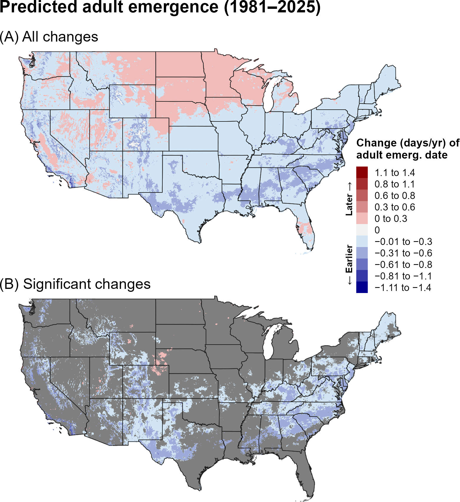
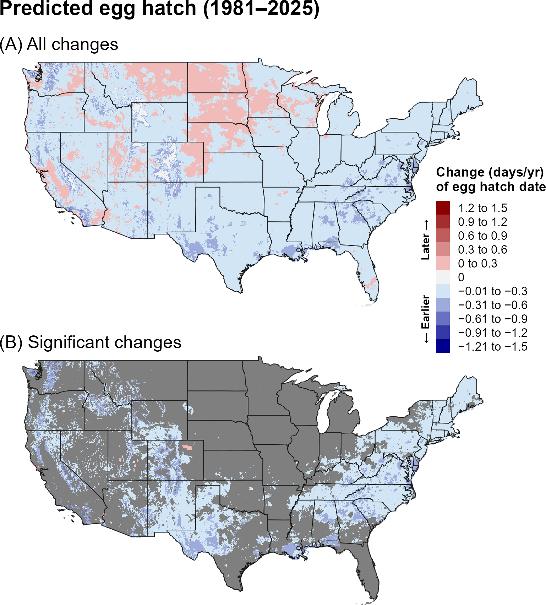
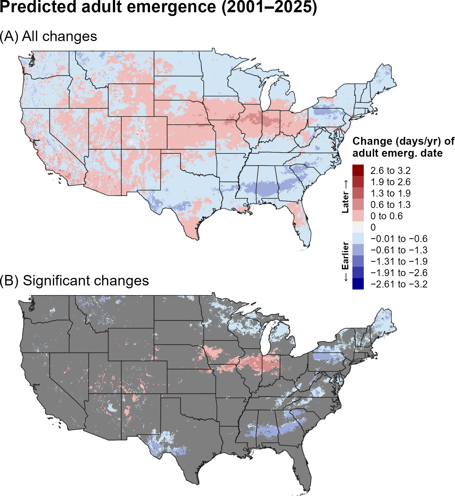
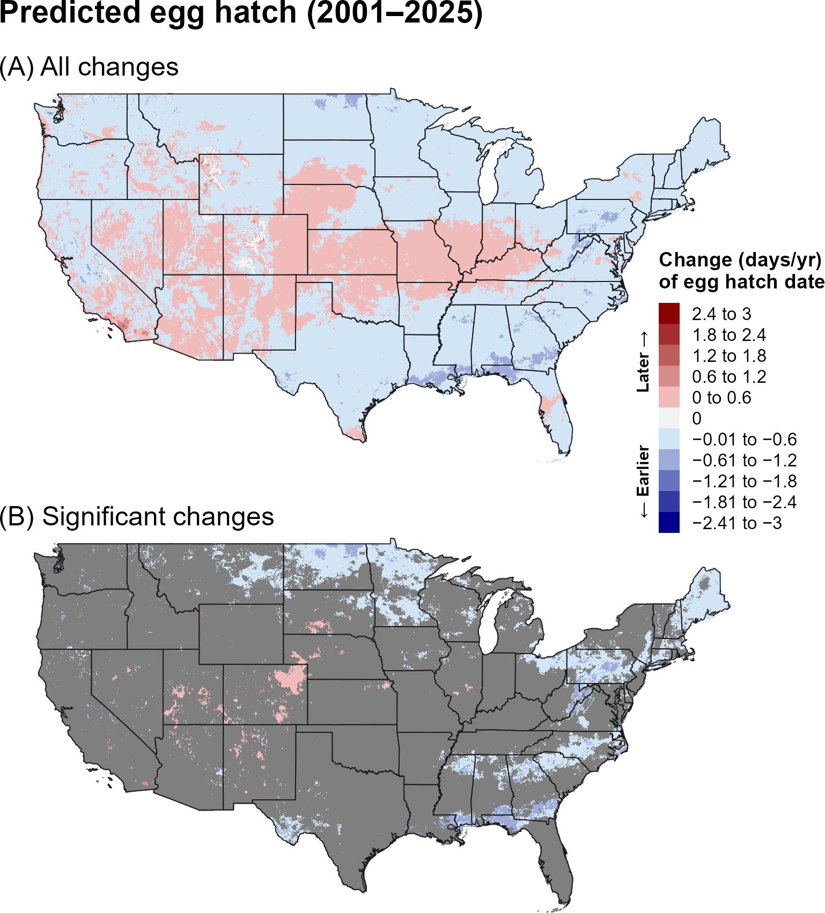
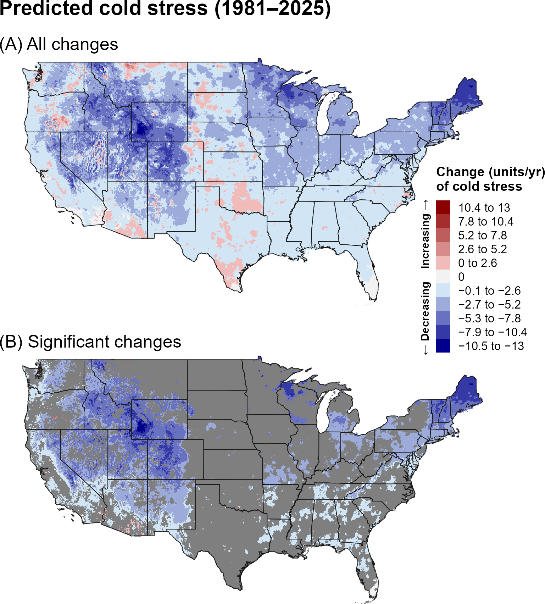
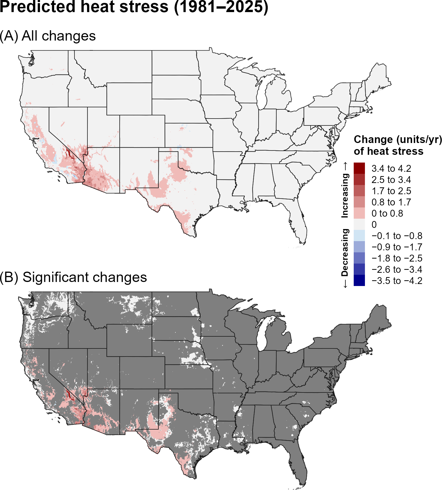
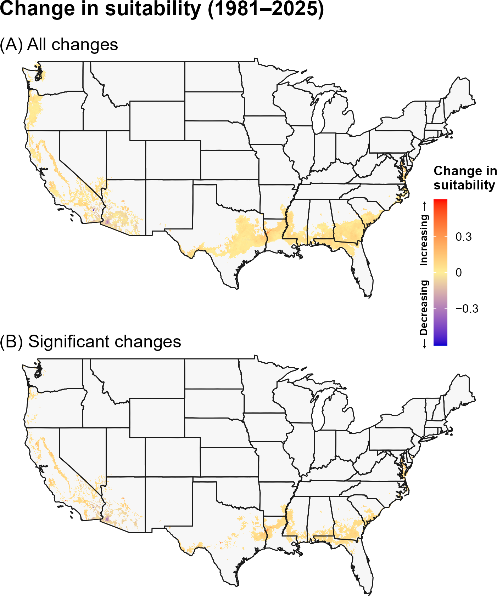
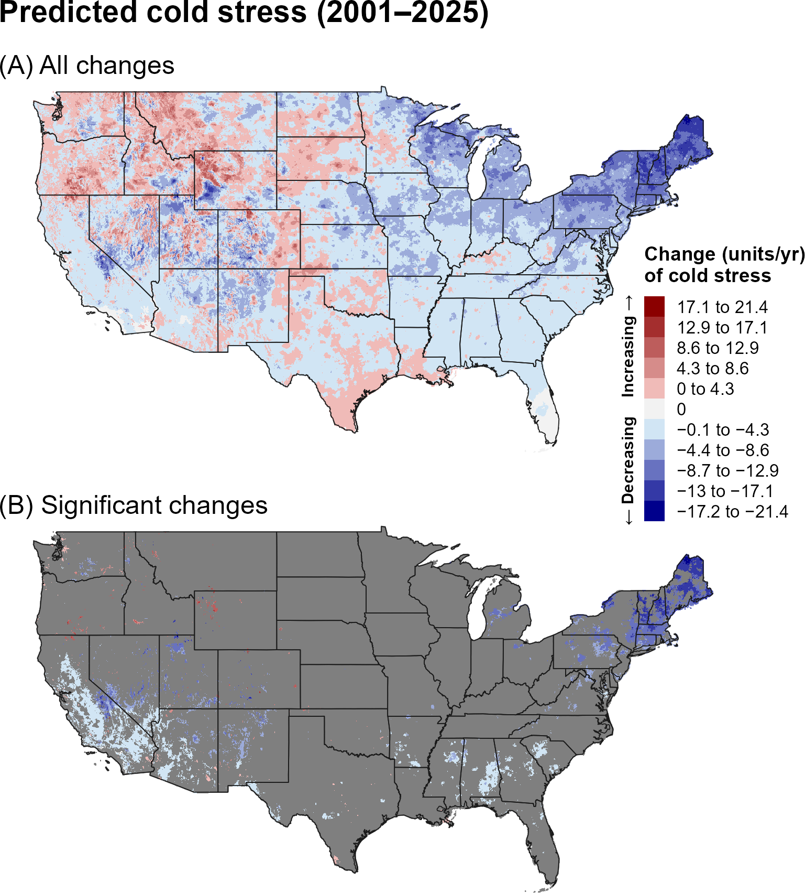
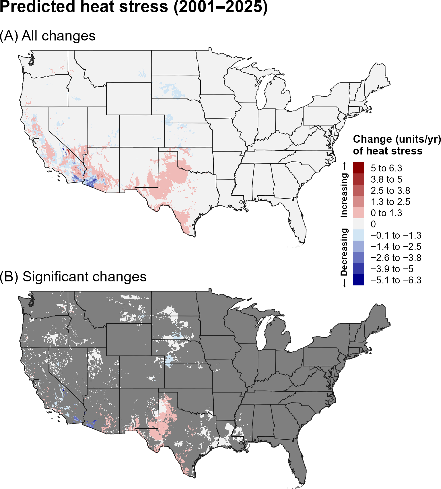
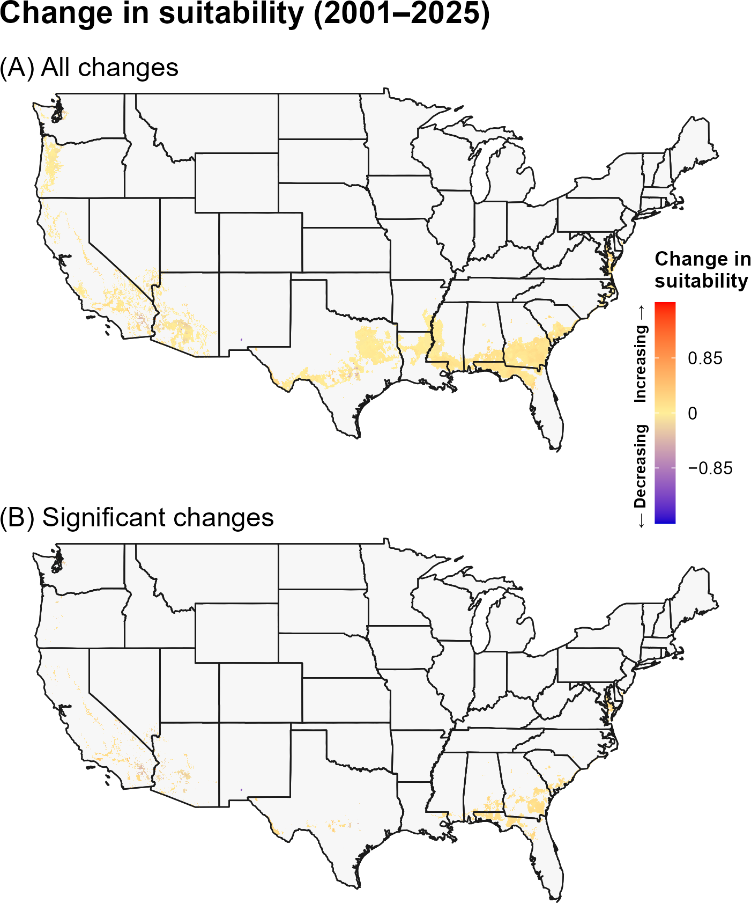

:::: {.content-visible when-format="html"}
::: {style="text-align: left;"}
[Download FCM report as PDF](FCM.pdf){.btn .btn-primary}
:::
::::

## **6A. Introduction** {.unlisted}

Native to sub-Saharan Africa, the false codling moth (FCM), *Thaumatotibia leucotreta* Meyrick (Lepidoptera: Tortricidae), is a highly polyphagous pest distributed throughout much of Africa and parts of the Middle East, including Israel (`\hyperref[ref-carstens-moore-2020]{Carstens and Moore 2020}`{=latex}`<a href="#ref-carstens-moore-2020">Carstens and Moore 2020</a>`{=html}). Economically important hosts include avocado, Citrus spp., corn, cotton, eggplant, grapes, stone fruits, peppers, and cut roses (`\hyperref[ref-eppo-2025]{EPPO 2025}`{=latex}`<a href="#ref-eppo-2025">EPPO 2025</a>`{=html}). FCM undergoes five larval instars, during which larvae bore into and feed within plant tissues, particularly fruit, causing direct damage before exiting the host to form cocoons in the soil (`\hyperref[ref-nappfast-2003]{NAPPFAST 2003}`{=latex}`<a href="#ref-nappfast-2003">NAPPFAST 2003</a>`{=html}, `\hyperref[ref-gilligan-2011]{Gilligan et al. 2011}`{=latex}`<a href="#ref-gilligan-2011">Gilligan et al. 2011</a>`{=html}). In 2008, a single adult male was discovered in Ventura County, California, representing the first domestic detection of FCM, extensive subsequent trapping failed to detect additional individuals, and the introduction was successfully eradicated (`\hyperref[ref-gilligan-2011]{Gilligan et al. 2011}`{=latex}`<a href="#ref-gilligan-2011">Gilligan et al. 2011</a>`{=html}). Although FCM is not established in the United States, it has been repeatedly intercepted at United States ports of entry in both cargo and passenger baggage (`\hyperref[ref-stibick-2006]{Stibick 2006}`{=latex}`<a href="#ref-stibick-2006">Stibick 2006</a>`{=html}). If established in the United States, FCM could cause substantial economic losses, potentially reaching billions of dollars (`\hyperref[ref-venette-2003]{Venette et al. 2003}`{=latex}`<a href="#ref-venette-2003">Venette et al. 2003</a>`{=html}, `\hyperref[ref-stibick-2006]{Stibick 2006}`{=latex}`<a href="#ref-stibick-2006">Stibick 2006</a>`{=html}).

A model for FCM developed for the Degree-Day, establishment Risk, and Phenological event mapping system (DDRP) is operationalized to produce near real-time forecasts for the CONUS at <https://uspest.org/DDRP>. The full set of model parameters for FCM, including developmental temperature thresholds, degree-day requirements for individual life stages, and climate stress thresholds and limits, are available at USPest.org (`\hyperref[ref-barker-coop-2019]{Barker and Coop 2019}`{=latex}`<a href="#ref-barker-coop-2019">Barker and Coop 2019</a>`{=html}).

## **6B. Results** {.unlisted}

### **i. Phenology**

#### **Entire period: 1981--2025**

Trends in predicted first adult emergence and egg hatch for FCM over the 44-year period (1981–2025) were predominantly negative, indicating that both phenological events shifted earlier over time (@fig-fcm-emergence, @fig-fcm-egg-hatch). Earlier phenology was predicted across much of the eastern, south-central, and western United States. Statistically significant trends were more spatially restricted, occurring primarily in portions of the eastern and southwestern United States and scattered areas of the Intermountain West. Within these regions, predicted adult emergence and egg hatch shifted earlier by approximately 0.01–0.6 days per year, with some of the largest shifts occurring in more southern regions. Trends toward later phenology occurred in a some isolated areas of the Great Plains and Intermountain West but most were not statistically significant.

```{r}
#| echo: false
#| out-width: 70%
#| fig-align: center
#| fig-cap: "Changes (days/year) in predicted dates of first adult emergence for FCM across the CONUS over the entire 44-year period (1981–2025). Maps show (A) all changes and (B) statistically significant changes (P < 0.1); areas shown in gray are not statistically significant."
#| label: fig-fcm-emergence

```

```{r}
#| echo: false
#| out-width: 70%
#| fig-align: center
#| fig-cap: "Changes (days/year) in predicted dates of first egg hatch for FCM across the CONUS over the entire 44-year period (1981–2025). Maps show (A) all changes and (B) statistically significant changes (P < 0.1); areas shown in gray are not statistically significant."
#| label: fig-fcm-egg-hatch

```

#### **Recent period: 2001--2025**

Trends in predictions of first adult emergence and egg hatch for FCM over the recent 24-year period (2001–2025) were partially consistent with those observed over the 1981–2025 period. Trends became more spatially heterogeneous, with significantly later predicted events across portions of the central and northern United States and earlier events in parts of the southeastern and western United States (@fig-fcm-emergence-recent, @fig-fcm-egg-hatch-recent). Significant changes were relatively localized, particularly in the central and eastern United States.

```{r}
#| echo: false
#| out-width: 70%
#| fig-align: center
#| fig-cap: "Changes (days/year) in predicted dates of first adult emergence for FCM across the CONUS over the recent 24-year period (2001–2025). Maps show (A) all changes and (B) statistically significant changes (P < 0.1); areas shown in gray are not statistically significant."
#| label: fig-fcm-emergence-recent

```

```{r}
#| echo: false
#| out-width: 70%
#| fig-align: center
#| fig-cap: "Changes (days/year) in predicted dates of first egg hatch for FCM across the CONUS over the recent 24-year period (2001–2025). Maps show (A) all changes and (B) statistically significant changes (P < 0.1); areas shown in gray are not statistically significant."
#| label: fig-fcm-egg-hatch-recent

```

### **ii. Climatic suitability**

#### **Entire period: 1981--2025**

Over the entire 44-year period (1981–2025), predicted cold stress for FCM decreased across much of the northern and western United States, with significant decreases especially evident in northern states in the midwestern and eastern United States and higher-elevation areas of the Intermountain West (@fig-fcm-cold-stress). However, decreases across the Great Plains, northern interior, and southeastern United States were generally smaller and significant in only some areas. Predicted heat stress significantly increased in isoated parts of the southwestern United States and California (@fig-fcm-heat-stress). Climatic suitability showed significant increases in portions of California and the southern United States, including parts of the Southeast and Southwest, although the changes were spatially limited (@fig-fcm-suitability). Decreases in suitability owing to heat stress were predicted in parts of the Sonoran Desert. 

```{r}
#| echo: false
#| out-width: 70%
#| fig-align: center
#| fig-cap: "Changes (units/year) in predicted cold stress for FCM across the CONUS over the entire 44-year period (1981–2025). Maps show (A) all changes and (B) statistically significant changes (P < 0.1); areas shown in gray are not statistically significant. Areas shown as 0 in (B) had significant trends but very small changes."
#| label: fig-fcm-cold-stress

```

```{r}
#| echo: false
#| out-width: 70%
#| fig-align: center
#| fig-cap: "Changes (units/year) in predicted heat stress for FCM across the CONUS over the entire 44-year period (1981–2025). Maps show (A) all changes and (B) statistically significant changes (P < 0.1); areas shown in gray are not statistically significant. Areas shown as 0 in (B) had significant trends but very small changes."
#| label: fig-fcm-heat-stress

```

```{r}
#| echo: false
#| out-width: 70%
#| fig-align: center
#| fig-cap: "Changes in predicted climatic suitability for FCM across the CONUS over the 44-year period (1981–2025). Suitability is defined as areas not excluded by climate stress. Positive changes (warmer colors) indicate an increased likelihood of establishment, whereas negative changes (cooler colors) indicate a decreased likelihood of establishment."
#| label: fig-fcm-suitability

```

#### **Recent period: 2001--2025**

Many areas that exhibited significant decreases in cold stress for FCM over 1981–2025 no longer showed significant trends during the recent period. These areas were concentrated in scattered patches across the northeastern and southern United States, and in California (@fig-fcm-cold-stress-recent). Significant increases in predicted cold stress occurred in a few small, isolated areas of the northwestern United States. Areas with increasing heat stress were concentrated in the southwestern United States, particularly Texas, whereas parts of California showed significant decreases (@fig-fcm-heat-stress-recent). The climatic-suitability map showed relatively limited significant change, although increases remained evident in small portions of the southern United States (@fig-fcm-suitability-recent).

```{r}
#| echo: false
#| out-width: 70%
#| fig-align: center
#| fig-cap: "Changes (units/year) in predicted cold stress for FCM across the CONUS over the recent 24-year period (2001–2025). Maps show (A) all changes and (B) statistically significant changes (P < 0.1); areas shown in gray are not statistically significant. Areas shown as 0 in (B) had significant trends but very small changes."
#| label: fig-fcm-cold-stress-recent

```

```{r}
#| echo: false
#| out-width: 70%
#| fig-align: center
#| fig-cap: "Changes (units/year) in predicted heat stress for FCM across the CONUS over the recent 24-year period (2001–2025). Maps show (A) all changes and (B) statistically significant changes (P < 0.1); areas shown in gray are not statistically significant. Areas shown as 0 in (B) had significant trends but very small changes."
#| label: fig-fcm-heat-stress-recent

```

```{r}
#| echo: false
#| out-width: 70%
#| fig-align: center
#| fig-cap: "Changes in predicted climatic suitability for FCM across the CONUS over the recent 24-year period (2001–2025). Suitability is defined as areas not excluded by climate stress. Positive changes (warmer colors) indicate an increased likelihood of establishment, whereas negative changes (cooler colors) indicate a decreased likelihood of establishment."
#| label: fig-fcm-suitability-recent

```

## **6C. Discussion** {.unlisted}

Although FCM is not established in the CONUS, understanding predicted changes in phenology can inform surveillance planning. In areas exhibiting significant trends toward earlier phenology, predicted dates shifted earlier by approximately 0.01–0.6 days per year, suggesting that surveillance materials may need to be deployed earlier in the season.

FCM can complete 2–10 generations per year, with the number of generations influenced by temperature, food availability and quality, photoperiod, humidity, and latitude (`\hyperref[ref-venette-2003]{Venette et al. 2003}`{=latex}`<a href="#ref-venette-2003">Venette et al. 2003</a>`{=html}, `\hyperref[ref-gilligan-2011]{Gilligan et al. 2011}`{=latex}`<a href="#ref-gilligan-2011">Gilligan et al. 2011</a>`{=html}). In environmentally suitable areas of the contiguous United States (CONUS), FCM is predicted to complete 1–9 generations (`\hyperref[ref-barker-coop-2019]{Barker and Coop 2019}`{=latex}`<a href="#ref-barker-coop-2019">Barker and Coop 2019</a>`{=html}). Drought and associated changes in host-plant availability may contribute to variation in FCM developmental rates and host use (`\hyperref[ref-gilligan-2011]{Gilligan et al. 2011}`{=latex}`<a href="#ref-gilligan-2011">Gilligan et al. 2011</a>`{=html}), while experimental evidence indicates that moisture stress can also affect FCM development and infestation of tomato (`\hyperref[ref-patrick-2021]{Patrick et al. 2021}`{=latex}`<a href="#ref-patrick-2021">Patrick et al. 2021</a>`{=html}).

Decreases in predicted cold stress across parts of the CONUS, particularly in the southern United States and California, indicate that cold conditions have become less limiting to FCM establishment in these regions. These areas warrant particular attention because California and Texas account for a large proportion of U.S. citrus production and also grow other crops susceptible to FCM, including avocados, peaches, and cotton. Previous assessments have also identified parts of these regions as potentially suitable for FCM establishment. A biome-based risk map identified parts of Florida and the western United States, excluding the Pacific Coast, as suitable for establishment (`\hyperref[ref-venette-2003]{Venette et al. 2003}`{=latex}`<a href="#ref-venette-2003">Venette et al. 2003</a>`{=html}). Although Mediterranean climates, including California, were previously considered unsuitable for FCM (`\hyperref[ref-eppo-2013]{EPPO 2013}`{=latex}`<a href="#ref-eppo-2013">EPPO 2013</a>`{=html}), subsequent modeling predicted suitable conditions in California and other parts of the Pacific Coast, as well as portions of the southern United States (`\hyperref[ref-barker-coop-2019]{Barker and Coop 2019}`{=latex}`<a href="#ref-barker-coop-2019">Barker and Coop 2019</a>`{=html}). Together, these findings support continued surveillance in regions where suitable crop hosts coincide with potentially favorable climatic conditions.

Nevertheless, significant increases in predicted heat stress—and corresponding reductions in establishment risk—occurred in the hottest parts of the southwestern United States, primarily in the Sonoran Desert region. These trends suggest that, despite the presence of suitable crop hosts, some areas may be becoming less favorable for FCM establishment. However, climatic tolerance may differ among FCM life stages: although the pest has limited capacity for rapid cold hardening over short periods, larvae can tolerate a broader range of temperatures than adults, whereas adults exhibit a heat-hardening response (`\hyperref[ref-stotter-terblanche-2009]{Stotter and Terblanche 2009}`{=latex}`<a href="#ref-stotter-terblanche-2009">Stotter and Terblanche 2009</a>`{=html}, `\hyperref[ref-terblanche-2017]{Terblanche et al. 2017}`{=latex}`<a href="#ref-terblanche-2017">Terblanche et al. 2017</a>`{=html}). In addition, FCM establishment may depend on factors beyond temperature, including food availability, photoperiod, humidity, and latitude (get citations). Therefore, climate-stress trends should be interpreted as one component of establishment risk rather than as a definitive measure of establishment potential.

The stronger and more spatially extensive trends in predicted phenology and climate stress over the full 44-year period may reflect both the larger sample size, which can reduce noise and improve detection of directional patterns, and differences in the underlying climate trends between the two time periods. In particular, the recent 24-year period may capture climate variability or regional trends that differ from those observed over the longer 44-year period. Thus, differences between the two periods should be interpreted as reflecting both long-term climate trends and shorter-term regional variability.

## **6D. References** {.unlisted}

\begingroup
\setlength{\parindent}{-0.5in}
\setlength{\leftskip}{0.5in}

\noindent

<span id="ref-barker-coop-2019"></span>
\phantomsection\label{ref-barker-coop-2019}

Barker, B. S., and L. Coop. 2019. False codling moth, Thaumatotibia leucotreta.  Phenology/degree-day and climate suitability model analysis for USPEST.ORG. Prepared for United States Department of Agriculture (USDA) – Animal and Plant Health Inspection Service (APHIS) – Plant Protection and Quarantine (PPQ). Vs. 1.0 (12/2/2019). Online at: <https://uspest.org/CAPS/Thaumatotibia_leucotreta_white_paper.pdf> (accessed 8 September 2025).

<span id="ref-carstens-moore-2020"></span>
\phantomsection\label{ref-carstens-moore-2020}

Carstens, E., and S. Moore. 2020. *Thaumatotibia leucotreta* (false codling moth (FCM)). CABI Compendium. Available online: <https://doi.org/10.1079/cabicompendium.6904> (accessed 25 August 2025).

<span id="ref-eppo-2013"></span>
\phantomsection\label{ref-eppo-2013}

EPPO. 2013. Pest risk analysis for *Thaumatotibia leucotreta*. EPPO, Paris.

<span id="ref-eppo-2025"></span>
\phantomsection\label{ref-eppo-2025}

EPPO. 2025. *Thaumatotibia leucotreta*. EPPO datasheets on pests recommended for regulation. Online at: <https://gd.eppo.int/> (accessed 25 August 2025).

<span id="ref-gilligan-2011"></span>
\phantomsection\label{ref-gilligan-2011}

Gilligan, T. M., M. E. Epstein, and K. M. Hoffman. 2011. Discovery of false codling moth, *Thaumatotibia leucotreta* (Meyrick), in California (Lepidoptera: Tortricidae). Proceedings of the Entomological Society of Washington 113:426–435.

<span id="ref-nappfast-2003"></span>
\phantomsection\label{ref-nappfast-2003}

NAPPFAST. 2003. Pest assessment: False codling moth, *Cryptophlebia leucotreta* (Meyrick), (Lepidoptera: Tortricidae). USDA-APHIS-PPQ-CPHST-PERAL/NCSU.

<span id="ref-patrick-2021"></span>
\phantomsection\label{ref-patrick-2021}

Patrick, E. M., I. Koomen, S. Ndlela, and J. M. Wesonga. 2021. Effect of moisture stress on the development of false codling moth *Thaumatotibia leucotreta* (Lepidoptera: Tortricidae) on two tomato varieties. Neotropical Entomology 50:828–834.

<span id="ref-stotter-terblanche-2009"></span>
\phantomsection\label{ref-stotter-terblanche-2009}

Stotter, R. L., and J. S. Terblanche. 2009. Low-temperature tolerance of false codling moth *Thaumatotibia leucotreta* (Meyrick) (Lepidoptera: Tortricidae) in South Africa. Journal of Thermal Biology 34:320–325.

<span id="ref-terblanche-2017"></span>
\phantomsection\label{ref-terblanche-2017}

Terblanche, J. S., K. A. Mitchell, W. Uys, C. Short, and L. Boardman. 2017. Thermal limits to survival and activity in two life stages of false codling moth *Thaumatotibia leucotreta* (Lepidoptera, Tortricidae). Physiological Entomology 42:379–388.

<span id="ref-stibick-2006"></span>
\phantomsection\label{ref-stibick-2006}

Stibick, J. 2006. New pest response guidelines: false codling moth Thaumatotibia leucotreta. USDA-APHIS-PPQ-Emergency and Domestic Programs, Riverdale, Maryland. Online at: <https://www.cdfa.ca.gov/plant/fcm/pdfs/publications/Stibick_2006-FCM_NPRG.pdf> (accessed 3 April 2026).

<span id="ref-venette-2003"></span>
\phantomsection\label{ref-venette-2003}

Venette, R. C., E. E. Davis, M. Dacosta, H. Heisler, and M. Larson. 2003. Mini risk assessment False codling moth, *Thaumatotibia* (=*Cryptophlebia*) *leucotreta* (Meyrick) [Lepidoptera: Tortricidae]. CAPS PRA, St. Paul, Minnesota.

\par
\endgroup