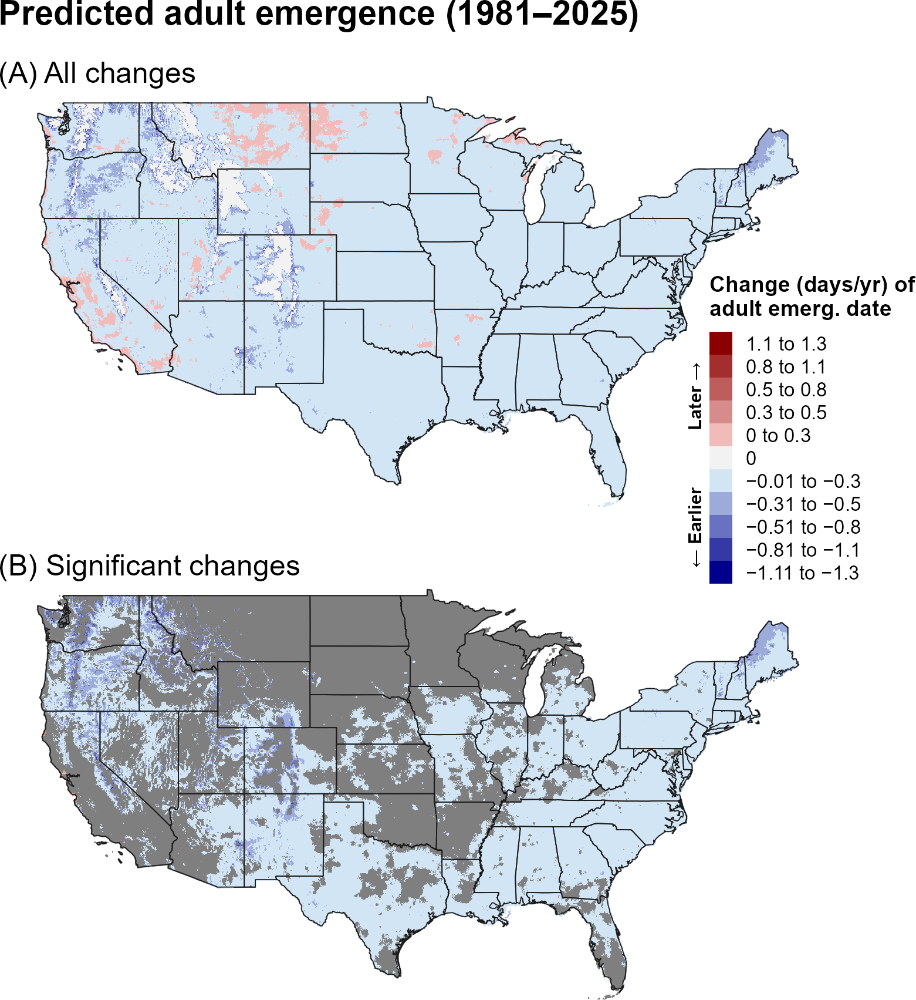
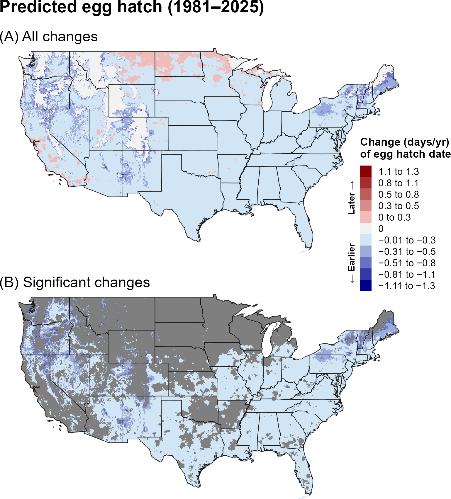
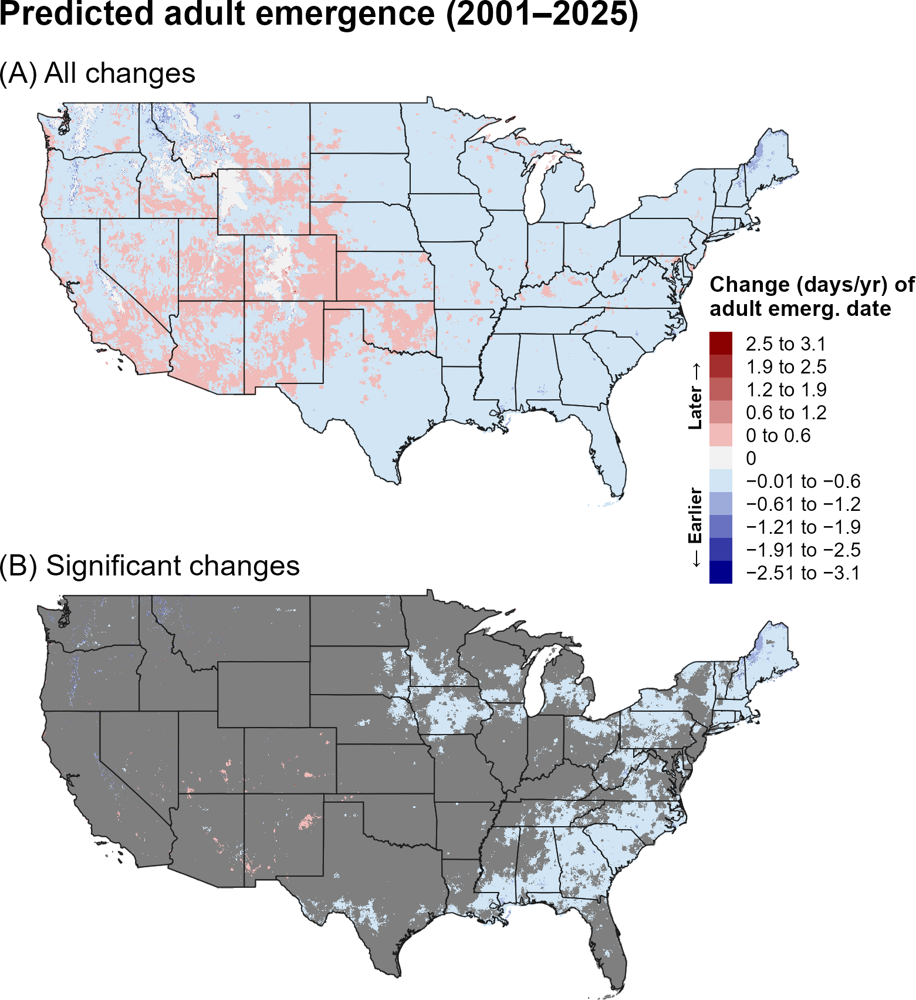
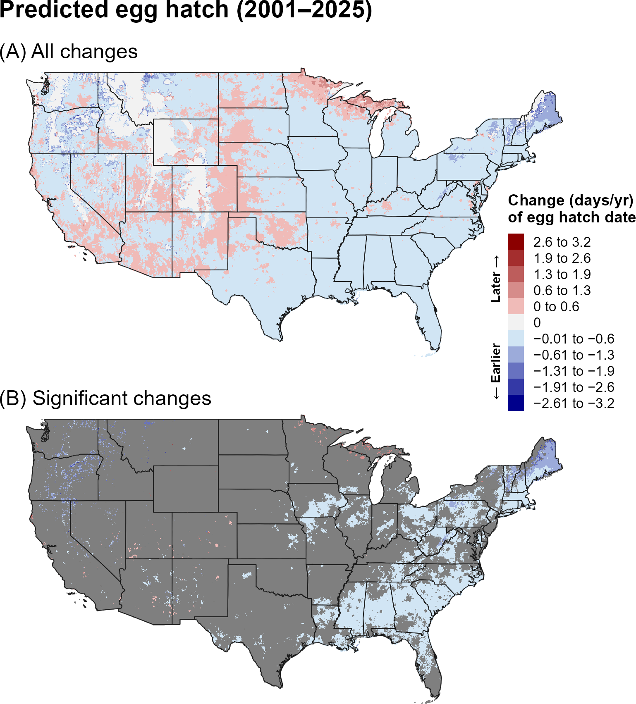
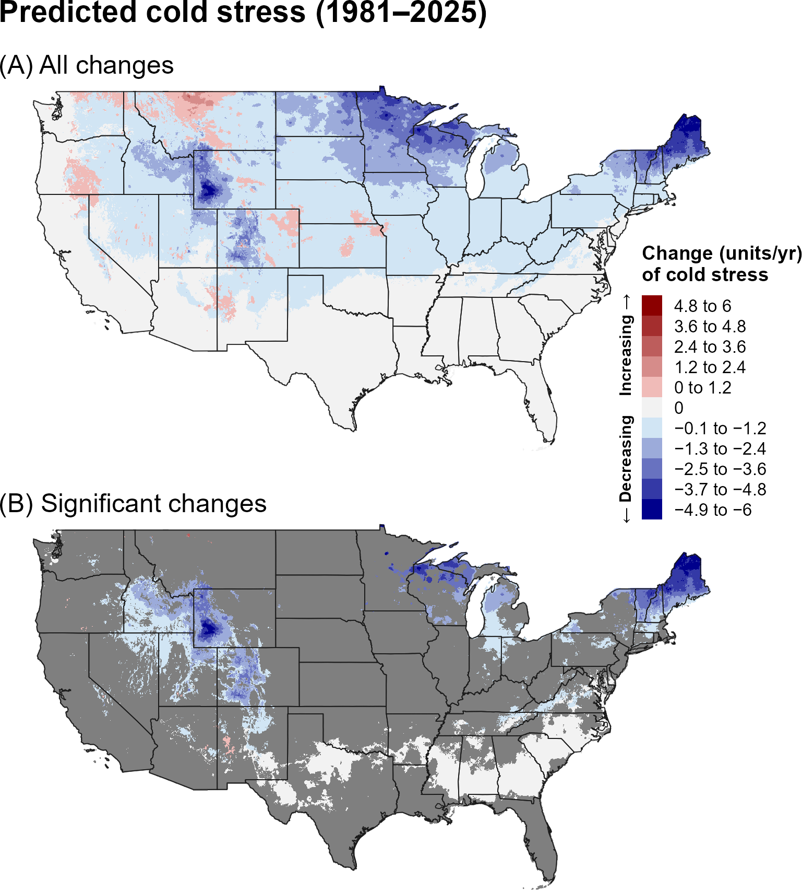
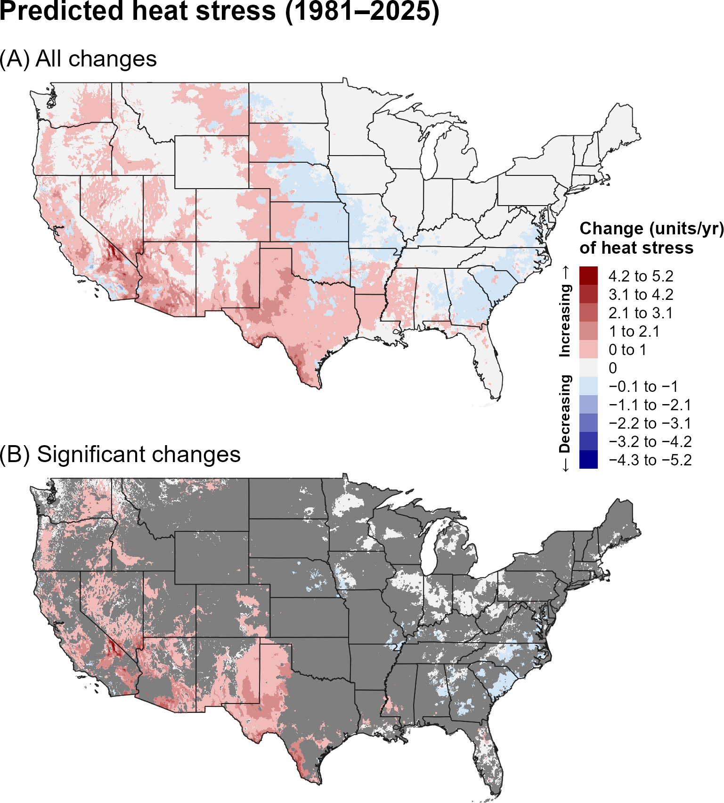
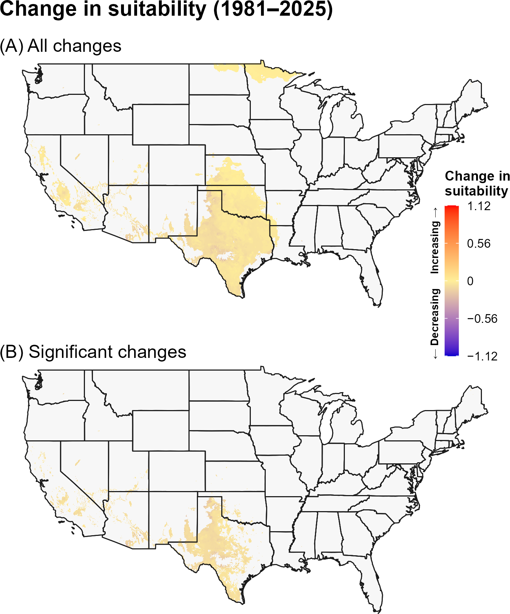
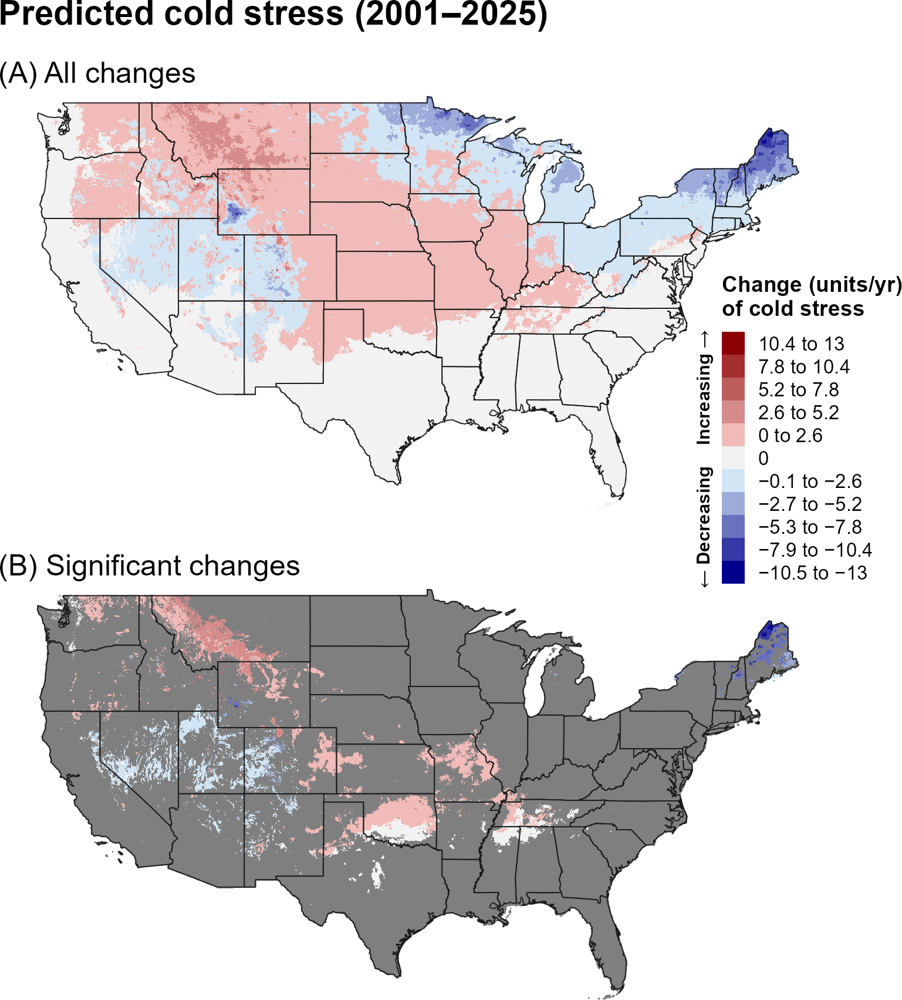
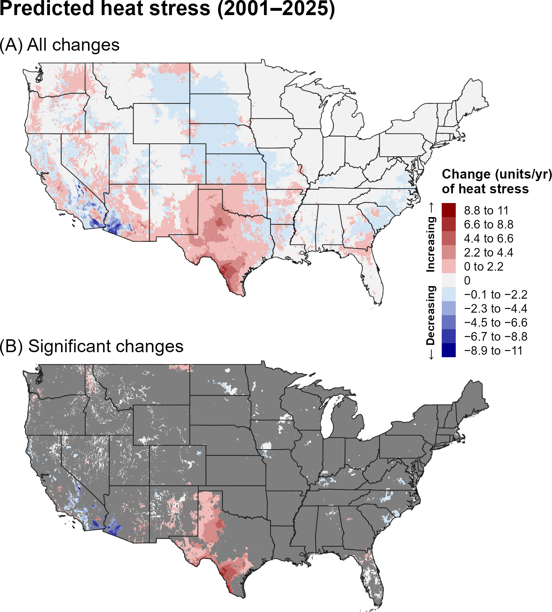
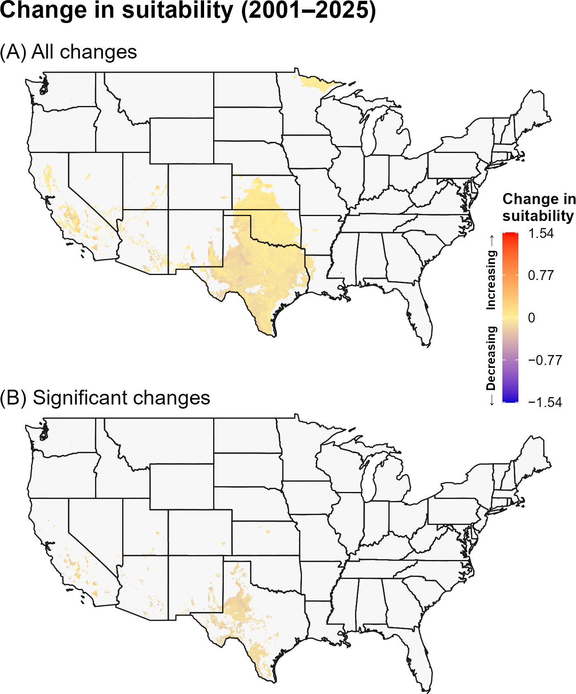

:::: {.content-visible when-format="html"}
::: {style="text-align: left;"}
[Download JPB report as PDF](JPB/JPB.pdf){.btn .btn-primary}
:::
::::

## **7A. Introduction** {.unlisted}

Native to Japan, the Japanese beetle (JPB), *Popillia japonica* Newman (Coleoptera: Scarabaeidae), is a highly polyphagous pest with a host range exceeding 400 plant species, including food crops, fruit trees, turfgrass, and ornamental plant (`\hyperref[ref-fleming-1972]{Fleming 1972}`{=latex}`<a href="#ref-fleming-1972">Fleming 1972</a>`{=html}, `\hyperref[ref-eppo-2025]{EPPO 2025}`{=latex}`<a href="#ref-eppo-2025">EPPO 2025</a>`{=html}, `\hyperref[ref-tayeh-2023]{Tayeh et al. 2023}`{=latex}`<a href="#ref-tayeh-2023">Tayeh et al. 2023</a>`{=html}). Since its initial detection in the United States in 1916 in New Jersey, JPB has spread widely across the eastern and central regions of the country, as well as parts of eastern Canada (`\hyperref[ref-dickerson-1918]{Dickerson and Weiss 1918}`{=latex}`<a href="#ref-dickerson-1918">Dickerson and Weiss 1918</a>`{=html}, `\hyperref[ref-fleming-1972]{Fleming 1972}`{=latex}`<a href="#ref-fleming-1972">Fleming 1972</a>`{=html}, `\hyperref[ref-eppo-2025]{EPPO 2025}`{=latex}`<a href="#ref-eppo-2025">EPPO 2025</a>`{=html}, `\hyperref[ref-althoff-rice-2022]{Althoff and Rice 2022}`{=latex}`<a href="#ref-althoff-rice-2022">Althoff and Rice 2022</a>`{=html}). Although isolated infestations have been successfully eradicated in several western states, including Nevada and California, the beetle persists in localized areas of the Pacific Northwest, including parts of Colorado, British Columbia, Washington, and Oregon (`\hyperref[ref-althoff-rice-2022]{Althoff and Rice 2022}`{=latex}`<a href="#ref-althoff-rice-2022">Althoff and Rice 2022</a>`{=html}, `\hyperref[ref-eppo-2025]{EPPO 2025}`{=latex}`<a href="#ref-eppo-2025">EPPO 2025</a>`{=html}, `\hyperref[ref-stoven-2021]{Stoven et al. 2021}`{=latex}`<a href="#ref-stoven-2021">Stoven et al. 2021</a>`{=html}). Total associated costs of JPB in the United States are estimated at $460 million annually, with $234 million a year spent on control and turf replacement costs (`\hyperref[ref-fleming-1972]{Fleming 1972}`{=latex}`<a href="#ref-fleming-1972">Fleming 1972</a>`{=html}, `\hyperref[ref-usda-aphis-2015]{USDA-APHIS 2015}`{=latex}`<a href="#ref-usda-aphis-2015">USDA-APHIS 2015</a>`{=html}).

A model for JPB developed for the Degree-Day, establishment Risk, and Phenological event mapping system (DDRP) is operationalized to produce near real-time forecasts for the contiguous United States (CONUS) at <https://uspest.org/DDRP>. The full set of model parameters for JPB, including developmental temperature thresholds, degree-day requirements for individual life stages, and climate stress thresholds and limits, are available at USPest.org (`\hyperref[ref-barker-coop-2024]{Barker and Coop 2024}`{=latex}`<a href="#ref-barker-coop-2024">Barker and Coop 2024</a>`{=html}).

## **7B. Results** {.unlisted}

### **i. Phenology**

#### **Entire period: 1981--2025**

Predicted adult emergence and egg hatch for JPB shifted significantly earlier across large portions of CONUS over the entire period (1981–2025), including most East Coast states, parts of the southern and midwestern United States, and the Intermountain West (@fig-jpb-emergence, @fig-jpb-egg-hatch). In these regions, predicted adult emergence and egg hatch decreased by approximately 0.01–0.5 days per year, with some of the largest declines occurring at higher elevations in the northeastern and western United States. 

```{r}
#| echo: false
#| out-width: 70%
#| fig-align: center
#| fig-cap: "Changes (days/year) in predicted dates of first adult emergence for JPB across the CONUS over the entire 44-year period (1981–2025). Maps show (A) all changes and (B) statistically significant changes (P < 0.1); areas shown in gray are not statistically significant."
#| label: fig-jpb-emergence

```

```{r}
#| echo: false
#| out-width: 70%
#| fig-align: center
#| fig-cap: "Changes (days/year) in predicted dates of first egg hatch for JPB across the CONUS over the entire 44-year period (1981–2025). Maps show (A) all changes and (B) statistically significant changes (P < 0.1); areas shown in gray are not statistically significant."
#| label: fig-jpb-egg-hatch

```

#### **Recent period: 2001--2025**

Trends in predictions of first adult emergence and egg hatch for JPB over the recent 24-year period (2001–2025) were partially consistent with those observed over the 1981–2025 period. In the eastern United States, significant trends were similar in magnitude but less spatially extensive (@fig-jpb-emergence-recent, @fig-jpb-egg-hatch-recent), occurring mostly in East coast states and certain parts of the northern Midwest. Most trends in the western United States were not were not significant. In contrast to the longer-term trends, some  isolated areas of the interior West, primarily in the southern Intermountain West, exhibited significant trends toward later phenological events.

```{r}
#| echo: false
#| out-width: 70%
#| fig-align: center
#| fig-cap: "Changes (days/year) in predicted dates of first adult emergence for JPB across the CONUS over the recent 24-year period (2001–2025). Maps show (A) all changes and (B) statistically significant changes (P < 0.1); areas shown in gray are not statistically significant."
#| label: fig-jpb-emergence-recent

```

```{r}
#| echo: false
#| out-width: 70%
#| fig-align: center
#| fig-cap: "Changes (days/year) in predicted dates of first egg hatch for JPB across the CONUS over the recent 24-year period (2001–2025). Maps show (A) all changes and (B) statistically significant changes (P < 0.1); areas shown in gray are not statistically significant."
#| label: fig-jpb-egg-hatch-recent

```

### **ii. Climatic suitability**

#### **Entire period: 1981--2025**

Significant trends in predicted cold stress for JPB over the entire 44-year period (1981–2025) were predominantly negative (@fig-jpb-cold-stress), indicating a general decrease in cold stress over time. In contrast, significant trends in heat stress were largely positive across portions of the South and West, indicating increasing heat stress (@fig-jpb-heat-stress). When annual accumulated stress units exceed limits specified in DDRP models, climatic suitability may change.
Consistent with these trends, suitability for JPB increased in Minnesota, but decreased in portions of the Southwest (@fig-jpb-suitability). However, these changes were statistically significant only in parts the Southwest and California, suggesting that changes in predicted heat stress may reduce the likelihood of JPB establishment in these areas.

```{r}
#| echo: false
#| out-width: 70%
#| fig-align: center
#| fig-cap: "Changes (units/year) in predicted cold stress for JPB across the CONUS over the entire 44-year period (1981–2025). Maps show (A) all changes and (B) statistically significant changes (P < 0.1); areas shown in gray are not statistically significant. Areas shown as 0 in (B) had significant trends but very small changes."
#| label: fig-jpb-cold-stress

```

```{r}
#| echo: false
#| out-width: 70%
#| fig-align: center
#| fig-cap: "Changes (units/year) in predicted heat stress for JPB across the CONUS over the entire 44-year period (1981–2025). Maps show (A) all changes and (B) statistically significant changes (P < 0.1); areas shown in gray are not statistically significant. Areas shown as 0 in (B) had significant trends but very small changes."
#| label: fig-jpb-heat-stress

```

```{r}
#| echo: false
#| out-width: 70%
#| fig-align: center
#| fig-cap: "Changes in predicted climatic suitability for JPB across the CONUS over the 44-year period (1981–2025). Suitability is defined as areas not excluded by climate stress. Positive changes (warmer colors) indicate an increased likelihood of establishment, whereas negative changes (cooler colors) indicate a decreased likelihood of establishment."
#| label: fig-jpb-suitability

```

#### **Recent period: 2001--2025**

Statistically significant trends in predicted heat and cold stress for JPB during the recent period (2001–2025) were more spatially limited than those observed over the entire period (1981–2025) (@fig-jpb-cold-stress-recent, @fig-jpb-heat-stress-recent). Areas with significant increases in heat stress were generally consistent between the two periods, whereas several areas that exhibited significant decreases in cold stress over the entire period, including the Great Lakes region, no longer showed significant trends. Conversely, parts of the Great Plains and Rocky Mountains exhibited significant increases in cold stress during the recent period. Trends in predicted climatic suitability were broadly consistent with those observed over the entire period but were less spatially extensive, with significant decreases in suitability confined to isolated areas of the Southwest and California, where heat stress increased (@fig-jpb-suitability-recent).

```{r}
#| echo: false
#| out-width: 70%
#| fig-align: center
#| fig-cap: "Changes (units/year) in predicted cold stress for JPB across the CONUS over the recent 24-year period (2001–2025). Maps show (A) all changes and (B) statistically significant changes (P < 0.1); areas shown in gray are not statistically significant. Areas shown as 0 in (B) had significant trends but very small changes."
#| label: fig-jpb-cold-stress-recent

```

```{r}
#| echo: false
#| out-width: 70%
#| fig-align: center
#| fig-cap: "Changes (units/year) in predicted heat stress for JPB across the CONUS over the recent 24-year period (2001–2025). Maps show (A) all changes and (B) statistically significant changes (P < 0.1); areas shown in gray are not statistically significant. Areas shown as 0 in (B) had significant trends but very small changes."
#| label: fig-jpb-heat-stress-recent

```

```{r}
#| echo: false
#| out-width: 70%
#| fig-align: center
#| fig-cap: "Changes in predicted climatic suitability for JPB across the CONUS over the recent 24-year period (2001–2025). Suitability is defined as areas not excluded by climate stress. Positive changes (warmer colors) indicate an increased likelihood of establishment, whereas negative changes (cooler colors) indicate a decreased likelihood of establishment."
#| label: fig-jpb-suitability-recent

```

## **7C. Discussion** {.unlisted}

Because JPB is widely established across much of the East and Midwest, trends toward earlier predicted adult emergence and egg hatch could have practical implications for monitoring and management. Pest managers may need to adjust the timing of seasonal activities to maintain their effectiveness. For example, traps targeting adult beetles may need to be deployed earlier to improve early detection of new infestations, while insecticide treatments targeting larvae may need to be applied earlier because first- and second-instar larvae are more susceptible to insecticides than older larvae. Similarly, releases of larval parasitoids, such as *Tiphia vernalis* (Rohwer), may need to be timed to coincide with earlier larval development.

A trend toward earlier phenological events could increase the likelihood of univoltinism in cooler regions. Although JPB is generally univoltine in the United States, semivoltinism has been reported in colder areas, such as New England, where larvae overwinter a second winter as second or third instars in the soil, typically beneath managed turfgrass (`\hyperref[ref-fleming-1972]{Fleming 1972}`{=latex}`<a href="#ref-fleming-1972">Fleming 1972</a>`{=html}, `\hyperref[ref-vittum-1986]{Vittum 1986}`{=latex}`<a href="#ref-vittum-1986">Vittum 1986</a>`{=html}). Consistent with field observations, a CLIMEX model predicted univoltinism across most of the beetle’s current North American range, but semivoltinism in the Northeast and along the United States–Canada border (`\hyperref[ref-kistner-thomas-2019]{Kistner-Thomas 2019}`{=latex}`<a href="#ref-kistner-thomas-2019">Kistner-Thomas 2019</a>`{=html}). 

Although cold stress declined for JPB in northern and high-elevation regions of the CONUS, these changes did not translate into significant shifts in predicted establishment risk. However, previous research linked JPB occurrence at its expanding range edge in the Midwest and Great Plains to minimum temperatures and long-term weather trends (`\hyperref[ref-kucherov-2025]{Kucherov et al. 2025}`{=latex}`<a href="#ref-kucherov-2025">Kucherov et al. 2025</a>`{=html}), suggesting that changes in cold stress could influence its distribution over time. Declining cold stress may also reduce the effectiveness of *Ovavesicula popilliae*, a microsporidian biocontrol agent that increases JPB larval mortality under cold overwintering conditions (`\hyperref[ref-smitley-2026]{Smitley et al. 2026}`{=latex}`<a href="#ref-smitley-2026">Smitley et al. 2026</a>`{=html}). In contrast, Kucherov *et al.* (`\hyperlink{ref-kucherov-2025}{2025}`{=latex}`<a href="#ref-kucherov-2025">2025</a>`{=html}) found negative associations between JPB occurrence and maximum temperature, consistent with our finding of significant declines in predicted climatic suitability across the Southwest and California, where heat stress increased over both the entire (1981–2025) and recent (2001–2025) periods. These declines also align with evidence that JPB survival is low under hot, dry conditions ( `\hyperref[ref-fleming-1972]{Fleming 1972}`{=latex}`<a href="#ref-fleming-1972">Fleming 1972</a>`{=html}, `\hyperref[ref-vittum-1986]{Vittum 1986}`{=latex}`<a href="#ref-vittum-1986">Vittum 1986</a>`{=html}, `\hyperref[ref-allsopp-1996]{Allsopp 1996}`{=latex}`<a href="#ref-allsopp-1996">Allsopp 1996</a>`{=html}).

The stronger and more spatially extensive trends in predicted phenology and climate stress over the entire 44-year period may reflect both the larger sample size, which can reduce noise and improve detection of directional patterns, and differences in the underlying climate trends between the two time periods. In particular, the recent 24-year period may capture climate variability or regional trends that differ from those observed over the longer 44-year period. Thus, differences between the two periods should be interpreted as reflecting both long-term climate trends and shorter-term regional variability.

## **7D. References** {.unlisted}

\begingroup
\setlength{\parindent}{-0.5in}
\setlength{\leftskip}{0.5in}

\noindent

<span id="ref-allsopp-1996"></span>
\phantomsection\label{ref-allsopp-1996}

Allsopp, P. G. 1996. Japanese beetle, *Popillia japonica* Newman (Coleoptera: Scarabaeidae): rate of movement and potential distribution of an immigrant species. The Coleopterists Bulletin 50:81–95.

<span id="ref-althoff-rice-2022"></span>
\phantomsection\label{ref-althoff-rice-2022}

Althoff, E. R., and K. B. Rice. 2022. Japanese beetle (Coleoptera: Scarabaeidae) invasion of North America: history, ecology, and management. Journal of Integrated Pest Management 13:1–11.

<span id="ref-barker-coop-2024"></span>
\phantomsection\label{ref-barker-coop-2024}

Barker, B. S., and L. Coop. 2024. Japanese beetle, *Popillia japonica*. Phenology/degree-day and climate suitability model analysis for USPEST.ORG. Prepared for National Institute of Food and Agriculture, Agriculture and Food Research Initiative, and Tactical Sciences for Agricultural Biosecurity. Vs. 1.0 (11/22/24). Available online: <https://uspest.org/CAPS/Popillia_japonica_white_paper.pdf> (accessed 29 May 2025).

<span id="ref-della-rocca-milanesi-2022"></span>
\phantomsection\label{ref-della-rocca-milanesi-2022}

Della Rocca, F., and P. Milanesi. 2022. The new dominator of the world: modeling the global distribution of the Japanese beetle under land use and climate change scenarios. Land 11:567.

<span id="ref-dickerson-1918"></span>
\phantomsection\label{ref-dickerson-1918}

Dickerson, E.L. and Weiss H.B. (1918). *Popillia japonica* Newman, a recently introduced Japanese pest. Canadian Entomologist 50:217–221.

<span id="ref-eppo-2025"></span>
\phantomsection\label{ref-eppo-2025}

EPPO. 2025. *Popillia japonica*. EPPO datasheets on pests recommended for regulation. Available online: <https://gd.eppo.int> (accessed 5 August 2025).

<span id="ref-fleming-1972"></span>
\phantomsection\label{ref-fleming-1972}

Fleming, W. E. 1972. Biology of the Japanese Beetle. Technical Bulletin No. 1149. United States Department of Agriculture, Agricultural Research Service, Washington D.C. Available online: <http://dx.doi.org/10.22004/ag.econ.171890> (accessed 5 August 2025).

<span id="ref-gilioli-2022"></span>
\phantomsection\label{ref-gilioli-2022}

Gilioli, G., G. Sperandio, A. Simonetto, M. Colturato, A. Battisti, N. Mori, M. Ciampitti, B. Cavagna, A. Bianchi, and P. Gervasio. 2022. Modelling diapause termination and phenology of the Japanese beetle, *Popillia japonica*. Journal of Pest Science 95:869–880.

<span id="ref-kistner-thomas-2019"></span>
\phantomsection\label{ref-kistner-thomas-2019}

Kistner-Thomas, E. J. 2019. The potential global distribution and voltinism of the Japanese beetle (Coleoptera: Scarabaeidae) under current and future climates. Journal of Insect Science 19:6.

<span id="ref-kucherov-2025"></span>
\phantomsection\label{ref-kucherov-2025}

Kucherov NB, Hefley T, Kim TN. 2025. Climate and human-modified landscapes influence spread of invasive agricultural pest *Popillia japonica* Newman in American Midwest and Great Plains. Scientific Reports 15:33013. 

<span id="ref-petty-2015"></span>
\phantomsection\label{ref-petty-2015}

Petty, B. M., D. T. Johnson, and D. C. Steinkraus. 2015. Changes in abundance of larvae and adults of *Popillia japonica* (Coleoptera: Scarabaeidae: Rutelinae) and other white grub species in Northwest Arkansas and their relation to regional temperatures. Florida Entomologist 98:1006–1008.

<span id="ref-pulighe-2025"></span>
\phantomsection\label{ref-pulighe-2025}

Pulighe, G., F. Lupia, and V. Manente. 2025. Climate-driven invasion risks of Japanese beetle (*Popillia japonica* Newman) in Europe predicted through species distribution modelling. Agriculture 15:684.

<span id="ref-pulighe-2025"></span>
\phantomsection\label{ref-smitley-2026}

Smitley D, Krischik V, Lewis P, Nomura Y, Cranshaw W, Deans C, Parkanzky E, Guédot C, Hajek AE. 2026. Biological and microbial control: increasing prevalence of *Ovavesicula popilliae* (Microsporidia), a pathogen of Japanese beetle (Coleoptera: Scarabaeidae), in the Midwest and North-central United States from 1999 to 2025. Journal of Economic Entomology:toag249.

<span id="ref-stoven-2021"></span>
\phantomsection\label{ref-stoven-2021}

Stoven, H., J. Rendon, and G. Langellotto-Rhodaback. 2021. Japanese Beetles in Oregon. Oregon State University Extension Service. Available online: <https://extension.oregonstate.edu/sites/extd8/files/documents/em9158.pdf> (accessed 16 December 2025).

<span id="ref-tayeh-2023"></span>
\phantomsection\label{ref-tayeh-2023}

Tayeh, C., C. Poggi, N. Desneuex, H. Jactel, and F. Verheggen. 2023. Host plants of *Popillia japonica*: a review. Data INRAE. Available online: <https://doi.org/10.57745/SXZNQF> (accessed 29 May 2025).

<span id="ref-usda-aphis-2015"></span>
\phantomsection\label{ref-usda-aphis-2015}

USDA-APHIS. 2015. Managing the Japanese beetle: A homeowner’s handbook. APHIS Publication 81-25-003. United States Department of Agriculture, Animal and Plant Health Inspection Service, Washington D.C. Available online: <https://www.aphis.usda.gov/sites/default/files/JBhandbook.pdf> (accessed 5 Feb 2025).

<span id="ref-vittum-1986"></span>
\phantomsection\label{ref-vittum-1986}

Vittum, P. J. 1986. Biology of the Japanese beetle (Coleoptera: Scarabaeidae) in eastern Massachusetts. Journal of Economic Entomology 79:387–391.

\par
\endgroup
