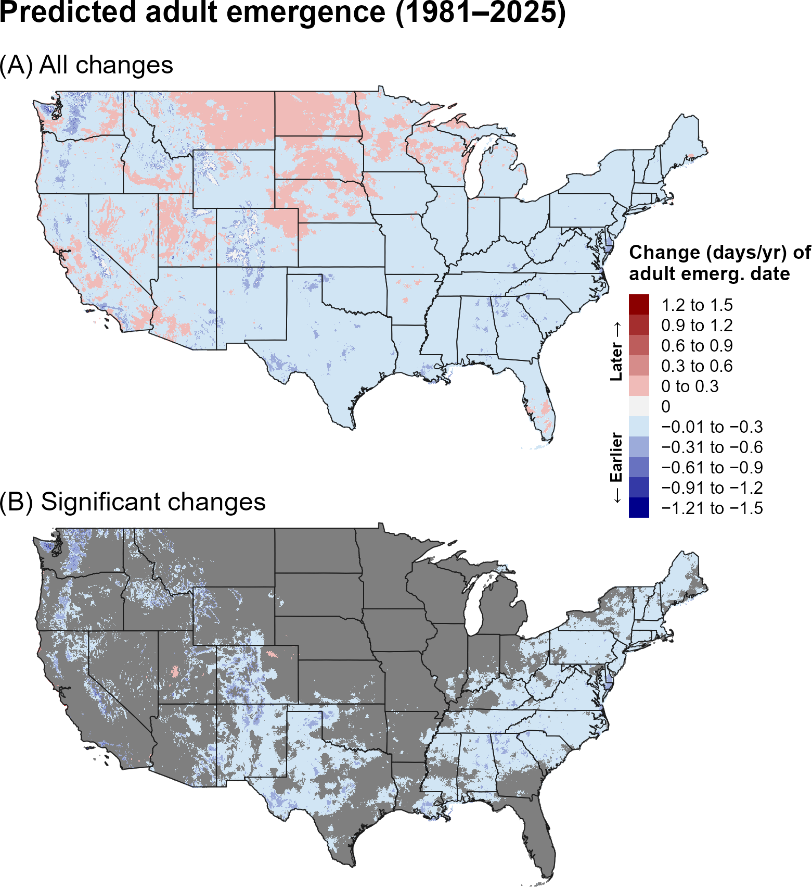
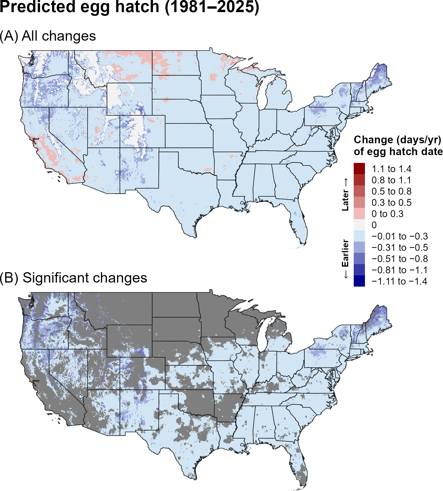
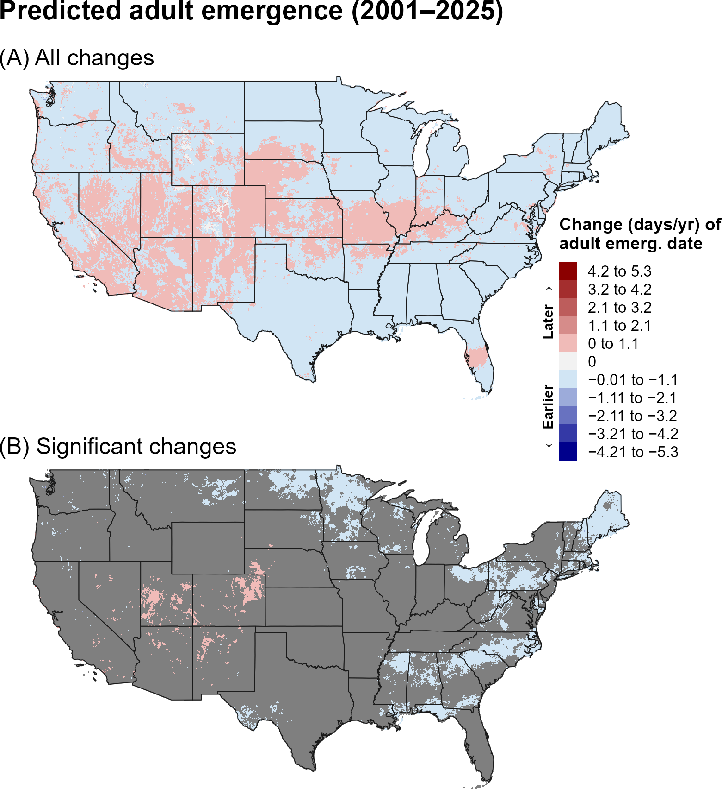
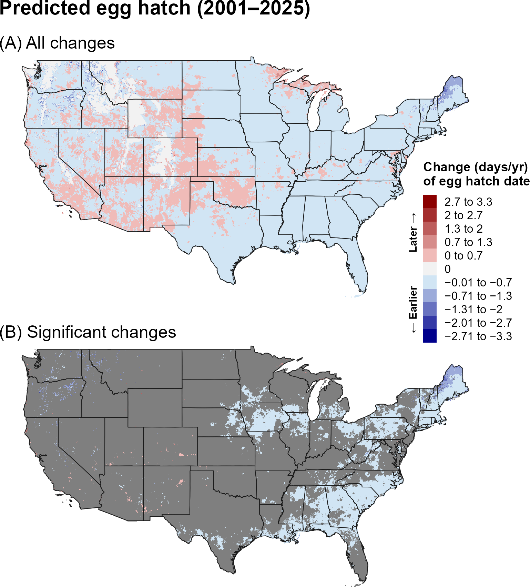
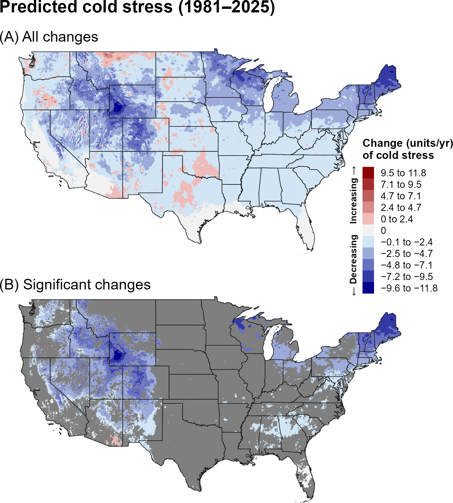
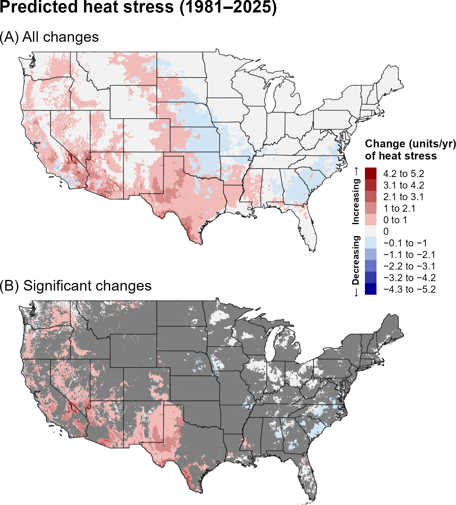
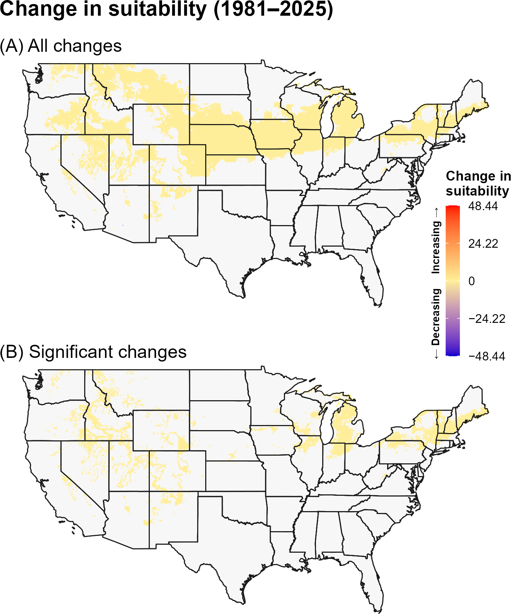
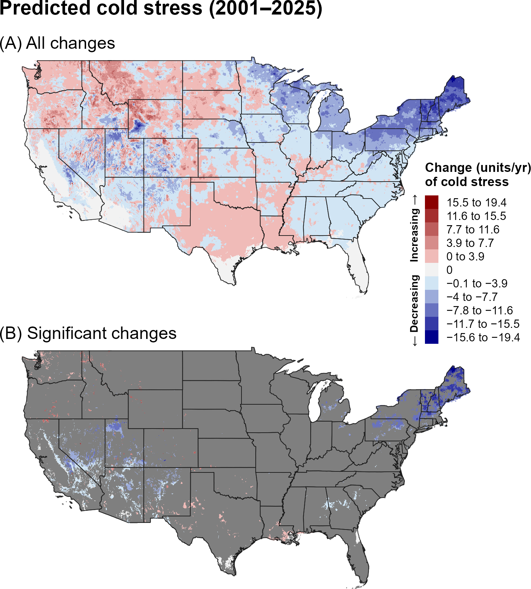
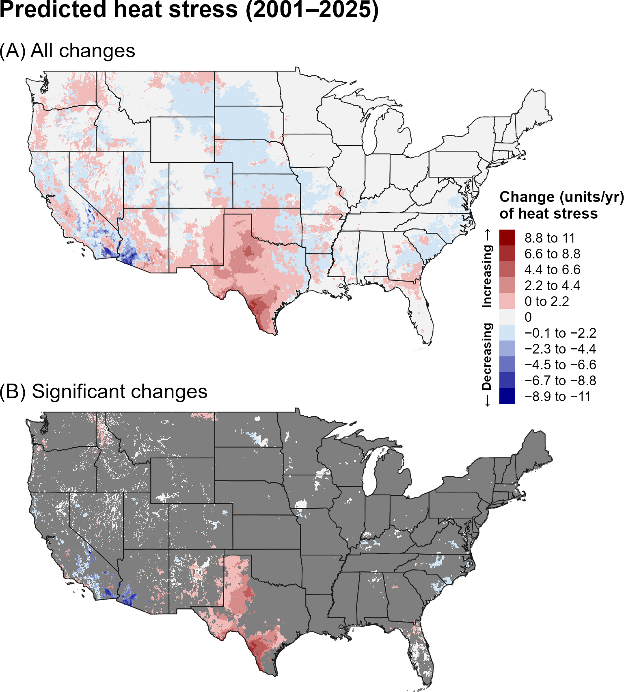
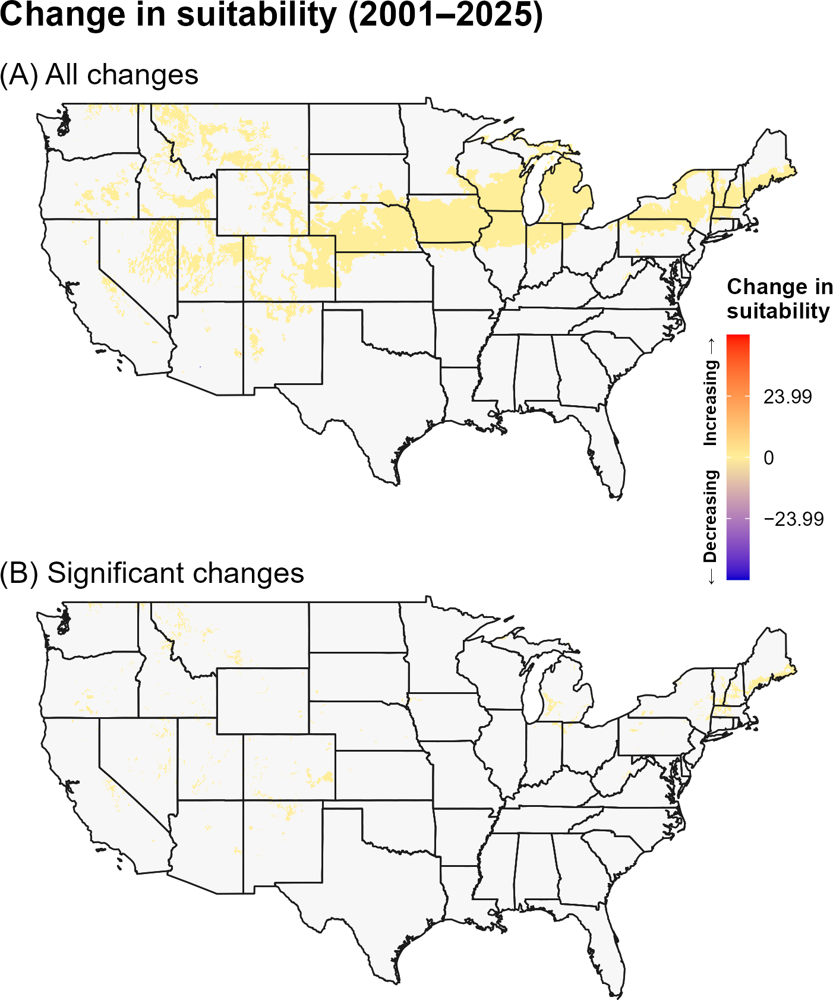

:::: {.content-visible when-format="html"}
::: {style="text-align: left;"}
[Download JPSB report as PDF](JPSB.pdf){.btn .btn-primary}
:::
::::

## **8A. Introduction** {.unlisted}

The Japanese pine sawyer beetle (JPSB), *Monochamus alternatus* Hope (Coleoptera: Cerambycidae), is a major vector of nematodes that cause pine wilt disease, primarily *Bursaphelenchus xylophilus*, commonly known as the pine wilt nematode or pinewood nematode (`\hyperref[ref-vicente-2012]{Vicente et al. 2012}`{=latex}`<a href="#ref-vicente-2012">Vicente et al. 2012</a>`{=html}, `\hyperref[ref-eppo-2024]{EPPO 2024}`{=latex}`<a href="#ref-eppo-2024">EPPO 2024</a>`{=html}). Native to East Asia, including mainland China, Taiwan, Laos, Korea, and Japan, JPSB has expanded its range to other parts of Asia, including Vietnam (`\hyperref[ref-kobayashi-1984]{Kobayashi et al. 1984}`{=latex}`<a href="#ref-kobayashi-1984">Kobayashi et al. 1984</a>`{=html}, `\hyperref[ref-eppo-2024]{EPPO 2024}`{=latex}`<a href="#ref-eppo-2024">EPPO 2024</a>`{=html}). The pest primarily attacks conifers, particularly *Pinus*, *Abies*, *Picea*, *Larix*, and *Cedrus*, although some hardwood genera, such as *Malus* and *Acer*, may also serve as occasional hosts (`\hyperref[ref-kobayashi-1984]{Kobayashi et al. 1984}`{=latex}`<a href="#ref-kobayashi-1984">Kobayashi et al. 1984</a>`{=html}, `\hyperref[ref-eppo-2024]{EPPO 2024}`{=latex}`<a href="#ref-eppo-2024">EPPO 2024</a>`{=html}). Pine wilt disease has caused extensive tree mortality and substantial economic losses where it has been introduced, particularly in Asia and Europe (`\hyperref[ref-vicente-2012]{Vicente et al. 2012}`{=latex}`<a href="#ref-vicente-2012">Vicente et al. 2012</a>`{=html}, `\hyperref[ref-an-2019]{An et al. 2019}`{=latex}`<a href="#ref-an-2019">An et al. 2019</a>`{=html}). JPSB is not known to be established in the United States. Although it was detected in Mississippi in 2020, the introduced population was subsequently eradicated. Historically, most U.S. interceptions of *Monochamus* species have occurred in general cargo associated with wood, crating, and dunnage (`\hyperref[ref-haack-cavey-2000]{Haack and Cavey 2000}`{=latex}`<a href="#ref-haack-cavey-2000">Haack and Cavey 2000</a>`{=html}). Live adults were also discovered in infested crating at a warehouse in western New York in 1998 (`\hyperref[ref-caps-2013]{CAPS 2013}`{=latex}`<a href="#ref-caps-2013">CAPS 2013</a>`{=html}). More recently, a study conducted by U.S. Customs and Border Protection and APHIS at 11 U.S. ports documented eight interceptions of live JPSB in pine wood packaging material originating from China between 2012 and 2018 (`\hyperref[ref-krishnankutty-2020]{Krishnankutty 2020}`{=latex}`<a href="#ref-krishnankutty-2020">Krishnankutty 2020</a>`{=html}). 

Adult JPSB acquire and transmit nematodes while feeding on healthy pine trees, with infection disrupting xylem function and causing wilt and, in susceptible trees, death within weeks (`\hyperref[ref-kobayashi-1984]{Kobayashi et al. 1984}`{=latex}`<a href="#ref-kobayashi-1984">Kobayashi et al. 1984</a>`{=html}, `\hyperref[ref-vicente-2012]{Vicente et al. 2012}`{=latex}`<a href="#ref-vicente-2012">Vicente et al. 2012</a>`{=html}). Females primarily oviposit in weakened or diseased trees, where larvae develop beneath the bark and in the sapwood. Nematodes subsequently associate with newly emerging adults, completing the transmission cycle (`\hyperref[ref-kobayashi-1984]{Kobayashi et al. 1984}`{=latex}`<a href="#ref-kobayashi-1984">Kobayashi et al. 1984</a>`{=html}, `\hyperref[ref-an-2019]{An et al. 2019}`{=latex}`<a href="#ref-an-2019">An et al. 2019</a>`{=html}). Although *B. xylophilus* is native to North America and generally causes little damage in its native range, JPSB may also serve as a vector for other nematode species not currently present in North America (`\hyperref[ref-caps-2013]{CAPS 2013}`{=latex}`<a href="#ref-caps-2013">CAPS 2013</a>`{=html}, `\hyperref[ref-an-2019]{An et al. 2019}`{=latex}`<a href="#ref-an-2019">An et al. 2019</a>`{=html}). Recorded hosts for *B. xylophilus* include several pine species native to the eastern United States, including loblolly pine (*Pinus taeda*), longleaf pine (*P. palustris*), and eastern white pine (*P. strobus*) (`\hyperref[ref-caps-2013]{CAPS 2013}`{=latex}`<a href="#ref-caps-2013">CAPS 2013</a>`{=html}). Several introduced species commonly planted in the United States, including Scots pine (*P. sylvestris*), Austrian pine (*P. nigra*), and Japanese black pine (*P. thunbergii*), are also susceptible to pine wilt disease (`(\hyperref[ref-caps-2013]{CAPS 2013}`{=latex}`<a href="#ref-caps-2013">CAPS 2013</a>`{=html}, `\hyperref[ref-donald-2016]{Donald et al. 2016}`{=latex}`<a href="#ref-donald-2016">Donald et al. 2016</a>`{=html}). Drought stress may further increase host vulnerability to nematode-induced hydraulic dysfunction and mortality (`\hyperref[ref-suzuki-1978]{Suzuki and Kiyohara 1978}`{=latex}`<a href="#ref-suzuki-1978">Suzuki and Kiyohara 1978</a>`{=html}).

A model for JPSB developed for the Degree-Day, establishment Risk, and Phenological event mapping system (DDRP) is operationalized to produce near real-time forecasts for the contiguous United States (CONUS) at <https://uspest.org/DDRP>. The full set of model parameters for FCM, including developmental temperature thresholds, degree-day requirements for individual life stages, and climate stress thresholds and limits, are available at USPest.org (`\hyperref[ref-barker-coop-2020]{Barker and Coop 2020}`{=latex}`<a href="#ref-barker-coop-2020">Barker and Coop 2020</a>`{=html}).

## **8B. Results** {.unlisted}

### **i. Phenology**

#### **Entire period: 1981--2025**

Predicted adult emergence and egg hatch for JPSB shifted significantly (P < 0.01) earlier across large portions of CONUS over the entire period (1981–2025), including most East Coast states, parts of the South and Midwest, and the Intermountain West (@fig-jpsb-emergence, @fig-jpsb-egg-hatch). In these regions, predicted adult emergence and egg hatch decreased by approximately 0.01–0.5 days per year, with some of the largest declines occurring at higher elevations in the Northeast and Intermountain West.

```{r}
#| echo: false
#| out-width: 70%
#| fig-align: center
#| fig-cap: "Changes (days/year) in predicted dates of first adult emergence for JPSB across the CONUS over the entire 44-year period (1981–2025). Maps show (A) all changes and (B) statistically significant changes (P < 0.1); areas shown in gray are not statistically significant."
#| label: fig-jpsb-emergence

```

```{r}
#| echo: false
#| out-width: 70%
#| fig-align: center
#| fig-cap: "Changes (days/year) in predicted dates of first egg hatch for JPSB across the CONUS over the entire 44-year period (1981–2025). Maps show (A) all changes and (B) statistically significant changes (P < 0.1); areas shown in gray are not statistically significant."
#| label: fig-jpsb-egg-hatch

```

#### **Recent period: 2001--2025**

Trends in predictions of first adult emergence and egg hatch for JPSB over the recent 24-year period (2001–2025) were partially consistent with those observed over the 1981–2025 period. In the eastern United States, significant trends were similar in magnitude but less spatially extensive (@fig-jpsb-emergence-recent, @fig-jpsb-egg-hatch-recent), occurring mostly in East Coast states and the Upper Midwest. Most trends in the West were not significant. In contrast to the longer-term trends, some isolated areas of the interior West, primarily in the southern Intermountain West, exhibited significant trends toward later phenological events.

```{r}
#| echo: false
#| out-width: 70%
#| fig-align: center
#| fig-cap: "Changes (days/year) in predicted dates of first adult emergence for JPSB across the CONUS over the recent 24-year period (2001–2025). Maps show (A) all changes and (B) statistically significant changes (P < 0.1); areas shown in gray are not statistically significant."
#| label: fig-jpsb-emergence-recent

```

```{r}
#| echo: false
#| out-width: 70%
#| fig-align: center
#| fig-cap: "Changes (days/year) in predicted dates of first egg hatch for JPSB across the CONUS over the recent 24-year period (2001–2025). Maps show (A) all changes and (B) statistically significant changes (P < 0.1); areas shown in gray are not statistically significant."
#| label: fig-jpsb-egg-hatch-recent

```

### **ii. Climatic suitability**

#### **Entire period: 1981--2025**

Significant trends in predicted cold stress for JPSB over the entire 44-year period (1981–2025) were predominantly negative (@fig-jpsb-cold-stress), indicating a general decrease in cold stress over time. In contrast, significant trends in heat stress were largely positive across portions of the South and West, indicating increasing heat stress (@fig-jpsb-heat-stress). When annual accumulated stress units exceed limits specified in DDRP models, climatic suitability may change. Consistent with these trends, suitability for JPSB increased in parts of the Northeast, Midwest, and Intermountain West (@fig-jpsb-suitability), although these changes were statistically significant only in some areas.

```{r}
#| echo: false
#| out-width: 70%
#| fig-align: center
#| fig-cap: "Changes (units/year) in predicted cold stress for JPSB across the CONUS over the entire 44-year period (1981–2025). Maps show (A) all changes and (B) statistically significant changes (P < 0.1); areas shown in gray are not statistically significant. Areas shown as 0 in (B) had significant trends but very small changes."
#| label: fig-jpsb-cold-stress

```

```{r}
#| echo: false
#| out-width: 70%
#| fig-align: center
#| fig-cap: "Changes (units/year) in predicted heat stress for JPSB across the CONUS over the entire 44-year period (1981–2025). Maps show (A) all changes and (B) statistically significant changes (P < 0.1); areas shown in gray are not statistically significant. Areas shown as 0 in (B) had significant trends but very small changes."
#| label: fig-jpsb-heat-stress

```

```{r}
#| echo: false
#| out-width: 70%
#| fig-align: center
#| fig-cap: "Changes in predicted climatic suitability for JPSB across the CONUS over the entire 44-year period (1981–2025). Suitability is defined as areas not excluded by climate stress. Positive changes (warmer colors) indicate an increased likelihood of establishment, whereas negative changes (cooler colors) indicate a decreased likelihood of establishment."
#| label: fig-jpsb-suitability

```

#### **Recent period: 2001--2025**

Many areas that exhibited significant decreases in cold stress for JPSB over 1981–2025 no longer showed significant trends during the recent period. These areas were concentrated in scattered patches across the Northeast and higher-elevation parts of the Southwest (@fig-jpsb-cold-stress-recent). Significant increases in predicted cold stress occurred in a few small, isolated areas of the South and Northwest. Areas with increasing heat stress were concentrated in the Southwest, particularly Texas, whereas parts of California showed significant decreases (@fig-jpsb-heat-stress-recent). The climatic-suitability map showed relatively limited significant change, although increases remained evident in isolated areas of the Northeast, Midwest, and Intermountain West (@fig-jpsb-suitability-recent).

```{r}
#| echo: false
#| out-width: 70%
#| fig-align: center
#| fig-cap: "Changes (units/year) in predicted cold stress for JPSB across the CONUS over the recent 24-year period (2001–2025). Maps show (A) all changes and (B) statistically significant changes (P < 0.1); areas shown in gray are not statistically significant. Areas shown as 0 in (B) had significant trends but very small changes."
#| label: fig-jpsb-cold-stress-recent

```

```{r}
#| echo: false
#| out-width: 70%
#| fig-align: center
#| fig-cap: "Changes (units/year) in predicted heat stress for JPSB across the CONUS over the recent 24-year period (2001–2025). Maps show (A) all changes and (B) statistically significant changes (P < 0.1); areas shown in gray are not statistically significant. Areas shown as 0 in (B) had significant trends but very small changes."
#| label: fig-jpsb-heat-stress-recent

```

```{r}
#| echo: false
#| out-width: 70%
#| fig-align: center
#| fig-cap: "Changes in predicted climatic suitability for JPSB across the CONUS over the recent 24-year period (2001–2025). Suitability is defined as areas not excluded by climate stress. Positive changes (warmer colors) indicate an increased likelihood of establishment, whereas negative changes (cooler colors) indicate a decreased likelihood of establishment."
#| label: fig-jpsb-suitability-recent

```

## **8C. Discussion** {.unlisted}

Although JPSB is not established in the CONUS, understanding potential changes in phenology can inform surveillance planning. In areas exhibiting significant trends toward earlier phenology, predicted dates shifted earlier by approximately 0.01–0.5 days per year, suggesting that surveillance materials may need to be deployed earlier in the season. These trends may be particularly relevant in the Southeast and Midwest, where extensive pine forests and plantations include introduced species such as *P. sylvestris*, *P. nigra*, and *P. thunbergii* that are susceptible to infection by *B. xylophilus* (`\hyperref[ref-wingfield-1986]{Wingfield et al. 1986}`{=latex}`<a href="#ref-wingfield-1986">Wingfield et al. 1986</a>`{=html}, `\hyperref[ref-caps-2013]{CAPS 2013}`{=latex}`<a href="#ref-caps-2013">CAPS 2013</a>`{=html}, `\hyperref[ref-donald-2016]{Donald et al. 2016}`{=latex}`<a href="#ref-donald-2016">Donald et al. 2016</a>`{=html}).

JPSB undergoes winter diapause primarily during the final larval instar, with diapause termination dependent on winter chilling requirements and subsequent temperature-driven development (`\hyperref[ref-togashi-1995]{Togashi 1995}`{=latex}`<a href="#ref-togashi-1995">Togashi 1995</a>`{=html}, `\hyperref[ref-go-2026]{Go et al. 2026}`{=latex}`<a href="#ref-go-2026">Go et al. 2026</a>`{=html}). Climate-driven changes in winter and spring temperatures could therefore alter the timing of diapause termination and first adult emergence, while warmer growing-season temperatures could accelerate development and increase the potential for additional generations. The number of generations completed annually by JPSB varies geographically, ranging from univoltine or semivoltine development in colder parts of its native range to 2–3 generations in warmer regions of subtropical and tropical China (`\hyperref[ref-togashi-1989]{Togashi 1989}`{=latex}`<a href="#ref-togashi-1989">Togashi 1989</a>`{=html}, `\hyperref[ref-caps-2013]{CAPS 2013}`{=latex}`<a href="#ref-caps-2013">CAPS 2013</a>`{=html}, `\hyperref[ref-togashi-sugimoto-2024]{Togashi and Sugimoto 2024}`{=latex}`<a href="#ref-togashi-sugimoto-2024">Togashi and Sugimoto 2024</a>`{=html}). Within environmentally suitable areas of the CONUS, JPSB is predicted to complete at least one generation annually, with up to four generations in the South (`\hyperref[ref-barker-coop-2020]{Barker and Coop 2020}`{=latex}`<a href="#ref-barker-coop-2020">Barker and Coop 2020</a>`{=html}). Earlier emergence and increased voltinism could have important epidemiological implications by creating additional opportunities for *B. xylophilus* transmission, increasing the number of nematode-carrying adults emerging from infested trees, and potentially accelerating pine wilt disease spread and increasing tree mortality in susceptible pine populations (`\hyperref[ref-togashi-sugimoto-2024]{Togashi and Sugimoto 2024}`{=latex}`<a href="#ref-togashi-sugimoto-2024">Togashi and Sugimoto 2024</a>`{=html}).

Declining cold stress and associated increases in climatic suitability for JPSB across portions of the Northeast, Midwest, and Intermountain West suggest that these regions may be becoming increasingly conducive to establishment. Previous modeling studies identified suitable climates for JPSB across much of the South and Midwest, while low temperatures were predicted to constrain establishment in colder regions, including the Northeast and high-elevation areas of the Intermountain West (`\hyperref[ref-song-2006]{Song and Xu 2006}`{=latex}`<a href="#ref-song-2006">Song and Xu 2006</a>`{=html}, `\hyperref[ref-barker-coop-2020]{Barker and Coop 2020}`{=latex}`<a href="#ref-barker-coop-2020">Barker and Coop 2020</a>`{=html}, `\hyperref[ref-gao-2023]{Gao et al. 2023}`{=latex}`<a href="#ref-gao-2023">Gao et al. 2023</a>`{=html}). Our findings suggest that these climatic constraints may be relaxing, potentially increasing establishment potential in regions previously considered less suitable. This is particularly concerning in the Midwest, where the presence of susceptible pine hosts could increase the consequences of JPSB establishment and subsequent pinewood nematode transmission. Although previous models also identified climatically suitable areas along the West Coast, including much of California (`\hyperref[ref-song-2006]{Song and Xu 2006}`{=latex}`<a href="#ref-song-2006">Song and Xu 2006</a>`{=html}, `\hyperref[ref-barker-coop-2020]{Barker and Coop 2020}`{=latex}`<a href="#ref-barker-coop-2020">Barker and Coop 2020</a>`{=html}), we detected few significant temporal trends in suitability across this state. 

The stronger and more spatially extensive trends in predicted phenology and climate stress over the entire 44-year period likely reflect both the greater number of years included, which may reduce interannual variability and improve the detection of directional trends, and differences in the underlying climatic trends between the two study periods. In particular, the recent 24-year period may capture climate variability or regional trends that differ from those observed over the longer 44-year period. Thus, differences between the two periods should be interpreted as reflecting both long-term climate trends and shorter-term regional variability.

## **8D. References** {.unlisted}

\begingroup
\setlength{\parindent}{-0.5in}
\setlength{\leftskip}{0.5in}

\noindent

<span id="ref-an-2019"></span>
\phantomsection\label{ref-an-2019}

An, H., S. Lee, and S. J. Cho. 2019. The effects of climate change on pine wilt disease in South Korea: Challenges and prospects. Forests 10:486.

<span id="ref-barker-coop-2020"></span>
\phantomsection\label{ref-barker-coop-2020}

Barker, B. S., and L. Coop. 2020. Japanese pine sawyer beetle, *Monochamus alternatus*.  Phenology/degree-day and climate suitability white paper for USPEST.ORG. Prepared for United States Department of Agriculture (USDA) – Animal and Plant Health Inspection Service (APHIS) – Plant Protection and Quarantine (PPQ). Vs. 1.0 (2/26/2020). Available online: <https://uspest.org/CAPS/Monochamus_alternatus_white_paper.pdf> (accessed 13 September 2025).

<span id="ref-caps-2013"></span>
\phantomsection\label{ref-caps-2013}

Cooperative Agricultural Pest Survey (CAPS). 2013. Exotic Wood Borer/Bark Beetle Survey Reference, *Monochamus alternatus* (Hope). USDA-APHIS-PPQ-CPHST (updated 29 July 2016). Available online: <https://caps.ceris.purdue.edu/wp-content/uploads/2025/07/Monochamus-alternatus_EWBB_2015.pdf> (accessed 18 September 2025).

<span id="ref-donald-2016"></span>
\phantomsection\label{ref-donald-2016}

Donald, P. A., W. T. Stamps, M. J. Linit, and T. C. Todd. 2016. Pine wilt. The Plant Health Instructor. Online at: https://doi.org/10.1094/PHI-I-2003-0130-01 (accessed 16 November 2026).

<span id="ref-eppo-2024"></span>
\phantomsection\label{ref-eppo-2024}

EPPO. 2024. *Monochamus alternatus*. EPPO datasheets on pests recommended for regulation. Online at: <https://gd.eppo.int/> (accessed 13 September 2025).

<span id="ref-gao-2023"></span>
\phantomsection\label{ref-gao-2023}

Gao, R., L. Liu, L. Zhao, and S. Cui. 2023. Potentially suitable geographical area for *Monochamus alternatus* under current and future climatic scenarios based on optimized MaxEnt model. Insects 14:182.

<span id="ref-go-2026"></span>
\phantomsection\label{ref-go-2026}

Go, M. S., S. H. Kwon, and D. S. Kim. 2026. A conceptual model for the diapause intensity curve and termination in overwintering Japanese pine sawyer larvae, *Monochamus alternatus* (Coleoptera: Cerambycidae). Physiological Entomology 51:226–236.

<span id="ref-haack-cavey-2000"></span>
\phantomsection\label{ref-haack-cavey-2000}

Haack, R. A., and J. F. Cavey. 2000. Insects intercepted on solid wood packing materials at United States ports-of-entry: 1985–1998. In Proceedings of the International Conference on Quarantine Pests for the Forestry Sector and Their Effects on Foreign Trade (27–28 June 2000, Concepción, Chile). CORMA. 16 pp.

<span id="ref-kobayashi-1984"></span>
\phantomsection\label{ref-kobayashi-1984}

Kobayashi, F., A. Yamane, and T. Ikeda. 1984. The Japanese pine sawyer beetle as the vector of pine wilt disease. Annual Review of Entomology 29:115–135.

<span id="ref-krishnankutty-2020"></span>
\phantomsection\label{ref-krishnankutty-2020}

Krishnankutty, S., H. Nadel, A. M. Taylor, M. C. Wiemann, Y. Wu, S. W. Lingafelter, S. W. Myers, and A. M. Ray. 2020. Identification of tree genera used in the construction of solid wood-packaging materials that arrived at U.S. ports infested with live wood-boring insects. Journal of Economic Entomology 113:1183-1194.

<span id="ref-song-2006"></span>
\phantomsection\label{ref-song-2006}

Song, H.-M., and R.-M. Xu. 2006. Global potential geographical distribution of *Monochamus alternatus*. Chinese Bulletin of Entomology 43:535–539.

<span id="ref-suzuki-1978"></span>
\phantomsection\label{ref-suzuki-1978}

Suzuki, K., and T. Kiyohara. 1978. Influence of water stress on development of pine wilting disease caused by *Bursaphelenchus lignicolus*. European Journal of Forest Pathology 8:97-107. 

<span id="ref-togashi-1989"></span>
\phantomsection\label{ref-togashi-1989}

Togashi, K. 1989. Development of *Monochamus alternatus* Hope (Coleoptera: Cerambycidae) in relation to oviposition time. Japanese Journal of Applied Entomology and Zoology 33:1–8.

<span id="ref-togashi-1995"></span>
\phantomsection\label{ref-togashi-1995}

Togashi, K. 1995. Interacting effects of temperature and photoperiod on diapause in larvae of *Monochamus alternatus* (Coleoptera: Cerambycidae). Japanese Journal of Entomology 63:243–252.

<span id="ref-togashi-sugimoto-2024"></span>
\phantomsection\label{ref-togashi-sugimoto-2024}

Togashi, K., and Sugimoto, H. 2024. Copulation duration and sperm precedence with reference to larval diapause induction in *Monochamus alternatus* Hope (Coleoptera: Cerambycidae). Insects 15:255.

<span id="ref-wingfield-1986"></span>
\phantomsection\label{ref-wingfield-1986}

Wingfield, M. J., P. J. Bedker, and R. A. Blanchette. 1986. Pathogenicity of *Bursaphelenchus xylophilus* on pines in Minnesota and Wisconsin. Journal of Nematology 18:44–49.

<span id="ref-vicente-2012"></span>
\phantomsection\label{ref-vicente-2012}

Vicente, C., M. Espada, P. Vieira, and M. Mota. 2012. Pine wilt disease: a threat to European forestry. European Journal of Plant Pathology 133:89–99.

\par
\endgroup