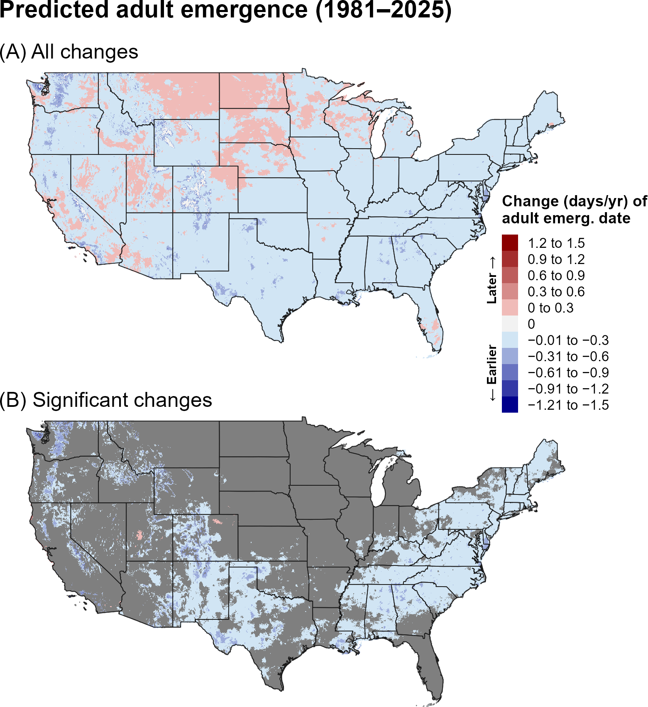
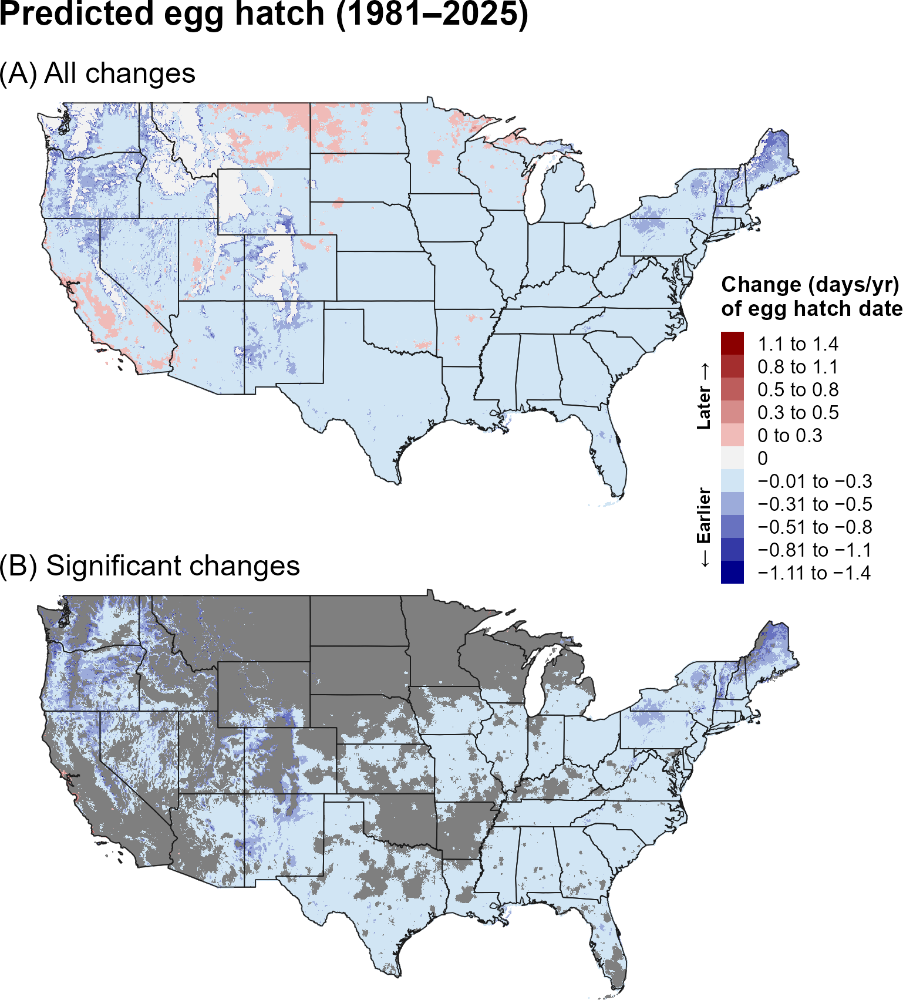
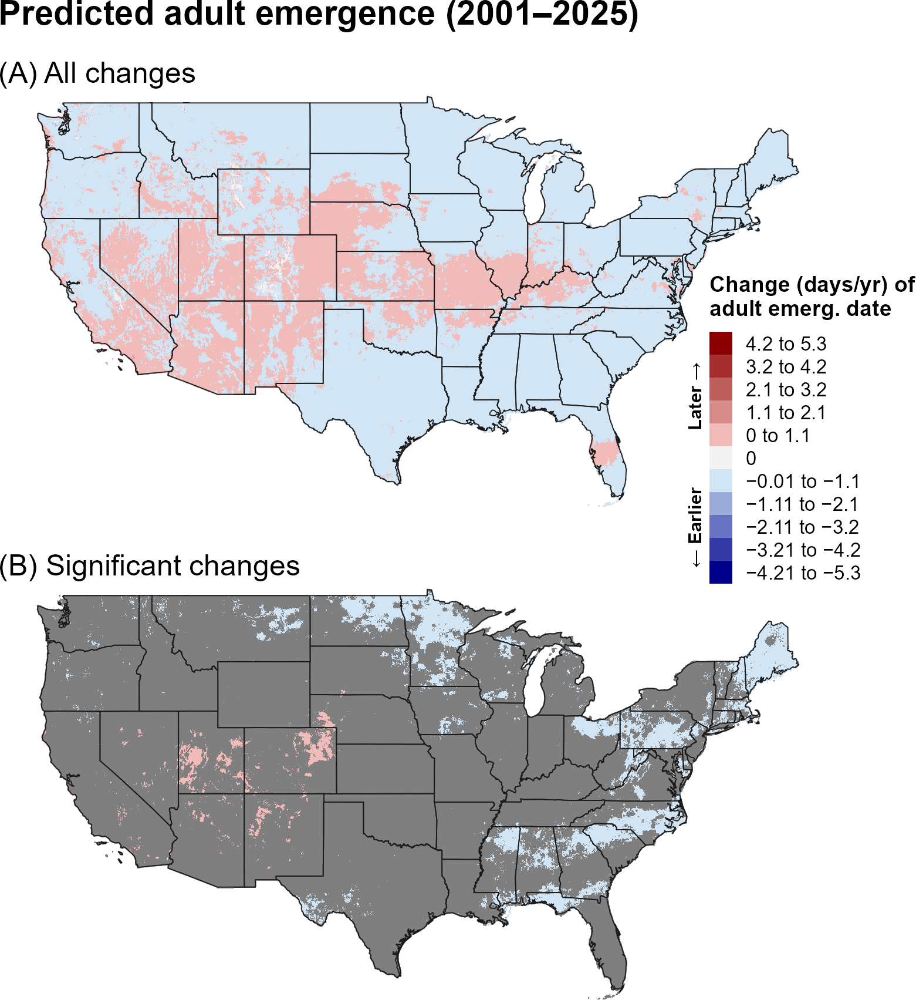
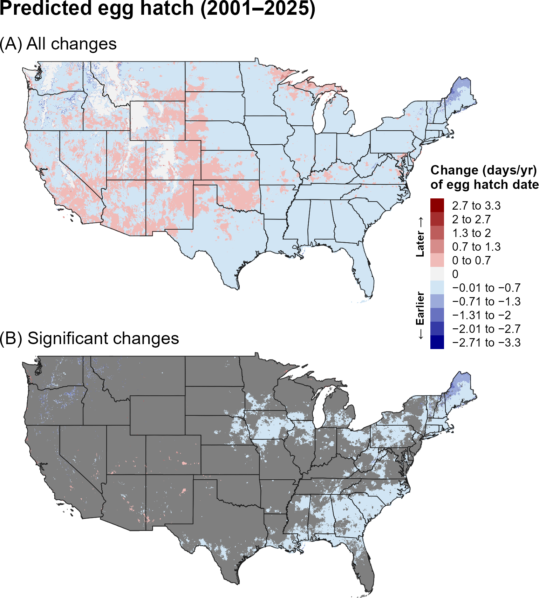
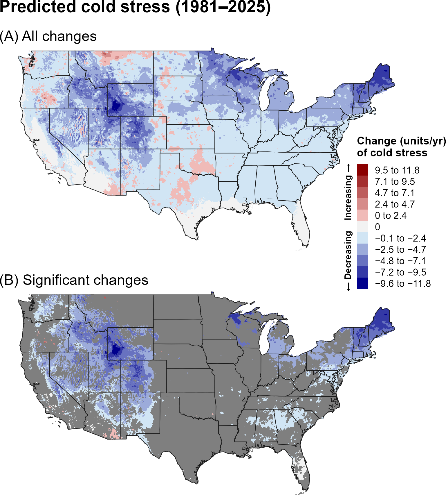
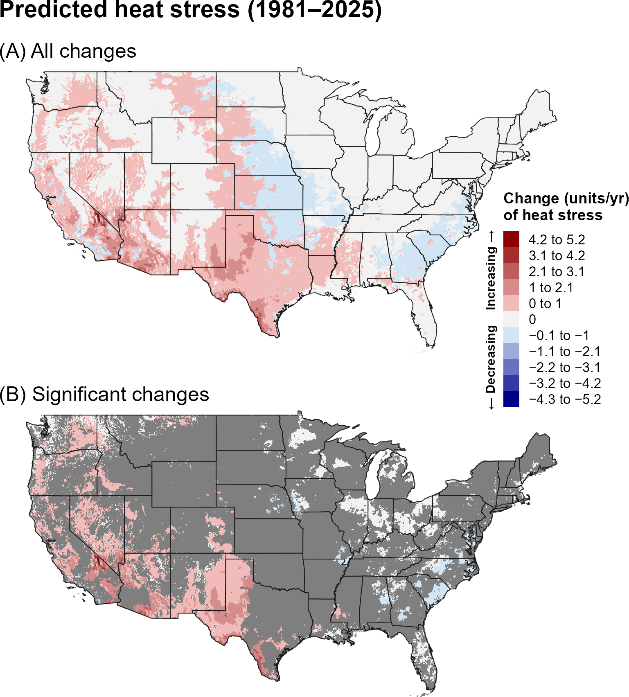
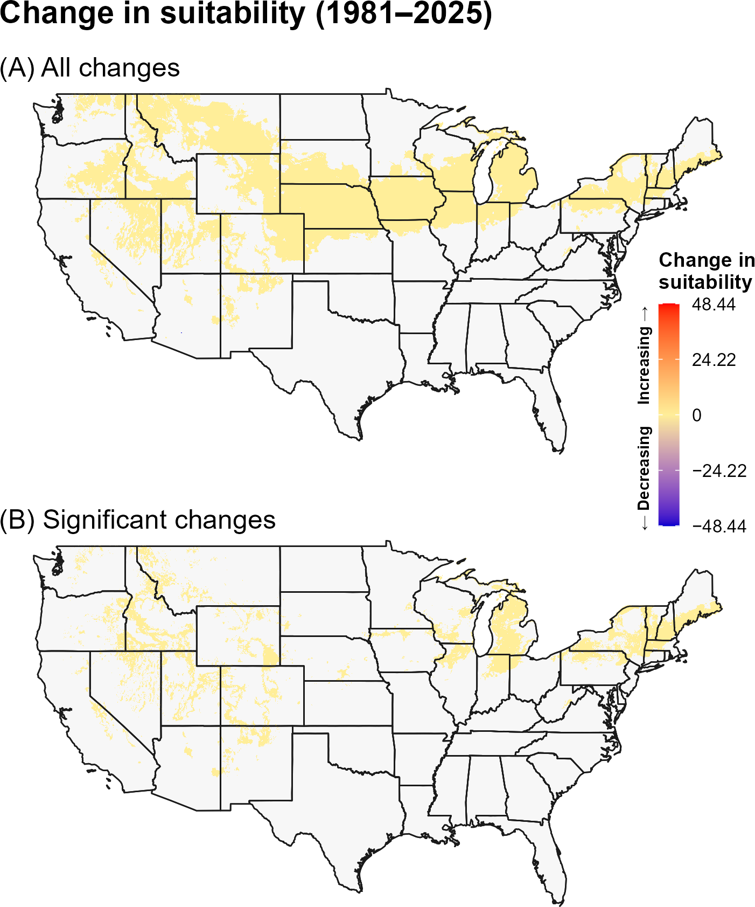
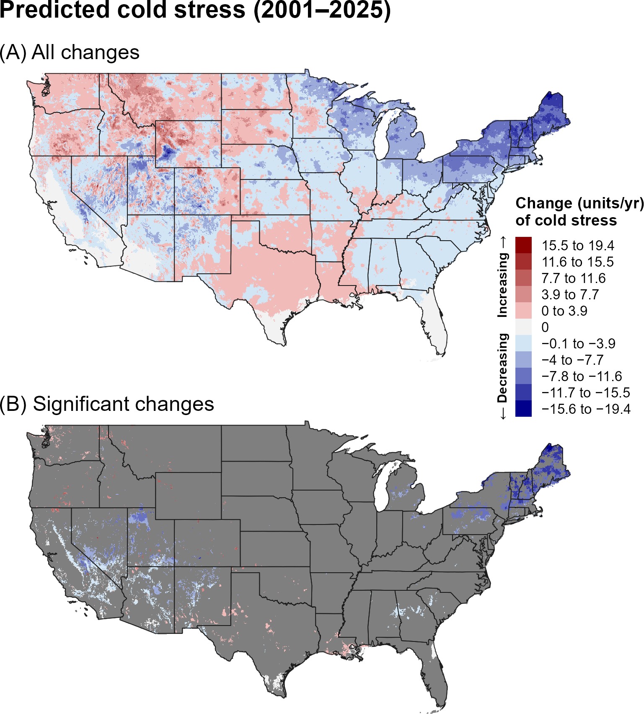
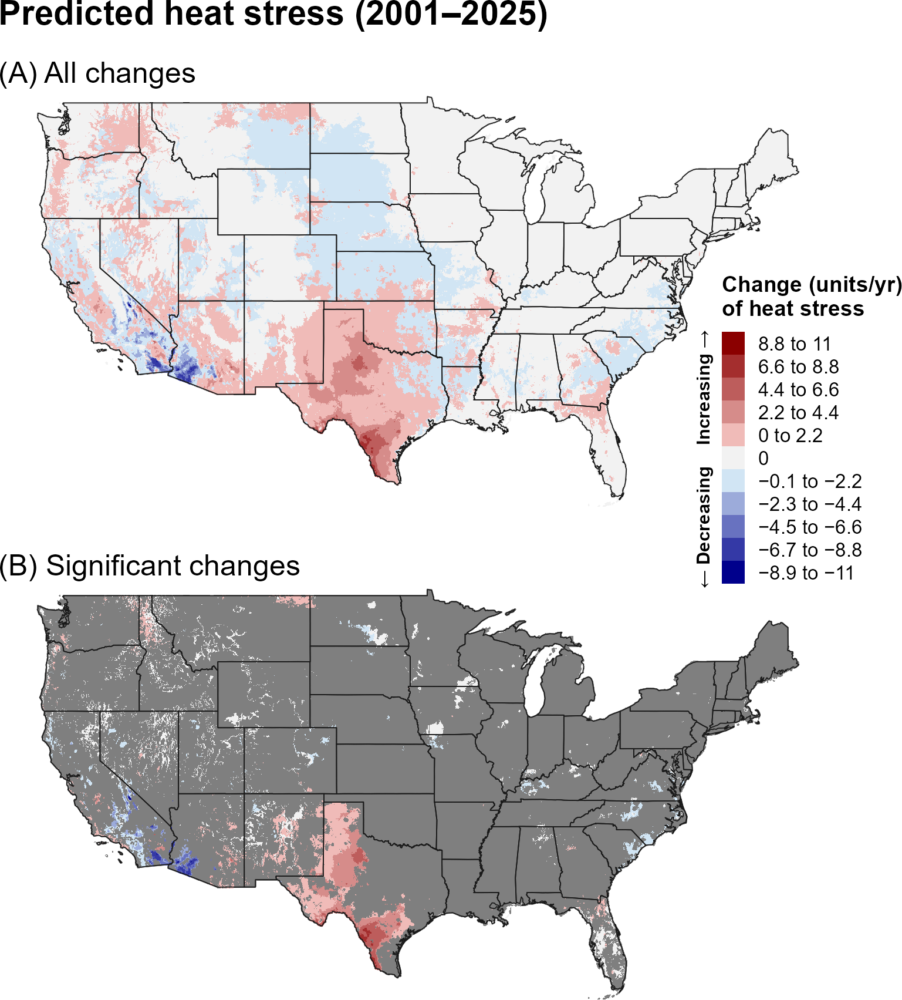
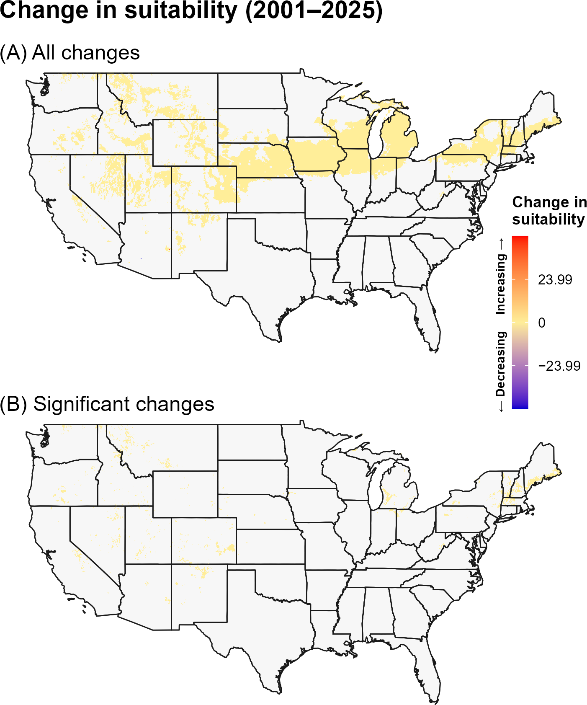

:::: {.content-visible when-format="html"}
::: {style="text-align: left;"}
[Download JPSB report as PDF](JPSB/JPSB.pdf){.btn .btn-primary}
:::
::::

## **8A. Introduction** {.unlisted}

The Japanese pine sawyer beetle (JPSB), Monochamus alternatus Hope (Coleoptera: Cerambycidae), is a major vector of nematodes that cause pine wilt disease, particularly Bursaphelenchus xylophilus (`\hyperref[ref-vicente-2012]{Vicente et al. 2012}`{=latex}`<a href="#ref-vicente-2012">Vicente et al. 2012</a>`{=html}, `\hyperref[ref-eppo-2024]{EPPO 2024}`{=latex}`<a href="#ref-eppo-2024">EPPO 2024</a>`{=html}). Native to East Asia, including mainland China, Taiwan, Laos, Korea, and Japan, JPSB has expanded its range to other parts of Asia, including Vietnam (`\hyperref[ref-kobayashi-1984]{Kobayashi et al. 1984}`{=latex}`<a href="#ref-kobayashi-1984">Kobayashi et al. 1984</a>`{=html}, `\hyperref[ref-ma-2006]{Ma et al. 2006}`{=latex}`<a href="#ref-ma-2006">Ma et al. 2006</a>`{=html}, `\hyperref[ref-eppo-2024]{EPPO 2024}`{=latex}`<a href="#ref-eppo-2024">EPPO 2024</a>`{=html}). Adult beetles acquire and transmit nematodes while feeding on healthy pine trees, with infection disrupting xylem function and causing wilt and, in susceptible trees, death within weeks (`\hyperref[ref-kobayashi-1984]{Kobayashi et al. 1984}`{=latex}`<a href="#ref-kobayashi-1984">Kobayashi et al. 1984</a>`{=html}, `\hyperref[ref-vicente-2012]{Vicente et al. 2012}`{=latex}`<a href="#ref-vicente-2012">Vicente et al. 2012</a>`{=html}). Females primarily oviposit in weakened or diseased trees, where larvae develop beneath the bark and in the sapwood, nematodes subsequently associate with newly emerging adults, completing the transmission cycle (`\hyperref[ref-kobayashi-1984]{Kobayashi et al. 1984}`{=latex}`<a href="#ref-kobayashi-1984">Kobayashi et al. 1984</a>`{=html}, `\hyperref[ref-ma-2006]{Ma et al. 2006}`{=latex}`<a href="#ref-ma-2006">Ma et al. 2006</a>`{=html}, `\hyperref[ref-an-2019]{An et al. 2019}`{=latex}`<a href="#ref-an-2019">An et al. 2019</a>`{=html}). Although B. xylophilus is native to North America and generally causes little damage in its native range, JPSB could also vector other nematode species not currently present in North America (`\hyperref[ref-caps-2013]{CAPS 2013}`{=latex}`<a href="#ref-caps-2013">CAPS 2013</a>`{=html}, `\hyperref[ref-an-2019]{An et al. 2019}`{=latex}`<a href="#ref-an-2019">An et al. 2019</a>`{=html}). JPSB primarily attacks conifers, particularly Pinus, Abies, Picea, Larix, and Cedrus, and pine wilt disease has caused extensive tree mortality and substantial economic losses where it has been introduced, particularly in Asia and Europe (`\hyperref[ref-vicente-2012]{Vicente et al. 2012}`{=latex}`<a href="#ref-vicente-2012">Vicente et al. 2012</a>`{=html}, `\hyperref[ref-an-2019]{An et al. 2019}`{=latex}`<a href="#ref-an-2019">An et al. 2019</a>`{=html}).

Areas suitable for JPSB are predicted throughout much of the southern and midwestern United States, whereas cold temperatures may limit establishment in colder regions, including parts of the Intermountain West and Northeast (`\hyperlink{ref-song-2006}{Song and Xu 2006}`{=latex}`<a href="#ref-song-2006">Song and Xu 2006</a>`{=html}, `\hyperref[ref-barker-coop-2020]{Barker and Coop 2020}`{=latex}`<a href="#ref-barker-coop-2020">Barker and Coop 2020</a>`{=html}), `\hyperref[ref-gao-2023]{Gao et al. 2023}`{=latex}`<a href="#ref-gao-2023">Gao et al. 2023</a>`{=html}). Parts of the West Coast, including most of California, were also predicted to be suitable by some models (`\hyperlink{ref-song-2006}{Song and Xu 2006}`{=latex}`<a href="#ref-song-2006">Song and Xu 2006</a>`{=html}, `\hyperref[ref-barker-coop-2020]{Barker and Coop 2020}`{=latex}`<a href="#ref-barker-coop-2020">Barker and Coop 2020</a>`{=html}). Within environmentally suitable areas of the contiguous United States, JPSB is predicted to complete at least one generation annually, with up to four generations in the South (`\hyperref[ref-barker-coop-2020]{Barker and Coop 2020}`{=latex}`<a href="#ref-barker-coop-2020">Barker and Coop 2020</a>`{=html}). In colder parts of its native range, JPSB may be univoltine or semivoltine, whereas 2–3 generations can occur annually in warmer regions such as subtropical and tropical China (`\hyperref[ref-togashi-1989]{Togashi 1989}`{=latex}`<a href="#ref-togashi-1989">Togashi 1989</a>`{=html}, `\hyperref[ref-ma-2006]{Ma et al. 2006}`{=latex}`<a href="#ref-ma-2006">Ma et al. 2006</a>`{=html}, `\hyperref[ref-caps-2013]{CAPS 2013}`{=latex}`<a href="#ref-caps-2013">CAPS 2013</a>`{=html}). JPSB undergoes winter diapause primarily during the final larval instar, with diapause induction influenced by larval density (`\hyperref[ref-togashi-2021]{Togashi 2021}`{=latex}`<a href="#ref-togashi-2021">Togashi 2021</a>`{=html}).

A model for Japanese pine sawyer beetle developed for the Degree-Day, establishment Risk, and Phenological event mapping system (DDRP) is operationalized to produce near real-time forecasts for the contiguous United States (CONUS) at <https://uspest.org/DDRP>. The phenology model applies a lower developmental threshold of 12.2 °C and upper threshold of 35 °C for all life stages (egg, larva, pupa, and adult) and assumes the larva is the overwintering stage. The climatic suitability model applies a lower cold stress threshold and upper heat stress threshold of −4 °C and 36 °C, respectively. The full set of model parameters for Japanese pine sawyer beetle, including degree-day requirements for individual life stages and climate stress limits, are presented in @tbl-jpsb-parameters. Details on model parameterization are available at USPest.org (`\hyperref[ref-barker-coop-2020]{Barker and Coop 2020}`{=latex}`<a href="#ref-barker-coop-2020">Barker and Coop 2020</a>`{=html}).

## **8B. Results** {.unlisted}

### **i. Phenology**

#### **Entire period: 1981--2025**

Over 1981–2025, predicted first adult emergence and egg hatch generally shifted earlier across much of the southern and eastern United States, while later events occurred in portions of the northern interior (@fig-jpsb-emergence, @fig-jpsb-egg-hatch). Significant changes were concentrated in the eastern and central United States, with additional localized changes in the West.

```{r}
#| echo: false
#| out-width: 70%
#| fig-align: center
#| fig-cap: "Changes (days/year) in predicted dates of first adult emergence for Japanese pine sawyer beetle across the CONUS over the entire 44-year period (1981–2025). Maps show (A) all changes and (B) statistically significant changes (P < 0.1); areas shown in gray are not statistically significant."
#| label: fig-jpsb-emergence

```

```{r}
#| echo: false
#| out-width: 70%
#| fig-align: center
#| fig-cap: "Changes (days/year) in predicted dates of first egg hatch for Japanese pine sawyer beetle across the CONUS over the entire 44-year period (1981–2025). Maps show (A) all changes and (B) statistically significant changes (P < 0.1); areas shown in gray are not statistically significant."
#| label: fig-jpsb-egg-hatch

```

#### **Recent period: 2001--2025**

During 2001–2025, earlier phenological events remained apparent across much of the western and central United States, while later events occurred in parts of the northern interior and East (@fig-jpsb-emergence-recent, @fig-jpsb-egg-hatch-recent). Significant changes were spatially limited compared with the full period.

```{r}
#| echo: false
#| out-width: 70%
#| fig-align: center
#| fig-cap: "Changes (days/year) in predicted dates of first adult emergence for Japanese pine sawyer beetle across the CONUS over the recent 24-year period (2001–2025). Maps show (A) all changes and (B) statistically significant changes (P < 0.1); areas shown in gray are not statistically significant."
#| label: fig-jpsb-emergence-recent

```

```{r}
#| echo: false
#| out-width: 70%
#| fig-align: center
#| fig-cap: "Changes (days/year) in predicted dates of first egg hatch for Japanese pine sawyer beetle across the CONUS over the recent 24-year period (2001–2025). Maps show (A) all changes and (B) statistically significant changes (P < 0.1); areas shown in gray are not statistically significant."
#| label: fig-jpsb-egg-hatch-recent

```

### **ii. Climatic suitability**

#### **Entire period: 1981--2025**

Predicted cold stress decreased across much of the northern United States over 1981–2025, with significant decreases in portions of the northern Rockies, Great Lakes, and Northeast (@fig-jpsb-cold-stress). Heat stress increased across the Southwest and southern Great Plains (@fig-jpsb-heat-stress). Climatic suitability increased significantly in portions of the northern United States, particularly the northern Plains, Great Lakes, and Northeast (@fig-jpsb-suitability).

```{r}
#| echo: false
#| out-width: 70%
#| fig-align: center
#| fig-cap: "Changes (units/year) in predicted cold stress for Japanese pine sawyer beetle across the CONUS over the entire 44-year period (1981–2025). Maps show (A) all changes and (B) statistically significant changes (P < 0.1); areas shown in gray are not statistically significant. Areas shown as 0 in (B) had significant trends but very small changes."
#| label: fig-jpsb-cold-stress

```

```{r}
#| echo: false
#| out-width: 70%
#| fig-align: center
#| fig-cap: "Changes (units/year) in predicted heat stress for Japanese pine sawyer beetle across the CONUS over the entire 44-year period (1981–2025). Maps show (A) all changes and (B) statistically significant changes (P < 0.1); areas shown in gray are not statistically significant. Areas shown as 0 in (B) had significant trends but very small changes."
#| label: fig-jpsb-heat-stress

```

```{r}
#| echo: false
#| out-width: 70%
#| fig-align: center
#| fig-cap: "Changes in predicted climatic suitability for Japanese pine sawyer beetle across the CONUS over the 44-year period (1981–2025). Suitability is defined as areas not excluded by climate stress. Positive changes (warmer colors) indicate an increased likelihood of establishment, whereas negative changes (cooler colors) indicate a decreased likelihood of establishment."
#| label: fig-jpsb-suitability

```

#### **Recent period: 2001--2025**

During 2001–2025, increases in cold stress became more evident across portions of the northern and central interior, although decreases persisted in scattered northern and eastern areas (@fig-jpsb-cold-stress-recent). Heat stress continued to increase in the Southwest and southern Great Plains (@fig-jpsb-heat-stress-recent). Significant suitability increases were more spatially limited during the recent period but remained evident in portions of the northern United States (@fig-jpsb-suitability-recent).

```{r}
#| echo: false
#| out-width: 70%
#| fig-align: center
#| fig-cap: "Changes (units/year) in predicted cold stress for Japanese pine sawyer beetle across the CONUS over the recent 24-year period (2001–2025). Maps show (A) all changes and (B) statistically significant changes (P < 0.1); areas shown in gray are not statistically significant. Areas shown as 0 in (B) had significant trends but very small changes."
#| label: fig-jpsb-cold-stress-recent

```

```{r}
#| echo: false
#| out-width: 70%
#| fig-align: center
#| fig-cap: "Changes (units/year) in predicted heat stress for Japanese pine sawyer beetle across the CONUS over the recent 24-year period (2001–2025). Maps show (A) all changes and (B) statistically significant changes (P < 0.1); areas shown in gray are not statistically significant. Areas shown as 0 in (B) had significant trends but very small changes."
#| label: fig-jpsb-heat-stress-recent

```

```{r}
#| echo: false
#| out-width: 70%
#| fig-align: center
#| fig-cap: "Changes in predicted climatic suitability for Japanese pine sawyer beetle across the CONUS over the recent 24-year period (2001–2025). Suitability is defined as areas not excluded by climate stress. Positive changes (warmer colors) indicate an increased likelihood of establishment, whereas negative changes (cooler colors) indicate a decreased likelihood of establishment."
#| label: fig-jpsb-suitability-recent

```

## **8C. Discussion** {.unlisted}

The JPSB results indicate earlier phenology across many regions over the full period, with more limited and heterogeneous changes during 2001–2025. Because JPSB is associated with conifer hosts and its development is temperature dependent, regional shifts in emergence and egg hatch could alter the timing of detection and management activities. The stronger long-term pattern suggests that recent variability may be obscuring some of the longer-term directional signal.

The increase in predicted climatic suitability across portions of the northern United States over the full period is consistent with the concurrent decline in cold stress in those regions. This pattern suggests that warming may reduce cold-related limitations on establishment. During the recent period, increases in cold stress in parts of the northern interior corresponded with weaker suitability changes, illustrating how shorter-term regional climate patterns can alter the establishment signal.

The stronger and more spatially extensive trends in predicted phenology and climate stress over the full 44-year period may reflect both the larger sample size, which can reduce noise and improve detection of directional patterns, and differences in the underlying climate trends between the two time periods. In particular, the recent 24-year period may capture climate variability or regional trends that differ from those observed over the longer 44-year period. Thus, differences between the two periods should be interpreted as reflecting both long-term climate trends and shorter-term regional variability.

## **8D. References** {.unlisted}

\begingroup
\setlength{\parindent}{-0.5in}
\setlength{\leftskip}{0.5in}

\noindent

<span id="ref-an-2019"></span>
\phantomsection\label{ref-an-2019}

An, H., S. Lee, and S. J. Cho. 2019. The effects of climate change on pine wilt disease in South Korea: Challenges and prospects. Forests 10:486.

<span id="ref-barker-coop-2020"></span>
\phantomsection\label{ref-barker-coop-2020}

Barker, B. S., and L. Coop. 2020. Japanese pine sawyer beetle, *Monochamus alternatus*.  Phenology/degree-day and climate suitability white paper for USPEST.ORG. Prepared for United States Department of Agriculture (USDA) – Animal and Plant Health Inspection Service (APHIS) – Plant Protection and Quarantine (PPQ). Vs. 1.0 (2/26/2020). Online at: <https://uspest.org/CAPS/Monochamus_alternatus_white_paper.pdf> (accessed 13 September 2025).

<span id="ref-caps-2013"></span>
\phantomsection\label{ref-caps-2013}

Cooperative Agricultural Pest Survey (CAPS). 2013. Exotic Wood Borer/Bark Beetle Survey Reference, *Monochamus alternatus* (Hope). USDA-APHIS-PPQ-CPHST (updated 29 July 2016). Online at: <https://caps.ceris.purdue.edu/wp-content/uploads/2025/07/Monochamus-alternatus_EWBB_2015.pdf> (accessed 18 September 2025).

<span id="ref-eppo-2024"></span>
\phantomsection\label{ref-eppo-2024}

EPPO. 2024. *Monochamus alternatus*. EPPO datasheets on pests recommended for regulation. Online at: <https://gd.eppo.int/> (accessed 13 September 2025).

<span id="ref-gao-2023"></span>
\phantomsection\label{ref-gao-2023}

Gao, R., L. Liu, L. Zhao, and S. Cui. 2023. Potentially suitable geographical area for *Monochamus alternatus* under current and future climatic scenarios based on optimized MaxEnt model. Insects 14:182.

<span id="ref-kobayashi-1984"></span>
\phantomsection\label{ref-kobayashi-1984}

Kobayashi, F., A. Yamane, and T. Ikeda. 1984. The Japanese pine sawyer beetle as the vector of pine wilt disease. Annual Review of Entomology 29:115–135.

<span id="ref-ma-2006"></span>
\phantomsection\label{ref-ma-2006}

Ma, R.-Y., S.-G. Hao, W.-N. Kong, J.-H. Sun, and L. Kang. 2006. Cold hardiness as a factor for assessing the potential distribution of the Japanese pine sawyer *Monochamus alternatus* (Coleoptera: Cerambycidae) in China. Annals of Forest Science:449–456.

<span id="ref-song-2006"></span>
\phantomsection\label{ref-song-2006}

Song, H.-M., and R.-M. Xu. 2006. Global potential geographical distribution of *Monochamus alternatus*. Chinese Bulletin of Entomology 43:535–539.

<span id="ref-togashi-1989"></span>
\phantomsection\label{ref-togashi-1989}

Togashi, K. 1989. Development of *Monochamus alternatus* Hope (Coleoptera: Cerambycidae) in relation to oviposition time. Japanese Journal of Applied Entomology and Zoology 33:1–8.

<span id="ref-togashi-2021"></span>
\phantomsection\label{ref-togashi-2021}

Togashi, K. 2021. Inverse density-dependent diapause and its influence on population dynamics in *Monochamus alternatus alternatus* (Coleoptera: Cerambycidae). Applied Entomology and Zoology 56:175–186.

<span id="ref-togashi-magira-1981"></span>
\phantomsection\label{ref-togashi-magira-1981}

Togashi, K., and H. Magira. 1981. Age-specific survival rate and fecundity of the adult Japanese pine sawyer *Monochamus alternatus* Hope (Coleoptera: Cerambycidae), at different emergence times. Applied Entomology and Zoology 16:351–361.

<span id="ref-vicente-2012"></span>
\phantomsection\label{ref-vicente-2012}

Vicente, C., M. Espada, P. Vieira, and M. Mota. 2012. Pine wilt disease: a threat to European forestry. European Journal of Plant Pathology 133:89–99.

\par
\endgroup
