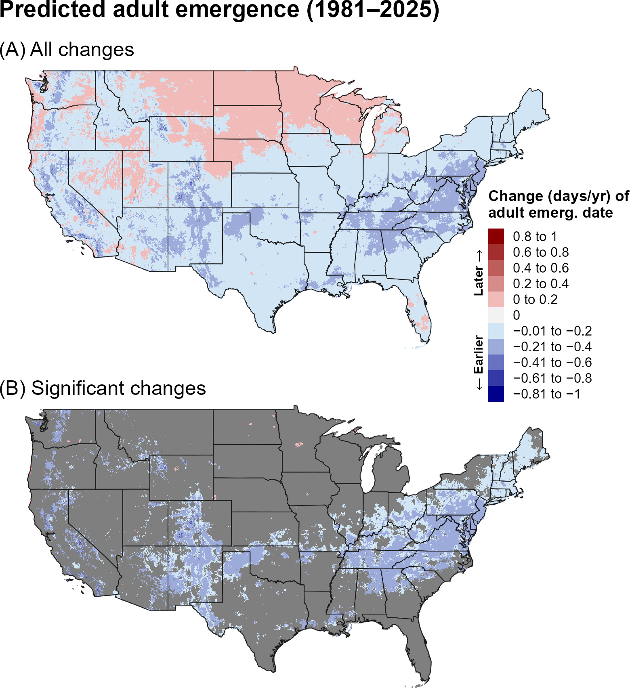
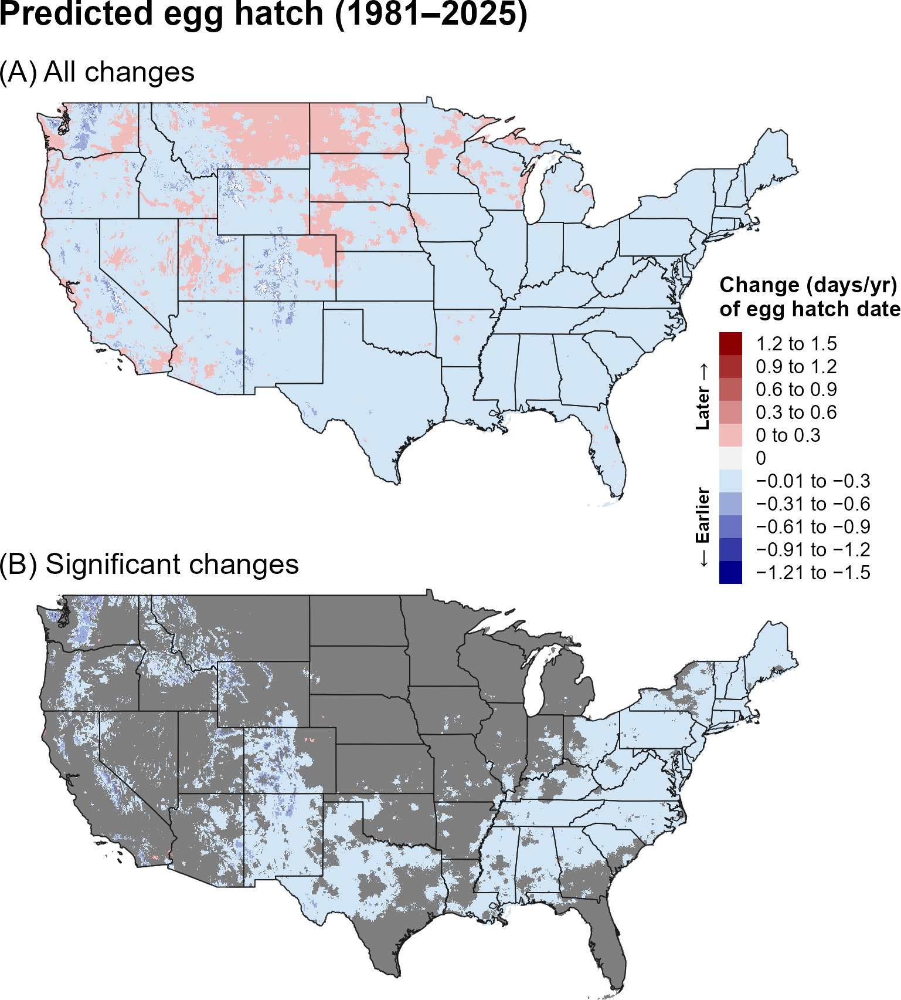
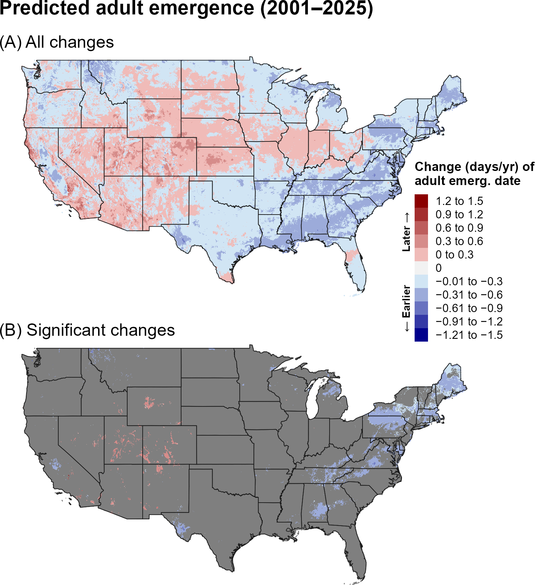
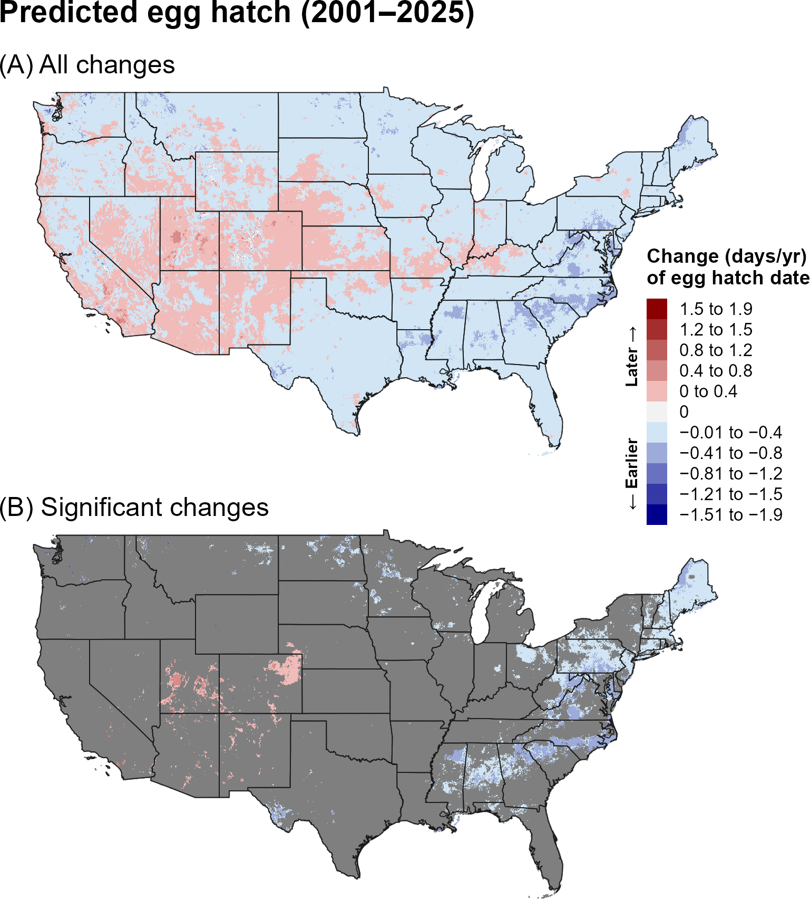
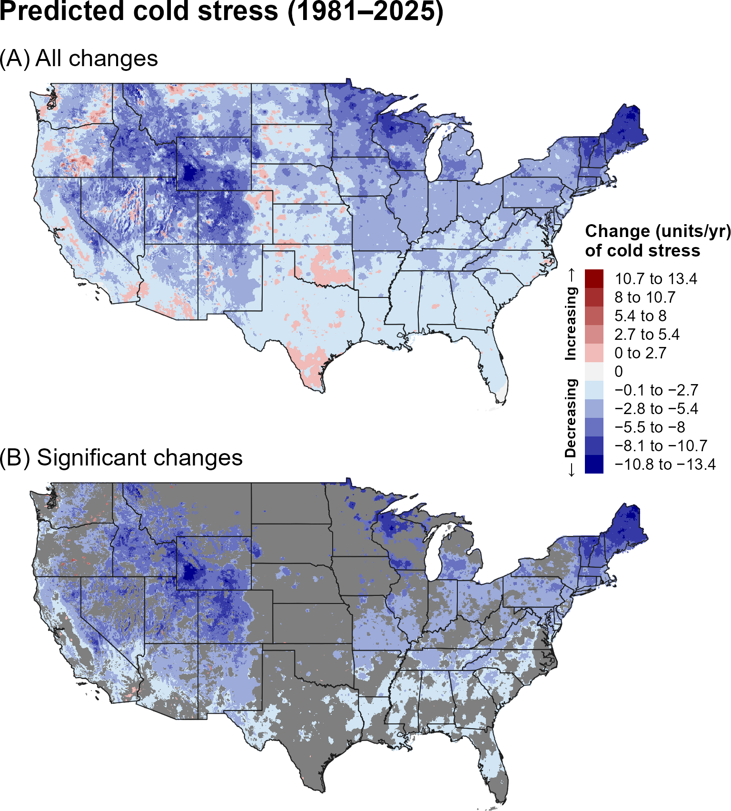
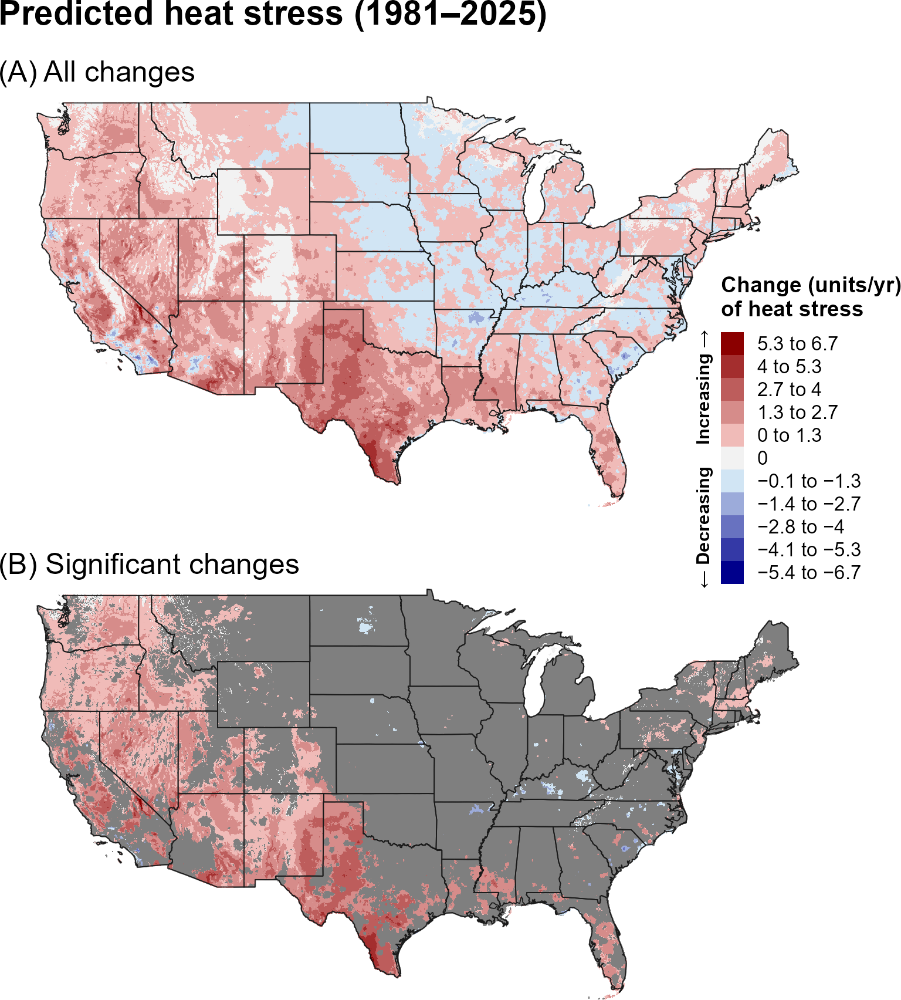
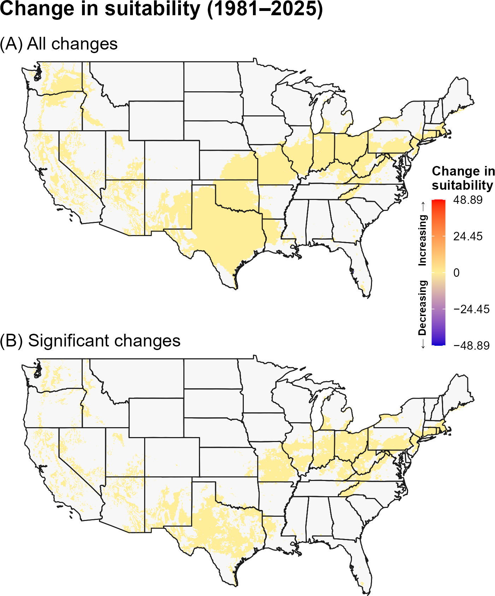
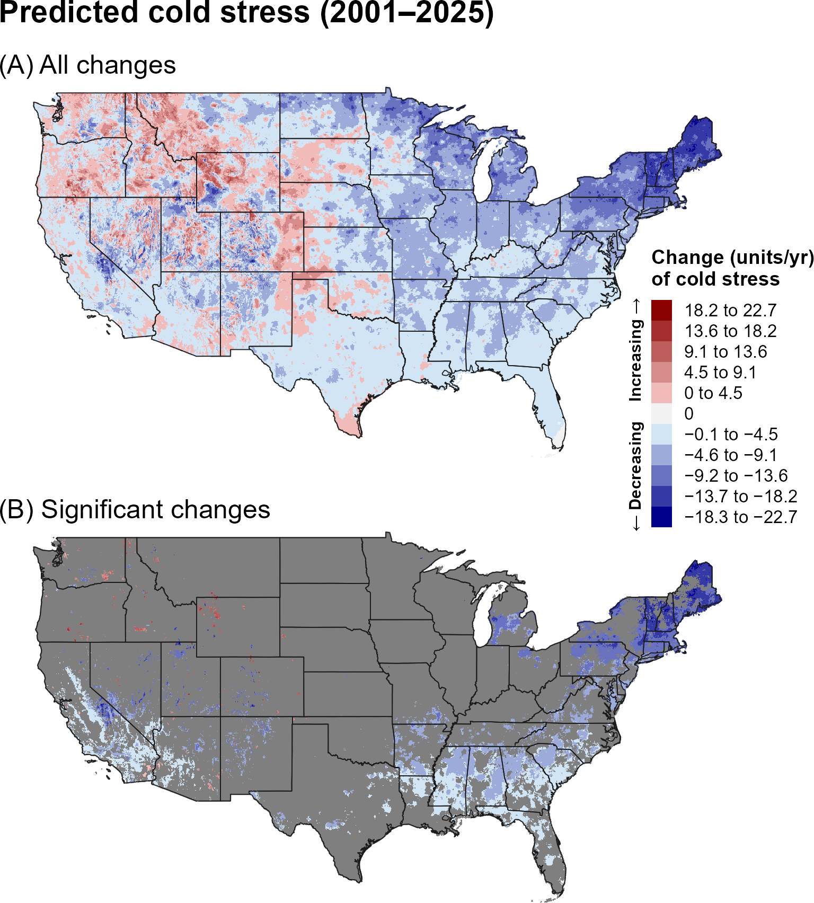
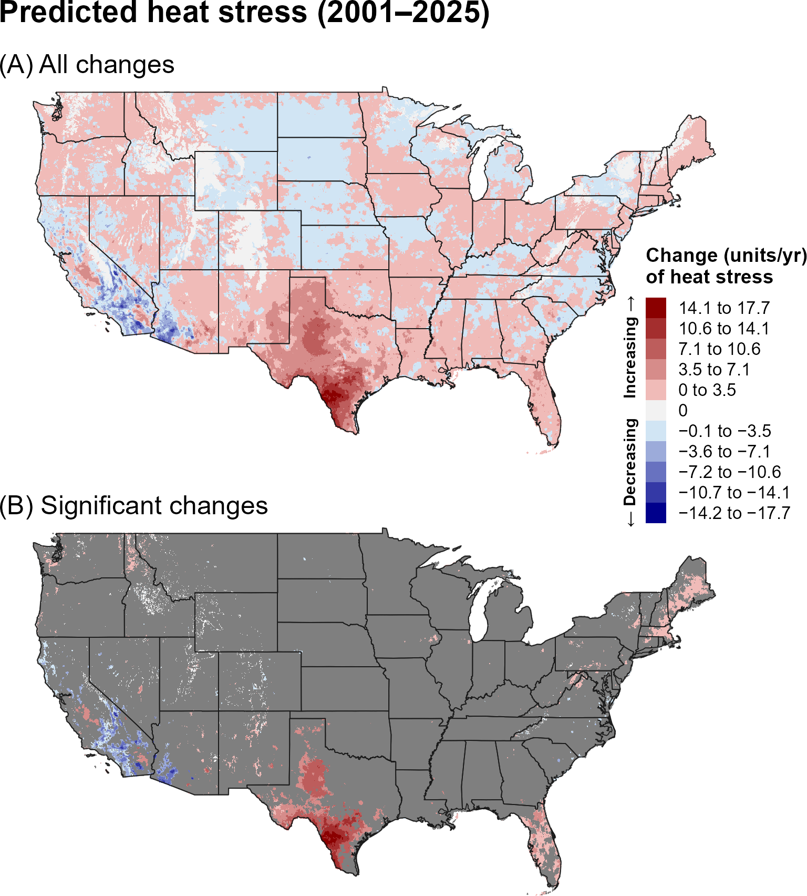
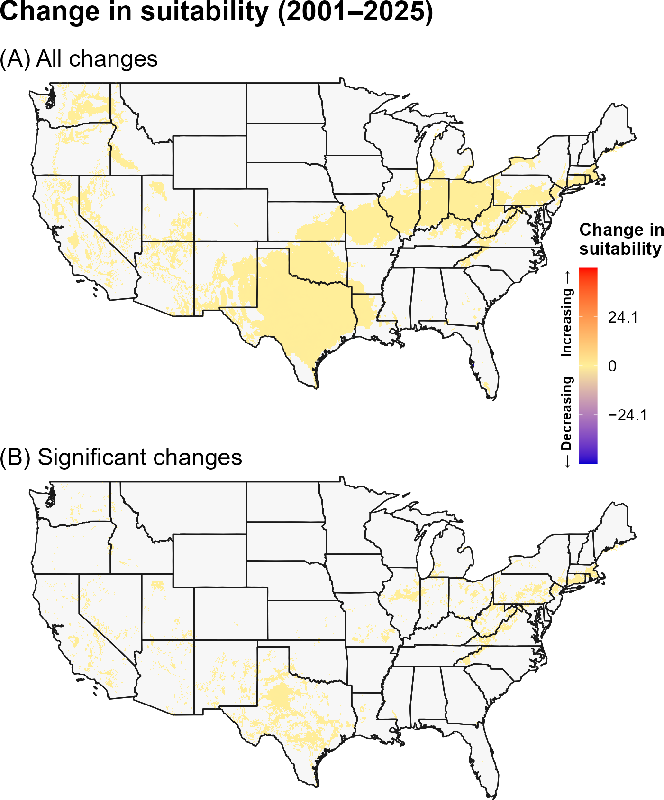

:::: {.content-visible when-format="html"}
::: {style="text-align: left;"}
[Download LBAM report as PDF](LBAM.pdf){.btn .btn-primary}
:::
::::

## **9A. Introduction** {.unlisted}

Native to Australia, the light brown apple moth (LBAM), *Epiphyas postvittana* (Walker) (Lepidoptera: Tortricidae), is an invasive species established in the United States, the United Kingdom, New Zealand, New Caledonia, and the Azores, with additional interceptions reported worldwide (`\hyperref[ref-danthanarayana-1975]{Danthanarayana 1975}`{=latex}`<a href="#ref-danthanarayana-1975">Danthanarayana 1975</a>`{=html}, `\hyperref[ref-eppo-2024]{EPPO 2024}`{=latex}`<a href="#ref-eppo-2024">EPPO 2024</a>`{=html}). This highly polyphagous pest has a host range exceeding 500 plant species, although its most significant economic impacts have been observed in apples, pears, and grapes (`\hyperref[ref-brockerhoff-2011]{Brockerhoff et al. 2011}`{=latex}`<a href="#ref-brockerhoff-2011">Brockerhoff et al. 2011</a>`{=html}). Infestations can create market access challenges due to the risk of transporting live larvae on a wide variety of host plants (`\hyperref[ref-suckling-brockerhoff-2010]{Suckling and Brockerhoff 2010}`{=latex}`<a href="#ref-suckling-brockerhoff-2010">Suckling and Brockerhoff 2010</a>`{=html}). In the United States, its distribution is currently limited to Hawaii, where it was first reported in 1893, and California, where it was confirmed in 2007 and now persists primarily in the San Francisco Bay Area, the Central Coast, and parts of southern California (`\hyperref[ref-zimmerman-1978]{Zimmerman 1978}`{=latex}`<a href="#ref-zimmerman-1978">Zimmerman 1978</a>`{=html}; `\hyperref[ref-suckling-brockerhoff-2010]{Suckling and Brockerhoff 2010}`{=latex}`<a href="#ref-suckling-brockerhoff-2010">Suckling and Brockerhoff 2010</a>`{=html}; `\hyperref[ref-barker-2020]{Barker et al. 2020}`{=latex}`<a href="#ref-barker-2020">Barker et al. 2020</a>`{=html}).

Previous modeling studies indicated suitable environmental conditions for LBAM across much of the southeastern United States and along the Pacific coast (`\hyperref[ref-lozier-mills-2011]{Lozier \& Mills 2011}`{=latex}`<a href="#ref-lozier-mills-2011">Lozier &amp; Mills 2011</a>`{=html}, `\hyperref[ref-he-2012]{He et al. 2012}`{=latex}`<a href="#ref-he-2012">He et al. 2012</a>`{=html}, `\hyperref[ref-barker-2020]{Barker et al. 2020}`{=latex}`<a href="#ref-barker-2020">Barker et al. 2020</a>`{=html}). Because LBAM does not undergo winter diapause, its distribution and population persistence are likely constrained in colder regions by minimum winter temperatures (`\hyperref[ref-burgi-mills-2010]{Bürgi and Mills 2010}`{=latex}`<a href="#ref-burgi-mills-2010">Bürgi and Mills 2010</a>`{=html}). Cold tolerance varies among larval instars, with reported lower lethal temperatures ranging from –10.5 °C to –0.9 °C (`\hyperref[ref-burgi-mills-2010]{Bürgi and Mills 2010}`{=latex}`<a href="#ref-burgi-mills-2010">Bürgi and Mills 2010</a>`{=html}), and associations with certain host plants may further increase larval cold tolerance and overwintering survival (`\hyperref[ref-morey-2016]{Morey et al. 2016}`{=latex}`<a href="#ref-morey-2016">Morey et al. 2016</a>`{=html}). In warmer regions, the absence of diapause or other strong seasonal synchronizing cues, such as photoperiod or temperature, allows LBAM to maintain overlapping generations throughout the year (`\hyperref[ref-buergi-2011]{Buergi et al. 2011}`{=latex}`<a href="#ref-buergi-2011">Buergi et al. 2011</a>`{=html}). Consistent with this life-history strategy, the DDRP model predicted as many as nine generations per year in portions of the contiguous United States in 2018, although field observations in California reported an average of 3.27 generations in San Francisco and 4.58 generations in Santa Cruz (`\hyperref[ref-buergi-2011]{Buergi et al. 2011}`{=latex}`<a href="#ref-buergi-2011">Buergi et al. 2011</a>`{=html}, `\hyperref[ref-barker-2020]{Barker et al. 2020}`{=latex}`<a href="#ref-barker-2020">Barker et al. 2020</a>`{=html}). Beyond temperature, population growth may also be influenced by rainfall and relative humidity, with higher growth rates reported under cooler temperatures and moderate moisture conditions (`\hyperref[ref-danthanarayana-1995]{Danthanarayana 1995}`{=latex}`<a href="#ref-danthanarayana-1995">Danthanarayana 1995</a>`{=html}). Together, these findings indicate that LBAM risk is influenced by multiple interacting environmental factors, including winter temperature, temperature during the growing season, and moisture conditions.

A model for LBAM developed for the Degree-Day, establishment Risk, and Phenological event mapping system (DDRP) is operationalized to produce near real-time forecasts for the contiguous United States (CONUS) at <https://uspest.org/DDRP>. The phenology model applies a lower developmental threshold of 7.2 °C and upper threshold of 31.1 °C for all life stages (egg, larva, pupa, and adult) and assumes the larva is the overwintering stage. The climatic suitability model applies a lower cold stress threshold and upper heat stress threshold of 3 °C and 31 °C, respectively. The full set of model parameters for LBAM, including degree-day requirements for individual life stages and climate stress limits, are presented in @tbl-lbam-parameters. Details on model parameterization are available at USPest.org (`\hyperref[ref-barker-2020]{Barker et al. 2020}`{=latex}`<a href="#ref-barker-2020">Barker et al. 2020</a>`{=html}). The phenology model applies a lower developmental threshold of 7.2 °C and an upper developmental threshold of 31.1 °C to all life stages (egg, larva, pupa, and adult) and assumes that the larva is the overwintering stage. The climatic suitability model applies thresholds of 3 °C and 31 °C for cold and heat stress, respectively.

## **9B. Results** {.unlisted}

### **i. Phenology**

#### **Entire period: 1981--2025**

Over 1981–2025, predicted first adult emergence and egg hatch generally occurred earlier across much of the southern and western United States, while later events were more apparent across portions of the northern interior (@fig-lbam-emergence, @fig-lbam-egg-hatch). Significant changes occurred across broad portions of the eastern and central United States, with additional localized changes in the West.

```{r}
#| echo: false
#| out-width: 70%
#| fig-align: center
#| fig-cap: "Changes (days/year) in predicted dates of first adult emergence for LBAM across the CONUS over the entire 44-year period (1981–2025). Maps show (A) all changes and (B) statistically significant changes (P < 0.1); areas shown in gray are not statistically significant."
#| label: fig-lbam-emergence

```

```{r}
#| echo: false
#| out-width: 70%
#| fig-align: center
#| fig-cap: "Changes (days/year) in predicted dates of first egg hatch for LBAM across the CONUS over the entire 44-year period (1981–2025). Maps show (A) all changes and (B) statistically significant changes (P < 0.1); areas shown in gray are not statistically significant."
#| label: fig-lbam-egg-hatch

```

#### **Recent period: 2001--2025**

During 2001–2025, earlier predicted phenology remained widespread across much of the West and central United States, while later events occurred in portions of the eastern and southern United States (@fig-lbam-emergence-recent, @fig-lbam-egg-hatch-recent). Significant changes were more spatially limited than during the full period.

```{r}
#| echo: false
#| out-width: 70%
#| fig-align: center
#| fig-cap: "Changes (days/year) in predicted dates of first adult emergence for LBAM across the CONUS over the recent 24-year period (2001–2025). Maps show (A) all changes and (B) statistically significant changes (P < 0.1); areas shown in gray are not statistically significant."
#| label: fig-lbam-emergence-recent

```

```{r}
#| echo: false
#| out-width: 70%
#| fig-align: center
#| fig-cap: "Changes (days/year) in predicted dates of first egg hatch for LBAM across the CONUS over the recent 24-year period (2001–2025). Maps show (A) all changes and (B) statistically significant changes (P < 0.1); areas shown in gray are not statistically significant."
#| label: fig-lbam-egg-hatch-recent

```

### **ii. Climatic suitability**

#### **Entire period: 1981--2025**

Predicted cold stress decreased broadly across the northern United States over 1981–2025, while predicted heat stress increased across much of the western and southern United States and extended into portions of the eastern CONUS (@fig-lbam-cold-stress, @fig-lbam-heat-stress). These stress trends corresponded with relatively broad increases in predicted climatic suitability, particularly across portions of the central, southern, and eastern United States (@fig-lbam-suitability).

```{r}
#| echo: false
#| out-width: 70%
#| fig-align: center
#| fig-cap: "Changes (units/year) in predicted cold stress for LBAM across the CONUS over the entire 44-year period (1981–2025). Maps show (A) all changes and (B) statistically significant changes (P < 0.1); areas shown in gray are not statistically significant. Areas shown as 0 in (B) had significant trends but very small changes."
#| label: fig-lbam-cold-stress

```

```{r}
#| echo: false
#| out-width: 70%
#| fig-align: center
#| fig-cap: "Changes (units/year) in predicted heat stress for LBAM across the CONUS over the entire 44-year period (1981–2025). Maps show (A) all changes and (B) statistically significant changes (P < 0.1); areas shown in gray are not statistically significant. Areas shown as 0 in (B) had significant trends but very small changes."
#| label: fig-lbam-heat-stress

```

```{r}
#| echo: false
#| out-width: 70%
#| fig-align: center
#| fig-cap: "Changes in predicted climatic suitability for LBAM across the CONUS over the 44-year period (1981–2025). Suitability is defined as areas not excluded by climate stress. Positive changes (warmer colors) indicate an increased likelihood of establishment, whereas negative changes (cooler colors) indicate a decreased likelihood of establishment."
#| label: fig-lbam-suitability

```

#### **Recent period: 2001--2025**

During 2001–2025, cold-stress changes remained mixed but decreases persisted in portions of the northern United States, while heat stress continued to increase across much of the CONUS (@fig-lbam-cold-stress-recent, @fig-lbam-heat-stress-recent). Significant suitability increases were more spatially limited than over the full period but remained evident in portions of the central and eastern United States (@fig-lbam-suitability-recent).

```{r}
#| echo: false
#| out-width: 70%
#| fig-align: center
#| fig-cap: "Changes (units/year) in predicted cold stress for LBAM across the CONUS over the recent 24-year period (2001–2025). Maps show (A) all changes and (B) statistically significant changes (P < 0.1); areas shown in gray are not statistically significant. Areas shown as 0 in (B) had significant trends but very small changes."
#| label: fig-lbam-cold-stress-recent

```

```{r}
#| echo: false
#| out-width: 70%
#| fig-align: center
#| fig-cap: "Changes (units/year) in predicted heat stress for LBAM across the CONUS over the recent 24-year period (2001–2025). Maps show (A) all changes and (B) statistically significant changes (P < 0.1); areas shown in gray are not statistically significant. Areas shown as 0 in (B) had significant trends but very small changes."
#| label: fig-lbam-heat-stress-recent

```

```{r}
#| echo: false
#| out-width: 70%
#| fig-align: center
#| fig-cap: "Changes in predicted climatic suitability for LBAM across the CONUS over the recent 24-year period (2001–2025). Suitability is defined as areas not excluded by climate stress. Positive changes (warmer colors) indicate an increased likelihood of establishment, whereas negative changes (cooler colors) indicate a decreased likelihood of establishment."
#| label: fig-lbam-suitability-recent

```

## **9C. Discussion** {.unlisted}

The LBAM maps show broad changes in predicted phenology over the full period, with many regions experiencing earlier adult emergence and egg hatch. Because LBAM is a multivoltine pest whose development is strongly temperature dependent, earlier seasonal activity could increase the period during which populations can develop and reproduce in environmentally suitable areas. The recent-period maps show that these long-term patterns are not uniform through time, emphasizing the importance of considering both long-term trends and recent climate variability.

The combination of decreasing cold stress and increasing heat stress produced relatively broad changes in predicted climatic suitability over the full period. In northern regions, declining cold stress may reduce a major climatic constraint, whereas increasing heat stress in the warmest regions could offset potential suitability gains. The more limited recent-period suitability changes suggest that establishment potential has been comparatively stable in many regions during the shorter period.

The stronger and more spatially extensive trends in predicted phenology and climate stress over the full 44-year period may reflect both the larger sample size, which can reduce noise and improve detection of directional patterns, and differences in the underlying climate trends between the two time periods. In particular, the recent 24-year period may capture climate variability or regional trends that differ from those observed over the longer 44-year period. Thus, differences between the two periods should be interpreted as reflecting both long-term climate trends and shorter-term regional variability.

## **9D. References** {.unlisted}

\begingroup
\setlength{\parindent}{-0.5in}
\setlength{\leftskip}{0.5in}

\noindent

<span id="ref-barker-2020"></span>
\phantomsection\label{ref-barker-2020}

Barker, B. S., L. Coop, T. Wepprich, F. Grevstad, and G. Cook. 2020. DDRP: Real-time phenology and climatic suitability modeling of invasive insects. PLoS ONE 15:e0244005.

<span id="ref-brockerhoff-2011"></span>
\phantomsection\label{ref-brockerhoff-2011}

Brockerhoff, E. G., D. M. Suckling, C. E. Ecroyd, S. J. Wagstaff, M. C. Raabe, R. V. Dowell, and C. H. Wearing. 2011. Worldwide host plants of the highly polyphagous, invasive *Epiphyas postvittana* (Lepidoptera: Tortricidae). Journal of Economic Entomology 104:1514–1524.

<span id="ref-buergi-2011"></span>
\phantomsection\label{ref-buergi-2011}

Buergi, L. P., W. J. Roltsch, and N. J. Mills. 2011. Abundance, age structure, and voltinism of light brown apple moth populations in California. Environmental Entomology 40:1370–1377.

<span id="ref-burgi-mills-2010"></span>
\phantomsection\label{ref-burgi-mills-2010}

Bürgi, L. P., and N. J. Mills. 2010. Cold tolerance of the overwintering larval instars of light brown apple moth *Epiphyas postvittana*. Journal of Insect Physiology 56:1645–1650.

<span id="ref-danthanarayana-1975"></span>
\phantomsection\label{ref-danthanarayana-1975}

Danthanarayana, W. 1975. The bionomics, distribution and host range of the light brown apple moth, *Epiphyas postvittana* (Walk.) (Tortricidae). Australian Journal of Zoology 23:419–456.

<span id="ref-danthanarayana-1995"></span>
\phantomsection\label{ref-danthanarayana-1995}

Danthanarayana, W., H. Gu, and S. Ashley. 1995. Population growth potential of *Epiphyas postvittana*, the lightbrown apple moth (Lepidoptera: Tortricidae) in relation to diet, temperature and climate. Australian Journal of Zoology 43:381–394.

<span id="ref-eppo-2024"></span>
\phantomsection\label{ref-eppo-2024}

EPPO. 2024. *Epiphyas postvittana*. EPPO datasheets on pests recommended for regulation. Online at: <https://gd.eppo.int> (accessed 5 June 2025).

<span id="ref-he-2012"></span>
\phantomsection\label{ref-he-2012}

He, S., S. P. Worner, and T. Ikeda. 2012. Modeling the potential global distribution of light brown apple moth *Epiphyas postvittana* (Lepidoptera: Tortricidae) using CLIMEX. Journal of Asia-Pacific Entomology 15:479–485.

<span id="ref-lozier-mills-2011"></span>
\phantomsection\label{ref-lozier-mills-2011}

Lozier, J. D., and N. J. Mills. 2011. Predicting the potential invasive range of light brown apple moth (*Epiphyas postvittana*) using biologically informed and correlative species distribution models. Biological Invasions 13:2409–2421.

<span id="ref-morey-2016"></span>
\phantomsection\label{ref-morey-2016}

Morey, A. C., R. C. Venette, E. C. Nystrom Santacruz, L. A. Mosca, and W. D. Hutchison. 2016. Host-mediated shift in the cold tolerance of an invasive insect. Ecology and Evolution 6:8267–8275.

<span id="ref-suckling-brockerhoff-2010"></span>
\phantomsection\label{ref-suckling-brockerhoff-2010}

Suckling, D. M., and E. G. Brockerhoff. 2010. Invasion biology, ecology, and management of the light brown apple moth (Tortricidae). Annual Review of Entomology 55:285–306.

<span id="ref-zimmerman-1978"></span>
\phantomsection\label{ref-zimmerman-1978}

Zimmerman, E. C. 1978. Subfamily Tortricinae. Pages 404-528 *in* Insects of Hawaii, vol. 9, Microlepidoptera, Part 1. University of Hawaii Press, Honolulu, HI. Available online: <https://scholarspace.manoa.hawaii.edu/items/d865dd6c-9e33-455f-8f11-a059bfc19d94/full> (accessed on 5 June 2025).

\par
\endgroup