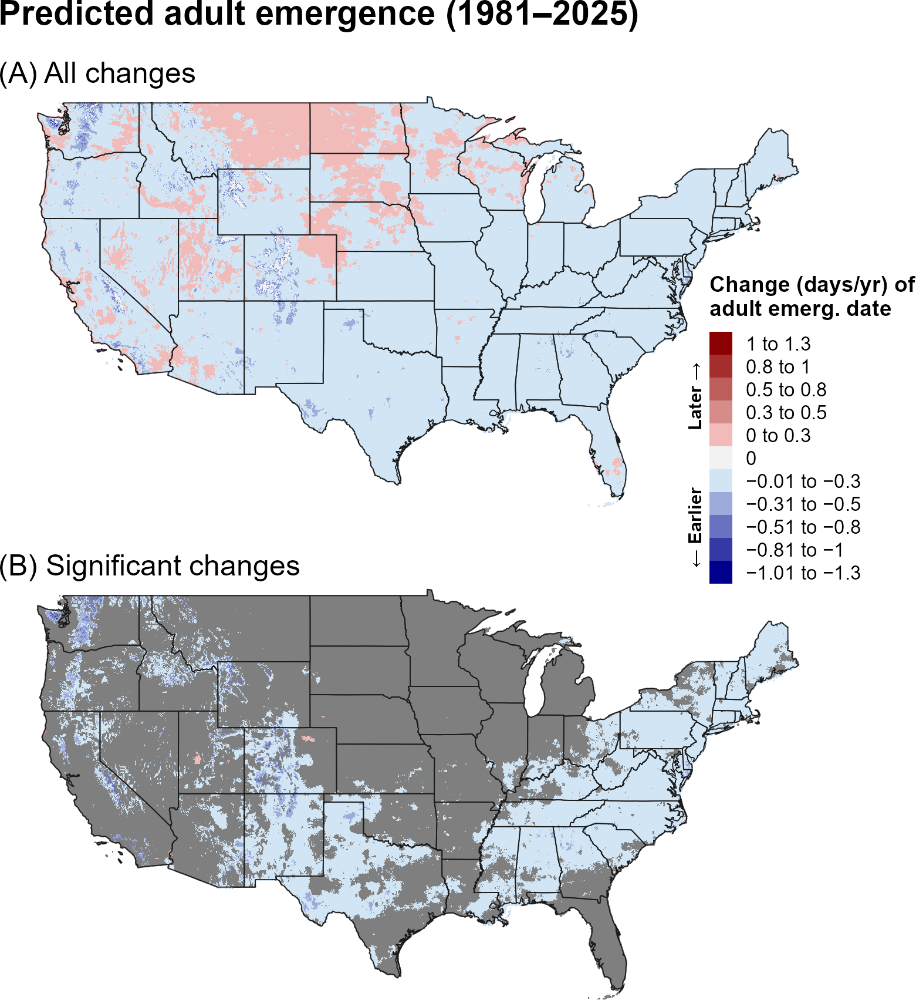
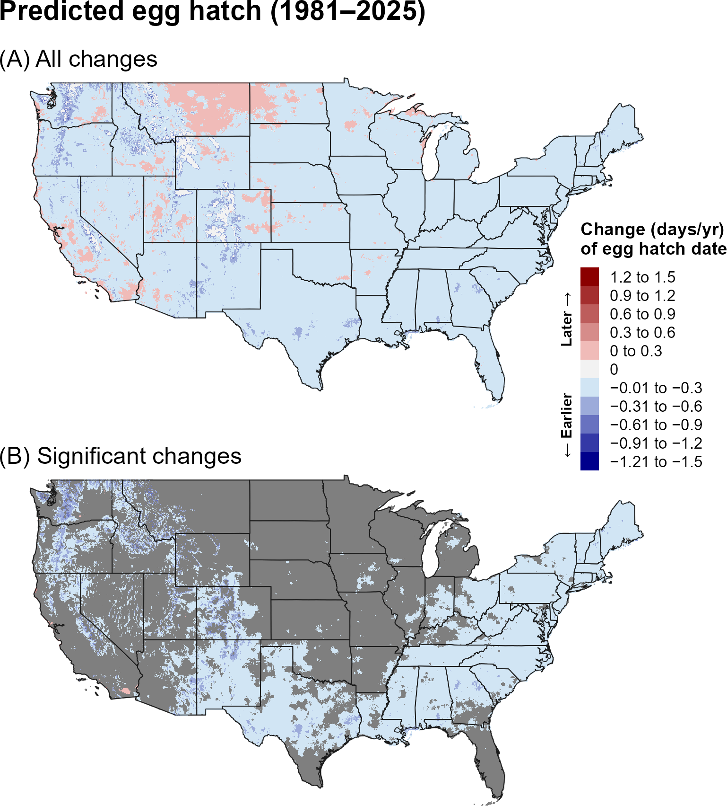
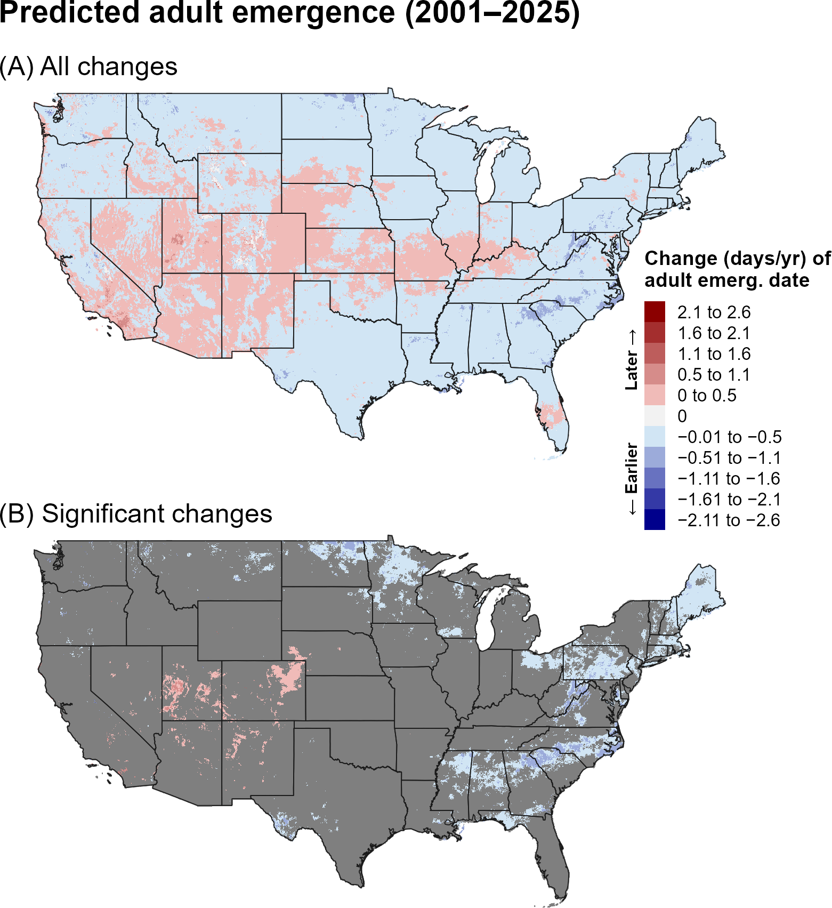
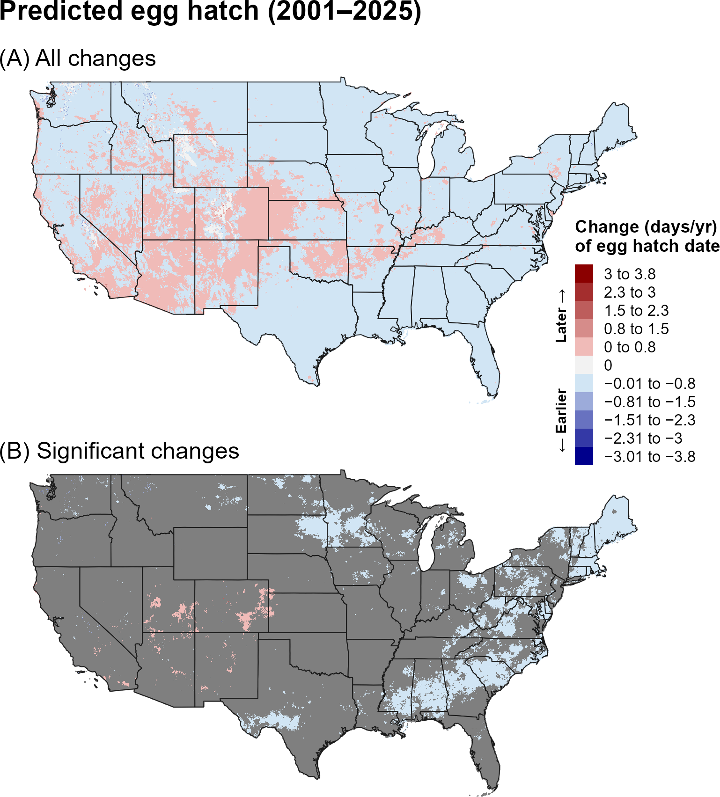
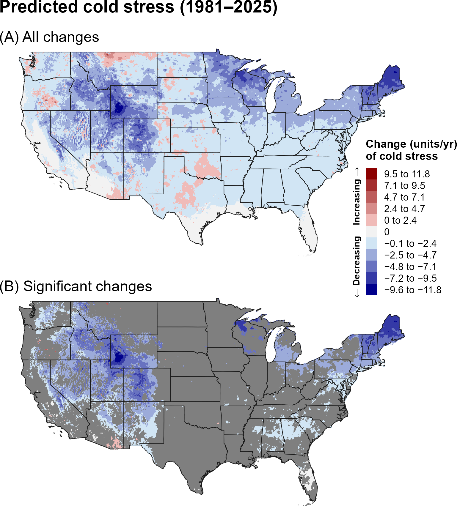
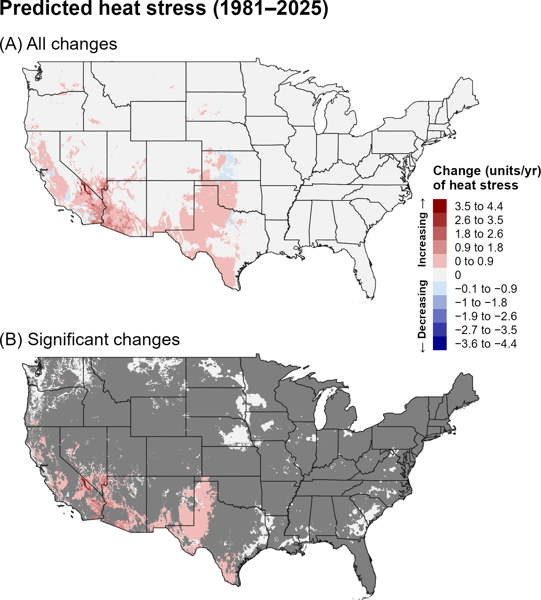
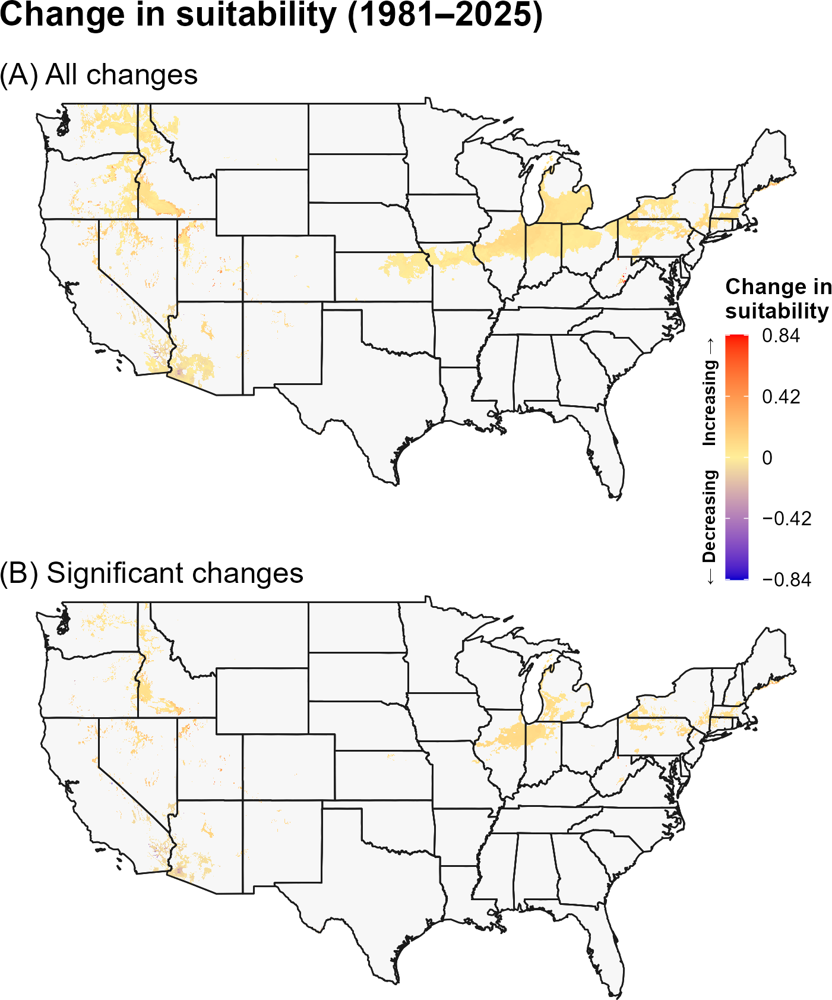
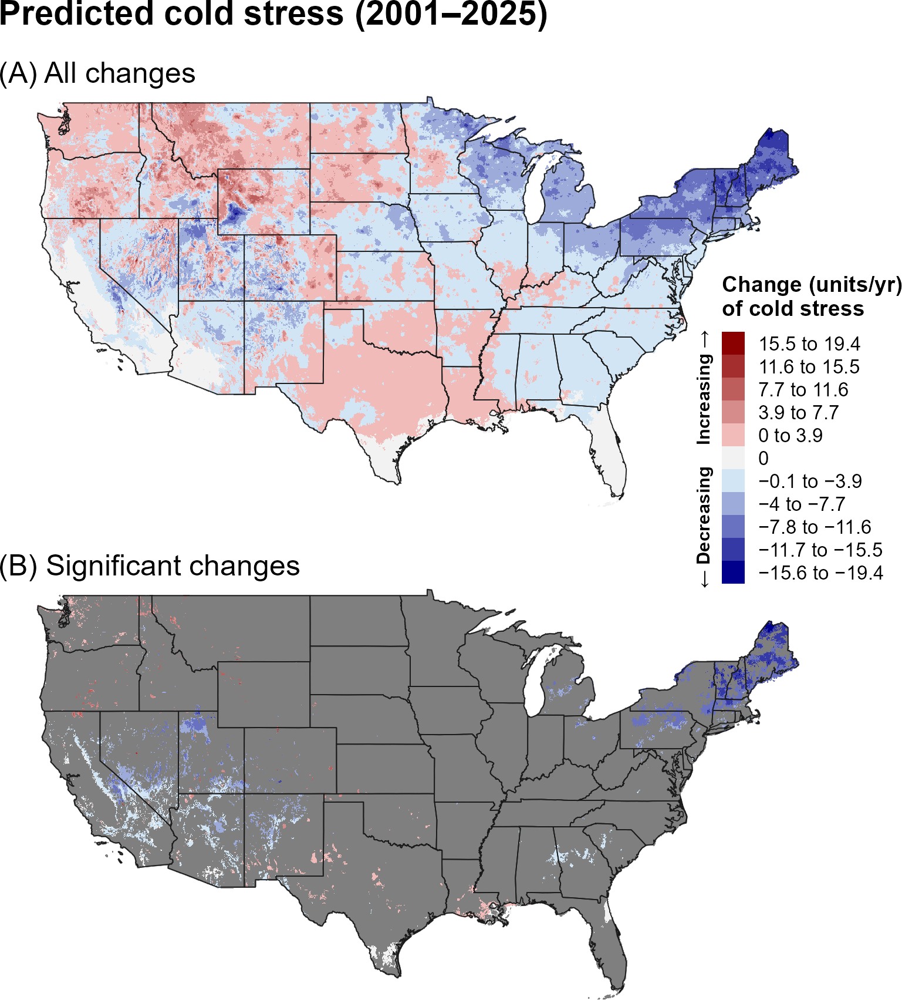
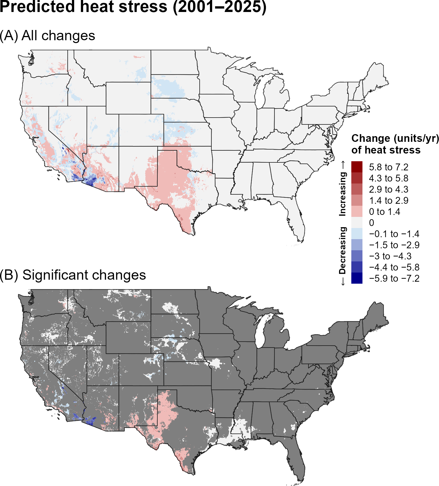
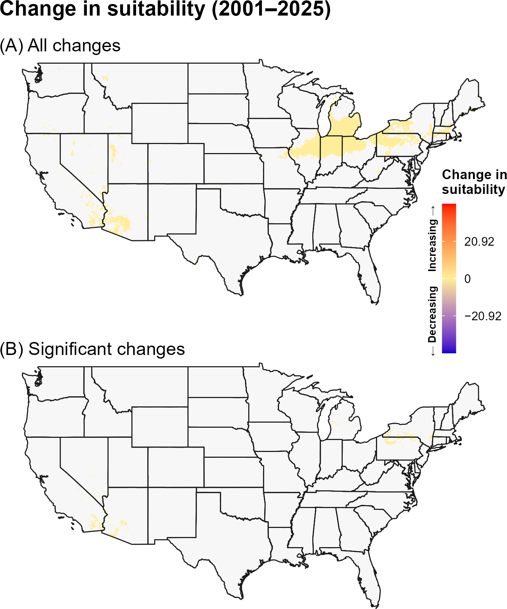

:::: {.content-visible when-format="html"}
::: {style="text-align: left;"}
[Download OWBW report as PDF](OWBW/OWBW.pdf){.btn .btn-primary}
:::
::::

## **11A. Introduction** {.unlisted}

The Old World bollworm (OWBW), *Helicoverpa armigera* (Hübner) (Lepidoptera: Noctuidae), is a highly polyphagous pest that feeds on agricultural crops from 68 plant families, including chickpea, corn, cotton, tobacco, tomato, potato, and soybean (`\hyperref[ref-cunningham-zalucki-2014]{Cunningham and Zalucki 2014}`{=latex}`<a href="#ref-cunningham-zalucki-2014">Cunningham and Zalucki 2014</a>`{=html}, `\hyperref[ref-eppo-2020]{EPPO 2020}`{=latex}`<a href="#ref-eppo-2020">EPPO 2020</a>`{=html}). Larvae are the primary damaging life stage of OWBW, as feeding by larvae directly damages vegetative and reproductive plant tissues and can cause substantial yield loss (`\hyperref[ref-rogers-brier-2010]{Rogers and Brier 2010}`{=latex}`<a href="#ref-rogers-brier-2010">Rogers and Brier 2010</a>`{=html}, `\hyperref[ref-cameron-2001]{Cameron et al. 2001}`{=latex}`<a href="#ref-cameron-2001">Cameron et al. 2001</a>`{=html}). It is widely distributed across much of Europe, Asia, Africa, and Australasia, and began expanding into Central and South America in 2013 (`\hyperref[ref-eppo-2025]{EPPO 2025}`{=latex}`<a href="#ref-eppo-2025">EPPO 2025</a>`{=html}). In 2015, several specimens were detected in Florida, although populations did not become established (`\hyperref[ref-florida-2015]{Florida Department of Agriculture and Consumer Services 2015}`{=latex}`<a href="#ref-florida-2015">Florida Department of Agriculture and Consumer Services 2015</a>`{=html}). The species is capable of long-distance migration, traveling up to 2,000 km when assisted by favorable winds (`\hyperref[ref-widmer-schofield-1983]{Widmer and Schofield 1983}`{=latex}`<a href="#ref-widmer-schofield-1983">Widmer and Schofield 1983</a>`{=html}). It has also developed resistance to multiple insecticides and some transgenic crops (`\hyperref[ref-efsa-2014]{EFSA 2014}`{=latex}`<a href="#ref-efsa-2014">EFSA 2014</a>`{=html}). If established in the United States, OWBW could place crops valued at an estimated $78 billion annually at risk of damage (`\hyperref[ref-kriticos-2015]{Kriticos et al. 2015}`{=latex}`<a href="#ref-kriticos-2015">Kriticos et al. 2015</a>`{=html}).

Environmental suitability for OWBW is widespread across the United States, with modeling studies predicting suitable conditions across much of the eastern United States and portions of the West (`\hyperref[ref-kriticos-2015]{Kriticos et al. 2015}`{=latex}`<a href="#ref-kriticos-2015">Kriticos et al. 2015</a>`{=html}, `\hyperref[ref-coop-2018]{Coop 2018}`{=latex}`<a href="#ref-coop-2018">Coop 2018</a>`{=html}). In the United States, the number of generations per year varies geographically, with up to 10 generations predicted in Florida, while generation numbers are lower in more temperate regions (`\hyperref[ref-coop-2018]{Coop 2018}`{=latex}`<a href="#ref-coop-2018">Coop 2018</a>`{=html}). Under favorable conditions, generations can be completed in approximately 30 days, and up to 12 generations per year have been reported in tropical regions (`\hyperref[ref-eppo-2020]{EPPO 2020}`{=latex}`<a href="#ref-eppo-2020">EPPO 2020</a>`{=html}). OWBW is highly fecund, with females producing up to 3,000–4,000 eggs and eggs hatching in as little as three days under optimal conditions (`\hyperref[ref-hardwick-1965]{Hardwick 1965}`{=latex}`<a href="#ref-hardwick-1965">Hardwick 1965</a>`{=html}, `\hyperref[ref-silva-2018]{Silva et al. 2018}`{=latex}`<a href="#ref-silva-2018">Silva et al. 2018</a>`{=html}). The species can enter facultative diapause in response to temperature and photoperiod, with diapause incidence increasing with latitude, short-day photoperiods at 20 °C can induce diapause during the early fifth instar, although low temperatures may also induce diapause independently of photoperiod under appropriate conditions (`\hyperref[ref-hackett-gatehouse-1982]{Hackett and Gatehouse 1982}`{=latex}`<a href="#ref-hackett-gatehouse-1982">Hackett and Gatehouse 1982</a>`{=html}, `\hyperref[ref-nibouche-1998]{Nibouche 1998}`{=latex}`<a href="#ref-nibouche-1998">Nibouche 1998</a>`{=html}, `\hyperref[ref-kurban-2005]{Kurban et al. 2005}`{=latex}`<a href="#ref-kurban-2005">Kurban et al. 2005</a>`{=html}, `\hyperref[ref-mironidis-savopoulou-soultani-2012]{Mironidis and Savopoulou-Soultani 2012}`{=latex}`<a href="#ref-mironidis-savopoulou-soultani-2012">Mironidis and Savopoulou-Soultani 2012</a>`{=html}, `\hyperref[ref-shimizu-2006]{Shimizu et al. 2006}`{=latex}`<a href="#ref-shimizu-2006">Shimizu et al. 2006</a>`{=html}). Development and population dynamics may also vary among host plant species (`\hyperref[ref-liu-2004]{Liu et al. 2004}`{=latex}`<a href="#ref-liu-2004">Liu et al. 2004</a>`{=html}, `\hyperref[ref-silva-2018]{Silva et al. 2018}`{=latex}`<a href="#ref-silva-2018">Silva et al. 2018</a>`{=html}).

A model for OWBW developed for the Degree-Day, establishment Risk, and Phenological event mapping system (DDRP) is operationalized to produce near real-time forecasts for the contiguous United States (CONUS) at <https://uspest.org/DDRP>. The phenology model applies a lower developmental threshold of 10.6 ºC and upper threshold of 38 ºC for all life stages (egg, larva, pupa, and adult) and assumes the pupa is the overwintering stage. The climatic suitability model applies a lower cold stress threshold and upper heat stress threshold of −4 °C and 39 °C, respectively. The full set of model parameters for OWBW, including degree-day requirements for individual life stages and climate stress limits, are presented in @tbl-owbw-parameters. Details on model parameterization are Online at USPest.org (`\hyperref[ref-coop-2018]{Coop 2018}`{=latex}`<a href="#ref-coop-2018">Coop 2018</a>`{=html}).


## **11B. Results** {.unlisted}

### **i. Phenology**

#### **Entire period: 1981--2025**

Over 1981–2025, predicted adult emergence and egg hatch generally shifted earlier across much of the southern and western United States, with later events across portions of the northern interior (@fig-owbw-emergence, @fig-owbw-egg-hatch). Significant changes were concentrated in the eastern and central United States and in scattered western areas.

```{r}
#| echo: false
#| out-width: 70%
#| fig-align: center
#| fig-cap: "Changes (days/year) in predicted dates of first adult emergence for OWBW across the CONUS over the entire 44-year period (1981–2025). Maps show (A) all changes and (B) statistically significant changes (P < 0.1); areas shown in gray are not statistically significant."
#| label: fig-owbw-emergence

```

```{r}
#| echo: false
#| out-width: 70%
#| fig-align: center
#| fig-cap: "Changes (days/year) in predicted dates of first egg hatch for OWBW across the CONUS over the entire 44-year period (1981–2025). Maps show (A) all changes and (B) statistically significant changes (P < 0.1); areas shown in gray are not statistically significant."
#| label: fig-owbw-egg-hatch

```

#### **Recent period: 2001--2025**

During 2001–2025, earlier phenology remained widespread across much of the West and central United States, while later events were evident in portions of the northern and eastern interior (@fig-owbw-emergence-recent, @fig-owbw-egg-hatch-recent). Significant changes were less spatially extensive than over the full period.

```{r}
#| echo: false
#| out-width: 70%
#| fig-align: center
#| fig-cap: "Changes (days/year) in predicted dates of first adult emergence for OWBW across the CONUS over the recent 24-year period (2001–2025). Maps show (A) all changes and (B) statistically significant changes (P < 0.1); areas shown in gray are not statistically significant."
#| label: fig-owbw-emergence-recent

```

```{r}
#| echo: false
#| out-width: 70%
#| fig-align: center
#| fig-cap: "Changes (days/year) in predicted dates of first egg hatch for OWBW across the CONUS over the recent 24-year period (2001–2025). Maps show (A) all changes and (B) statistically significant changes (P < 0.1); areas shown in gray are not statistically significant."
#| label: fig-owbw-egg-hatch-recent

```

### **ii. Climatic suitability**

#### **Entire period: 1981--2025**

Predicted cold stress decreased across much of the northern United States over 1981–2025, while heat stress increased in the Southwest and southern Great Plains (@fig-owbw-cold-stress, @fig-owbw-heat-stress). Significant increases in climatic suitability occurred primarily in portions of the Great Lakes and Northeast, with smaller areas elsewhere (@fig-owbw-suitability).

```{r}
#| echo: false
#| out-width: 70%
#| fig-align: center
#| fig-cap: "Changes (units/year) in predicted cold stress for OWBW across the CONUS over the entire 44-year period (1981–2025). Maps show (A) all changes and (B) statistically significant changes (P < 0.1); areas shown in gray are not statistically significant. Areas shown as 0 in (B) had significant trends but very small changes."
#| label: fig-owbw-cold-stress

```

```{r}
#| echo: false
#| out-width: 70%
#| fig-align: center
#| fig-cap: "Changes (units/year) in predicted heat stress for OWBW across the CONUS over the entire 44-year period (1981–2025). Maps show (A) all changes and (B) statistically significant changes (P < 0.1); areas shown in gray are not statistically significant. Areas shown as 0 in (B) had significant trends but very small changes."
#| label: fig-owbw-heat-stress

```

```{r}
#| echo: false
#| out-width: 70%
#| fig-align: center
#| fig-cap: "Changes in predicted climatic suitability for OWBW across the CONUS over the 44-year period (1981–2025). Suitability is defined as areas not excluded by climate stress. Positive changes (warmer colors) indicate an increased likelihood of establishment, whereas negative changes (cooler colors) indicate a decreased likelihood of establishment."
#| label: fig-owbw-suitability

```

#### **Recent period: 2001--2025**

During 2001–2025, increases in cold stress were evident across portions of the northern and central interior, whereas heat stress continued to increase in the Southwest and southern Great Plains (@fig-owbw-cold-stress-recent, @fig-owbw-heat-stress-recent). Climatic-suitability changes were more limited during the recent period, although increases persisted in parts of the northern United States (@fig-owbw-suitability-recent).

```{r}
#| echo: false
#| out-width: 70%
#| fig-align: center
#| fig-cap: "Changes (units/year) in predicted cold stress for OWBW across the CONUS over the recent 24-year period (2001–2025). Maps show (A) all changes and (B) statistically significant changes (P < 0.1); areas shown in gray are not statistically significant. Areas shown as 0 in (B) had significant trends but very small changes."
#| label: fig-owbw-cold-stress-recent

```

```{r}
#| echo: false
#| out-width: 70%
#| fig-align: center
#| fig-cap: "Changes (units/year) in predicted heat stress for OWBW across the CONUS over the recent 24-year period (2001–2025). Maps show (A) all changes and (B) statistically significant changes (P < 0.1); areas shown in gray are not statistically significant. Areas shown as 0 in (B) had significant trends but very small changes."
#| label: fig-owbw-heat-stress-recent

```

```{r}
#| echo: false
#| out-width: 70%
#| fig-align: center
#| fig-cap: "Changes in predicted climatic suitability for OWBW across the CONUS over the recent 24-year period (2001–2025). Suitability is defined as areas not excluded by climate stress. Positive changes (warmer colors) indicate an increased likelihood of establishment, whereas negative changes (cooler colors) indicate a decreased likelihood of establishment."
#| label: fig-owbw-suitability-recent

```

## **11C. Discussion** {.unlisted}

The OWBW maps indicate widespread regional changes in phenological timing, with earlier adult emergence and egg hatch occurring across many portions of the CONUS over the full period. Because OWBW is highly polyphagous and can have multiple generations in suitable climates, earlier development could increase the period available for population growth and reproduction in regions that remain environmentally suitable.

The decline in cold stress across northern regions and corresponding increases in climatic suitability suggest a potential reduction in cold limitation over the long term. Increasing heat stress in the Southwest may counteract this effect at the warm end of the species' climatic range. The more limited recent-period suitability changes indicate that establishment potential has not changed uniformly during the shorter period.

The stronger and more spatially extensive trends in predicted phenology and climate stress over the full 44-year period may reflect both the larger sample size, which can reduce noise and improve detection of directional patterns, and differences in the underlying climate trends between the two time periods. In particular, the recent 24-year period may capture climate variability or regional trends that differ from those observed over the longer 44-year period. Thus, differences between the two periods should be interpreted as reflecting both long-term climate trends and shorter-term regional variability.

## **11D. References** {.unlisted}

\begingroup
\setlength{\parindent}{-0.5in}
\setlength{\leftskip}{0.5in}

\noindent

<span id="ref-coop-2018"></span>
\phantomsection\label{ref-coop-2018}

Coop, K. 2018. IPPC Model Analysis Summary: Old world bollworm (OWBW) (*Helicoverpa armigera*) Phenology (degree-day) Model. Developed for Animal and Plant Health Inspection Service (APHIS) – Plant Protection and Quarantine (PPQ) – Cooperative Agricultural Pest Survey (CAPS). Vs. 1.1 (4/2/2018). Online at: <https://uspest.org/wea/Helicoverpa_armigera_model.pdf>  (accessed 5 November 2025).

<span id="ref-cameron-2001"></span>
\phantomsection\label{ref-cameron-2001}

Cameron PJ, Walker GP, Herman TJB, Wallace AR. 2001. Development of economic thresholds and monitoring systems for Helicoverpa armigera (Lepidoptera: Noctuidae) in tomatoes. Journal of Economic Entomology 94:1104–1112. DOI: 10.1603/0022-0493-94.5.1104.

<span id="ref-cunningham-zalucki-2014"></span>
\phantomsection\label{ref-cunningham-zalucki-2014}

Cunningham, J. P., and M. P. Zalucki. 2014. Understanding heliothine (Lepidoptera: Heliothinae) pests: what is a host plant? Journal of Economic Entomology 107:881–896.

<span id="ref-efsa-2014"></span>
\phantomsection\label{ref-efsa-2014}

EFSA. 2014. Scientific opinion on the pest categorisation of *Helicoverpa armigera* (Hübner). EFSA Journal 12:3833.

<span id="ref-eppo-2020"></span>
\phantomsection\label{ref-eppo-2020}

EPPO. 2020. *Helicoverpa armigera*. EPPO datasheets on pests recommended for regulation. Online at: <https://gd.eppo.int/> (accessed 5 November 2025).

<span id="ref-eppo-2025"></span>
\phantomsection\label{ref-eppo-2025}

EPPO. 2025. EPPO global database distribution. Online at: <https://gd.eppo.int/taxon/HELIAR/distribution> (accessed 16 September 2026).

<span id="ref-florida-2015"></span>
\phantomsection\label{ref-florida-2015}

Florida Department of Agriculture and Consumer Services, Division of Plant Industry. 2015. Pest alert: *Helicoverpa armigera* (Lepidoptera: Noctuidae), the Old World bollworm. J. E. Hayden and J. Brambila. June 1, 2015.

<span id="ref-hackett-gatehouse-1982"></span>
\phantomsection\label{ref-hackett-gatehouse-1982}

Hackett, D. S., and A. G. Gatehouse. 1982. Diapause in Heliothis armigera (Hübner) and H. fletcheri (Hardwick) (Lepidoptera: Noctuidae) in the Sudan Gezira. Bulletin of Entomological Research 72:409–422.

<span id="ref-hardwick-1965"></span>
\phantomsection\label{ref-hardwick-1965}

Hardwick, D. F. 1965. The corn earworm complex. Memoirs of the Entomological Society of Canada 97:5–247.

<span id="ref-kriticos-2015"></span>
\phantomsection\label{ref-kriticos-2015}

Kriticos, D. J., N. Ota, W. D. Hutchison, J. Beddow, T. Walsh, W. T. Tay, D. M. Borchert, S. V. Paula-Moreas, C. Czepak, and M. P. Zalucki. 2015. The potential distribution of invading *Helicoverpa armigera* in North America: Is it just a matter of time? PLoS ONE 10:e0119618.

<span id="ref-kurban-2005"></span>
\phantomsection\label{ref-kurban-2005}

Kurban, A., H. Yoshida, Y. Izumi, S. Sonoda, and H. Tsumuki. 2005. Pupal diapause of *Helicoverpa armigera*: Sensitive stage for photoperiodic induction. Applied Entomology and Zoology 40:457–460.

<span id="ref-liu-2004"></span>
\phantomsection\label{ref-liu-2004}

Liu, Z., D. Li, P. Gong, and K. Wu. 2004. Life table studies of the cotton bollworm, *Helicoverpa armigera* (Hübner) (Lepidoptera: Noctuidae), on different host plants. Environmental Entomology 33:1570–1576.

<span id="ref-mironidis-savopoulou-soultani-2012"></span>
\phantomsection\label{ref-mironidis-savopoulou-soultani-2012}

Mironidis, G. K., and M. Savopoulou-Soultani. 2012. Effects of constant and changing temperature conditions on diapause induction in *Helicoverpa armigera* (Lepidoptera: Noctuidae). Bulletin of Entomological Research 102:139–147.

<span id="ref-nibouche-1998"></span>
\phantomsection\label{ref-nibouche-1998}

Nibouche, S. 1998. High temperature induced diapause in the cotton bollworm *Helicoverpa armigera*. Entomologia Experimentalis et Applicata 87:271–274.

<span id="ref-rogers-brier-2010"></span>
\phantomsection\label{ref-rogers-brier-2010}

Rogers, D. J., and H. Brier. 2010. Pest-damage relationships for *Helicoverpa armigera* (Hübner) (Lepidoptera: Noctuidae) on soybean (Glycine max) and dry bean (Phaseolus vulgaris) during pod-fill. Crop Protection 29:47–57.

<span id="ref-shimizu-2006"></span>
\phantomsection\label{ref-shimizu-2006}

Shimizu, K., K. Shimizu, and K. Fujisaki. 2006. Timing of diapause induction and overwintering success in the cotton bollworm *Helicoverpa armigera* (Hb.) (Lepidoptera: Noctuidae) under outdoor conditions in temperate Japan. Applied Entomology and Zoology 41:151–159.

<span id="ref-silva-2018"></span>
\phantomsection\label{ref-silva-2018}

Silva, I. F., E. L. L. Baldin, A. Specht, D. R. Sosa-Gómez, V. F. Roque-Specht, R. Morando, and S. V. Paula-Moraes. 2018. Biotic potential and life table of *Helicoverpa armigera* (Hübner) (Lepidoptera: Noctuidae) from three Brazilian regions. Neotropical Entomology 47:344–351.

<span id="ref-widmer-schofield-1983"></span>
\phantomsection\label{ref-widmer-schofield-1983}

Widmer, M., and P. Schofield. 1983. Heliothis dispersal and migration. Tropical Development and Research Institute, London, UK. 41 p.

\par
\endgroup
