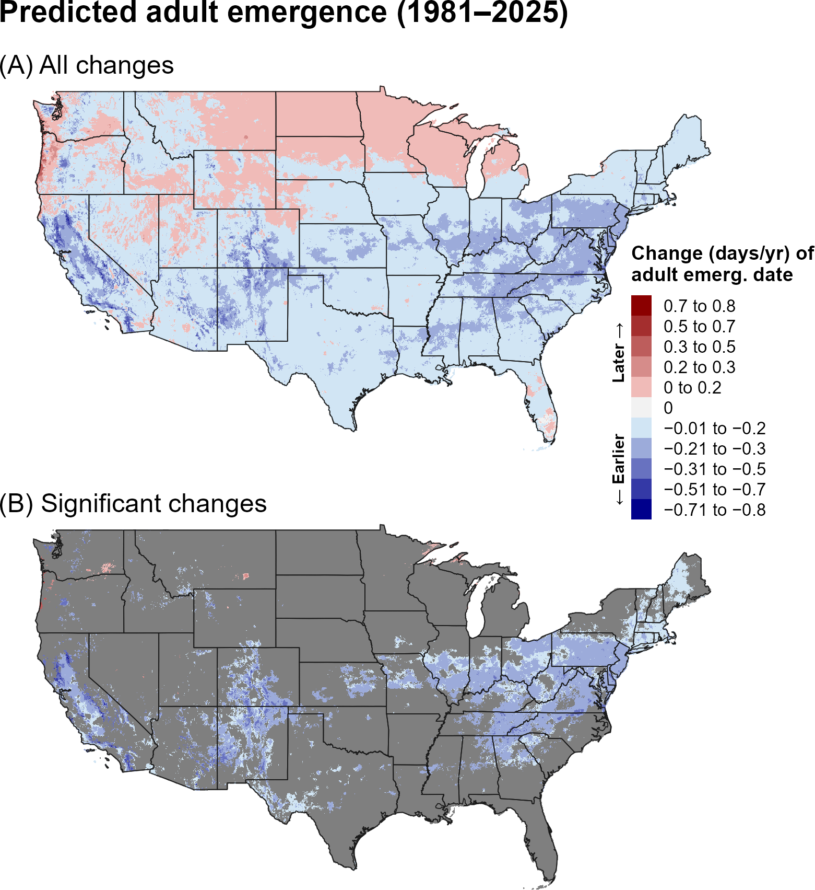
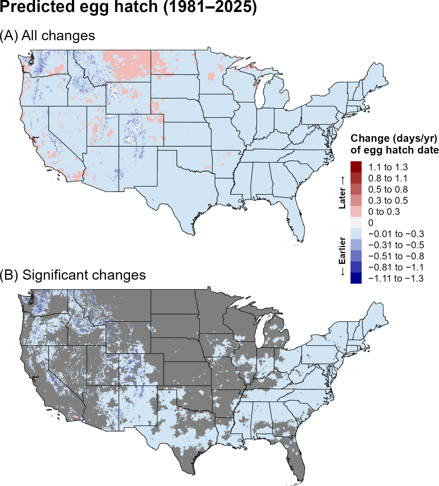
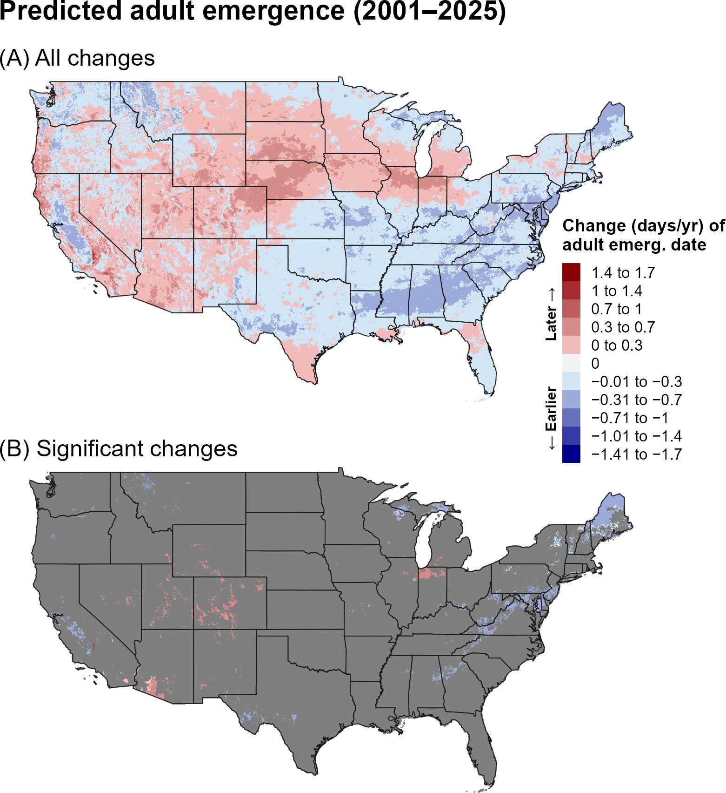
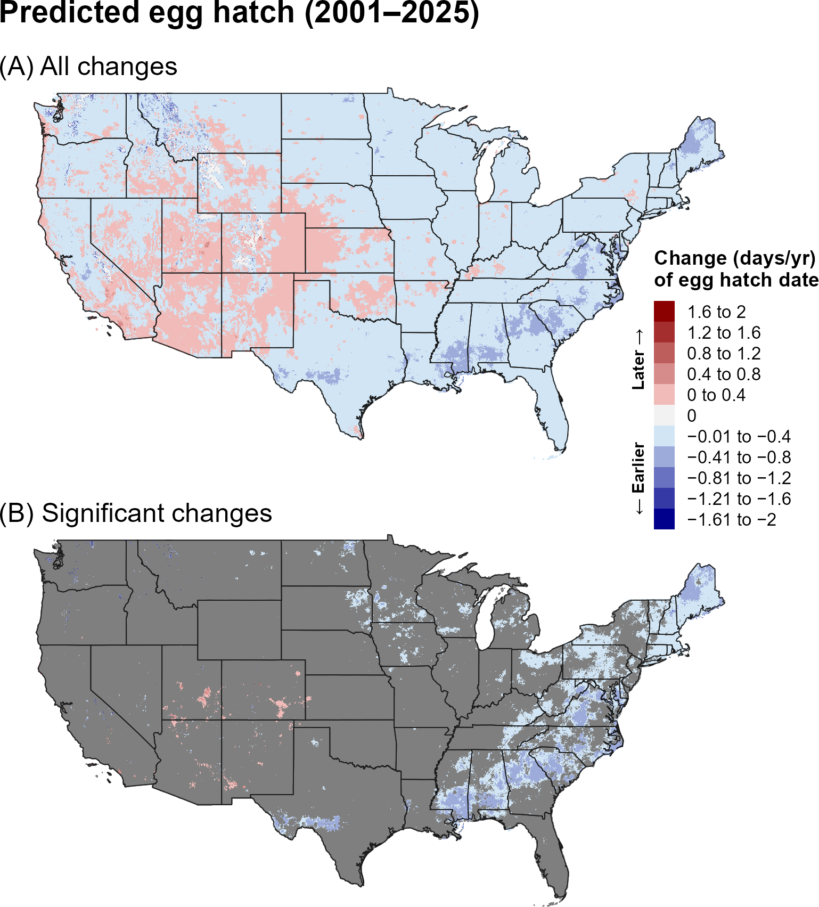
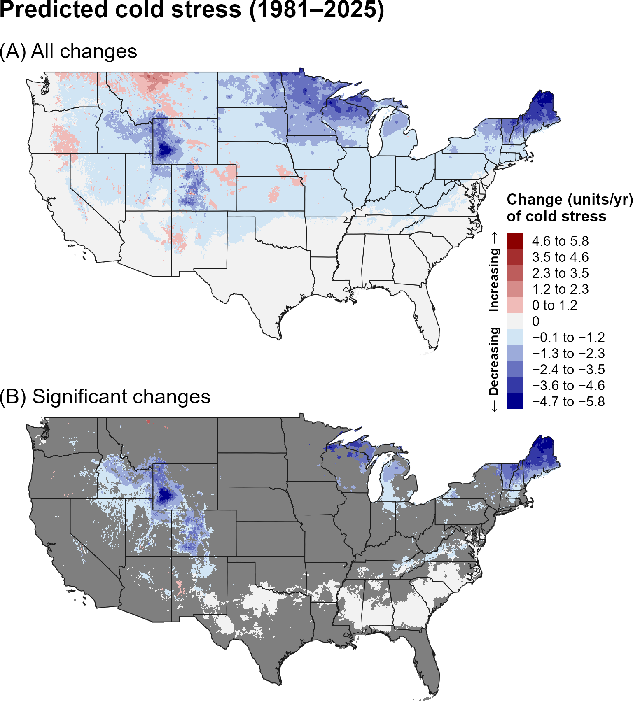
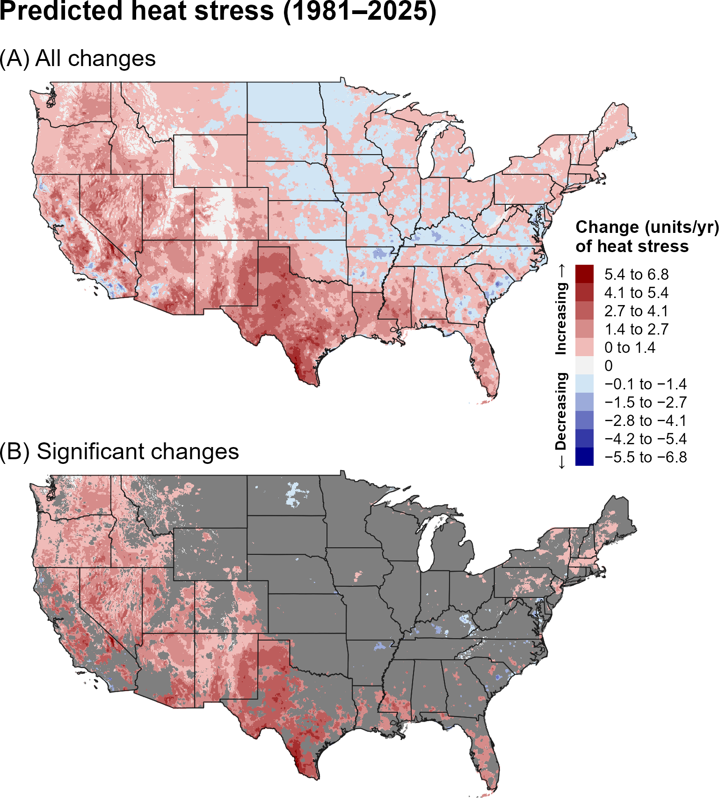
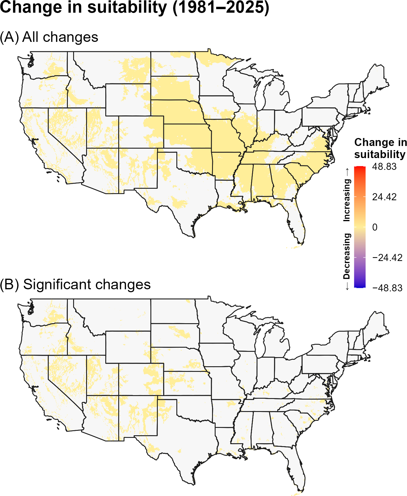
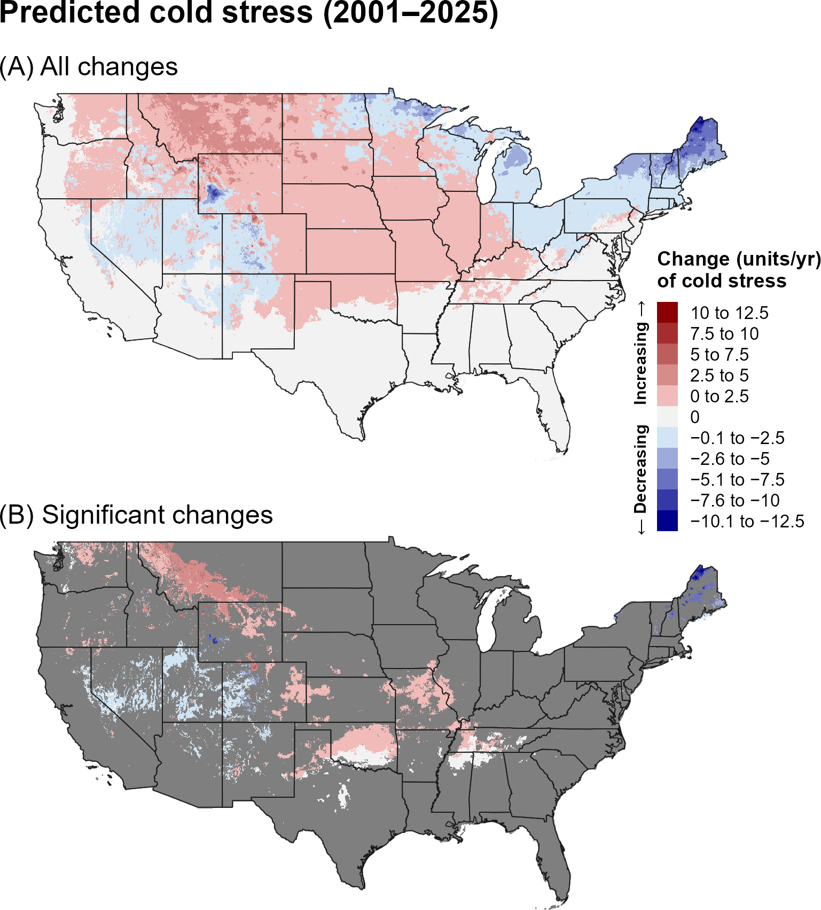
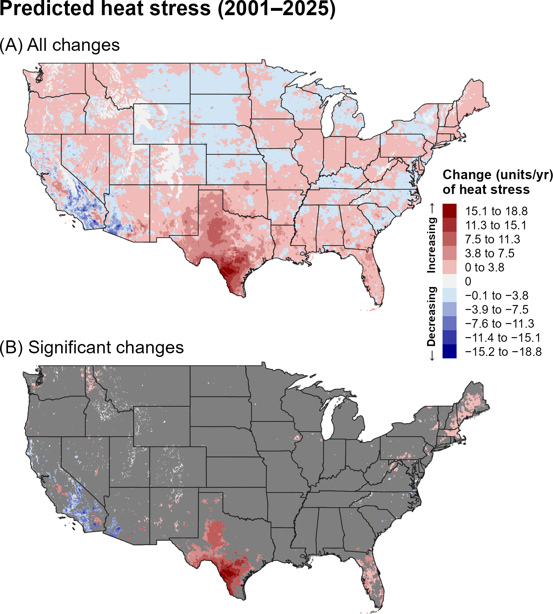
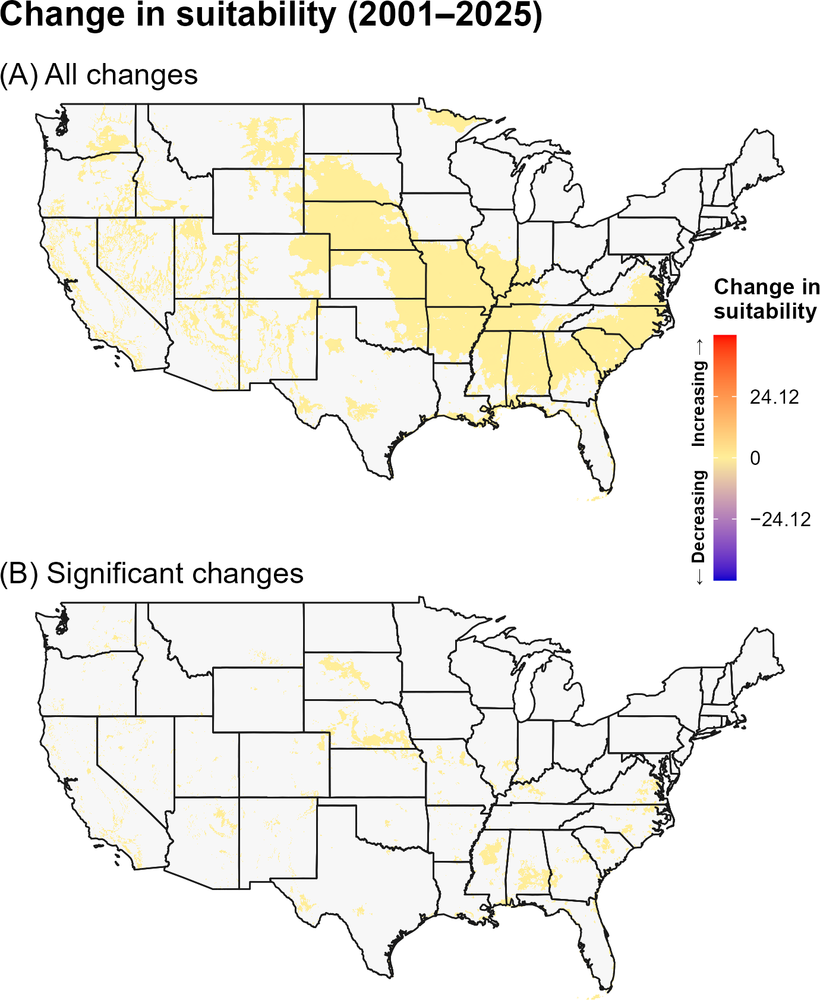

:::: {.content-visible when-format="html"}
::: {style="text-align: left;"}
[Download PTLM report as PDF](PTLM.pdf){.btn .btn-primary}
:::
::::

## **12A. Introduction** {.unlisted}

The pine-tree lappet moth, *Dendrolimus pini* Linnaeus (Lepidoptera: Lasiocampidae) (PTLM), is an economically important pest of pine trees that is native to Europe and Asia (`\hyperref[ref-hardin-suazo-2012]{Hardin and Suazo 2012}`{=latex}`<a href="#ref-hardin-suazo-2012">Hardin and Suazo 2012</a>`{=html}). Its current range includes Europe, Russia, Kazakhstan, Northern China, and Morocco (`\hyperref[ref-hardin-suazo-2012]{Hardin and Suazo 2012}`{=latex}`<a href="#ref-hardin-suazo-2012">Hardin and Suazo 2012</a>`{=html}, `\hyperref[ref-eppo-2024]{EPPO 2024}`{=latex}`<a href="#ref-eppo-2024">EPPO 2024</a>`{=html}). PTLM’s primary host is the Scots pine (*Pinus sylvestris*), but it can successfully develop on 17 other species of pine, Douglas fir (*Pseudotsuga menziesii*), and Eastern hemlock (*Tsuga canadensis*), and may be able to successfully develop on *Pinus* spp. outside of its current range (`\hyperref[ref-hardin-suazo-2012]{Hardin and Suazo 2012}`{=latex}`<a href="#ref-hardin-suazo-2012">Hardin and Suazo 2012</a>`{=html}, `\hyperref[ref-lukowski-2021]{Łukowski 2021}`{=latex}`<a href="#ref-lukowski-2021">Łukowski 2021</a>`{=html}). Surviving affected trees take several years to recover from defoliation and are more susceptible to other forest pests (`\hyperref[ref-hardin-suazo-2012]{Hardin and Suazo 2012}`{=latex}`<a href="#ref-hardin-suazo-2012">Hardin and Suazo 2012</a>`{=html}). If introduced to the United States, PTLM could cause significant damage to forests dominated by pine and monoculture pin plantations, potentially resulting in economic damage to the timber and Christmas tree industries (`\hyperref[ref-hardin-suazo-2012]{Hardin and Suazo 2012}`{=latex}`<a href="#ref-hardin-suazo-2012">Hardin and Suazo 2012</a>`{=html}, `\hyperref[ref-ray-2016]{Ray et al. 2016}`{=latex}`<a href="#ref-ray-2016">Ray et al. 2016</a>`{=html}).

Climate suitability models indicate that PTLM could establish across much of the contiguous United States, although predictions vary among models, with the most suitable areas generally concentrated in temperate forest regions of the Northeast, Midwest, Appalachia, and Pacific Northwest (`\hyperref[ref-barker-coop-2020]{Barker and Coop 2020}`{=latex}`<a href="#ref-barker-coop-2020">Barker and Coop 2020</a>`{=html}, `\hyperref[ref-hardin-suazo-2012]{Hardin and Suazo 2012}`{=latex}`<a href="#ref-hardin-suazo-2012">Hardin and Suazo 2012</a>`{=html}). In Europe, the species is typically univoltine but may require two or more years to complete its life cycle in cooler regions (`\hyperref[ref-moore-evans-2016]{Moore and Evans 2016}`{=latex}`<a href="#ref-moore-evans-2016">Moore and Evans 2016</a>`{=html}, `\hyperref[ref-sukovata-2019]{Sukovata 2019}`{=latex}`<a href="#ref-sukovata-2019">Sukovata 2019</a>`{=html}). DDRP predicts one generation per year across much of the western and northern United States, two generations in parts of Appalachia and the Midwest, and three to four generations in portions of the Southeast (`\hyperref[ref-barker-coop-2020]{Barker and Coop 2020}`{=latex}`<a href="#ref-barker-coop-2020">Barker and Coop 2020</a>`{=html}). Host species can affect larval and pupal development rates, and photoperiod regulates diapause and subsequent spring emergence (`\hyperref[ref-hardin-suazo-2012]{Hardin and Suazo 2012}`{=latex}`<a href="#ref-hardin-suazo-2012">Hardin and Suazo 2012</a>`{=html}, `\hyperref[ref-winokur-1991]{Winokur 1991}`{=latex}`<a href="#ref-winokur-1991">Winokur 1991</a>`{=html}, `\hyperref[ref-lukowski-2021]{Łukowski 2021}`{=latex}`<a href="#ref-lukowski-2021">Łukowski 2021</a>`{=html}). PTLM outbreaks have also been associated with warmer and drier conditions, which may influence pest development directly or indirectly through effects on the host plant (`\hyperref[ref-lesniak-1976]{Lesniak 1976}`{=latex}`<a href="#ref-lesniak-1976">Lesniak 1976</a>`{=html}, `\hyperref[ref-hardin-suazo-2012]{Hardin and Suazo 2012}`{=latex}`<a href="#ref-hardin-suazo-2012">Hardin and Suazo 2012</a>`{=html}, `\hyperref[ref-moore-evans-2016]{Moore and Evans 2016}`{=latex}`<a href="#ref-moore-evans-2016">Moore and Evans 2016</a>`{=html}, `\hyperref[ref-hentschel-2018]{Hentschel et al. 2018}`{=latex}`<a href="#ref-hentschel-2018">Hentschel et al. 2018</a>`{=html}).

A model for PTLM developed for the Degree-Day, establishment Risk, and Phenological event mapping system (DDRP) is operationalized to produce near real-time forecasts for the contiguous United States (CONUS) at <https://uspest.org/DDRP>. The phenology model applies a lower developmental threshold of 7.2 ºC and upper threshold of 30.0 ºC for all life stages (egg, larva, pupa, and adult) and assumes the larva is the overwintering stage. The climatic suitability model applies a lower cold stress threshold and upper heat stress threshold of −15 °C and 30 °C, respectively. The full set of model parameters for PTLM, including degree-day requirements for individual life stages and climate stress limits, are presented in @tbl-ptlm-parameters. Details on model parameterization are Online at USPest.org (`\hyperref[ref-barker-coop-2020]{Barker and Coop 2020}`{=latex}`<a href="#ref-barker-coop-2020">Barker and Coop 2020</a>`{=html}).

## **12B. Results** {.unlisted}

### **i. Phenology**

#### **Entire period: 1981--2025**

Over 1981–2025, predicted adult emergence and egg hatch showed mixed spatial trends, with earlier events common across the southern and eastern United States and later events occurring in portions of the northern interior (@fig-ptlm-emergence, @fig-ptlm-egg-hatch). Significant changes were concentrated in the eastern and central United States.

```{r}
#| echo: false
#| out-width: 70%
#| fig-align: center
#| fig-cap: "Changes (days/year) in predicted dates of first adult emergence for PTLM across the CONUS over the entire 44-year period (1981–2025). Maps show (A) all changes and (B) statistically significant changes (P < 0.1); areas shown in gray are not statistically significant."
#| label: fig-ptlm-emergence

```

```{r}
#| echo: false
#| out-width: 70%
#| fig-align: center
#| fig-cap: "Changes (days/year) in predicted dates of first egg hatch for PTLM across the CONUS over the entire 44-year period (1981–2025). Maps show (A) all changes and (B) statistically significant changes (P < 0.1); areas shown in gray are not statistically significant."
#| label: fig-ptlm-egg-hatch

```

#### **Recent period: 2001--2025**

During 2001–2025, predicted egg hatch generally shifted earlier across much of the western and central United States, whereas adult emergence showed a more mixed pattern, including later events across portions of the northern and central interior (@fig-ptlm-emergence-recent, @fig-ptlm-egg-hatch-recent). Significant changes were spatially limited.

```{r}
#| echo: false
#| out-width: 70%
#| fig-align: center
#| fig-cap: "Changes (days/year) in predicted dates of first adult emergence for PTLM across the CONUS over the recent 24-year period (2001–2025). Maps show (A) all changes and (B) statistically significant changes (P < 0.1); areas shown in gray are not statistically significant."
#| label: fig-ptlm-emergence-recent

```

```{r}
#| echo: false
#| out-width: 70%
#| fig-align: center
#| fig-cap: "Changes (days/year) in predicted dates of first egg hatch for PTLM across the CONUS over the recent 24-year period (2001–2025). Maps show (A) all changes and (B) statistically significant changes (P < 0.1); areas shown in gray are not statistically significant."
#| label: fig-ptlm-egg-hatch-recent

```

### **ii. Climatic suitability**

#### **Entire period: 1981--2025**

Predicted cold stress decreased across much of the northern United States over 1981–2025, while heat stress increased broadly across the western and southern United States (@fig-ptlm-cold-stress, @fig-ptlm-heat-stress). Significant increases in climatic suitability occurred across portions of the central and eastern United States, with additional localized areas in the West (@fig-ptlm-suitability).

```{r}
#| echo: false
#| out-width: 70%
#| fig-align: center
#| fig-cap: "Changes (units/year) in predicted cold stress for PTLM across the CONUS over the entire 44-year period (1981–2025). Maps show (A) all changes and (B) statistically significant changes (P < 0.1); areas shown in gray are not statistically significant. Areas shown as 0 in (B) had significant trends but very small changes."
#| label: fig-ptlm-cold-stress

```

```{r}
#| echo: false
#| out-width: 70%
#| fig-align: center
#| fig-cap: "Changes (units/year) in predicted heat stress for PTLM across the CONUS over the entire 44-year period (1981–2025). Maps show (A) all changes and (B) statistically significant changes (P < 0.1); areas shown in gray are not statistically significant. Areas shown as 0 in (B) had significant trends but very small changes."
#| label: fig-ptlm-heat-stress

```

```{r}
#| echo: false
#| out-width: 70%
#| fig-align: center
#| fig-cap: "Changes in predicted climatic suitability for PTLM across the CONUS over the 44-year period (1981–2025). Suitability is defined as areas not excluded by climate stress. Positive changes (warmer colors) indicate an increased likelihood of establishment, whereas negative changes (cooler colors) indicate a decreased likelihood of establishment."
#| label: fig-ptlm-suitability

```

#### **Recent period: 2001--2025**

During 2001–2025, cold-stress changes became more mixed, with increases across portions of the northern and central interior (@fig-ptlm-cold-stress-recent). Heat stress continued to increase broadly in the West and South (@fig-ptlm-heat-stress-recent). Climatic-suitability increases were more spatially limited during the recent period but remained evident in portions of the central and eastern United States (@fig-ptlm-suitability-recent).

```{r}
#| echo: false
#| out-width: 70%
#| fig-align: center
#| fig-cap: "Changes (units/year) in predicted cold stress for PTLM across the CONUS over the recent 24-year period (2001–2025). Maps show (A) all changes and (B) statistically significant changes (P < 0.1); areas shown in gray are not statistically significant. Areas shown as 0 in (B) had significant trends but very small changes."
#| label: fig-ptlm-cold-stress-recent

```

```{r}
#| echo: false
#| out-width: 70%
#| fig-align: center
#| fig-cap: "Changes (units/year) in predicted heat stress for PTLM across the CONUS over the recent 24-year period (2001–2025). Maps show (A) all changes and (B) statistically significant changes (P < 0.1); areas shown in gray are not statistically significant. Areas shown as 0 in (B) had significant trends but very small changes."
#| label: fig-ptlm-heat-stress-recent

```

```{r}
#| echo: false
#| out-width: 70%
#| fig-align: center
#| fig-cap: "Changes in predicted climatic suitability for PTLM across the CONUS over the recent 24-year period (2001–2025). Suitability is defined as areas not excluded by climate stress. Positive changes (warmer colors) indicate an increased likelihood of establishment, whereas negative changes (cooler colors) indicate a decreased likelihood of establishment."
#| label: fig-ptlm-suitability-recent

```

## **12C. Discussion** {.unlisted}

Predicted phenology for PTLM was more spatially heterogeneous than for several of the other species, particularly during the recent period. Earlier egg hatch across broad areas could shift the timing of early-season activity, whereas the contrasting adult-emergence patterns indicate that different stages may respond differently to regional climate trends. Management timing may therefore benefit from considering multiple phenological events rather than relying on a single event.

The full-period increase in predicted suitability across portions of the central and eastern United States coincided with widespread decreases in cold stress and increasing heat stress in warmer regions. The recent-period increase in cold stress across parts of the northern interior may help explain the reduced spatial extent of suitability changes during 2001–2025.

The stronger and more spatially extensive trends in predicted phenology and climate stress over the full 44-year period may reflect both the larger sample size, which can reduce noise and improve detection of directional patterns, and differences in the underlying climate trends between the two time periods. In particular, the recent 24-year period may capture climate variability or regional trends that differ from those observed over the longer 44-year period. Thus, differences between the two periods should be interpreted as reflecting both long-term climate trends and shorter-term regional variability.

## **12D. References** {.unlisted}

\begingroup
\setlength{\parindent}{-0.5in}
\setlength{\leftskip}{0.5in}

\noindent

<span id="ref-barker-coop-2020"></span>
\phantomsection\label{ref-barker-coop-2020}

Barker, B. S., and L. Coop. 2020. Pine tree lappet moth, *Dendrolimus pini*.  Phenology/degree-day and climate suitability white paper for USPEST.ORG. Prepared for United States Department of Agriculture (USDA) – Animal and Plant Health Inspection Service (APHIS) – Plant Protection and Quarantine (PPQ). Vs. 1.0 (6/11/2020). Online at: <https://uspest.org/CAPS/Dendrolimus_pini_white_paper.pdf> (accessed 12 November 2025).

<span id="ref-eppo-2024"></span>
\phantomsection\label{ref-eppo-2024}

EPPO. 2024. *Dendrolimus pini*. EPPO datasheets on pests recommended for regulation. Online at: <https://gd.eppo.int/> (accessed 12 November 2025).

<span id="ref-hardin-suazo-2012"></span>
\phantomsection\label{ref-hardin-suazo-2012}

Hardin, J. A., and A. Suazo. 2012. New Pest Response Guidelines: *Dendrolimus* Pine Moths. United States Department of Agriculture (USDA) – Animal and Plant Health Inspection Service (APHIS) – Plant Protection and Quarantine (PPQ).

<span id="ref-hentschel-2018"></span>
\phantomsection\label{ref-hentschel-2018}

Hentschel, R., K. Möller, A. Wenning, A. Degenhardt, and J. Schröder. 2018. Importance of ecological variables in explaining population dynamics of three important pine pest insects. Frontiers in Plant Science 9:1667.

<span id="ref-lesniak-1976"></span>
\phantomsection\label{ref-lesniak-1976}

Lesniak, A. 1976. Climatic and meteorological conditions of the pine tree (*Dendrolimus pini* L.) outbreaks. Ekologia Polska 24:515–547.

<span id="ref-lukowski-2021"></span>
\phantomsection\label{ref-lukowski-2021}

Łukowski, A., M. J. Giertych, D. Adamczyk, E. Mąderek, and P. Karolewski. 2021. Preference and performance of the pine-tree lappet *Dendrolimus pini* on various pine species. Forests 12:1261.

<span id="ref-moore-evans-2016"></span>
\phantomsection\label{ref-moore-evans-2016}

Moore, R., and H. Evans. 2016. Pest risk analysis for *Dendrolimus pini*. Forest Commission – Forest Research. United Kingdom.

<span id="ref-ray-2016"></span>
\phantomsection\label{ref-ray-2016}

Ray, D., A. Peace, R. Moore, M. Petr, Y. Grieve, C. Convery, and T. Ziesche. 2016. Improved prediction of the climate-driven outbreaks of *Dendrolimus pini* in *Pinus sylvestris* forests. Forestry 89:230–244.

<span id="ref-sukovata-2019"></span>
\phantomsection\label{ref-sukovata-2019}

Sukovata, L. 2019. A comparison of three approaches for larval instar separation in insects—A case study of *Dendrolimus pini*. Insects 10:384.

<span id="ref-winokur-1991"></span>
\phantomsection\label{ref-winokur-1991}

Winokur, L. 1991. Phenology and development in *Dendrolimus pini* (L.) (Lepidoptera: Lasiocampidae): A preliminary study. Entomologist’s Gazette 42:243–250.

\par
\endgroup