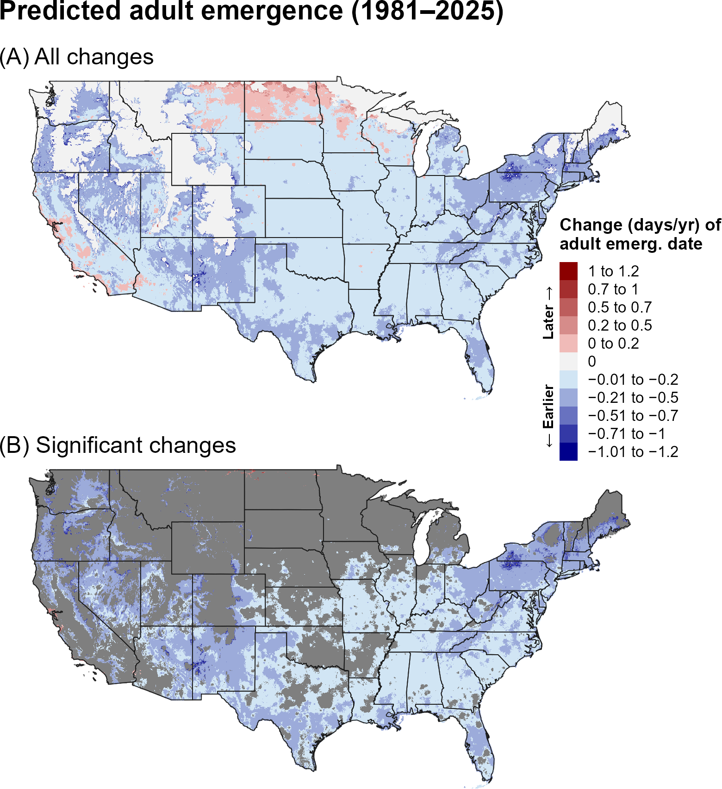
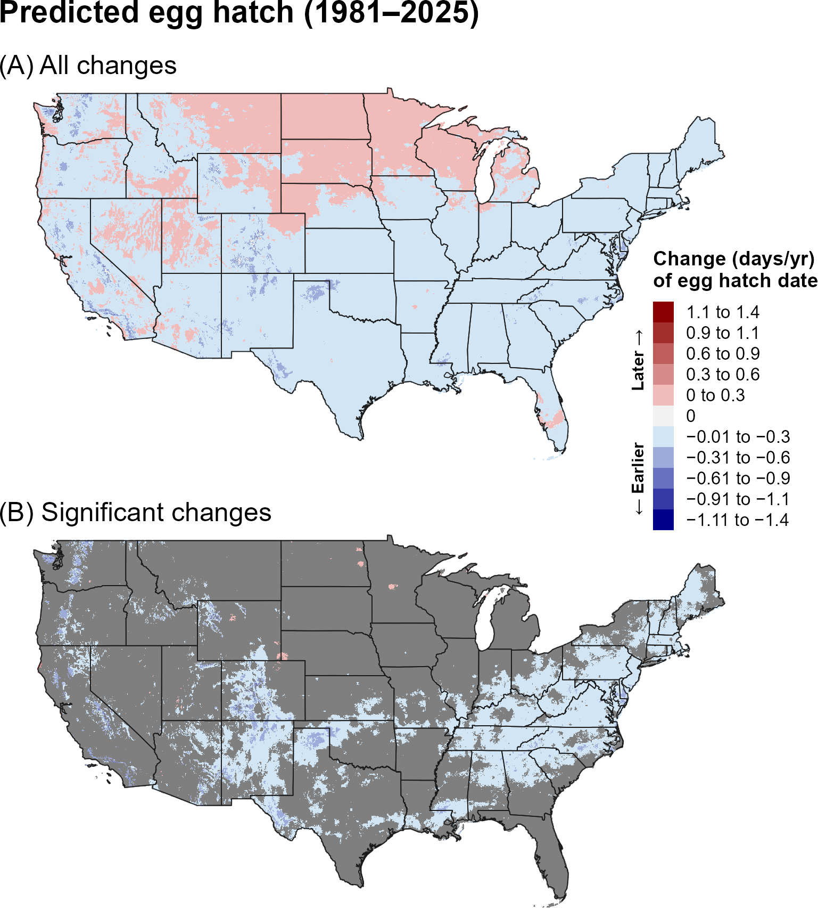
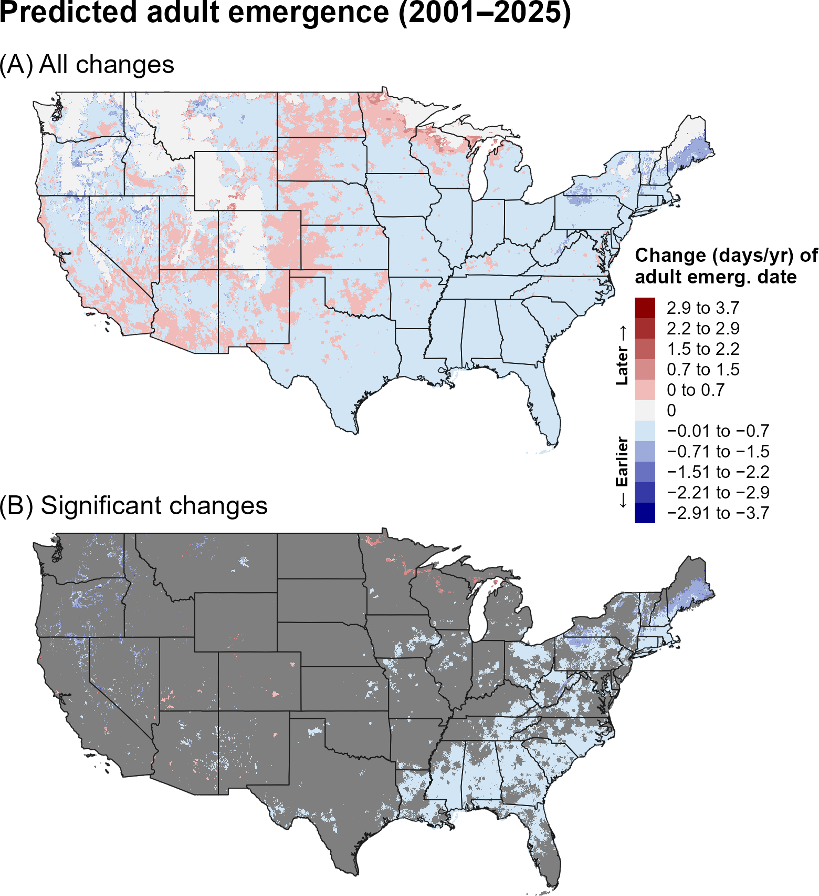
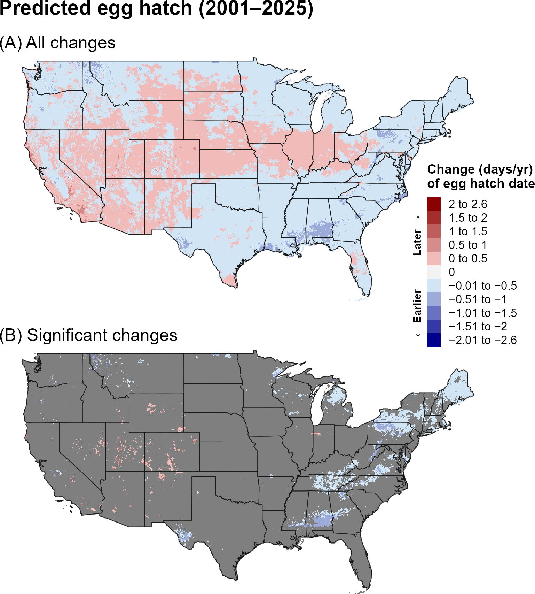
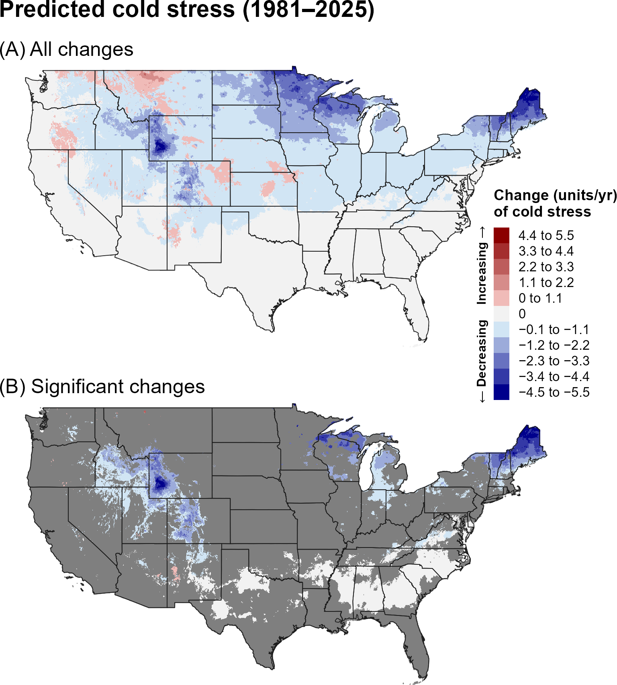
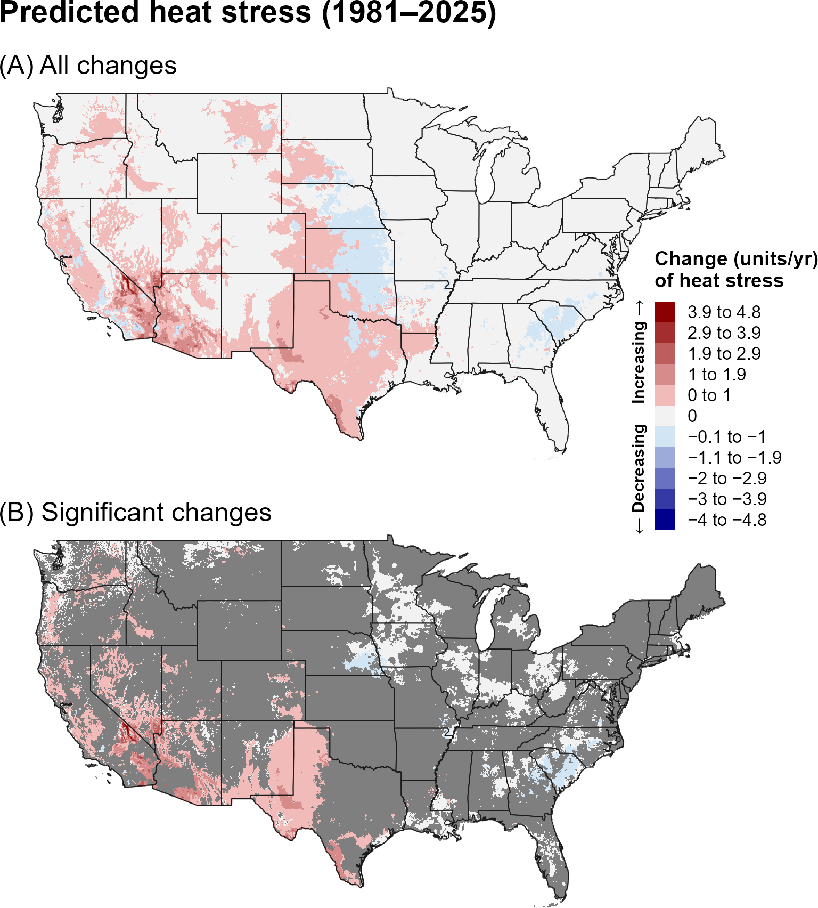
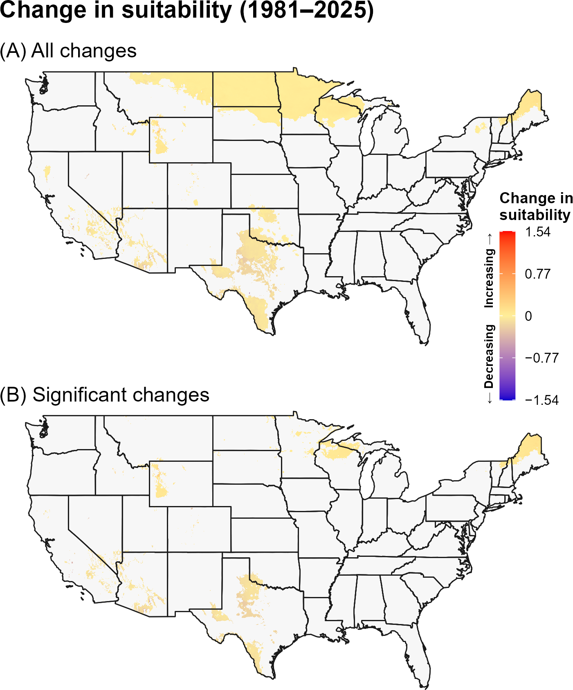
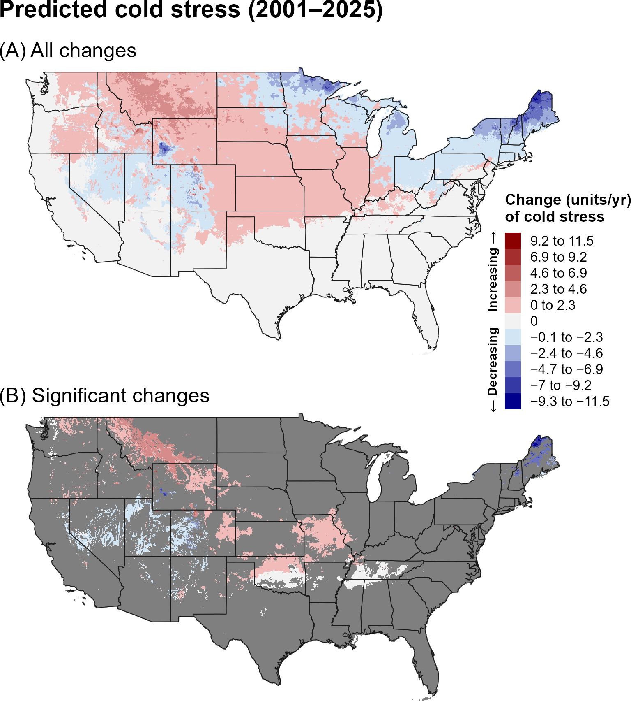
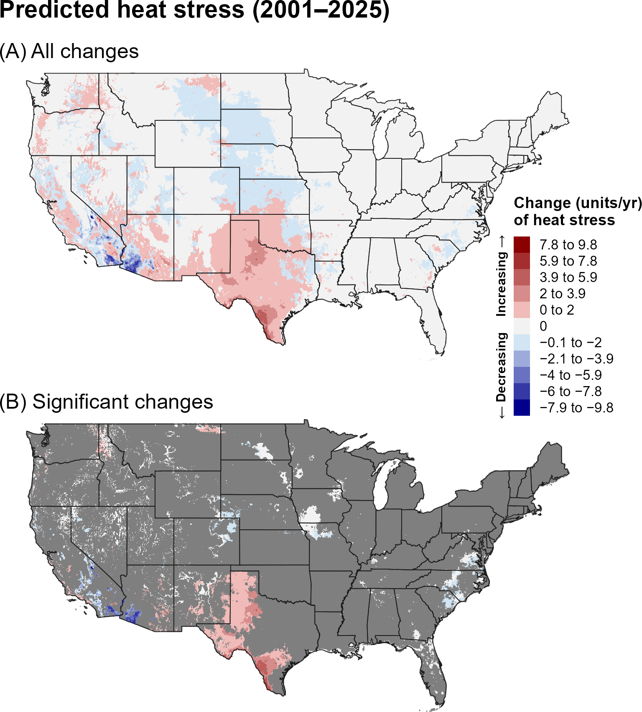
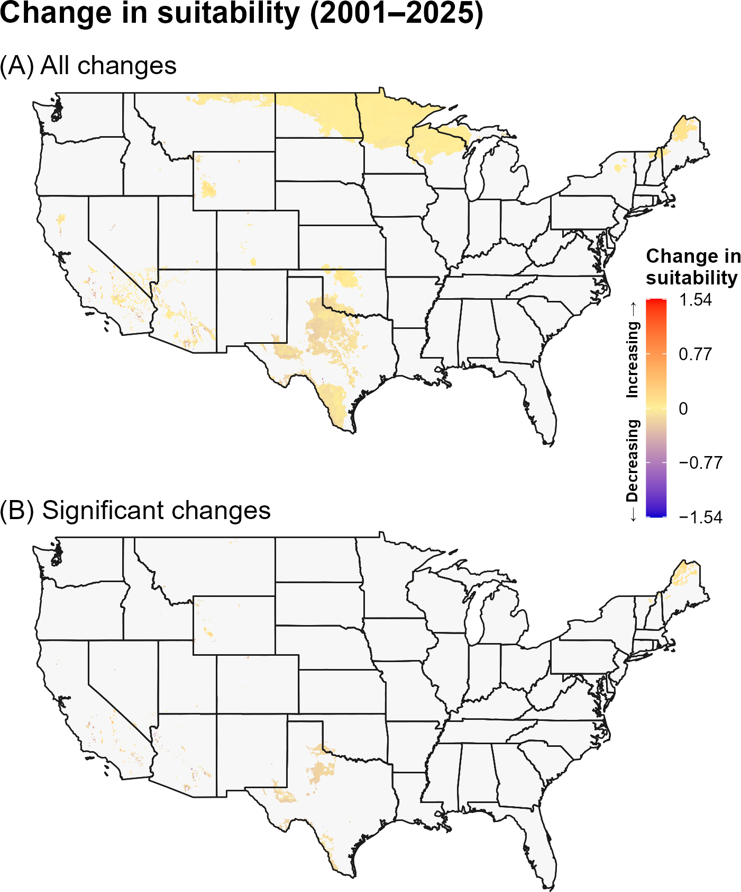

:::: {.content-visible when-format="html"}
::: {style="text-align: left;"}
[Download SLF report as PDF](SLF/SLF.pdf){.btn .btn-primary}
:::
::::

## **13A. Introduction** {.unlisted}

The spotted lanternfly (SLF), *Lycorma delicatula* (White) (Hemiptera: Fulgoridae), is a highly polyphagous planthopper that feeds on a broad range of agricultural and non-agricultural plants, including grapevines, fruit and nut trees, and ornamental species (`\hyperref[ref-chu-1930]{Chu 1930}`{=latex}`<a href="#ref-chu-1930">Chu 1930</a>`{=html}, `\hyperref[ref-barringer-ciafre-2020]{Barringer and Ciafré 2020}`{=latex}`<a href="#ref-barringer-ciafre-2020">Barringer and Ciafré 2020</a>`{=html}, `\hyperref[ref-eppo-2025]{EPPO 2025}`{=latex}`<a href="#ref-eppo-2025">EPPO 2025</a>`{=html}). Adults cause direct damage by feeding on plant sap, while the accumulation of honeydew promotes the growth of sooty mold, which can inhibit photosynthesis and attract additional pests (`\hyperref[ref-dara-2015]{Dara et al. 2015}`{=latex}`<a href="#ref-dara-2015">Dara et al. 2015</a>`{=html}, `\hyperref[ref-urban-leach-2023]{Urban and Leach 2023}`{=latex}`<a href="#ref-urban-leach-2023">Urban and Leach 2023</a>`{=html}). Native to China, SLF was first detected in the United States in 2014 in Pennsylvania and has since spread to at least 22 eastern states (`\hyperref[ref-urban-leach-2023]{Urban and Leach 2023}`{=latex}`<a href="#ref-urban-leach-2023">Urban and Leach 2023</a>`{=html}, `\hyperref[ref-cornell-2026]{Cornell Integrated Pest Management 2026}`{=latex}`<a href="#ref-n-2026">Cornell Integrated Pest Management 2026</a>`{=html}). The widespread presence of its preferred host, tree-of-heaven [*Ailanthus altissima* (Mill.) Swingle], has facilitated its rapid expansion (`\hyperref[ref-barringer-ciafre-2020]{Barringer and Ciafré 2020}`{=latex}`<a href="#ref-barringer-ciafre-2020">Barringer and Ciafré 2020</a>`{=html}). In suburban and urban environments, SLF can become a significant nuisance, with large aggregations of adults often swarming on trees (`\hyperref[ref-urban-leach-2023]{Urban and Leach 2023}`{=latex}`<a href="#ref-urban-leach-2023">Urban and Leach 2023</a>`{=html}). The species has already caused substantial economic impacts in the United States, including estimated annual losses of $8.8 million to New York’s grape industry alone (`\hyperref[ref-pinto-2025]{Pinto et al. 2025}`{=latex}`<a href="#ref-pinto-2025">Pinto et al. 2025</a>`{=html}).

A model for SLF developed for the Degree-Day, establishment Risk, and Phenological event mapping system (DDRP) is operationalized to produce near real-time forecasts for the contiguous United States (CONUS) at <https://uspest.org/DDRP>. The full set of model parameters for SLF, including developmental temperature thresholds, degree-day requirements for individual life stages, and climate stress thresholds and limits, are available at USPest.org (`\hyperref[ref-barker-2025]{Barker et al. 2025}`{=latex}`<a href="#ref-barker-2025">Barker et al. 2025</a>`{=html}).

## **13B. Results** {.unlisted}

### **i. Phenology**

#### **Entire period: 1981--2025**

Trends in predicted first adult emergence and egg hatch for SLF over the 44-year period (1981–2025) were predominantly negative, indicating that both phenological events shifted earlier over time. These earlier phenological events were spatially extensive, occurring across much of the CONUS, although trends toward later phenology were evident in portions of the northern interior and western United States (@fig-slf-emergence, @fig-slf-egg-hatch). Statistically significant trends were more spatially restricted, particularly for egg hatch, and occurred primarily in the East, South, and portions of the West. Within these regions, predicted adult emergence and egg hatch shifted earlier by approximately 0.01–0.5 days per year, with some of the largest shifts occurring in the Northeast and at higher elevations in the West. Only a few small, isolated areas exhibited significant trends toward later phenology.

```{r}
#| echo: false
#| out-width: 70%
#| fig-align: center
#| fig-cap: "Changes (days/year) in predicted dates of first adult emergence for SLF across the CONUS over the entire 44-year period (1981–2025). Maps show (A) all changes and (B) statistically significant changes (P < 0.1); areas shown in gray are not statistically significant."
#| label: fig-slf-emergence

```

```{r}
#| echo: false
#| out-width: 70%
#| fig-align: center
#| fig-cap: "Changes (days/year) in predicted dates of first egg hatch for SLF across the CONUS over the entire 44-year period (1981–2025). Maps show (A) all changes and (B) statistically significant changes (P < 0.1); areas shown in gray are not statistically significant."
#| label: fig-slf-egg-hatch

```

#### **Recent period: 2001--2025**

Trends in predictions of first adult emergence and egg hatch for SLF over the recent 24-year period (2001–2025) were partially consistent with those observed over the 1981–2025 period. Significant trends towards earlier phenology were similar in magnitude but less spatially extensive (@fig-slf-emergence-recent, @fig-slf-egg-hatch-recent), occurring primarily in the Northeast and Southeast. In contrast to the longer-term trends, several isolated areas of the Upper Midwest and Intermountain West showed significant trends toward later phenological events. 

```{r}
#| echo: false
#| out-width: 70%
#| fig-align: center
#| fig-cap: "Changes (days/year) in predicted dates of first adult emergence for SLF across the CONUS over the recent 24-year period (2001–2025). Maps show (A) all changes and (B) statistically significant changes (P < 0.1); areas shown in gray are not statistically significant."
#| label: fig-slf-emergence-recent

```

```{r}
#| echo: false
#| out-width: 70%
#| fig-align: center
#| fig-cap: "Changes (days/year) in predicted dates of first egg hatch for SLF across the CONUS over the recent 24-year period (2001–2025). Maps show (A) all changes and (B) statistically significant changes (P < 0.1); areas shown in gray are not statistically significant."
#| label: fig-slf-egg-hatch-recent

```

### **ii. Climatic suitability**

#### **Entire period: 1981--2025**

Trends in predicted cold stress for SLF over the full 44-year period (1981–2025) were predominantly negative (@fig-slf-cold-stress), indicating an overall decline in cold stress, with statistically significant decreases occurring in portions of the northern United States, including New England and the Upper Midwest. In contrast, trends in heat stress were significantly positive across parts of the Southwest and Pacific coast, indicating increasing heat stress in these regions (@fig-slf-heat-stress). When annual accumulated stress units exceed limits specified in DDRP models, climatic suitability may change. Consistent with these trends, predicted climatic suitability for SLF increased in parts of the northern United States but decreased in portions of the Southwest, including Texas (@fig-slf-suitability). Many of these changes were statistically significant, although significant changes in the Midwest were concentrated primarily in the Great Lakes region.

```{r}
#| echo: false
#| out-width: 70%
#| fig-align: center
#| fig-cap: "Changes (units/year) in predicted cold stress for SLF across the CONUS over the entire 44-year period (1981–2025). Maps show (A) all changes and (B) statistically significant changes (P < 0.1); areas shown in gray are not statistically significant. Areas shown as 0 in (B) had significant trends but very small changes."
#| label: fig-slf-cold-stress

```

```{r}
#| echo: false
#| out-width: 70%
#| fig-align: center
#| fig-cap: "Changes (units/year) in predicted heat stress for SLF across the CONUS over the entire 44-year period (1981–2025). Maps show (A) all changes and (B) statistically significant changes (P < 0.1); areas shown in gray are not statistically significant. Areas shown as 0 in (B) had significant trends but very small changes."
#| label: fig-slf-heat-stress

```

```{r}
#| echo: false
#| out-width: 70%
#| fig-align: center
#| fig-cap: "Changes in predicted climatic suitability for SLF across the CONUS over the 44-year period (1981–2025). Suitability is defined as areas not excluded by climate stress. Positive changes (warmer colors) indicate an increased likelihood of establishment, whereas negative changes (cooler colors) indicate a decreased likelihood of establishment."
#| label: fig-slf-suitability

```

#### **Recent period: 2001--2025**

Over the recent 24-year period (2001–2025), statistically significant trends in predicted heat and cold stress for SLF were less spatially extensive than those observed over the full 44-year period (1981–2025) (@fig-slf-cold-stress-recent, @fig-slf-heat-stress-recent). Significant increases in heat stress generally occurred in the same regions identified over the full period, although significant decreases were also predicted in parts of southern California and Arizona. In contrast, several areas that exhibited significant decreases in cold stress over 1981–2025 showed no significant trends over 2001–2025. Additionally, parts of the Midwest and Intermountain West exhibited significant increases in cold stress over the more recent period. Consistent with these patterns, significant changes in climatic suitability were less extensive, with predicted increases largely restricted to parts of northern New England (@fig-slf-suitability-recent).

```{r}
#| echo: false
#| out-width: 70%
#| fig-align: center
#| fig-cap: "Changes (units/year) in predicted cold stress for SLF across the CONUS over the recent 24-year period (2001–2025). Maps show (A) all changes and (B) statistically significant changes (P < 0.1); areas shown in gray are not statistically significant. Areas shown as 0 in (B) had significant trends but very small changes."
#| label: fig-slf-cold-stress-recent

```

```{r}
#| echo: false
#| out-width: 70%
#| fig-align: center
#| fig-cap: "Changes (units/year) in predicted heat stress for SLF across the CONUS over the recent 24-year period (2001–2025). Maps show (A) all changes and (B) statistically significant changes (P < 0.1); areas shown in gray are not statistically significant. Areas shown as 0 in (B) had significant trends but very small changes."
#| label: fig-slf-heat-stress-recent

```

```{r}
#| echo: false
#| out-width: 70%
#| fig-align: center
#| fig-cap: "Changes in predicted climatic suitability for SLF across the CONUS over the recent 24-year period (2001–2025). Suitability is defined as areas not excluded by climate stress. Positive changes (warmer colors) indicate an increased likelihood of establishment, whereas negative changes (cooler colors) indicate a decreased likelihood of establishment."
#| label: fig-slf-suitability-recent

```

## **13C. Discussion** {.unlisted}

Significant trends toward earlier egg hatch and adult emergence of SLF in the Northeast are consistent with an analysis of citizen science observations from 2014 to 2022 that documented earlier adult emergence as SLF expanded its range in this region (`\hyperref[ref-owen-2024]{Owen et al. 2024}`{=latex}`<a href="#ref-owen-2024">Owen et al. 2024</a>`{=html}). Because SLF is now widely established across much of the Northeast, these shifts toward earlier predicted phenological events have important implications for seasonal surveillance and management. Pest managers may need to adjust the timing of monitoring, control activities, and biological control releases to maintain their effectiveness. For example, earlier egg hatch may necessitate earlier releases of the nymphal parasitoid, *Dryinus sinicus* Olmi, 1987 (Hymenoptera: Dryinidae), which is most effective against first-instar SLF (`\hyperref[ref-zhuang-2025]{Zhuang et al. 2025}`{=latex}`<a href="#ref-zhuang-2025">Zhuang et al. 2025</a>`{=html}). Similarly, earlier adult emergence could lead to earlier egg laying, potentially shifting the optimal timing for releasing of egg parasitoids, such as *Anastatus orientalis* Yang and Choi, 2015 (Hymenoptera: Eupelmidae) (`\hyperref[ref-gould-2024]{Gould et al. 2024}`{=latex}`<a href="#ref-gould-2024">Gould et al. 2024</a>`{=html}). 

Declining cold stress and associated increases in climatic suitability for SLF across portions of the northern United States, including parts of New England and the Great Lakes region, suggest that these areas may be becoming increasingly conducive to SLF establishment. Previous modeling studies indicate that SLF does not yet occupy its full fundamental climatic niche in the CONUS, with suitable conditions extending across much of the Pacific Coast and eastern United States (`\hyperref[ref-jones-2022]{Jones et al. 2022}`{=latex}`<a href="#ref-jones-2022">Jones et al. 2022</a>`{=html}, `\hyperref[ref-wakie-2019]{Wakie et al. 2019}`{=latex}`<a href="#ref-wakie-2019">Wakie et al. 2019</a>`{=html}, `\hyperref[ref-barker-2025]{Barker et al. 2025}`{=latex}`<a href="#ref-barker-2025">Barker et al. 2025</a>`{=html}). However, portions of the Midwest and Northeast, among the coldest regions of the CONUS, have historically been predicted to be less suitable for SLF establishment (`\hyperref[ref-wakie-2019]{Wakie et al. 2019}`{=latex}`<a href="#ref-wakie-2019">Wakie et al. 2019</a>`{=html}, `\hyperref[ref-barker-2025]{Barker et al. 2025}`{=latex}`<a href="#ref-barker-2025">Barker et al. 2025</a>`{=html}). Our findings of declining cold stress and increasing climatic suitability in portions of these regions suggest that their potential for SLF establishment may be greater than previously recognized. Furthermore, urban heat island effects could create localized microclimates that further facilitate establishment in colder regions beyond the currently predicted suitable range (`\hyperref[ref-owen-2024]{Owen et al. 2024}`{=latex}`<a href="#ref-owen-2024">Owen et al. 2024</a>`{=html}). 

Although the model captures important temperature-driven patterns in SLF phenology, uncertainty in how environmental cues interact to regulate diapause and development may influence predictions of phenological trends under changing climate conditions. The effects of temperature, photoperiod, and other environmental factors on egg diapause and developmental rates remain incompletely understood, making it difficult to fully predict how SLF may respond to changing weather patterns  (`\hyperref[ref-keena-nielsen-2021]{Keena and Nielsen 2021}`{=latex}`<a href="#ref-keena-nielsen-2021">Keena and Nielsen 2021</a>`{=html}, `\hyperref[ref-calvin-2023]{Calvin et al. 2023}`{=latex}`<a href="#ref-calvin-2023">Calvin et al. 2023</a>`{=html}). Diapause may buffer populations against weather variability by enhancing overwintering egg survival and accelerating development and fecundity during summer and fall heat waves (`\hyperref[ref-lewkiewicz-2024]{Lewkiewicz et al. 2024}`{=latex}`<a href="#ref-lewkiewicz-2024">Lewkiewicz et al. 2024</a>`{=html}). Although SLF is currently considered univoltine, even in warmer regions of China, whether it can complete multiple generations annually in warmer areas of the United States remains uncertain (`\hyperref[ref-keena-nielsen-2021]{Keena and Nielsen 2021}`{=latex}`<a href="#ref-keena-nielsen-2021">Keena and Nielsen 2021</a>`{=html}, `\hyperref[ref-calvin-2023]{Calvin et al. 2023}`{=latex}`<a href="#ref-calvin-2023">Calvin et al. 2023</a>`{=html}).

The stronger and more spatially extensive trends in predicted phenology and climate stress over the full 44-year period may reflect both the larger sample size, which can reduce noise and improve detection of directional patterns, and differences in the underlying climate trends between the two time periods. In particular, the recent 24-year period may capture climate variability or regional trends that differ from those observed over the longer 44-year period. Thus, differences between the two periods should be interpreted as reflecting both long-term climate trends and shorter-term regional variability.

## **13D. References** {.unlisted}

\begingroup
\setlength{\parindent}{-0.5in}
\setlength{\leftskip}{0.5in}

\noindent

<span id="ref-barker-2025"></span>
\phantomsection\label{ref-barker-2025}

Barker, B. S., J. Beyer, and L. Coop. 2025. Real-time integrative mapping of the phenology and climatic suitability for the spotted lanternfly, *Lycorma delicatula*. Insects 16:790.

<span id="ref-barringer-ciafre-2020"></span>
\phantomsection\label{ref-barringer-ciafre-2020}

Barringer, L., and C. M. Ciafré. 2020. Worldwide feeding host plants of spotted lanternfly, with significant additions from North America. Environmental Entomology 49:999–1011.

<span id="ref-calvin-2023"></span>
\phantomsection\label{ref-calvin-2023}

Calvin, D. D., J. Rost, J. Keller, S. Crawford, B. Walsh, M. Bosold, and J. Urban. 2023. Seasonal activity of spotted lanternfly (Hemiptera: Fulgoridae), in Southeast Pennsylvania. Environmental Entomology 52:1108–1125.

<span id="ref-chu-1930"></span>
\phantomsection\label{ref-chu-1930}

Chu, H. J. 1930. Notes on the life-history of *Lycorma delicatula* White in Nanking. Peking Natural History Bulletin 5:33–35.

<span id="ref-cornell-2026"></span>
\phantomsection\label{ref-cornell-2026}

Cornell Integrated Pest Management. 2026. Spotted lanternfly status map (version 1.0.0, dataset v2026.10.0). Cornell University College of Agriculture and Life Sciences. Online at: <https://maps.cornell-ipm.org/spotted-lanternfly> (accessed 3 November 2026).

<span id="ref-dara-2015"></span>
\phantomsection\label{ref-dara-2015}

Dara, S., L. Barringer, and S. Arthurs. 2015. *Lycorma delicatula* (Hemiptera: Fulgoridae): A new invasive pest in the United States. Journal of Integrated Pest Management 6:20.

<span id="ref-eppo-2025"></span>
\phantomsection\label{ref-eppo-2025} 

EPPO. 2025. Lycorma delicatula. EPPO datasheets on pests recommended for regulation. Online at: <https://gd.eppo.int> (accessed 29 May 2025).

<span id="ref-gould-2024"></span>
\phantomsection\label{ref-gould-2024} 

Gould, J. R., C. Losch, L. Sullivan, Y. Wu, X. Y. Wang, L. M. Cao, and H. J. Bradley. 2024. Lifecycle of *Anastatus orientalis* (Hymenoptera: Eupelmidae) and synchrony with its host, the spotted lanternfly, *Lycorma delicatula* (Hemiptera: Fulgoridae). Environmental Entomology 53:954-965.

<span id="ref-jones-2022"></span>
\phantomsection\label{ref-jones-2022}

Jones, C., M. M. Skrip, B. J. Seliger, S. Jones, T. Wakie, Y. Takeuchi, V. Petras, A. Petrasova, and R. K. Meentemeyer. 2022. Spotted lanternfly predicted to establish in California by 2033 without preventative management. Communications Biology 5:558.

<span id="ref-keena-nielsen-2021"></span>
\phantomsection\label{ref-keena-nielsen-2021}

Keena, M. A., and A. L. Nielsen. 2021. Comparison of the hatch of newly laid *Lycorma delicatula* (Hemiptera: Fulgoridae) eggs from the United States after exposure to different temperatures and durations of low temperature. Environmental Entomology 50:410–417.

<span id="ref-lewkiewicz-2024"></span>
\phantomsection\label{ref-lewkiewicz-2024}

Lewkiewicz, S. M., B. Seibold, and M. R. Helmus. 2024. Quantifying population resistance to climatic variability: The invasive spotted lanternfly grape pest is buffered against temperature extremes in California. Ecological Modelling 497:110841.

<span id="ref-owen-2024"></span>
\phantomsection\label{ref-owen-2024}

Owen HL, Meng F, Winchell KM. 2024. Urbanization and environmental variation drive phenological changes in the spotted lanternfly, *Lycorma delicatula* (Hemiptera: Fulgoridae). Biological Journal of the Linnean Society 143:blae099. 

<span id="ref-park-2015"></span>
\phantomsection\label{ref-park-2015}

Park, M. 2015. Overwintering ecology and population genetics of *Lycorma delicatula* (Hemiptera: Fulgoridae) in Korea. Ph.D. thesis. Seoul, South Korea: Seoul National University.

<span id="ref-pinto-2025"></span>
\phantomsection\label{ref-pinto-2025}

Pinto, A. F., B. C. Eshenaur, F. E. Acevedo, A. A. Calixto, M. Centinari, and M. I. Gómez. 2025. Assessing the potential economic impacts of spotted lanternfly (Hemiptera: Fulgoridae) infestations on grape production in New York State. Journal of Integrated Pest Management 16:2.

<span id="ref-urban-leach-2023"></span>
\phantomsection\label{ref-urban-leach-2023}

Urban, J. M., and H. Leach. 2023. Biology and management of the spotted lanternfly, *Lycorma delicatula* (Hemiptera: Fulgoridae), in the United States. Annual Review of Entomology:157–167.

<span id="ref-wakie-2019"></span>
\phantomsection\label{ref-wakie-2019}

Wakie, T. T., L. G. Neven, W. L. Yee, and Z. Lu. 2019. The establishment risk of *Lycorma delicatula* (Hemiptera: Fulgoridae) in the United States and globally. Journal of Economic Entomology 113:306–314.

<span id="ref-zhuang-2025"></span>
\phantomsection\label{ref-zhuang-2025}

Zhuang, Y., K. Bao, and X. Wang. 2025. Functional response of the native natural enemy of *Dryinus sinicus* (Hymenoptera: Dryinidae) to different instars of spotted lanternfly (*Lycorma delicatula*, Hemiptera: Fulgoridae). Journal of Economic Entomology 118:1320-1327.

\par
\endgroup