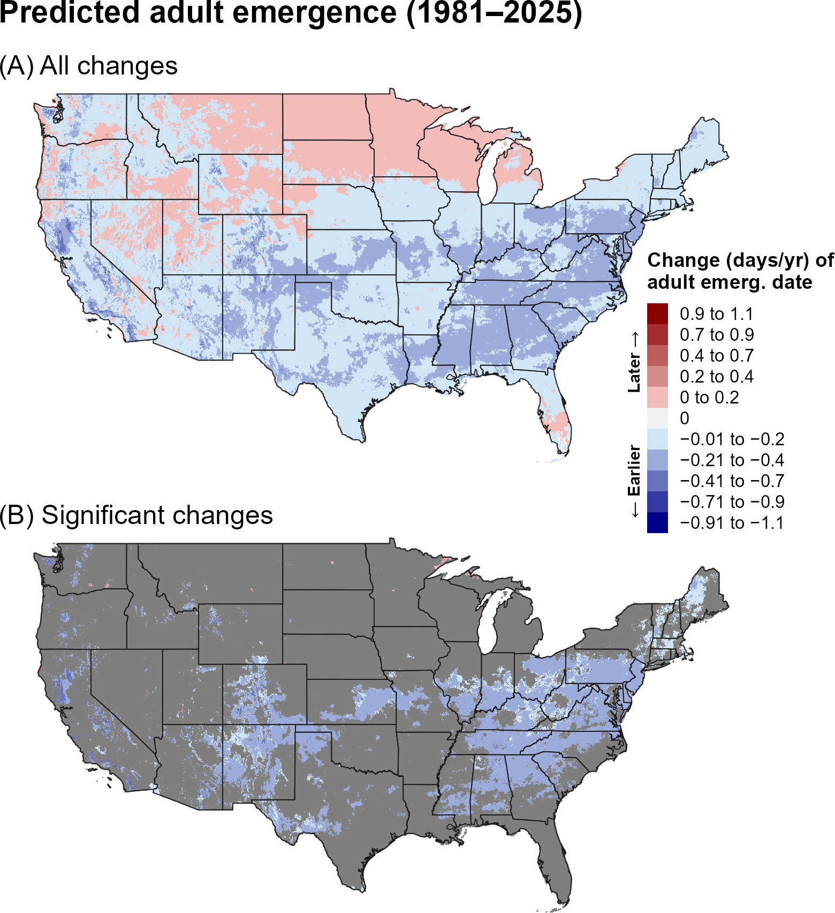
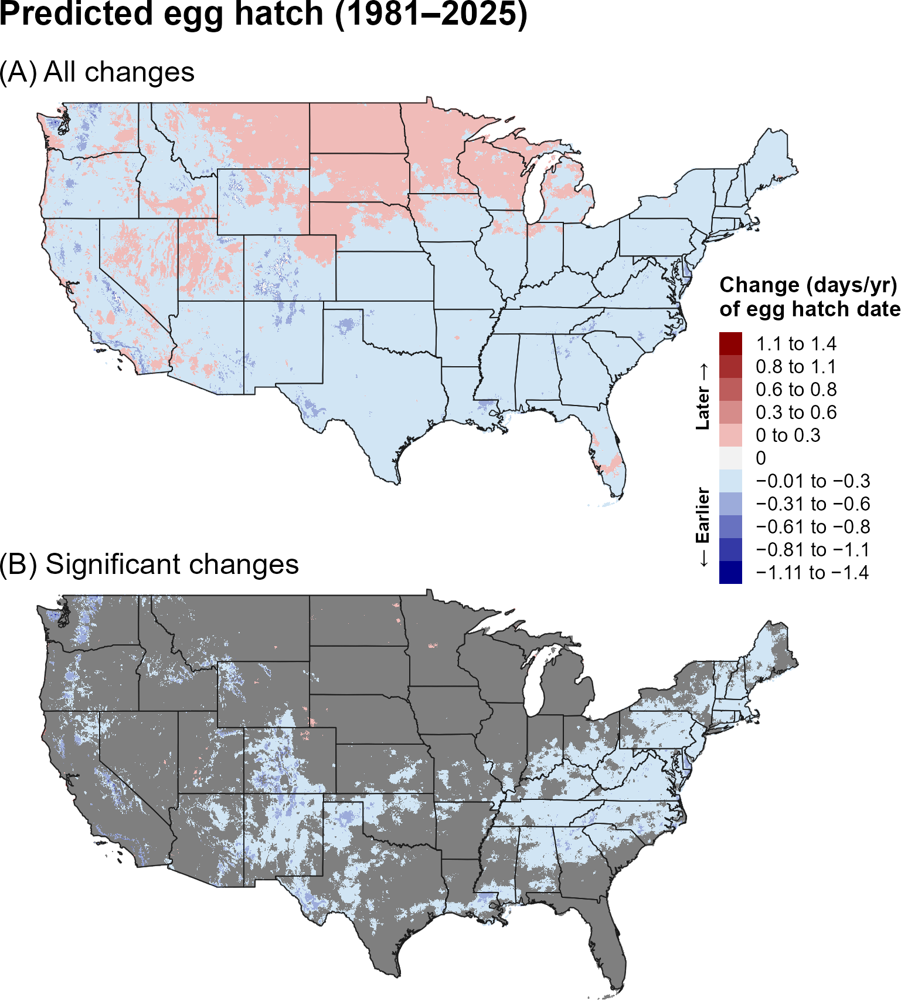
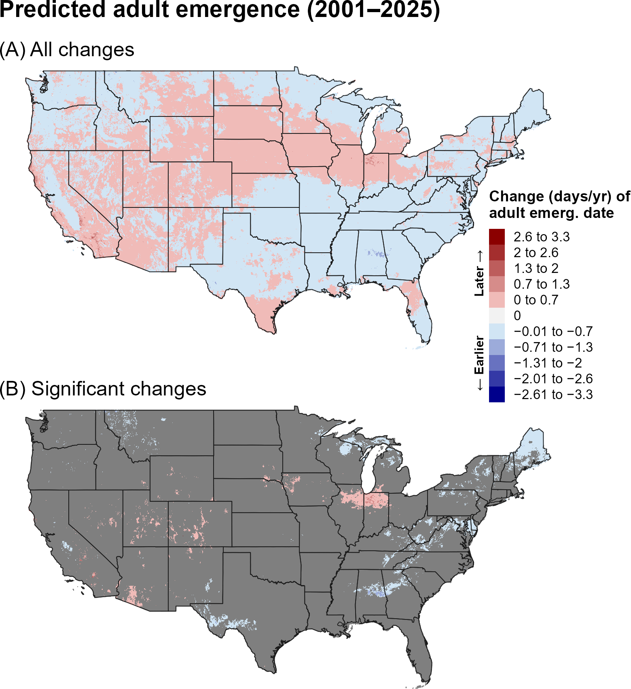
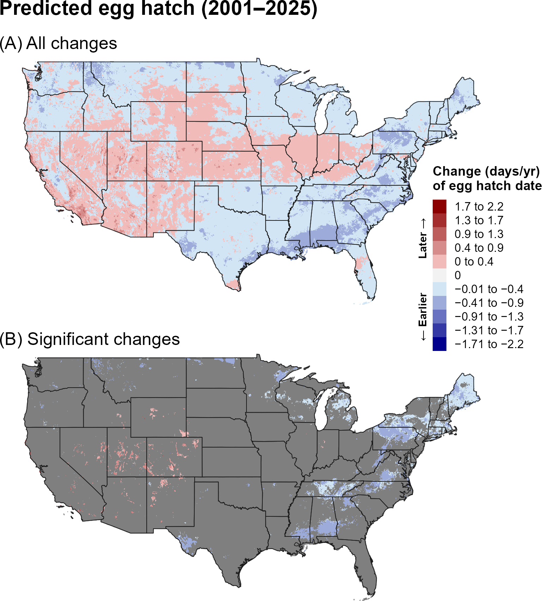
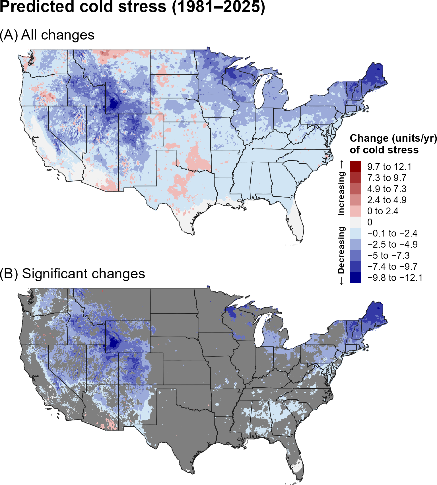
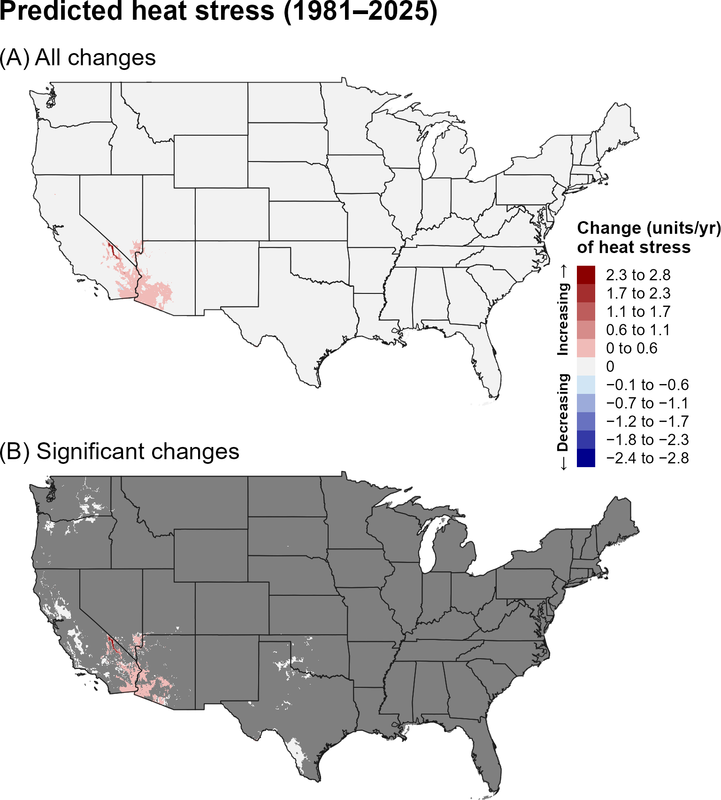
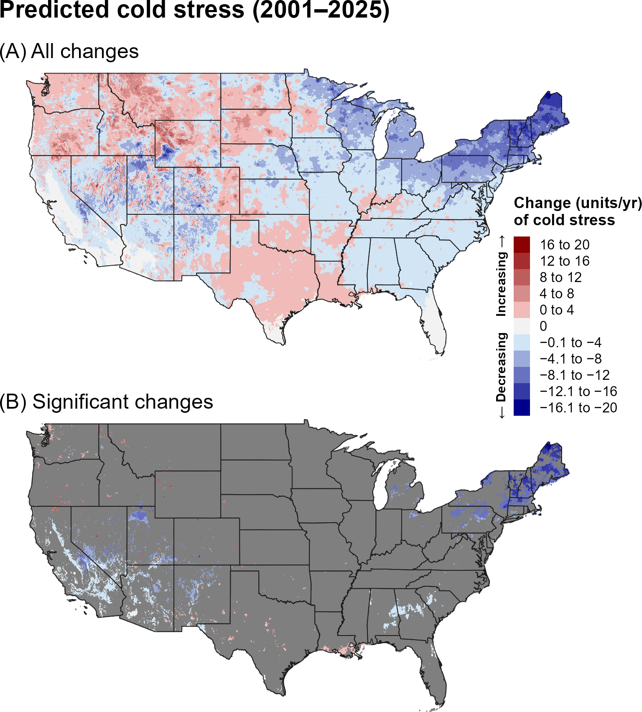
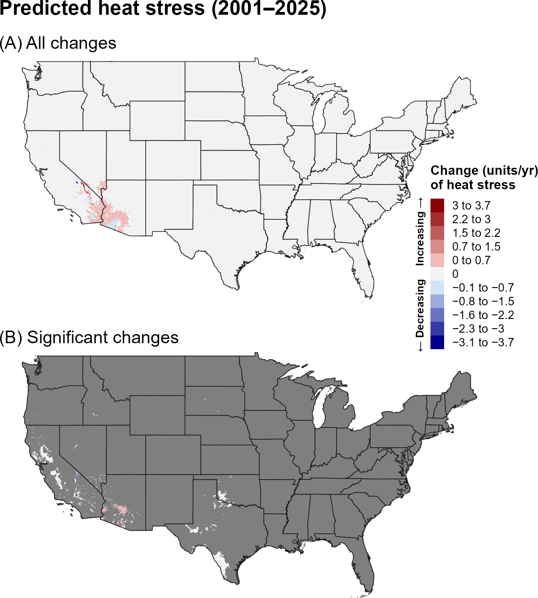
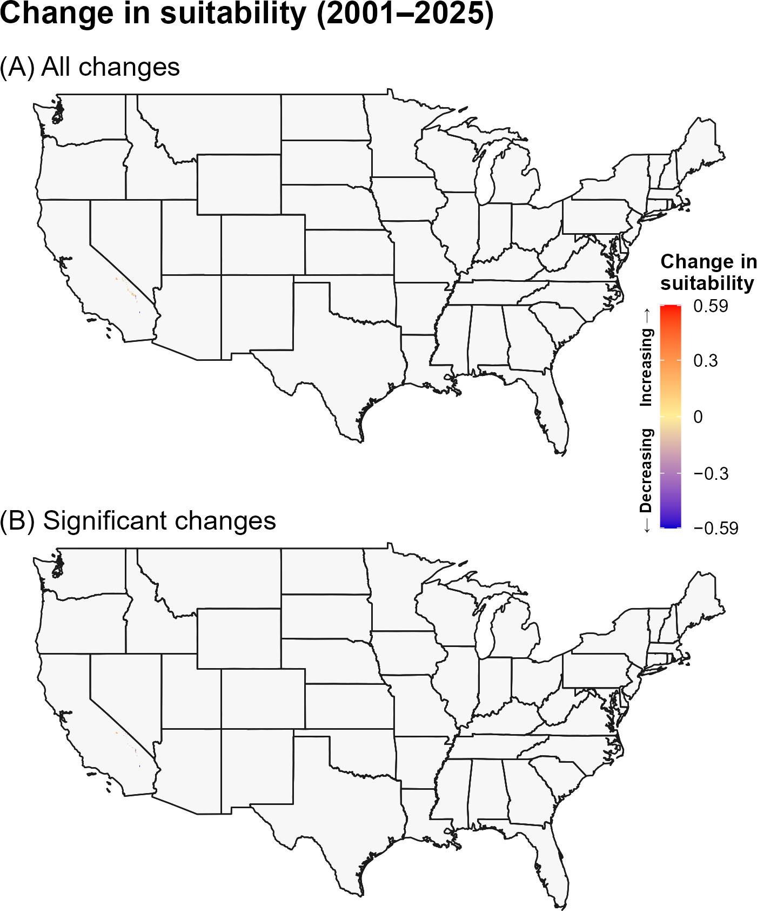

:::: {.content-visible when-format="html"}
::: {style="text-align: left;"}
[Download SLI report as PDF](SLI.pdf){.btn .btn-primary}
:::
::::

## **14A. Introduction** {.unlisted}

The common or cotton cutworm (SLI), *Spodoptera litura* (Fabricius, 1775) (Lepidoptera: Noctuidae), is a highly polyphagous pest that feeds on at least 120 plant species, including economically important crops such as corn, cotton, groundnut, potato, soybean, sweet potato, tea, tobacco, and a wide range of vegetables (`\hyperref[ref-venette-2003]{Venette et al. 2003}`{=latex}`<a href="#ref-venette-2003">Venette et al. 2003</a>`{=html}, `\hyperref[ref-sullivan-2007]{Sullivan 2007}`{=latex}`<a href="#ref-sullivan-2007">Sullivan 2007</a>`{=html}, `\hyperref[ref-bragard-2019]{Bragard et al. 2019}`{=latex}`<a href="#ref-bragard-2019">Bragard et al. 2019</a>`{=html}, `\hyperref[ref-eppo-2023]{EPPO 2023}`{=latex}`<a href="#ref-eppo-2023">EPPO 2023</a>`{=html}). Females lay eggs on host plants, and within a few days, emerging larvae begin feeding on plant tissue, causing extensive damage that can lead to stunted growth and reduced marketability (`\hyperref[ref-sullivan-2007]{Sullivan 2007}`{=latex}`<a href="#ref-sullivan-2007">Sullivan 2007</a>`{=html}). Native to Southeast Asia, SLI is now distributed across Australia, Oceania, several African islands, Hawaii, and other regions of Asia (`\hyperref[ref-bragard-2019]{Bragard et al. 2019}`{=latex}`<a href="#ref-bragard-2019">Bragard et al. 2019</a>`{=html}, `\hyperref[ref-eppo-2023]{EPPO 2023}`{=latex}`<a href="#ref-eppo-2023">EPPO 2023</a>`{=html}). The pest has been present in Hawaii since 1964 and has been intercepted hundreds of times at United States ports of entry, primarily through cargo and passenger baggage (`\hyperref[ref-venette-2003]{Venette et al. 2003}`{=latex}`<a href="#ref-venette-2003">Venette et al. 2003</a>`{=html}, `\hyperref[ref-sullivan-2007]{Sullivan 2007}`{=latex}`<a href="#ref-sullivan-2007">Sullivan 2007</a>`{=html}). The species has developed resistance to numerous insecticides and transgenic Bt cotton and is capable of long-distance migration, potentially aided by typhoons (`\hyperref[ref-tu-2010]{Tu et al. 2010}`{=latex}`<a href="#ref-tu-2010">Tu et al. 2010</a>`{=html}, `\hyperref[ref-fu-2015]{Fu et al. 2015}`{=latex}`<a href="#ref-fu-2015">Fu et al. 2015</a>`{=html}, `\hyperref[ref-wan-2008]{Wan et al. 2008}`{=latex}`<a href="#ref-wan-2008">Wan et al. 2008</a>`{=html}, `\hyperref[ref-bragard-2019]{Bragard et al. 2019}`{=latex}`<a href="#ref-bragard-2019">Bragard et al. 2019</a>`{=html}, `\hyperref[ref-murata-1998]{Murata et al. 1998}`{=latex}`<a href="#ref-murata-1998">Murata et al. 1998</a>`{=html}). Severe defoliation caused by larval feeding has led to significant crop damage and economic losses in affected regions (`\hyperref[ref-murata-1998]{Murata et al. 1998}`{=latex}`<a href="#ref-murata-1998">Murata et al. 1998</a>`{=html}, `\hyperref[ref-prasad-2013]{Prasad et al. 2013}`{=latex}`<a href="#ref-prasad-2013">Prasad et al. 2013</a>`{=html}, `\hyperref[ref-bragard-2019]{Bragard et al. 2019}`{=latex}`<a href="#ref-bragard-2019">Bragard et al. 2019</a>`{=html}, `\hyperref[ref-maharjan-2023]{Maharjan et al. 2023}`{=latex}`<a href="#ref-maharjan-2023">Maharjan et al. 2023</a>`{=html}).

Potentially environmentally suitable areas for establishment for SLI in the contiguous United States (CONUS) include much of the southeastern United States and along the Pacific Coast (`\hyperref[ref-coop-2018]{Coop 2018}`{=latex}`<a href="#ref-coop-2018">Coop 2018</a>`{=html}). If introduced to the United States, SLI could potentially overwinter in protected environments such as greenhouses or establish northern migratory populations (`\hyperref[ref-bragard-2019]{Bragard et al. 2019}`{=latex}`<a href="#ref-bragard-2019">Bragard et al. 2019</a>`{=html}). Development and fecundity are strongly influenced by temperature, humidity, and host plant quality (`\hyperref[ref-garad-1985]{Garad et al. 1985}`{=latex}`<a href="#ref-garad-1985">Garad et al. 1985</a>`{=html}, `\hyperref[ref-eppo-2023]{EPPO 2023}`{=latex}`<a href="#ref-eppo-2023">EPPO 2023</a>`{=html}, `\hyperref[ref-maharjan-2023]{Maharjan et al. 2023}`{=latex}`<a href="#ref-maharjan-2023">Maharjan et al. 2023</a>`{=html}, `\hyperref[ref-fu-2025]{Fu et al. 2025}`{=latex}`<a href="#ref-fu-2025">Fu et al. 2025</a>`{=html}). SLI does not undergo diapause and therefore cannot survive winter conditions in areas north of approximately 30°N in China, where it instead establishes seasonal migratory populations (`\hyperref[ref-fand-2015]{Fand et al. 2015}`{=latex}`<a href="#ref-fand-2015">Fand et al. 2015</a>`{=html}, `\hyperref[ref-fu-2015]{Fu et al. 2015}`{=latex}`<a href="#ref-fu-2015">Fu et al. 2015</a>`{=html}, `\hyperref[ref-bragard-2019]{Bragard et al. 2019}`{=latex}`<a href="#ref-bragard-2019">Bragard et al. 2019</a>`{=html}, `\hyperref[ref-eppo-2023]{EPPO 2023}`{=latex}`<a href="#ref-eppo-2023">EPPO 2023</a>`{=html}). SLI completes 3-12 generations in tropical regions versus three generations in colder parts of its distribution, including northern China (`\hyperref[ref-eppo-2023]{EPPO 2023}`{=latex}`<a href="#ref-eppo-2023">EPPO 2023</a>`{=html}). Consistent with its high reproductive potential under warm conditions, a DDRP model predicted one to ten possible generations annually in the conterminous United States, with four to six generations predicted across much of the Southeast and California (`\hyperref[ref-coop-2018]{Coop 2018}`{=latex}`<a href="#ref-coop-2018">Coop 2018</a>`{=html}). SLI may also respond to changing temperatures through shifts in its geographic distribution and population growth, although warming could reduce suitability in some areas if temperatures exceed optimal conditions for development (`\hyperref[ref-fand-2015]{Fand et al. 2015}`{=latex}`<a href="#ref-fand-2015">Fand et al. 2015</a>`{=html}, `\hyperref[ref-fu-2025]{Fu et al. 2025}`{=latex}`<a href="#ref-fu-2025">Fu et al. 2025</a>`{=html}).

A model for SLI was developed for the Degree-Day, establishment Risk, and Phenological event mapping system (DDRP) is operationalized to produce near real-time forecasts for the CONUS at <https://uspest.org/DDRP>. The phenology model applies a lower developmental threshold of 10.6 ºC and upper threshold of 40 ºC for all life stages (egg, larva, pupa, and adult) and assumes the pupa is the overwintering stage. The climatic suitability model applies a lower cold stress threshold and upper heat stress threshold of −3 °C and 44 °C, respectively. The full set of model parameters for SLI, including degree-day requirements for individual life stages and climate stress limits, are presented in @tbl-sli-parameters. Details on model parameterization are available at USPest.org (`\hyperref[ref-coop-2018]{Coop 2018}`{=latex}`<a href="#ref-coop-2018">Coop 2018</a>`{=html}). 

## **14B. Results** {.unlisted}

### **i. Phenology**

#### **Entire period: 1981--2025**

Over 1981–2025, predicted egg hatch generally shifted later across much of the northern and eastern United States, while adult emergence showed a broader mixture of earlier and later changes across the CONUS (@fig-sli-emergence, @fig-sli-egg-hatch). Significant changes were concentrated in scattered portions of the eastern and central United States.

```{r}
#| echo: false
#| out-width: 70%
#| fig-align: center
#| fig-cap: "Changes (days/year) in predicted dates of first adult emergence for SLI across the CONUS over the entire 44-year period (1981–2025). Maps show (A) all changes and (B) statistically significant changes (P < 0.1); areas shown in gray are not statistically significant."
#| label: fig-sli-emergence

```

```{r}
#| echo: false
#| out-width: 70%
#| fig-align: center
#| fig-cap: "Changes (days/year) in predicted dates of first egg hatch for SLI across the CONUS over the entire 44-year period (1981–2025). Maps show (A) all changes and (B) statistically significant changes (P < 0.1); areas shown in gray are not statistically significant."
#| label: fig-sli-egg-hatch

```

#### **Recent period: 2001--2025**

During 2001–2025, egg hatch showed earlier trends across much of the western and central United States, while adult emergence was later across portions of the northern interior and earlier in scattered southern areas (@fig-sli-emergence-recent, @fig-sli-egg-hatch-recent). Significant changes were spatially limited.

```{r}
#| echo: false
#| out-width: 70%
#| fig-align: center
#| fig-cap: "Changes (days/year) in predicted dates of first adult emergence for SLI across the CONUS over the recent 24-year period (2001–2025). Maps show (A) all changes and (B) statistically significant changes (P < 0.1); areas shown in gray are not statistically significant."
#| label: fig-sli-emergence-recent

```

```{r}
#| echo: false
#| out-width: 70%
#| fig-align: center
#| fig-cap: "Changes (days/year) in predicted dates of first egg hatch for SLI across the CONUS over the recent 24-year period (2001–2025). Maps show (A) all changes and (B) statistically significant changes (P < 0.1); areas shown in gray are not statistically significant."
#| label: fig-sli-egg-hatch-recent

```

### **ii. Climatic suitability**

#### **Entire period: 1981--2025**

Predicted cold stress decreased across much of the northern United States over 1981–2025, while heat stress changes were highly localized and concentrated mainly in portions of the Southwest (@fig-sli-cold-stress, @fig-sli-heat-stress). Predicted climatic suitability showed very little statistically significant change (@fig-sli-suitability).

```{r}
#| echo: false
#| out-width: 70%
#| fig-align: center
#| fig-cap: "Changes (units/year) in predicted cold stress for SLI across the CONUS over the entire 44-year period (1981–2025). Maps show (A) all changes and (B) statistically significant changes (P < 0.1); areas shown in gray are not statistically significant. Areas shown as 0 in (B) had significant trends but very small changes."
#| label: fig-sli-cold-stress

```

```{r}
#| echo: false
#| out-width: 70%
#| fig-align: center
#| fig-cap: "Changes (units/year) in predicted heat stress for SLI across the CONUS over the entire 44-year period (1981–2025). Maps show (A) all changes and (B) statistically significant changes (P < 0.1); areas shown in gray are not statistically significant. Areas shown as 0 in (B) had significant trends but very small changes."
#| label: fig-sli-heat-stress

```

```{r}
#| echo: false
#| out-width: 70%
#| fig-align: center
#| fig-cap: "Changes in predicted climatic suitability for SLI across the CONUS over the 44-year period (1981–2025). Suitability is defined as areas not excluded by climate stress. Positive changes (warmer colors) indicate an increased likelihood of establishment, whereas negative changes (cooler colors) indicate a decreased likelihood of establishment."
#| label: fig-sli-suitability

```

#### **Recent period: 2001--2025**

During 2001–2025, cold-stress trends became more mixed, with increases across portions of the northern and central interior and decreases in scattered areas (@fig-sli-cold-stress-recent). Heat-stress changes remained localized to the Southwest (@fig-sli-heat-stress-recent). Climatic-suitability changes were essentially absent at the P < 0.1 level (@fig-sli-suitability-recent).

```{r}
#| echo: false
#| out-width: 70%
#| fig-align: center
#| fig-cap: "Changes (units/year) in predicted cold stress for SLI across the CONUS over the recent 24-year period (2001–2025). Maps show (A) all changes and (B) statistically significant changes (P < 0.1); areas shown in gray are not statistically significant. Areas shown as 0 in (B) had significant trends but very small changes."
#| label: fig-sli-cold-stress-recent

```

```{r}
#| echo: false
#| out-width: 70%
#| fig-align: center
#| fig-cap: "Changes (units/year) in predicted heat stress for SLI across the CONUS over the recent 24-year period (2001–2025). Maps show (A) all changes and (B) statistically significant changes (P < 0.1); areas shown in gray are not statistically significant. Areas shown as 0 in (B) had significant trends but very small changes."
#| label: fig-sli-heat-stress-recent

```

```{r}
#| echo: false
#| out-width: 70%
#| fig-align: center
#| fig-cap: "Changes in predicted climatic suitability for SLI across the CONUS over the recent 24-year period (2001–2025). Suitability is defined as areas not excluded by climate stress. Positive changes (warmer colors) indicate an increased likelihood of establishment, whereas negative changes (cooler colors) indicate a decreased likelihood of establishment."
#| label: fig-sli-suitability-recent

```

## **14C. Discussion** {.unlisted}

The SLI maps indicate that phenological trends vary by event and region, with no single directional pattern dominating the CONUS. This variability suggests that changes in one developmental event should not necessarily be assumed to represent changes in all stages. Where significant phenological shifts occur, monitoring and management schedules may need to be adjusted regionally.

Despite substantial long-term declines in predicted cold stress across northern regions, the climatic-suitability maps showed little significant change. The limited heat-stress signal further suggests that climatic conditions remain broadly within the modeled suitability range across most of the CONUS, at least with respect to the stress thresholds represented by the model.

The stronger and more spatially extensive trends in predicted phenology and climate stress over the full 44-year period may reflect both the larger sample size, which can reduce noise and improve detection of directional patterns, and differences in the underlying climate trends between the two time periods. In particular, the recent 24-year period may capture climate variability or regional trends that differ from those observed over the longer 44-year period. Thus, differences between the two periods should be interpreted as reflecting both long-term climate trends and shorter-term regional variability.

## **14D. References** {.unlisted}

\begingroup
\setlength{\parindent}{-0.5in}
\setlength{\leftskip}{0.5in}

\noindent

<span id="ref-bragard-2019"></span>
\phantomsection\label{ref-bragard-2019}

Bragard, C., K. Dehnen-Schmutz, F. Di Serio, P. Gonthier, M. A. Jacques, J. A. Jaques Miret, A. F. Justesen, C. S. Magnusson, P. Milonas, J. A. Navas-Cortes, S. Parnell, R. Potting, P. L. Reignault, H. H. Thulke, W. Van der Werf, A. Vicent Civera, J. Yuen, L. Zappalà, C. Malumphy, E. Czwienczek, and A. MacLeod. 2019. Pest categorisation of *Spodoptera litura*. EFSA Journal 17:5765.

<span id="ref-coop-2018"></span>
\phantomsection\label{ref-coop-2018}

Coop, K. 2018. IPPC Model Analysis Summary: Cotton or common cutworm (*Spodoptera litura*) Phenology (degree-day) Model. Developed for Animal and Plant Health Inspection Service (APHIS) – Plant Protection and Quarantine (PPQ) – Cooperative Agricultural Pest Survey (CAPS). Vs. 1.0 (9/25/2017). Online at: <https://uspest.org/wea/Spodoptera_litura_model.pdf> (accessed 12 November 2025).

<span id="ref-eppo-2023"></span>
\phantomsection\label{ref-eppo-2023}

EPPO. 2023. *Spodoptera litura*. EPPO datasheets on pests recommended for regulation. Online at: <https://gd.eppo.int/> (accessed 8 December 2025).

<span id="ref-fand-2015"></span>
\phantomsection\label{ref-fand-2015}

Fand, B. B., N. T. Sul, S. K. Bal, and P. S. Minhas. 2015. Temperature impacts the development and survival of common cutworm (*Spodoptera litura*): Simulation and visualization of potential population growth in India under warmer temperatures through life cycle modelling and spatial mapping. PLoS ONE 10:e0124682.

<span id="ref-fu-2025"></span>
\phantomsection\label{ref-fu-2025}

Fu, C., Z. Liu, D. Xu, T. Gan, X. Deng, H. Zhang, and Z. Zhuo. 2025. Influence of temperature, humidity, and photophase on the developmental stages of *Spodoptera litura* (Lepidoptera: Noctuidae) and prediction of its population dynamics. Insects 16:355.

<span id="ref-fu-2015"></span>
\phantomsection\label{ref-fu-2015}

Fu, X., X. Zhao, B. Xie, A. Ali, and K. Wu. 2015. Seasonal pattern of *Spodoptera litura* (Lepidoptera: Noctuidae) migration across the Bohai Strait in Northern China. Journal of Economic Entomology 108:525–538.

<span id="ref-garad-1985"></span>
\phantomsection\label{ref-garad-1985}

Garad, G. P., P. R. Shivpuje, and G. G. Bilapate. 1985. Larval and post-larval development of *Spodoptera litura* (Fabricius) on some host plants. Proceedings of the Indian Academy of Sciences (Animal Sciences) 94:49–6.

<span id="ref-maharjan-2023"></span>
\phantomsection\label{ref-maharjan-2023}

Maharjan, R., S. Hong, J. Ahn, Y. Yoon, Y. Jang, J. Kim, M. Lee, K. Park, and H. Yi. 2023. Temperature and host plant impacts on the development of *Spodoptera litura* (Fabricius) (Lepidoptera: Noctuidae): Linear and nonlinear modeling. Insects 14:412.

<span id="ref-murata-1998"></span>
\phantomsection\label{ref-murata-1998}

Murata, M., T. Etoh, K. Itoyama, and S. Tojo. 1998. Sudden occurrence of the common cutworm, *Spodoptera litura* (Lepidoptera: Noctuidae) in southern Japan during the typhoon season. Applied Entomology and Zoology 33:419–427.

<span id="ref-prasad-2013"></span>
\phantomsection\label{ref-prasad-2013}

Prasad, Y. G., M. Gayathri, M. Prabhakar, P. Jeyakumar, S. Vennila, A. V. M. Subba Rao, I. Bhaskara Rao, K. V Rao, G. Ramachandra Rao, and V. U. M. Rao. 2013. Population dynamics of *Spodoptera litura* outbreak on soybean vis-a-vis rainfall events. Journal of Agrometeorology 15:37–40.

<span id="ref-sullivan-2007"></span>
\phantomsection\label{ref-sullivan-2007}

Sullivan, M. 2007. CPHST Pest Datasheet for *Spodoptera litura*. USDA-APHIS-PPQ-CPHST (updated April 2014). Available at: https://caps.ceris.purdue.edu/wp-content/uploads/2025/07/Spodoptera-litura_CPHST-Datasheet_2014.pdf (accessed 3 April 2026).

<span id="ref-tu-2010"></span>
\phantomsection\label{ref-tu-2010}

Tu, Y. G., K. M. Wu, F. Sen Xue, and Y. H. Lu. 2010. Laboratory evaluation of flight activity of the common cutworm, *Spodoptera litura* (Lepidoptera: Noctuidae). Insect Science 17:53–59.

<span id="ref-venette-2003"></span>
\phantomsection\label{ref-venette-2003}

Venette, R. C., Davis, E. E., Zaspel, J., H., Heisler, and M. Larson. 2003. Mini risk assessment: rice cutworm, *Spodoptera litura* Fabricius [Lepidoptera: Noctuidae]. Department of Entomology, University of Minnesota, St. Paul, MN.

<span id="ref-wan-2008"></span>
\phantomsection\label{ref-wan-2008}

Wan, P., K. Wu, M. Huang, D. Yu, and J. Wu. 2008. Population dynamics of *Spodoptera litura* (Lepidoptera: Noctuidae) on Bt cotton in the Yangtze River Valley of China. Environmental Entomology 37:1043.

\par
\endgroup