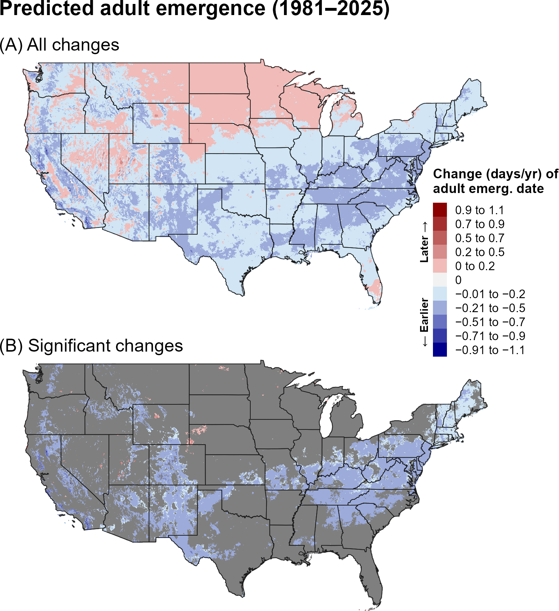
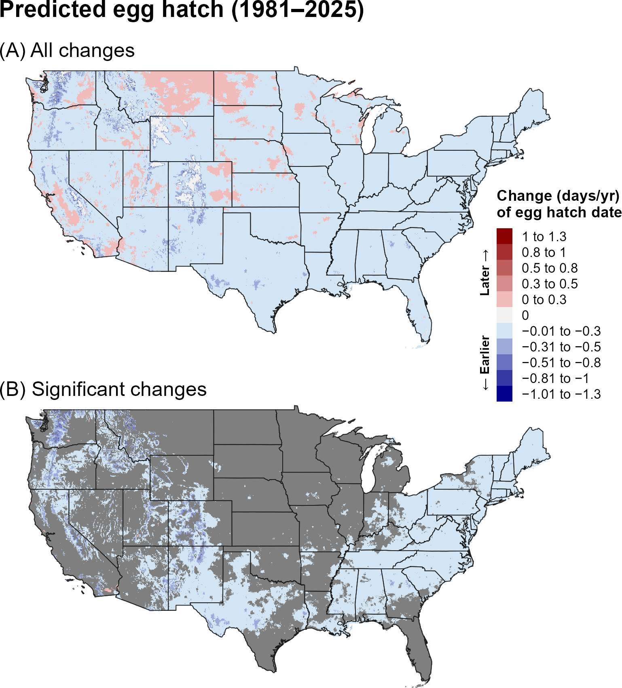
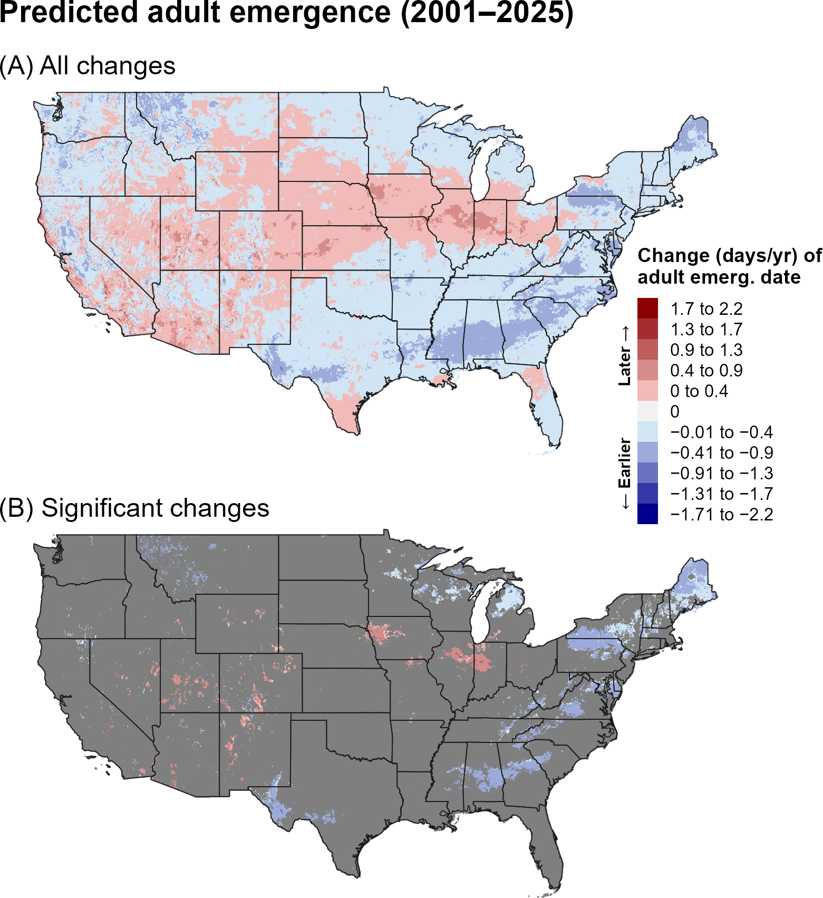
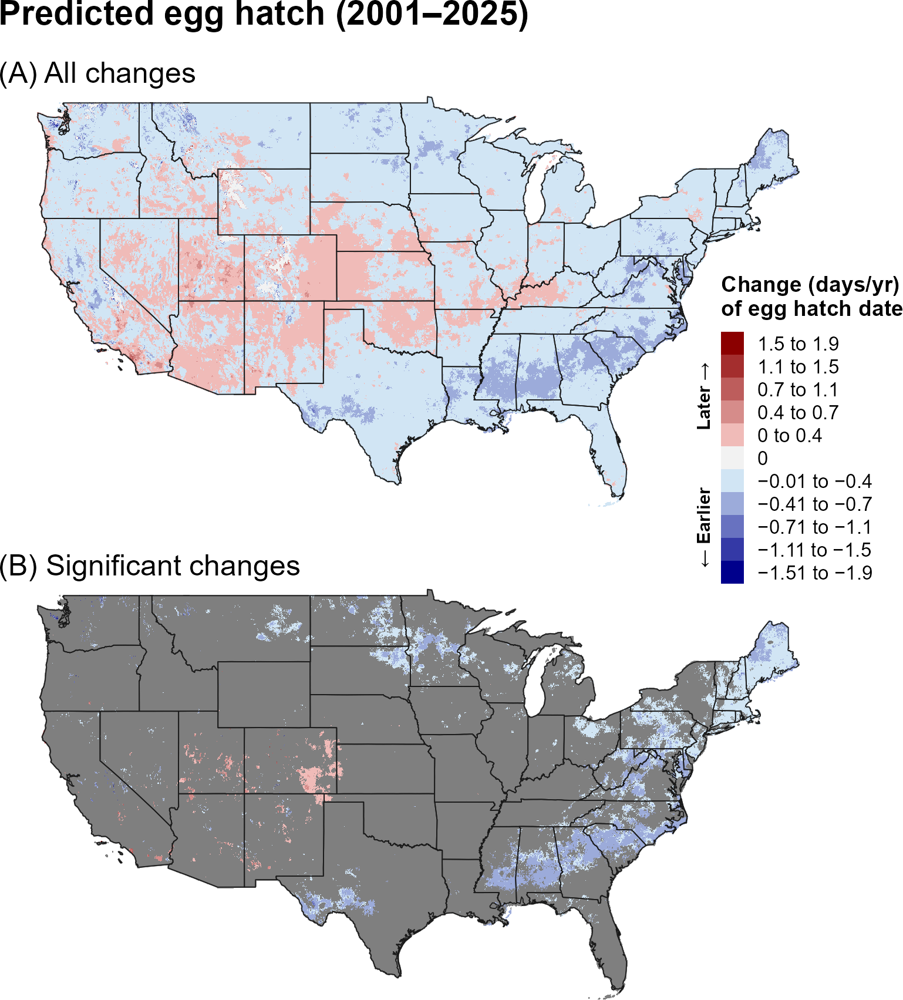
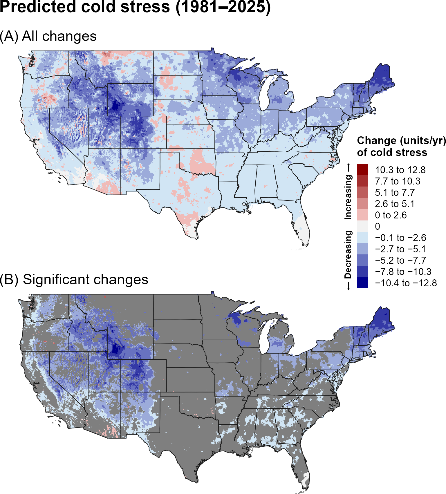
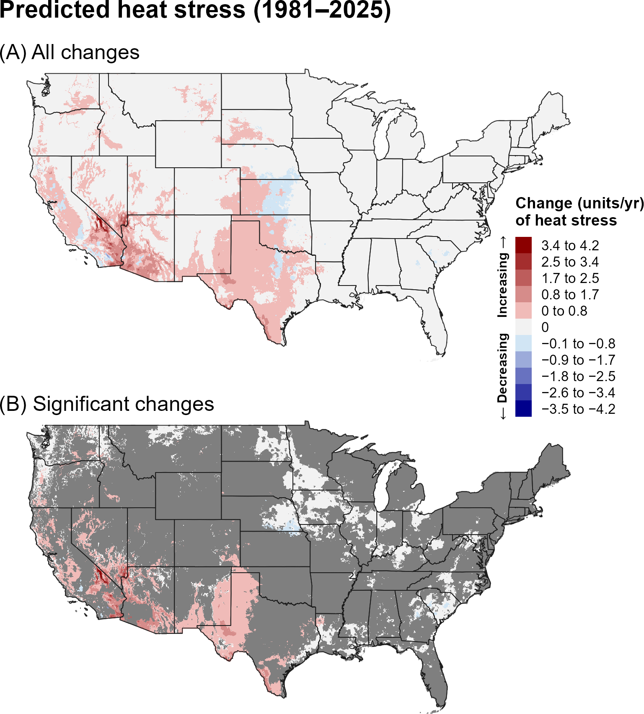
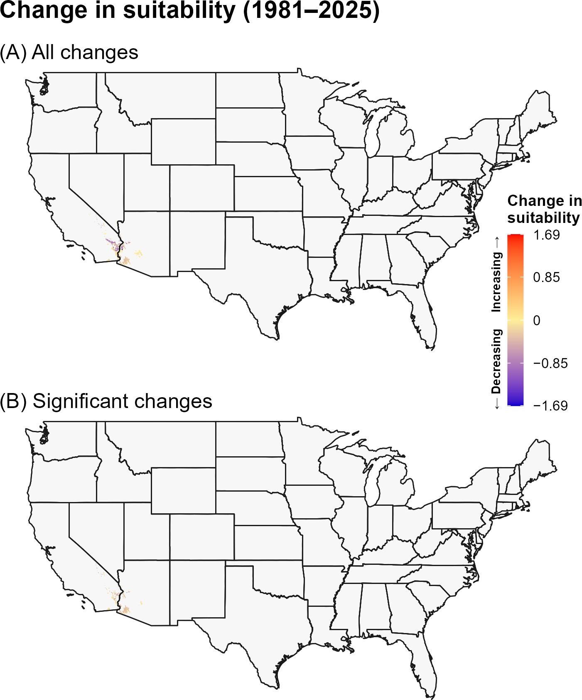
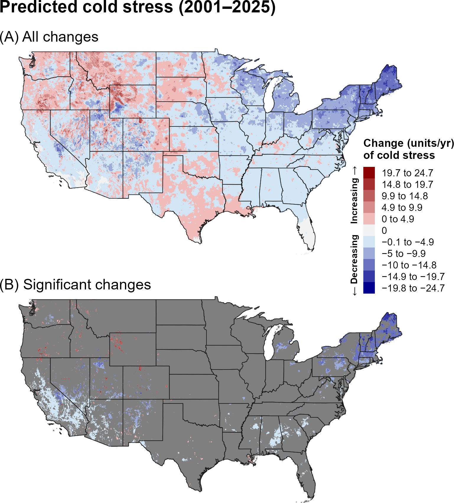
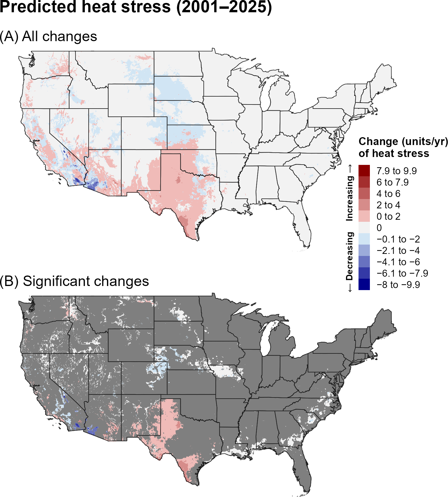
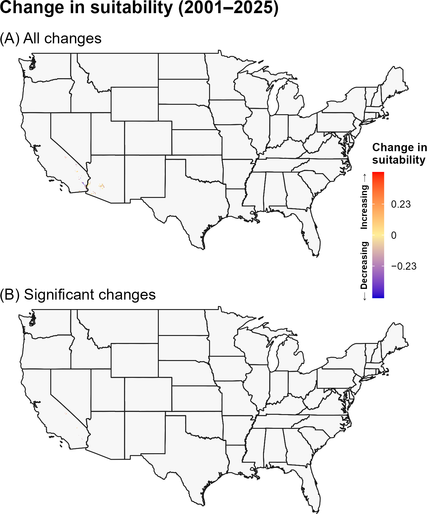

:::: {.content-visible when-format="html"}
::: {style="text-align: left;"}
[Download SLYM report as PDF](SLYM.pdf){.btn .btn-primary}
:::
::::

## **15A. Introduction** {.unlisted}

Widespread across Europe, northern Africa, and Asia, the silver Y moth (SLYM), *Autographa gamma* Linnaeus (Lepidoptera: Noctuidae), is a highly polyphagous defoliator of cereals, *Brassica* spp., legumes, tobacco, and a wide range of fruit and vegetable crops, with particularly significant impacts on sugar beet (`\hyperref[ref-maceljski-balarin-1972]{Maceljski and Balarin 1972}`{=latex}`<a href="#ref-maceljski-balarin-1972">Maceljski and Balarin 1972</a>`{=html}, `\hyperref[ref-venette-2003]{Venette et al. 2003}`{=latex}`<a href="#ref-venette-2003">Venette et al. 2003</a>`{=html}, Sullivan and Molet 2007, `\hyperref[ref-eppo-2019]{EPPO 2019}`{=latex}`<a href="#ref-eppo-2019">EPPO 2019</a>`{=html}, `\hyperref[ref-carneiro-2022]{Carneiro 2022}`{=latex}`<a href="#ref-carneiro-2022">Carneiro 2022</a>`{=html}). Adults undertake annual migrations to northern breeding regions across Eurasia to avoid the hot, dry conditions of Mediterranean overwintering areas (`\hyperref[ref-honek-2002]{Honěk et al. 2002}`{=latex}`<a href="#ref-honek-2002">Honěk et al. 2002</a>`{=html}, `\hyperref[ref-chapman-2012]{Chapman et al. 2012}`{=latex}`<a href="#ref-chapman-2012">Chapman et al. 2012</a>`{=html}, `\hyperref[ref-chapman-2015]{Chapman et al. 2015}`{=latex}`<a href="#ref-chapman-2015">Chapman et al. 2015</a>`{=html}, `\hyperref[ref-saulich-2017]{Saulich et al. 2017}`{=latex}`<a href="#ref-saulich-2017">Saulich et al. 2017</a>`{=html}, `\hyperref[ref-becher-revadi-2020]{Becher and Revadi 2020}`{=latex}`<a href="#ref-becher-revadi-2020">Becher and Revadi 2020</a>`{=html}). Population outbreaks in these breeding regions occur sporadically and are often associated with periods of unusually wet weather (`\hyperref[ref-maceljski-balarin-1974]{Maceljski and Balarin 1974}`{=latex}`<a href="#ref-maceljski-balarin-1974">Maceljski and Balarin 1974</a>`{=html}, `\hyperref[ref-carneiro-2022]{Carneiro 2022}`{=latex}`<a href="#ref-carneiro-2022">Carneiro 2022</a>`{=html}). The species is considered a high-risk invasive agricultural pest for the United States, with the potential to damage more than 200 plant species, including lettuce, cabbage, and grape (`\hyperref[ref-sullivan-molet-2014]{Sullivan and Molet 2014}`{=latex}`<a href="#ref-sullivan-molet-2014">Sullivan and Molet 2014</a>`{=html}). It has been intercepted hundreds of times at United States ports of entry on approximately 130 plant taxa and is considered to have a high likelihood of establishment if introduced (`\hyperref[ref-sullivan-molet-2014]{Sullivan and Molet 2014}`{=latex}`<a href="#ref-sullivan-molet-2014">Sullivan and Molet 2014</a>`{=html}).

Potentially suitable environmental conditions for SLYM occur across much of the United States, although winter conditions may prevent long-term persistence across much of the northern United States, where annual migration from southern source populations could allow temporary establishment during the growing season (`\hyperref[ref-barker-coop-2020]{Barker and Coop 2020}`{=latex}`<a href="#ref-barker-coop-2020">Barker and Coop 2020</a>`{=html}, `\hyperref[ref-ppq-2025]{PPQ 2025}`{=latex}`<a href="#ref-ppq-2025">PPQ 2025</a>`{=html}). In Eurasia, populations generally complete one to four generations per year, with voltinism increasing toward lower latitudes (`\hyperref[ref-saulich-2017]{Saulich et al. 2017}`{=latex}`<a href="#ref-saulich-2017">Saulich et al. 2017</a>`{=html}, `\hyperref[ref-carneiro-2022]{Carneiro 2022}`{=latex}`<a href="#ref-carneiro-2022">Carneiro 2022</a>`{=html}). Similarly, SLYM is predicted to complete one to five generations annually in the contiguous United States (CONUS), with the highest voltinism occurring in the Southeast, Southwest, and California (`\hyperref[ref-barker-coop-2020]{Barker and Coop 2020}`{=latex}`<a href="#ref-barker-coop-2020">Barker and Coop 2020</a>`{=html}, `\hyperref[ref-ppq-2025]{PPQ 2025}`{=latex}`<a href="#ref-ppq-2025">PPQ 2025</a>`{=html}). Hot, dry conditions may also limit populations, with increased drying in the Mediterranean region potentially reducing northward migration and consequently affecting annual population size and generation number (`\hyperref[ref-ellis-2016]{Ellis 2016}`{=latex}`<a href="#ref-ellis-2016">Ellis 2016</a>`{=html}).

A model for SLYM developed for the Degree-Day, establishment Risk, and Phenological event mapping system (DDRP) is operationalized to produce near real-time forecasts for the CONUS at <https://uspest.org/DDRP>. The phenology model applies a lower developmental threshold of 8.9 ºC and upper threshold of 35.0 ºC for all life stages (egg, larva, pupa, and adult) and assumes the larva is the overwintering stage. The climatic suitability model applies a lower cold stress threshold and upper heat stress threshold of −1 °C and 38 °C, respectively. The full set of model parameters for SLYM, including degree-day requirements for individual life stages and climate stress limits, are presented in @tbl-slym-parameters. Details on model parameterization are available at USPest.org (`\hyperref[ref-barker-coop-2020]{Barker and Coop 2020}`{=latex}`<a href="#ref-barker-coop-2020">Barker and Coop 2020</a>`{=html}).

## **15B. Results** {.unlisted}

### **i. Phenology**

#### **Entire period: 1981--2025**

Over 1981–2025, predicted egg hatch and adult emergence generally showed earlier trends across portions of the western and central United States, with later events in portions of the northern and eastern interior (@fig-slym-emergence, @fig-slym-egg-hatch). Significant changes were concentrated in scattered areas, particularly in the central and eastern United States.

```{r}
#| echo: false
#| out-width: 70%
#| fig-align: center
#| fig-cap: "Changes (days/year) in predicted dates of first adult emergence for SLYM across the CONUS over the entire 44-year period (1981–2025). Maps show (A) all changes and (B) statistically significant changes (P < 0.1); areas shown in gray are not statistically significant."
#| label: fig-slym-emergence

```

```{r}
#| echo: false
#| out-width: 70%
#| fig-align: center
#| fig-cap: "Changes (days/year) in predicted dates of first egg hatch for SLYM across the CONUS over the entire 44-year period (1981–2025). Maps show (A) all changes and (B) statistically significant changes (P < 0.1); areas shown in gray are not statistically significant."
#| label: fig-slym-egg-hatch

```

#### **Recent period: 2001--2025**

During 2001–2025, earlier predicted egg hatch and adult emergence remained evident across portions of the West and central United States, while later events occurred in parts of the northern and eastern United States (@fig-slym-emergence-recent, @fig-slym-egg-hatch-recent). Significant changes were spatially limited.

```{r}
#| echo: false
#| out-width: 70%
#| fig-align: center
#| fig-cap: "Changes (days/year) in predicted dates of first adult emergence for SLYM across the CONUS over the recent 24-year period (2001–2025). Maps show (A) all changes and (B) statistically significant changes (P < 0.1); areas shown in gray are not statistically significant."
#| label: fig-slym-emergence-recent

```

```{r}
#| echo: false
#| out-width: 70%
#| fig-align: center
#| fig-cap: "Changes (days/year) in predicted dates of first egg hatch for SLYM across the CONUS over the recent 24-year period (2001–2025). Maps show (A) all changes and (B) statistically significant changes (P < 0.1); areas shown in gray are not statistically significant."
#| label: fig-slym-egg-hatch-recent

```

### **ii. Climatic suitability**

#### **Entire period: 1981--2025**

Predicted cold stress decreased broadly across the northern United States over 1981–2025, while heat stress increased in the western and southern United States (@fig-slym-cold-stress, @fig-slym-heat-stress). Changes in predicted climatic suitability were extremely limited, with little significant change across the CONUS (@fig-slym-suitability).

```{r}
#| echo: false
#| out-width: 70%
#| fig-align: center
#| fig-cap: "Changes (units/year) in predicted cold stress for SLYM across the CONUS over the entire 44-year period (1981–2025). Maps show (A) all changes and (B) statistically significant changes (P < 0.1); areas shown in gray are not statistically significant. Areas shown as 0 in (B) had significant trends but very small changes."
#| label: fig-slym-cold-stress

```

```{r}
#| echo: false
#| out-width: 70%
#| fig-align: center
#| fig-cap: "Changes (units/year) in predicted heat stress for SLYM across the CONUS over the entire 44-year period (1981–2025). Maps show (A) all changes and (B) statistically significant changes (P < 0.1); areas shown in gray are not statistically significant. Areas shown as 0 in (B) had significant trends but very small changes."
#| label: fig-slym-heat-stress

```

```{r}
#| echo: false
#| out-width: 70%
#| fig-align: center
#| fig-cap: "Changes in predicted climatic suitability for SLYM across the CONUS over the 44-year period (1981–2025). Suitability is defined as areas not excluded by climate stress. Positive changes (warmer colors) indicate an increased likelihood of establishment, whereas negative changes (cooler colors) indicate a decreased likelihood of establishment."
#| label: fig-slym-suitability

```

#### **Recent period: 2001--2025**

During 2001–2025, cold-stress changes became more mixed, with increases across portions of the northern and central interior (@fig-slym-cold-stress-recent). Heat stress continued to increase in the Southwest and southern Great Plains (@fig-slym-heat-stress-recent). Climatic-suitability changes remained negligible and highly localized (@fig-slym-suitability-recent).

```{r}
#| echo: false
#| out-width: 70%
#| fig-align: center
#| fig-cap: "Changes (units/year) in predicted cold stress for SLYM across the CONUS over the recent 24-year period (2001–2025). Maps show (A) all changes and (B) statistically significant changes (P < 0.1); areas shown in gray are not statistically significant. Areas shown as 0 in (B) had significant trends but very small changes."
#| label: fig-slym-cold-stress-recent

```

```{r}
#| echo: false
#| out-width: 70%
#| fig-align: center
#| fig-cap: "Changes (units/year) in predicted heat stress for SLYM across the CONUS over the recent 24-year period (2001–2025). Maps show (A) all changes and (B) statistically significant changes (P < 0.1); areas shown in gray are not statistically significant. Areas shown as 0 in (B) had significant trends but very small changes."
#| label: fig-slym-heat-stress-recent

```

```{r}
#| echo: false
#| out-width: 70%
#| fig-align: center
#| fig-cap: "Changes in predicted climatic suitability for SLYM across the CONUS over the recent 24-year period (2001–2025). Suitability is defined as areas not excluded by climate stress. Positive changes (warmer colors) indicate an increased likelihood of establishment, whereas negative changes (cooler colors) indicate a decreased likelihood of establishment."
#| label: fig-slym-suitability-recent

```

## **15C. Discussion** {.unlisted}

Predicted phenology for SLYM showed regional changes in timing but relatively limited changes in climatic suitability. Earlier events in portions of the West and central United States could shift seasonal activity, while contrasting trends in northern and eastern areas indicate that the response is geographically heterogeneous. The recent-period maps also show that shorter-term climate patterns can differ from the longer-term signal.

The broad decline in cold stress over the full period did not produce a corresponding broad increase in predicted climatic suitability. This suggests that SLYM is not strongly constrained by the modeled cold-stress threshold across most of the CONUS. Increasing heat stress in the Southwest likewise produced little measurable change in overall suitability.

The stronger and more spatially extensive trends in predicted phenology and climate stress over the full 44-year period may reflect both the larger sample size, which can reduce noise and improve detection of directional patterns, and differences in the underlying climate trends between the two time periods. In particular, the recent 24-year period may capture climate variability or regional trends that differ from those observed over the longer 44-year period. Thus, differences between the two periods should be interpreted as reflecting both long-term climate trends and shorter-term regional variability.

## **15D. References** {.unlisted}

\begingroup
\setlength{\parindent}{-0.5in}
\setlength{\leftskip}{0.5in}

\noindent

<span id="ref-barker-coop-2020"></span>
\phantomsection\label{ref-barker-coop-2020}

Barker, B. S., and L. Coop. 2020. Silver Y moth, *Autographa gamma*. Phenology/degree-day and climate suitability white paper for USPEST.ORG. Prepared for United States Department of Agriculture (USDA) – Animal and Plant Health Inspection Service (APHIS) – Plant Protection and Quarantine (PPQ). Vs. 1.0 (7/15/2020). Online at: <https://uspest.org/CAPS/Autographa_gamma_white_paper.pdf> (accessed 8 December 2025).

<span id="ref-becher-revadi-2020"></span>
\phantomsection\label{ref-becher-revadi-2020}

Becher, P. G., and S. V. Revadi. 2020. Current Knowledge on the Migratory Moth *Autographa gamma* as Basis for Future Chemo-ecological Research. Pages 191–200 in Y. Gao, H. Hokkanen, and I. Menzler-Hokkanen, editors. Integrative Biological Control, Progress in Biological Control. Springer Nature, Switzerland.

<span id="ref-carneiro-2022"></span>
\phantomsection\label{ref-carneiro-2022}

Carneiro, E. 2022. *Autographa gamma* (silver-Y moth). CABI Invasive Species Compendium. Available online: <https://doi.org/10.1079/cabicompendium.46179> (accessed 16 December 2025).

<span id="ref-chapman-2012"></span>
\phantomsection\label{ref-chapman-2012}

Chapman, J. W., J. R. Bell, L. E. Burgin, D. R. Reynolds, L. B. Pettersson, J. K. Hill, M. B. Bonsall, and J. A. Thomas. 2012. Seasonal migration to high latitudes results in major reproductive benefits in an insect. PNAS 109:14924–14929.

<span id="ref-chapman-2015"></span>
\phantomsection\label{ref-chapman-2015}

Chapman, J. W., D. R. Reynolds, and K. Wilson. 2015. Long-range seasonal migration in insects: Mechanisms, evolutionary drivers and ecological consequences. Ecology Letters 18:287–302.

<span id="ref-ellis-2016"></span>
\phantomsection\label{ref-ellis-2016}

Ellis, W. N. 2016. What is going on with the silver Y, *Autographa gamma*? Entomologische Berichten 76:21–27.

<span id="ref-eppo-2019"></span>
\phantomsection\label{ref-eppo-2019}

EPPO. 2019. *Autographa gamma*. EPPO datasheets on pests recommended for regulation. Online at: <https://gd.eppo.int/> (accessed 8 December 2025).

<span id="ref-honek-2002"></span>
\phantomsection\label{ref-honek-2002}

Honěk, A., V. Jarošík, Z. Martinková, and I. Novák. 2002. Food induced variation of thermal constants of development and growth of *Autographa gamma* (Lepidoptera: Noctuidae) larvae. European Journal of Entomology 99:241–252.

<span id="ref-maceljski-balarin-1972"></span>
\phantomsection\label{ref-maceljski-balarin-1972}

Maceljski, M., and I. Balarin. 1972. On knowledge of polyphagy and its importance for the silver-Y moth (*Autographa gamma* L.). Acta Entomologica Jugoslavica 8:39–54.

<span id="ref-maceljski-balarin-1974"></span>
\phantomsection\label{ref-maceljski-balarin-1974}

Maceljski, M., and I. Balarin. 1974. Factors influencing the population density of the looper *Autographa gamma* L. in Yugoslavia. Acta Entomologica Jugoslavica 10:63–76.

<span id="ref-ppq-2025"></span>
\phantomsection\label{ref-ppq-2025}

PPQ. 2025. Cooperative Agricultural Pest Survey (CAPS) Pest Datasheet for *Autographa gamma* (Noctuidae): Silver Y Moth. United States Department of Agriculture, Animal and Plant Health Inspection Service, Plant Protection and Quarantine (PPQ), Raleigh, NC. Online at: <https://caps.ceris.purdue.edu/wp-content/uploads/2025/12/Autographa-gamma-CAPS-Datasheet.pdf?utm_source=chatgpt.com> (accessed 16 September 2026).

<span id="ref-saulich-2017"></span>
\phantomsection\label{ref-saulich-2017}

Saulich, A. K., I. V. Sokolova, and D. L. Musolin. 2017. Seasonal cycles of noctuid moths of the subfamily Plusiinae (Lepidoptera, Noctuidae) of the Palaearctic: Diversity and environmental control. Entomological Review 97:143–157.

<span id="ref-sullivan-molet-2014"></span>
\phantomsection\label{ref-sullivan-molet-2014}

Sullivan, M., and T. Molet. 2014. CPHST Pest Datasheet for *Autographa gamma*. USDA-APHIS-PPQ-CPHST. Online at: <https://caps.ceris.purdue.edu/wp-content/uploads/2025/07/Autographa-gamma_CPHST-Pest-Datasheet_2014-version.pdf> (accessed 16 September 2026).

<span id="ref-venette-2003"></span>
\phantomsection\label{ref-venette-2003}

Venette, R. C., E. E. Davis, H. Heisler, and M. Larson. 2003. Mini risk assessment silver Y moth, *Autographa gamma* (L.) [Lepidoptera: Noctuidae]. Cooperative Agricultural Pest Survey, Animal and Plant Health Inspection Service, United States Department of Agriculture

\par
\endgroup