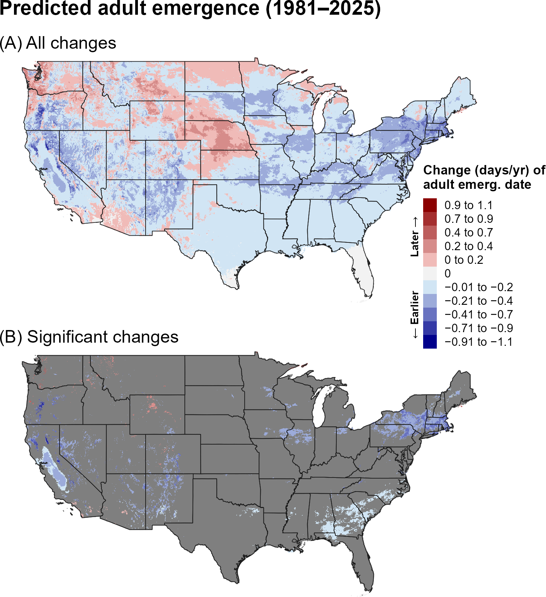
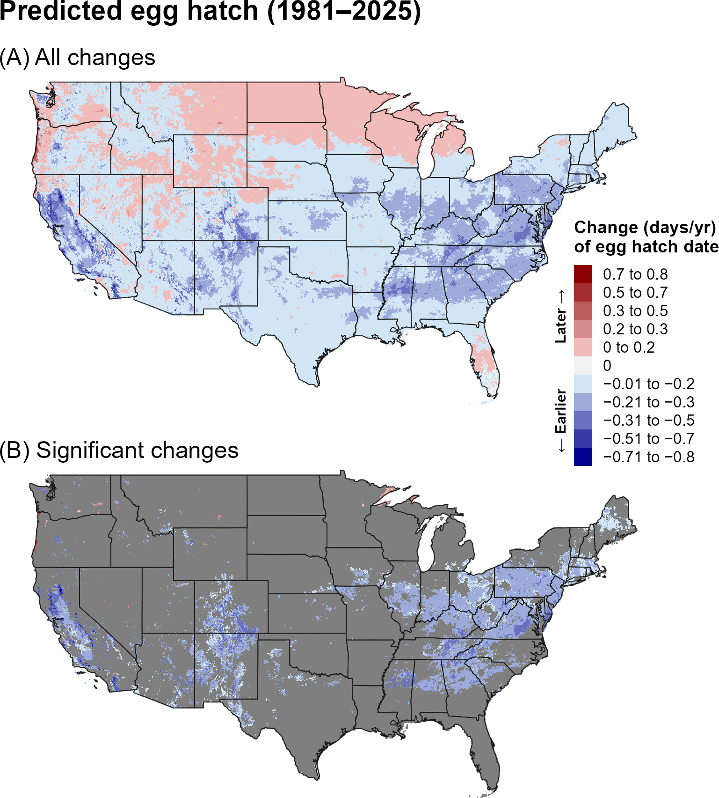
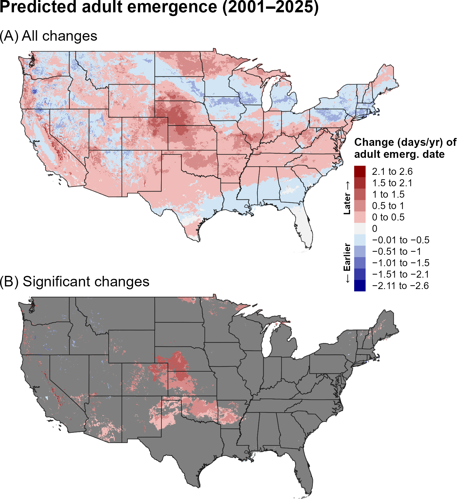
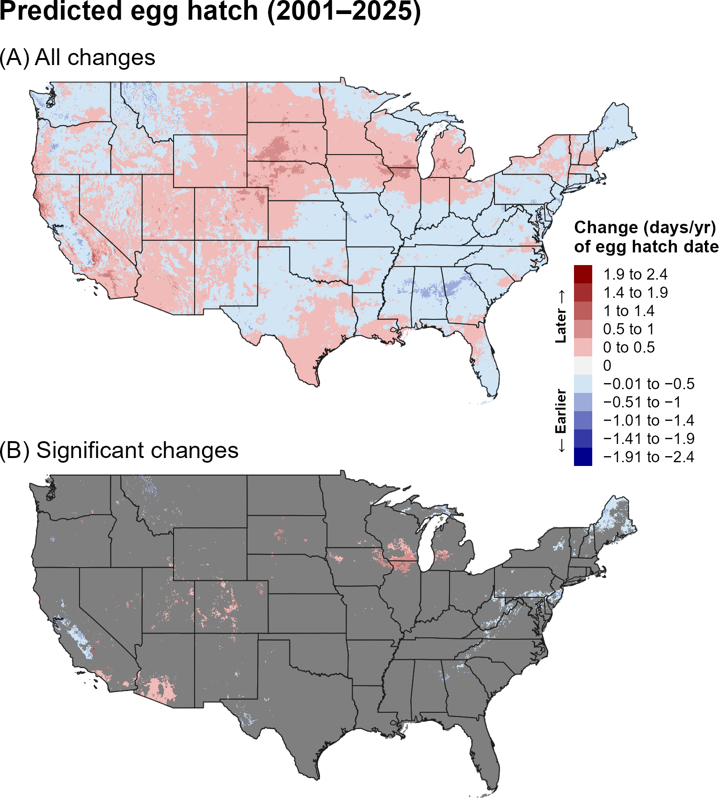
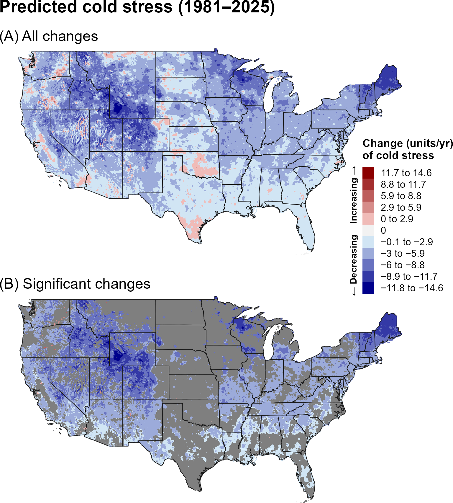
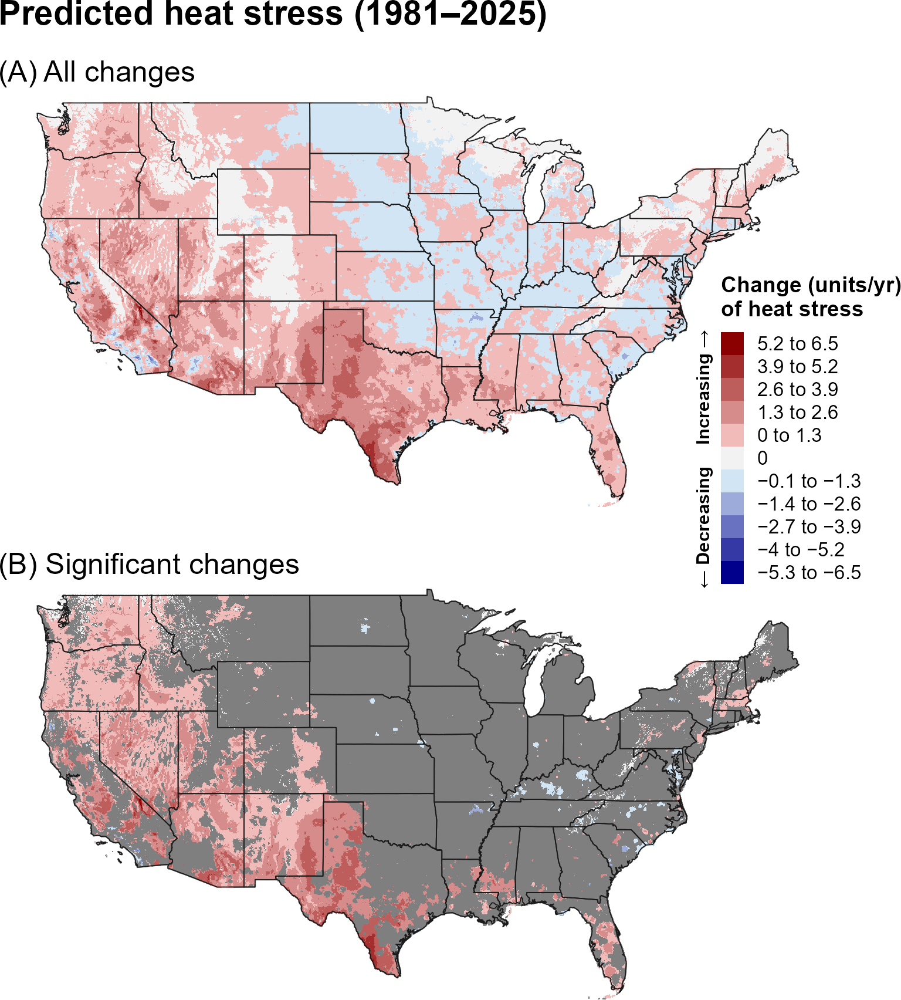
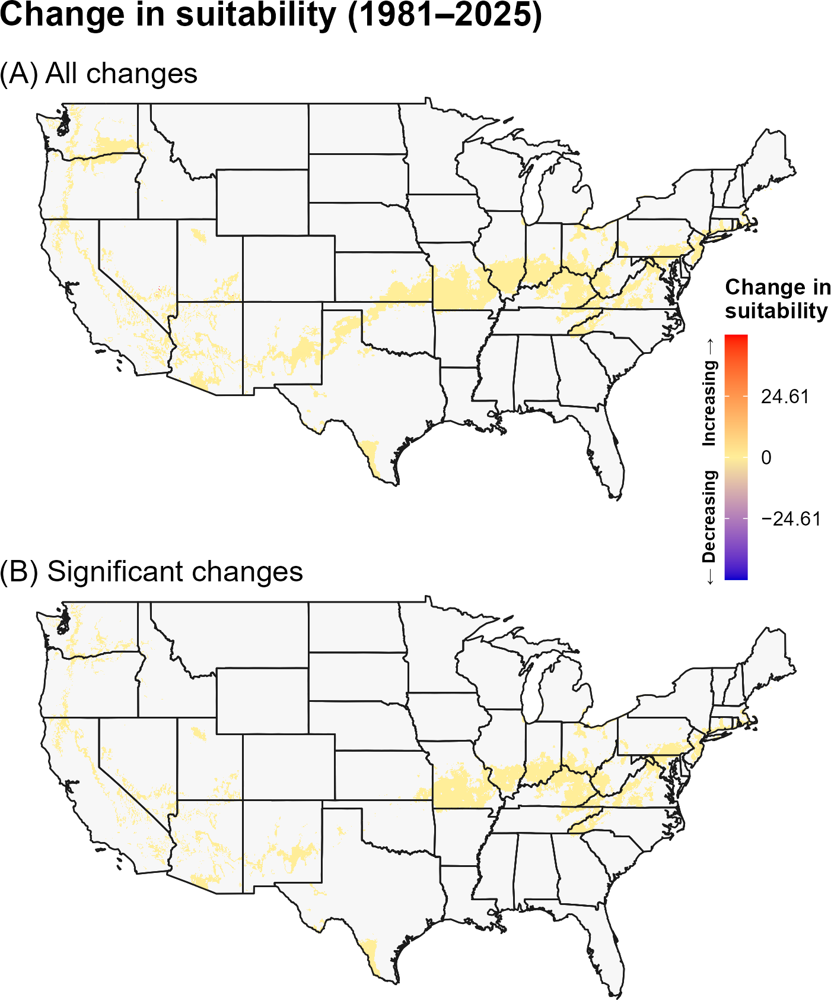
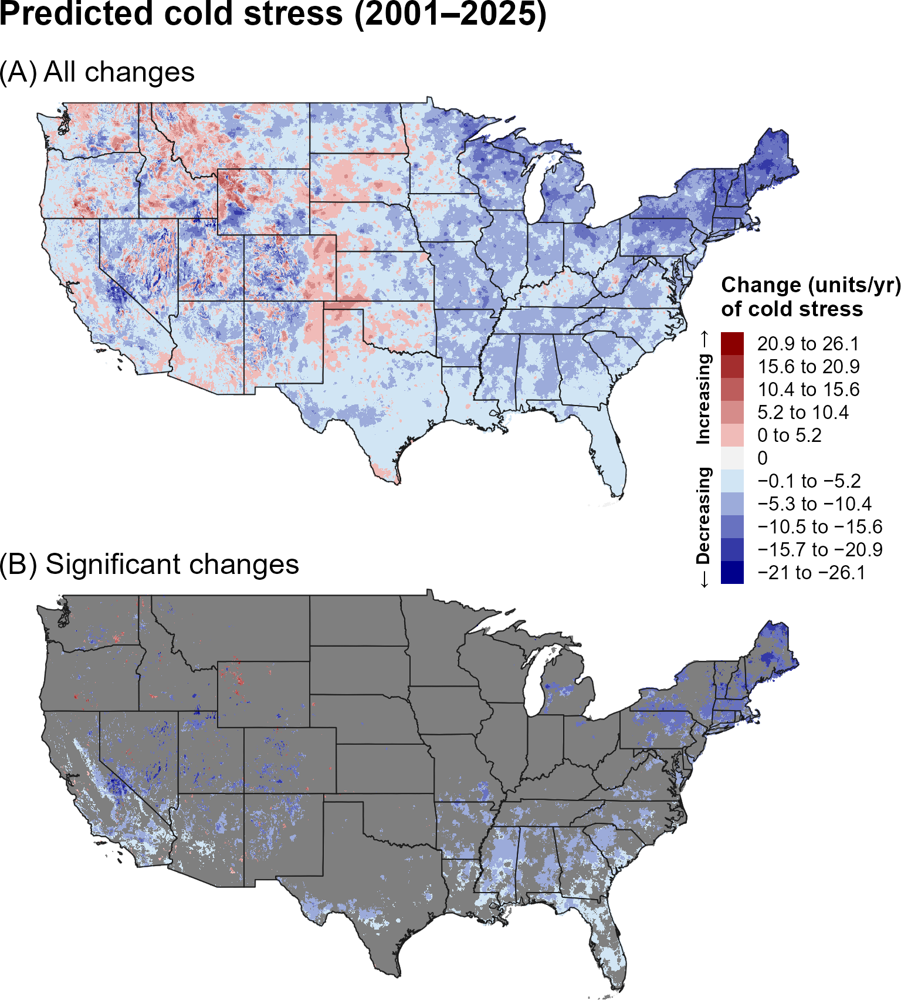
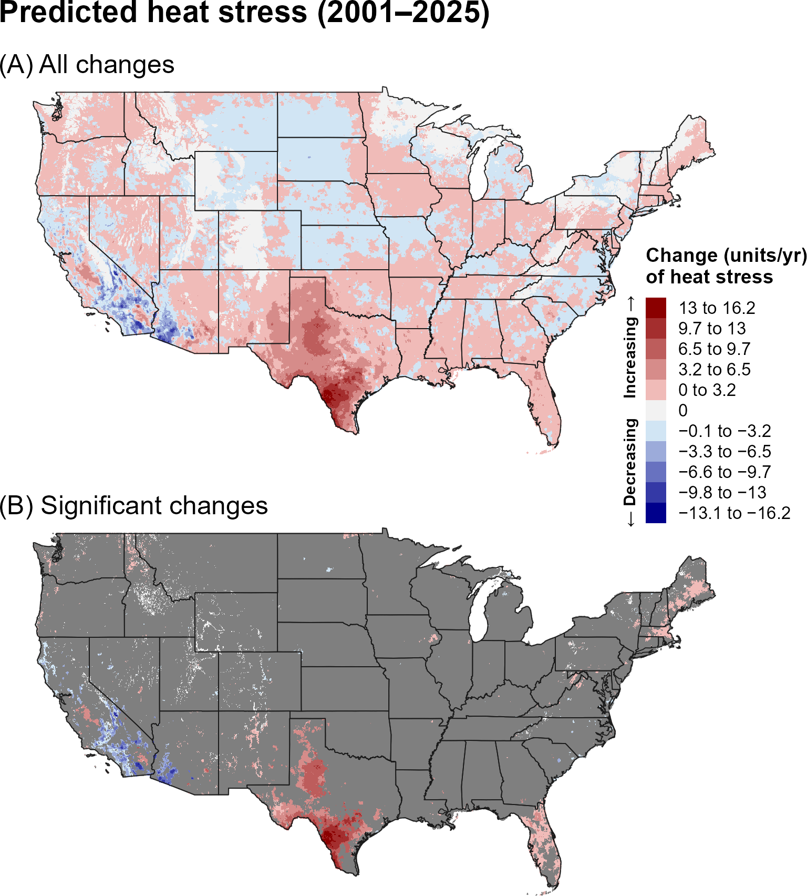
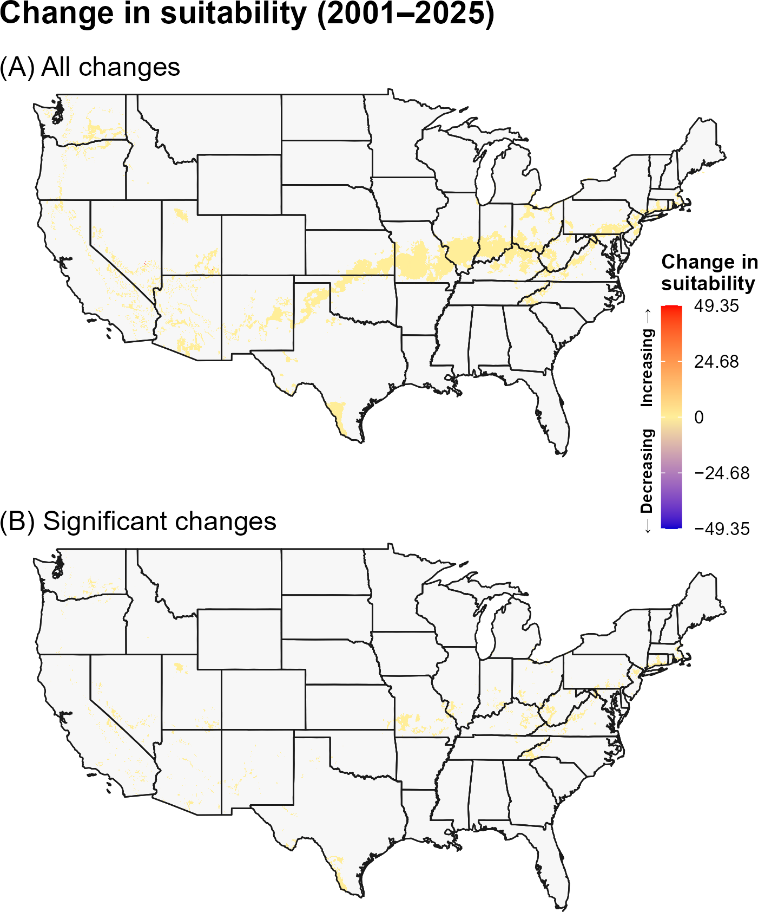

:::: {.content-visible when-format="html"}
::: {style="text-align: left;"}
[Download STB report as PDF](STB/STB.pdf){.btn .btn-primary}
:::
::::

## **16A. Introduction** {.unlisted}

The small tomato borer (STB), *Neoleucinodes elegantalis* (Guenée) (Lepidoptera: Pyralidae), is an oligophagous pest of Solanum species, including tomato, eggplant, red and green pepper, lulo (naranjilla), and wild Solanum spp. (`\hyperref[ref-molet-2012]{Molet 2012}`{=latex}`<a href="#ref-molet-2012">Molet 2012</a>`{=html}, `\hyperref[ref-oepp-eppo-2015]{OEPP/EPPO 2015}`{=latex}`<a href="#ref-oepp-eppo-2015">OEPP/EPPO 2015</a>`{=html}). Native to South America, it has expanded its range into Mexico, Central America, and the Caribbean (`\hyperref[ref-molet-2012]{Molet 2012}`{=latex}`<a href="#ref-molet-2012">Molet 2012</a>`{=html}, `\hyperref[ref-oepp-eppo-2015]{OEPP/EPPO 2015}`{=latex}`<a href="#ref-oepp-eppo-2015">OEPP/EPPO 2015</a>`{=html}, `\hyperref[ref-diaz-montilla-2013]{Díaz-Montilla 2013a}`{=latex}`<a href="#ref-diaz-montilla-2013">Díaz-Montilla 2013a</a>`{=html}). The species occupies a wide range of climatic conditions in South America, although its distribution varies depending on host plant availability and altitude (Díaz Montilla 2013b). Larvae develop through five instars, with the third through fifth instars responsible for the majority of fruit damage, and development rates that may vary by host plant (`\hyperref[ref-serrano-plaza-1992]{Serrano Plaza et al. 1992}`{=latex}`<a href="#ref-serrano-plaza-1992">Serrano Plaza et al. 1992</a>`{=html}, `\hyperref[ref-diaz-montilla-2013]{Díaz-Montilla 2013a}`{=latex}`<a href="#ref-diaz-montilla-2013">Díaz-Montilla 2013a</a>`{=html}). Infestations can result in severe economic losses, with reported yield reductions in South American tomato crops ranging from 45% to 90% (`\hyperref[ref-diaz-montilla-2024]{Díaz Montilla and Kondo 2024}`{=latex}`<a href="#ref-diaz-montilla-2024">Díaz Montilla and Kondo 2024</a>`{=html}). If introduced to the United States, regions with high levels of tomato and pepper production would be particularly vulnerable (`\hyperref[ref-molet-2012]{Molet 2012}`{=latex}`<a href="#ref-molet-2012">Molet 2012</a>`{=html}, `\hyperref[ref-usda-aphis-ppq-2024]{USDA-APHIS-PPQ 2024}`{=latex}`<a href="#ref-usda-aphis-ppq-2024">USDA-APHIS-PPQ 2024</a>`{=html}). In addition, STB poses a significant barrier to the export of solanaceous crops from South America to the United States and the European Union (`\hyperref[ref-diaz-montilla-2013]{Díaz-Montilla 2013a}`{=latex}`<a href="#ref-diaz-montilla-2013">Díaz-Montilla 2013a</a>`{=html}, `\hyperref[ref-diaz-montilla-2013-2]{Díaz-Montilla 2013b}`{=latex}`<a href="#ref-diaz-montilla-2013-2">Díaz-Montilla 2013b</a>`{=html}). The pest has been intercepted hundreds of times at United States ports of entry, with most interceptions originating from Brazil (`\hyperref[ref-molet-2012]{Molet 2012}`{=latex}`<a href="#ref-molet-2012">Molet 2012</a>`{=html}).

Potentially suitable environmental conditions for STB occur in western portions of the Pacific states, the Southeast, and parts of the southern Northeast, although colder conditions limit suitability across much of the northern United States (`\hyperref[ref-barker-2020]{Barker et al. 2020}`{=latex}`<a href="#ref-barker-2020">Barker et al. 2020</a>`{=html}). In its native range, increases in temperature and precipitation appear to favor STB populations, while arid conditions can limit its distribution, suggesting that moisture availability may influence STB distribution and climatic suitability in the contiguous United States (CONUS; `\hyperref[ref-silva-2020]{Silva et al. 2020}`{=latex}`<a href="#ref-silva-2020">Silva et al. 2020</a>`{=html}, `\hyperref[ref-da-silva-2018]{da Silva et al. 2018}`{=latex}`<a href="#ref-da-silva-2018">da Silva et al. 2018</a>`{=html}). Annual voltinism also varies substantially with climate, with models predicting 2–11 generations per year in Colombia and 5–10 generations in Brazil (`\hyperref[ref-moraes-foerster-2015]{de Moraes and Foerster 2015}`{=latex}`<a href="#ref-moraes-foerster-2015">de Moraes and Foerster 2015</a>`{=html}, `\hyperref[ref-santos-2021]{dos Santos and Marchioro 2021}`{=latex}`<a href="#ref-santos-2021">dos Santos and Marchioro 2021</a>`{=html}). STB does not appear to have a diapause or distinct overwintering stage and can produce continuous, overlapping generations, with voltinism generally increasing toward warmer, lower-latitude regions (`\hyperref[ref-serrano-plaza-1992]{Serrano Plaza et al. 1992}`{=latex}`<a href="#ref-serrano-plaza-1992">Serrano Plaza et al. 1992</a>`{=html}, `\hyperref[ref-moraes-foerster-2015]{Moraes and Foerster 2015}`{=latex}`<a href="#ref-moraes-foerster-2015">Moraes and Foerster 2015</a>`{=html}, `\hyperref[ref-barker-2020]{Barker et al. 2020}`{=latex}`<a href="#ref-barker-2020">Barker et al. 2020</a>`{=html}). In CONUS, annual voltinism is predicted to range from one to two generations in colder parts of the Pacific Northwest to seven to nine generations in coastal areas of the Southeast, with three to six generations across much of the remainder of the CONUS (`\hyperref[ref-barker-2020]{Barker et al. 2020}`{=latex}`<a href="#ref-barker-2020">Barker et al. 2020</a>`{=html}).

A model for tomato fruit borer developed for the Degree-Day, establishment Risk, and Phenological event mapping system (DDRP) is operationalized to produce near real-time forecasts for the CONUS at <https://uspest.org/DDRP>. The phenology model applies a lower developmental threshold of 8.89 °C and upper threshold of 30 °C for all life stages (egg, larva, pupa, and adult) and assumes the adult is the overwintering stage. The climatic suitability model applies a lower cold stress threshold and upper heat stress threshold of 6 °C and 32 °C, respectively. The full set of model parameters for tomato fruit borer, including degree-day requirements for individual life stages and climate stress limits, are presented in @tbl-stb-parameters. Details on model parameterization are available at USPest.org (`\hyperref[ref-barker-2020]{Barker et al. 2020}`{=latex}`<a href="#ref-barker-2020">Barker et al. 2020</a>`{=html}). 

## **16B. Results** {.unlisted}

### **i. Phenology**

#### **Entire period: 1981--2025**

Over 1981–2025, predicted adult emergence and egg hatch generally occurred earlier across much of the southern and eastern United States, while later events were evident across portions of the northern and western interior (@fig-stb-emergence, @fig-stb-egg-hatch). Significant changes were concentrated in the eastern and central United States.

```{r}
#| echo: false
#| out-width: 70%
#| fig-align: center
#| fig-cap: "Changes (days/year) in predicted dates of first adult emergence for STB across the CONUS over the entire 44-year period (1981–2025). Maps show (A) all changes and (B) statistically significant changes (P < 0.1); areas shown in gray are not statistically significant."
#| label: fig-stb-emergence

```

```{r}
#| echo: false
#| out-width: 70%
#| fig-align: center
#| fig-cap: "Changes (days/year) in predicted dates of first egg hatch for STB across the CONUS over the entire 44-year period (1981–2025). Maps show (A) all changes and (B) statistically significant changes (P < 0.1); areas shown in gray are not statistically significant."
#| label: fig-stb-egg-hatch

```

#### **Recent period: 2001--2025**

During 2001–2025, adult emergence and egg hatch showed a stronger tendency toward later dates across portions of the northern and central United States, with earlier events remaining in scattered western and southern areas (@fig-stb-emergence-recent, @fig-stb-egg-hatch-recent). Significant changes were relatively localized, with some concentrated areas in the central United States.

```{r}
#| echo: false
#| out-width: 70%
#| fig-align: center
#| fig-cap: "Changes (days/year) in predicted dates of first adult emergence for STB across the CONUS over the recent 24-year period (2001–2025). Maps show (A) all changes and (B) statistically significant changes (P < 0.1); areas shown in gray are not statistically significant."
#| label: fig-stb-emergence-recent

```

```{r}
#| echo: false
#| out-width: 70%
#| fig-align: center
#| fig-cap: "Changes (days/year) in predicted dates of first egg hatch for STB across the CONUS over the recent 24-year period (2001–2025). Maps show (A) all changes and (B) statistically significant changes (P < 0.1); areas shown in gray are not statistically significant."
#| label: fig-stb-egg-hatch-recent

```

### **ii. Climatic suitability**

#### **Entire period: 1981--2025**

Predicted cold stress decreased across broad portions of the northern United States over 1981–2025, while heat stress increased across much of the western and southern United States (@fig-stb-cold-stress, @fig-stb-heat-stress). Predicted climatic suitability increased significantly in portions of the Great Lakes, Northeast, and central United States (@fig-stb-suitability).

```{r}
#| echo: false
#| out-width: 70%
#| fig-align: center
#| fig-cap: "Changes (units/year) in predicted cold stress for STB across the CONUS over the entire 44-year period (1981–2025). Maps show (A) all changes and (B) statistically significant changes (P < 0.1); areas shown in gray are not statistically significant. Areas shown as 0 in (B) had significant trends but very small changes."
#| label: fig-stb-cold-stress

```

```{r}
#| echo: false
#| out-width: 70%
#| fig-align: center
#| fig-cap: "Changes (units/year) in predicted heat stress for STB across the CONUS over the entire 44-year period (1981–2025). Maps show (A) all changes and (B) statistically significant changes (P < 0.1); areas shown in gray are not statistically significant. Areas shown as 0 in (B) had significant trends but very small changes."
#| label: fig-stb-heat-stress

```

```{r}
#| echo: false
#| out-width: 70%
#| fig-align: center
#| fig-cap: "Changes in predicted climatic suitability for STB across the CONUS over the 44-year period (1981–2025). Suitability is defined as areas not excluded by climate stress. Positive changes (warmer colors) indicate an increased likelihood of establishment, whereas negative changes (cooler colors) indicate a decreased likelihood of establishment."
#| label: fig-stb-suitability

```

#### **Recent period: 2001--2025**

During 2001–2025, increases in predicted cold stress became prominent across portions of the northern and central interior, while heat stress continued to increase in the Southwest and southern Great Plains (@fig-stb-cold-stress-recent, @fig-stb-heat-stress-recent). Climatic-suitability increases remained concentrated in northern and central regions and were less extensive than over the full period (@fig-stb-suitability-recent).

```{r}
#| echo: false
#| out-width: 70%
#| fig-align: center
#| fig-cap: "Changes (units/year) in predicted cold stress for STB across the CONUS over the recent 24-year period (2001–2025). Maps show (A) all changes and (B) statistically significant changes (P < 0.1); areas shown in gray are not statistically significant. Areas shown as 0 in (B) had significant trends but very small changes."
#| label: fig-stb-cold-stress-recent

```

```{r}
#| echo: false
#| out-width: 70%
#| fig-align: center
#| fig-cap: "Changes (units/year) in predicted heat stress for STB across the CONUS over the recent 24-year period (2001–2025). Maps show (A) all changes and (B) statistically significant changes (P < 0.1); areas shown in gray are not statistically significant. Areas shown as 0 in (B) had significant trends but very small changes."
#| label: fig-stb-heat-stress-recent

```

```{r}
#| echo: false
#| out-width: 70%
#| fig-align: center
#| fig-cap: "Changes in predicted climatic suitability for STB across the CONUS over the recent 24-year period (2001–2025). Suitability is defined as areas not excluded by climate stress. Positive changes (warmer colors) indicate an increased likelihood of establishment, whereas negative changes (cooler colors) indicate a decreased likelihood of establishment."
#| label: fig-stb-suitability-recent

```

## **16C. Discussion** {.unlisted}

The STB results show a clear difference between the long-term and recent phenological patterns. Earlier emergence and egg hatch were common over 1981–2025, whereas later events became more prominent in the recent period across portions of the northern and central United States. This contrast suggests that recent regional climate variability has substantially influenced the short-term phenological signal and should be considered when interpreting current management timing.

The increase in predicted suitability across northern and central regions over the full period coincided with declining cold stress, suggesting that warming has reduced a temperature-related limitation in those areas. The recent increase in cold stress and corresponding reduction in suitability changes indicate that this long-term expansion signal is less evident during 2001–2025.

The stronger and more spatially extensive trends in predicted phenology and climate stress over the full 44-year period may reflect both the larger sample size, which can reduce noise and improve detection of directional patterns, and differences in the underlying climate trends between the two time periods. In particular, the recent 24-year period may capture climate variability or regional trends that differ from those observed over the longer 44-year period. Thus, differences between the two periods should be interpreted as reflecting both long-term climate trends and shorter-term regional variability.

## **16D. References** {.unlisted}

\begingroup
\setlength{\parindent}{-0.5in}
\setlength{\leftskip}{0.5in}

\noindent

<span id="ref-barker-2020"></span>
\phantomsection\label{ref-barker-2020}

Barker, B. S., L. Coop, T. Wepprich, F. Grevstad, and G. Cook. 2020. DDRP: Real-time phenology and climatic suitability modeling of invasive insects. PLoS ONE 15:e2557.

<span id="ref-diaz-montilla-2013"></span>
\phantomsection\label{ref-diaz-montilla-2013}

Diaz Montilla, A. E., M. A. Solis, and T. Kondo. 2013. The Tomato Fruit Borer, *Neoleucinodes elegantalis* (Guenée) (Lepidoptera: Crambidae), an Insect Pest of Neotropical Solanaceous Fruits. Pages 137–159 *in* J. Peña, editor. Potential Invasive Pests of Agricultural Crops. CAB International, Boston.

<span id="ref-diaz-montilla-2013-2"></span>
\phantomsection\label{ref-diaz-montilla-2013-2}

Díaz Montilla, A. E., H. G. Suárez-Baron, G. Gallego-Sánchez, C. I. Saldamando-Benjumea, and J. Tohme. 2013. Geographic differentiation of Colombian *Neoleucinodes elegantalis* (Lepidoptera: Crambidae) haplotypes: Evidence for solanaceae host plant association and Holdridge life zones for genetic differentiation. Annals of the Entomological Society of America 106:586–597.

<span id="ref-diaz-montilla-2024"></span>
\phantomsection\label{ref-diaz-montilla-2024}

Díaz Montilla AE, Kondo T. 2024. Biological control of *Neoleucinodes elegantalis* (Guenée) (Lepidoptera: Crambidae): A comprehensive review of IPM strategies for Andean solanaceous crops. Biological Control 199:105654.

<span id="ref-molet-2012"></span>
\phantomsection\label{ref-molet-2012}

Molet, T. 2012. CPHST Pest Datasheet for *Neoleucinodes elegantalis*. USDA-APHISPPQ-CPHST. Revised February 2013. Online at: <https://caps.ceris.purdue.edu/wp-content/uploads/2025/07/Neoleucinodes-elegantalis_Molet_2012.pdf> (accessed 3 April 2026).

<span id="ref-moraes-foerster-2015"></span>
\phantomsection\label{ref-moraes-foerster-2015}

Moraes, C. P., and L. A. Foerster. 2015. Thermal requirements, fertility, and number of generations of *Neoleucinodes elegantalis* (Guenée) (Lepidoptera: Crambidae). Neotropical Entomology 44:338–344.

<span id="ref-oepp-eppo-2015"></span>
\phantomsection\label{ref-oepp-eppo-2015}

OEPP/EPPO. 2015. *Neoleucinodes elegantalis*. EPPO Bulletin 45:9–13.

<span id="ref-usda-aphis-ppq-2024"></span>
\phantomsection\label{ref-usda-aphis-ppq-2024}

USDA-APHIS-PPQ. 2024. Cooperative Agricultural Pest Survey (CAPS) pest datasheet for *Neoleucinodes elegantalis* Guenée (Crambidae): Tomato fruit borer. Raleigh, NC.

<span id="ref-diaz-montilla-kondo-2024"></span>
\phantomsection\label{ref-diaz-montilla-kondo-2024}

Díaz Montilla, A. E., and T. Kondo. 2024. Biological control of *Neoleucinodes elegantalis* (Guenée) (Lepidoptera: Crambidae): A comprehensive review of IPM strategies for Andean solanaceous crops. Biological Control 199:105654.

<span id="ref-santos-2021"></span>
\phantomsection\label{ref-santos-2021}

dos Santos, H. T., and C. A. Marchioro. 2021. Selection of models to describe the temperature-dependent development of *Neoleucinodes elegantalis* (Lepidoptera: Crambidae) and its application to predict the species voltinism under future climate conditions. Bulletin of Entomological Research 111:476–484.

<span id="ref-serrano-plaza-1992"></span>
\phantomsection\label{ref-serrano-plaza-1992}

Serrano Plaza, A., E. Muñoz León, J. Pulido Fonseca, and J. De La Cruz. 1992. Biologia, habitos y enemigos naturales del *Neoleucinodes elegantalis* (Guenee). Revista Colombiana de Entomología 18:32–37.

<span id="ref-silva-2020"></span>
\phantomsection\label{ref-silva-2020}

Silva, M., R. S. Silva, P. C. Gontijo, J. F. Rosado, L. Bacci, J. C. Martins, and M. C. Picanço. 2020. Climatic variables limit population abundance of *Neoleucinodes elegantalis*: Important neotropical tomato pest. Crop Protection 138:105325.

<span id="ref-da-silva-2018"></span>
\phantomsection\label{ref-da-silva-2018}

da Silva, R. S., L. Kumar, F. Shabani, A. V. Ribeiro, and M. C. Picanço. 2018. Dry stress decreases areas suitable for *Neoleucinodes elegantalis* (Lepidoptera: Crambidae) and affects its survival under climate predictions in South America. Ecological Informatics 46:103–113.

\par
\endgroup
