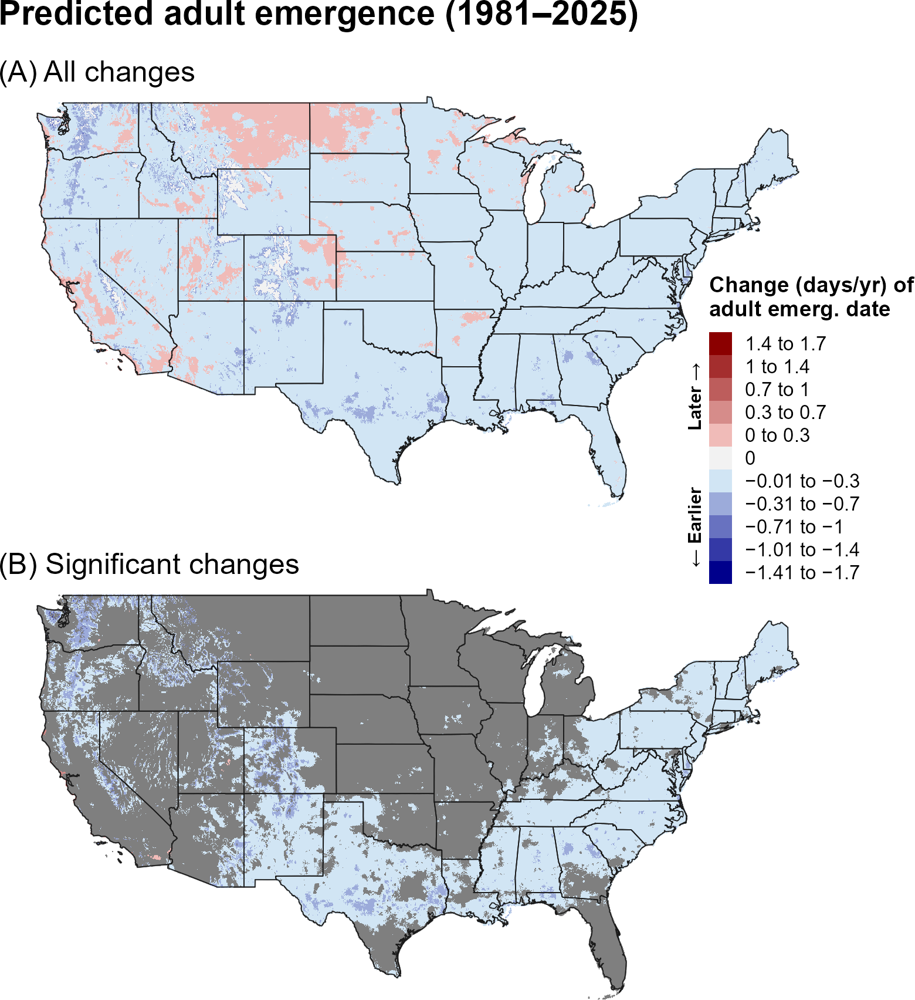
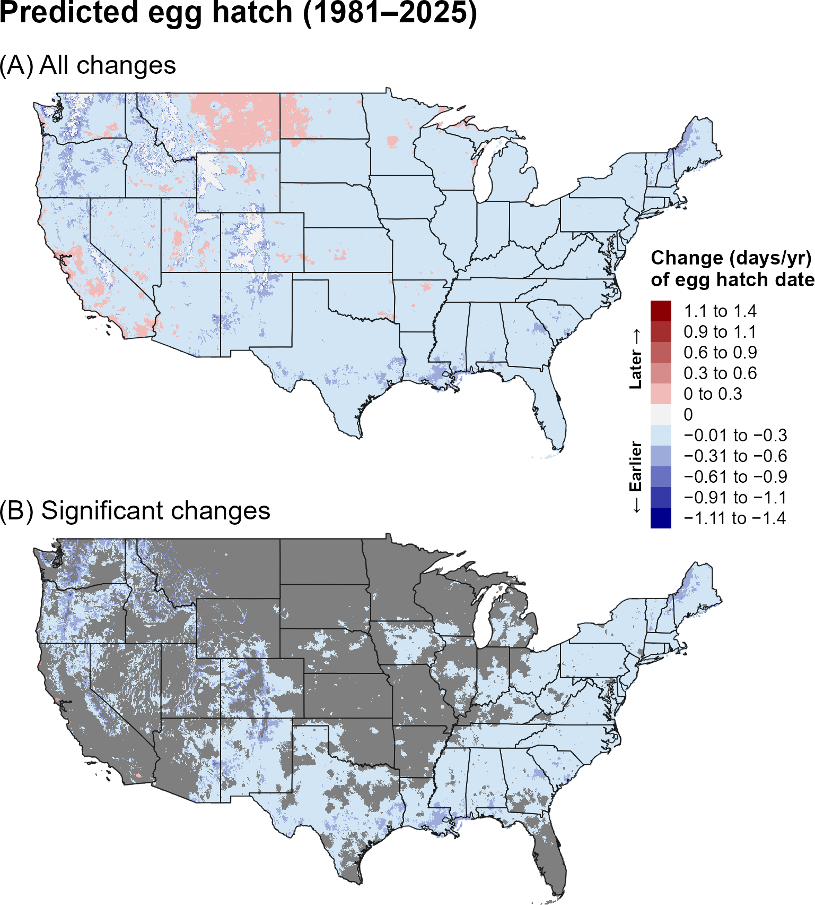
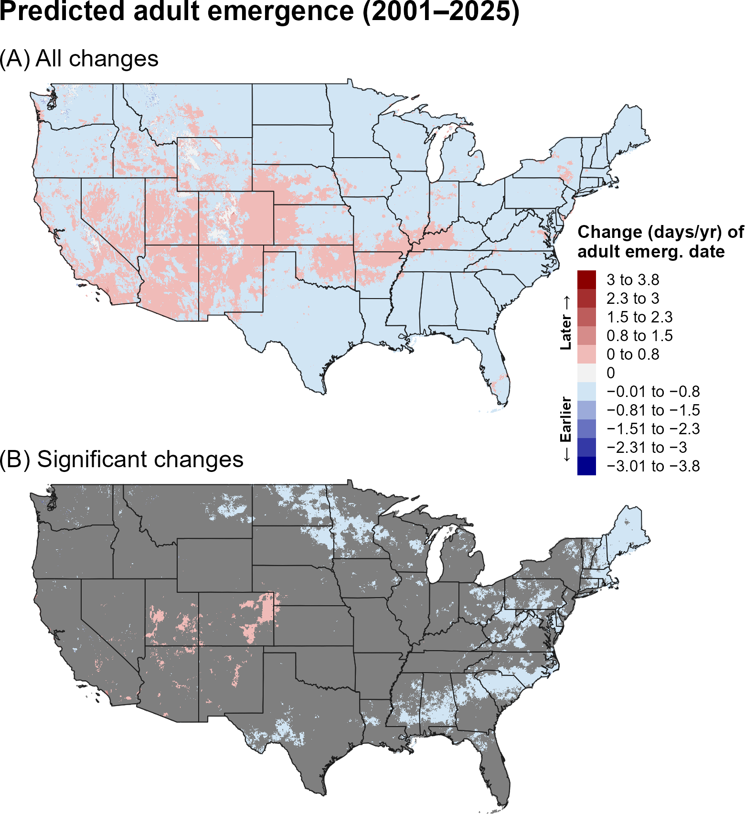
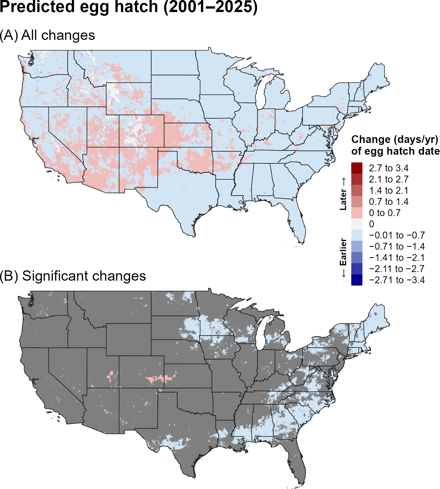
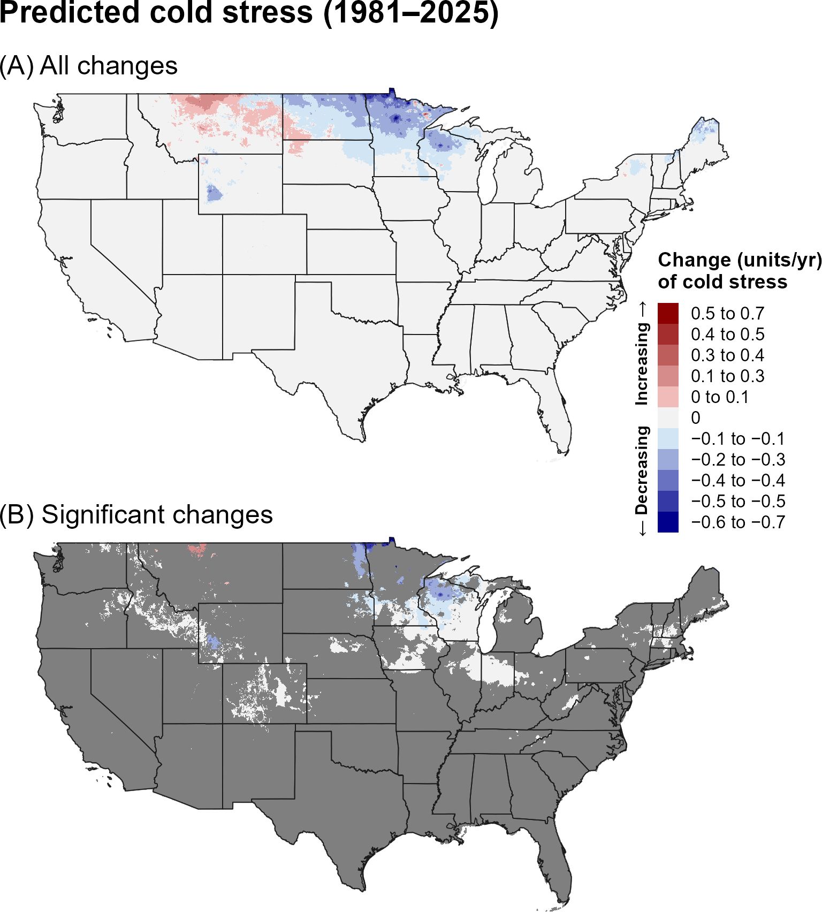
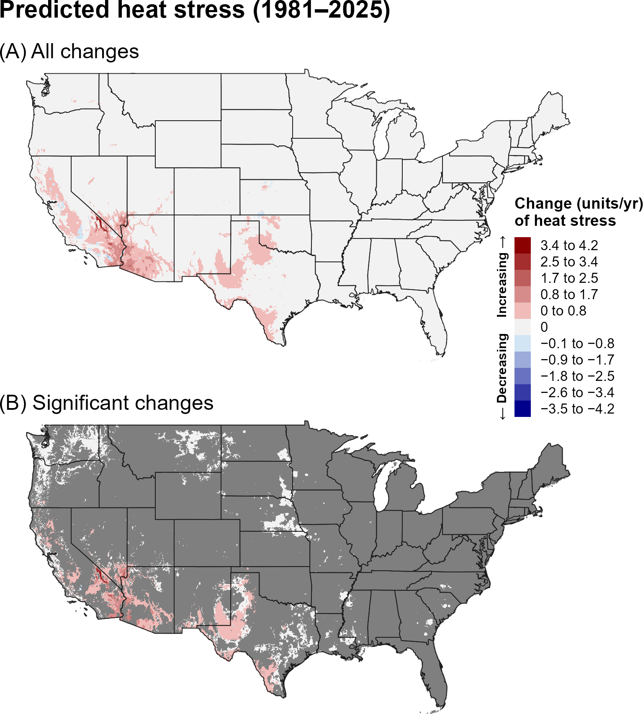
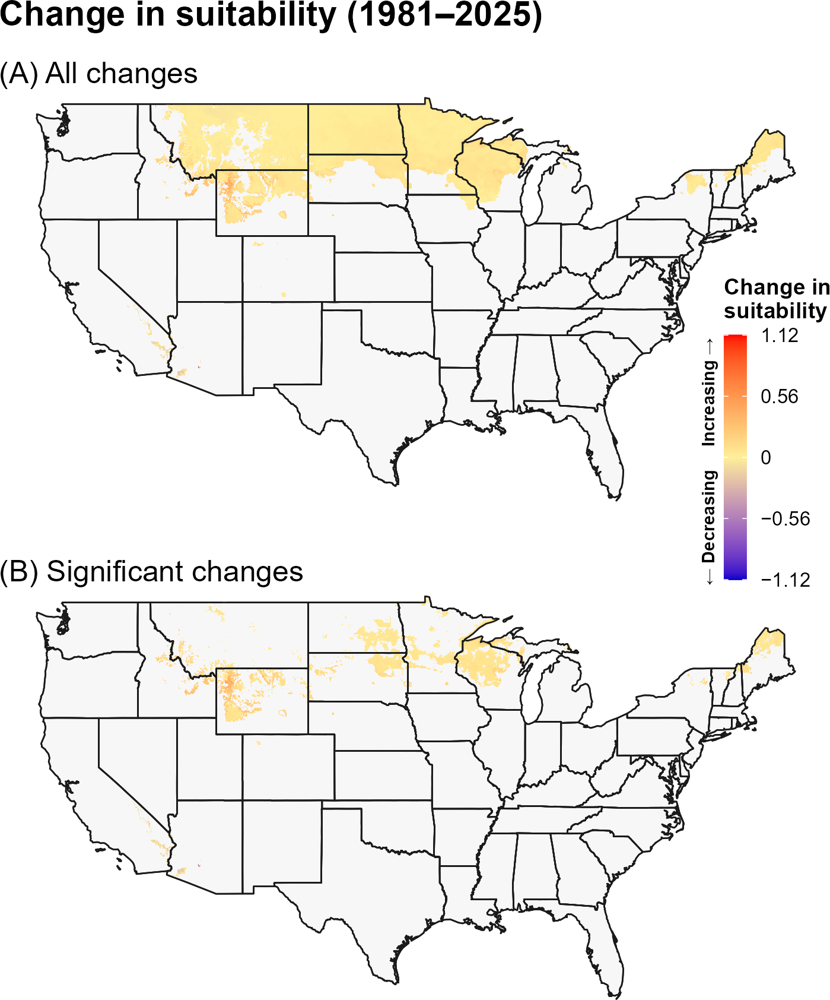
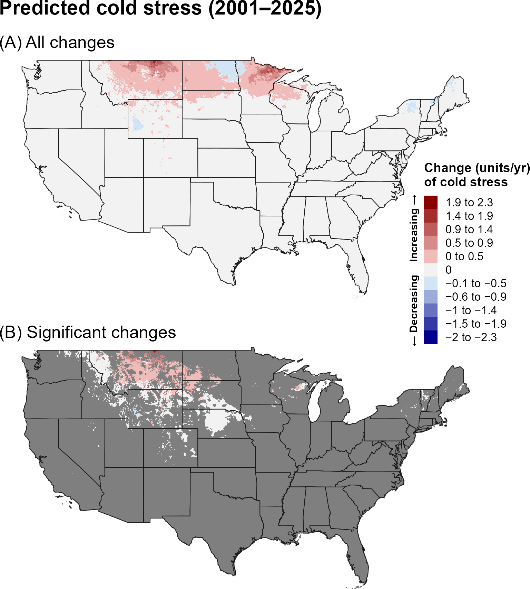
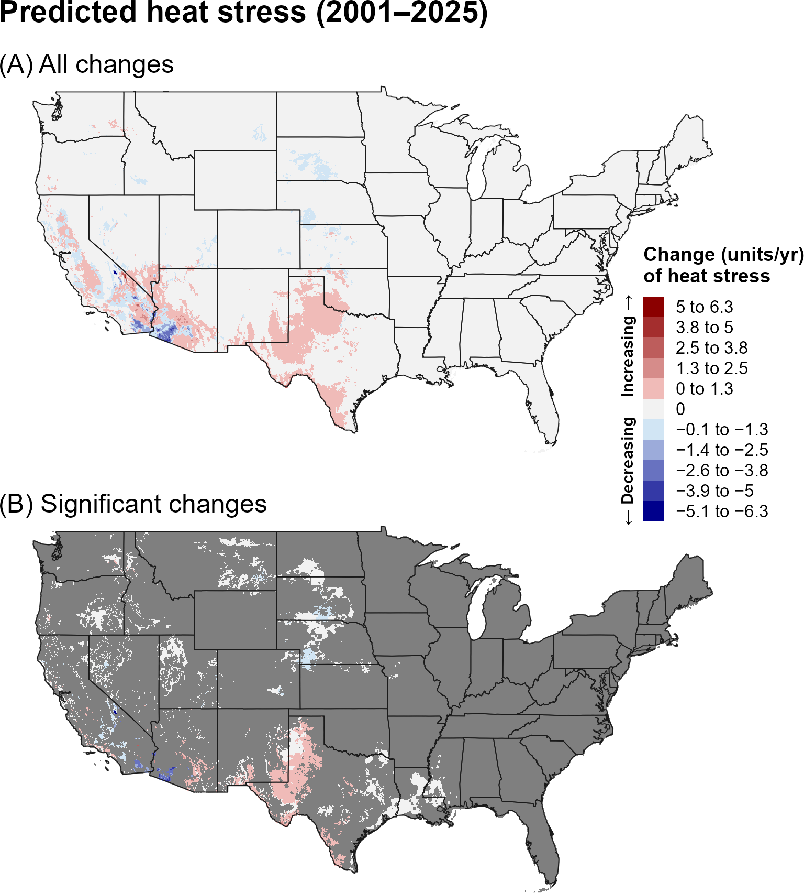
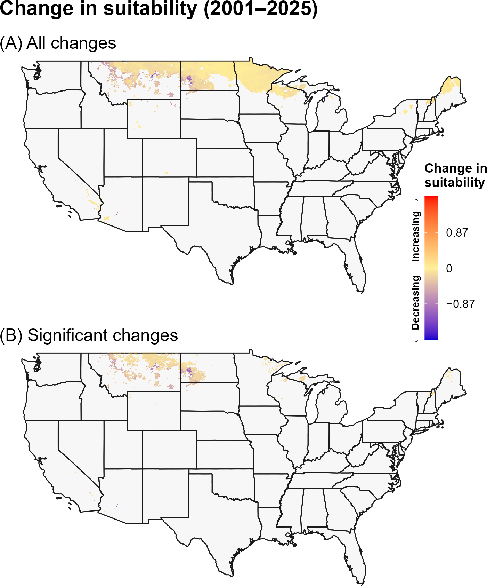

:::: {.content-visible when-format="html"}
::: {style="text-align: left;"}
[Download SUNP report as PDF](SUNP/SUNP.pdf){.btn .btn-primary}
:::
::::

## **17A. Introduction** {.unlisted}

The Sunn pest (SUNP), *Eurygaster integriceps* Puton, 1881 (Hemiptera: Scutelleridae), is a serious and economically important pest of wheat, barley, oats, rye, and sorghum. Its geographic range spans latitudes 25° to 55° N across Eurasia, including much of Eastern Europe, West Asia, Central Asia, and North Africa (`\hyperref[ref-paulian-popov-1980]{Paulian and Popov 1980}`{=latex}`<a href="#ref-paulian-popov-1980">Paulian and Popov 1980</a>`{=html}, `\hyperref[ref-critchley-1998]{Critchley 1998}`{=latex}`<a href="#ref-critchley-1998">Critchley 1998</a>`{=html}, `\hyperref[ref-mackesy-moylett-2018]{Mackesy and Moylett 2018}`{=latex}`<a href="#ref-mackesy-moylett-2018">Mackesy and Moylett 2018</a>`{=html}, `\hyperref[ref-eppo-2021]{EPPO 2021}`{=latex}`<a href="#ref-eppo-2021">EPPO 2021</a>`{=html}). Both larvae and adults damage host plants by causing plant death, arresting grain development, or degrading the gluten content of surviving wheat kernels (`\hyperref[ref-paulian-popov-1980]{Paulian and Popov 1980}`{=latex}`<a href="#ref-paulian-popov-1980">Paulian and Popov 1980</a>`{=html}, `\hyperref[ref-critchley-1998]{Critchley 1998}`{=latex}`<a href="#ref-critchley-1998">Critchley 1998</a>`{=html}). As a result, flour produced from infested grain yields bread of poor quality and reduced digestibility (`\hyperref[ref-paulian-popov-1980]{Paulian and Popov 1980}`{=latex}`<a href="#ref-paulian-popov-1980">Paulian and Popov 1980</a>`{=html}). In the absence of effective control measures, infestations can lead to complete crop loss (`\hyperref[ref-kivan-kilic-2005]{Kivan and Kilic 2005}`{=latex}`<a href="#ref-kivan-kilic-2005">Kivan and Kilic 2005</a>`{=html}). If introduced to the United States, SUNP could cause substantial economic damage to wheat and barley production, which were valued at $7.9 billion and $685 million, respectively, in 2017 (`\hyperref[ref-usda-nass-2019]{USDA-NASS 2019}`{=latex}`<a href="#ref-usda-nass-2019">USDA-NASS 2019</a>`{=html}). Areas at most risk for establishment of SUNP based on host presence are in the Midwestern United States, the Columbia River valley, and the lower Mississippi River valley (Macksey and Moylett 2018).

SUNP is a univoltine pest with two major periods in its annual life cycle (`\hyperref[ref-davari-parker-2018]{Davari and Parker 2018}`{=latex}`<a href="#ref-davari-parker-2018">Davari and Parker 2018</a>`{=html}). Adults spend late summer through winter in aestivation and overwintering sites, where they undergo obligatory diapause and remain largely inactive until spring temperatures reach approximately 10–14 °C, triggering emergence and migration to cereal fields for reproduction (`\hyperref[ref-banks-1961]{Banks et al. 1961}`{=latex}`<a href="#ref-banks-1961">Banks et al. 1961</a>`{=html}, `\hyperref[ref-critchley-1998]{Critchley 1998}`{=latex}`<a href="#ref-critchley-1998">Critchley 1998</a>`{=html}, `\hyperref[ref-parker-2011]{Parker et al. 2011}`{=latex}`<a href="#ref-parker-2011">Parker et al. 2011</a>`{=html}, `\hyperref[ref-islamoglu-2022]{Islamoglu 2022}`{=latex}`<a href="#ref-islamoglu-2022">Islamoglu 2022</a>`{=html}). Following development through five nymphal instars and the subsequent adult emergence, adults migrate approximately 10–20 km to hillside aestivation and overwintering sites, which occur at higher elevations under bushes in the southern part of the range and in deciduous Quercus forests in the northern part (`\hyperref[ref-paulian-popov-1980]{Paulian and Popov 1980}`{=latex}`<a href="#ref-paulian-popov-1980">Paulian and Popov 1980</a>`{=html}, `\hyperref[ref-critchley-1998]{Critchley 1998}`{=latex}`<a href="#ref-critchley-1998">Critchley 1998</a>`{=html}, `\hyperref[ref-davari-parker-2018]{Davari and Parker 2018}`{=latex}`<a href="#ref-davari-parker-2018">Davari and Parker 2018</a>`{=html}). This seasonal movement between agricultural and non-crop habitats complicates management and requires appropriately timed monitoring and control (`\hyperref[ref-critchley-1998]{Critchley 1998}`{=latex}`<a href="#ref-critchley-1998">Critchley 1998</a>`{=html}, `\hyperref[ref-davari-parker-2018]{Davari and Parker 2018}`{=latex}`<a href="#ref-davari-parker-2018">Davari and Parker 2018</a>`{=html}), while regional geographic features that influence temperature can affect the timing and direction of migration (`\hyperref[ref-parker-2011]{Parker et al. 2011}`{=latex}`<a href="#ref-parker-2011">Parker et al. 2011</a>`{=html}, `\hyperref[ref-islamoglu-2022]{Islamoglu 2022}`{=latex}`<a href="#ref-islamoglu-2022">Islamoglu 2022</a>`{=html}). Potentially suitable environmental conditions for SUNP occur across most of the contiguous United States (CONUS), although mountainous and higher-latitude regions of the West may be unsuitable for development because of insufficient thermal accumulation (`\hyperref[ref-aljaryian-2016]{Aljaryian et al. 2016}`{=latex}`<a href="#ref-aljaryian-2016">Aljaryian et al. 2016</a>`{=html}, `\hyperref[ref-barker-coop-2020]{Barker and Coop 2020}`{=latex}`<a href="#ref-barker-coop-2020">Barker and Coop 2020</a>`{=html}). Nevertheless, the species' migratory behavior could allow adults to move between suitable cereal-growing areas and nearby seasonal aestivation or overwintering sites, potentially facilitating persistence where seasonal conditions limit activity.

A model for SUNP developed for the Degree-Day, establishment Risk, and Phenological event mapping system (DDRP) is operationalized to produce near real-time forecasts for the CONUS at <https://uspest.org/DDRP>. The phenology model applies a lower developmental threshold of 12.2 °C and upper threshold of 36 °C for all life stages (egg, larva, pupa, and adult) and assumes the adults is the overwintering stage. The climatic suitability model applies a lower cold stress threshold and upper heat stress threshold of −30 °C and 40 °C, respectively. The full set of model parameters for SUNP, including degree-day requirements for individual life stages and climate stress limits, are presented in @tbl-sunp-parameters. Details on model parameterization are available at USPest.org (`\hyperref[ref-barker-coop-2020]{Barker and Coop 2020}`{=latex}`<a href="#ref-barker-coop-2020">Barker and Coop 2020</a>`{=html}).

## **17B. Results** {.unlisted}

### **i. Phenology**

#### **Entire period: 1981--2025**

Over 1981–2025, predicted adult emergence and egg hatch generally shifted earlier across much of the southern and central United States, with later events in portions of the northern interior (@fig-sunp-emergence, @fig-sunp-egg-hatch). Significant changes occurred primarily in the eastern and central United States, with additional localized changes elsewhere.

```{r}
#| echo: false
#| out-width: 70%
#| fig-align: center
#| fig-cap: "Changes (days/year) in predicted dates of first adult emergence for SUNP across the CONUS over the entire 44-year period (1981–2025). Maps show (A) all changes and (B) statistically significant changes (P < 0.1); areas shown in gray are not statistically significant."
#| label: fig-sunp-emergence

```

```{r}
#| echo: false
#| out-width: 70%
#| fig-align: center
#| fig-cap: "Changes (days/year) in predicted dates of first egg hatch for SUNP across the CONUS over the entire 44-year period (1981–2025). Maps show (A) all changes and (B) statistically significant changes (P < 0.1); areas shown in gray are not statistically significant."
#| label: fig-sunp-egg-hatch

```

#### **Recent period: 2001--2025**

During 2001–2025, earlier predicted phenology remained evident across much of the West and central United States, while later events occurred in portions of the northern and eastern interior (@fig-sunp-emergence-recent, @fig-sunp-egg-hatch-recent). Significant changes were spatially limited.

```{r}
#| echo: false
#| out-width: 70%
#| fig-align: center
#| fig-cap: "Changes (days/year) in predicted dates of first adult emergence for SUNP across the CONUS over the recent 24-year period (2001–2025). Maps show (A) all changes and (B) statistically significant changes (P < 0.1); areas shown in gray are not statistically significant."
#| label: fig-sunp-emergence-recent

```

```{r}
#| echo: false
#| out-width: 70%
#| fig-align: center
#| fig-cap: "Changes (days/year) in predicted dates of first egg hatch for SUNP across the CONUS over the recent 24-year period (2001–2025). Maps show (A) all changes and (B) statistically significant changes (P < 0.1); areas shown in gray are not statistically significant."
#| label: fig-sunp-egg-hatch-recent

```

### **ii. Climatic suitability**

#### **Entire period: 1981--2025**

Predicted cold stress decreased across portions of the northern United States over 1981–2025, especially in the northern Plains and Great Lakes, while heat stress increased in the Southwest and southern Great Plains (@fig-sunp-cold-stress, @fig-sunp-heat-stress). Climatic suitability increased significantly in portions of the northern Plains and Great Lakes (@fig-sunp-suitability).

```{r}
#| echo: false
#| out-width: 70%
#| fig-align: center
#| fig-cap: "Changes (units/year) in predicted cold stress for SUNP across the CONUS over the entire 44-year period (1981–2025). Maps show (A) all changes and (B) statistically significant changes (P < 0.1); areas shown in gray are not statistically significant. Areas shown as 0 in (B) had significant trends but very small changes."
#| label: fig-sunp-cold-stress

```

```{r}
#| echo: false
#| out-width: 70%
#| fig-align: center
#| fig-cap: "Changes (units/year) in predicted heat stress for SUNP across the CONUS over the entire 44-year period (1981–2025). Maps show (A) all changes and (B) statistically significant changes (P < 0.1); areas shown in gray are not statistically significant. Areas shown as 0 in (B) had significant trends but very small changes."
#| label: fig-sunp-heat-stress

```

```{r}
#| echo: false
#| out-width: 70%
#| fig-align: center
#| fig-cap: "Changes in predicted climatic suitability for SUNP across the CONUS over the 44-year period (1981–2025). Suitability is defined as areas not excluded by climate stress. Positive changes (warmer colors) indicate an increased likelihood of establishment, whereas negative changes (cooler colors) indicate a decreased likelihood of establishment."
#| label: fig-sunp-suitability

```

#### **Recent period: 2001--2025**

During 2001–2025, predicted cold stress increased across portions of the northern and central Plains, while decreases persisted in scattered northern areas (@fig-sunp-cold-stress-recent). Heat stress continued to increase in the Southwest and southern Great Plains (@fig-sunp-heat-stress-recent). Significant suitability changes were limited during the recent period, with small increases remaining in portions of the northern United States (@fig-sunp-suitability-recent).

```{r}
#| echo: false
#| out-width: 70%
#| fig-align: center
#| fig-cap: "Changes (units/year) in predicted cold stress for SUNP across the CONUS over the recent 24-year period (2001–2025). Maps show (A) all changes and (B) statistically significant changes (P < 0.1); areas shown in gray are not statistically significant. Areas shown as 0 in (B) had significant trends but very small changes."
#| label: fig-sunp-cold-stress-recent

```

```{r}
#| echo: false
#| out-width: 70%
#| fig-align: center
#| fig-cap: "Changes (units/year) in predicted heat stress for SUNP across the CONUS over the recent 24-year period (2001–2025). Maps show (A) all changes and (B) statistically significant changes (P < 0.1); areas shown in gray are not statistically significant. Areas shown as 0 in (B) had significant trends but very small changes."
#| label: fig-sunp-heat-stress-recent

```

```{r}
#| echo: false
#| out-width: 70%
#| fig-align: center
#| fig-cap: "Changes in predicted climatic suitability for SUNP across the CONUS over the recent 24-year period (2001–2025). Suitability is defined as areas not excluded by climate stress. Positive changes (warmer colors) indicate an increased likelihood of establishment, whereas negative changes (cooler colors) indicate a decreased likelihood of establishment."
#| label: fig-sunp-suitability-recent

```

## **17C. Discussion** {.unlisted}

The SUNP maps indicate earlier phenological timing over much of the CONUS during the full period, but a weaker and more heterogeneous pattern during the recent period. Because SUNP development and seasonal movement are closely associated with temperature and seasonal conditions, these shifts could alter the timing of movement and activity in regions where the species can establish.

The long-term increase in predicted suitability across portions of the northern Plains and Great Lakes is consistent with declining cold stress in those regions. Recent increases in cold stress across parts of the same broad region correspond with fewer significant suitability changes, suggesting that the establishment signal has become less consistent during the recent period.

The stronger and more spatially extensive trends in predicted phenology and climate stress over the full 44-year period may reflect both the larger sample size, which can reduce noise and improve detection of directional patterns, and differences in the underlying climate trends between the two time periods. In particular, the recent 24-year period may capture climate variability or regional trends that differ from those observed over the longer 44-year period. Thus, differences between the two periods should be interpreted as reflecting both long-term climate trends and shorter-term regional variability.

## **17D. References** {.unlisted}

\begingroup
\setlength{\parindent}{-0.5in}
\setlength{\leftskip}{0.5in}

\noindent

<span id="ref-aljaryian-2016"></span>
\phantomsection\label{ref-aljaryian-2016}

Aljaryian, R., L. Kumar, and S. Taylor. 2016. Modelling the current and potential future distributions of the Sunn pest *Eurygaster integriceps* (Hemiptera: Scutelleridae) using CLIMEX. Pest Management Science 72:1989–2000.

<span id="ref-banks-1961"></span>
\phantomsection\label{ref-banks-1961}

Banks, C. J., E. S. Brown, and A. Dezfulian. 1961. Field studies of the daily activity and feeding behaviour of Sunn pest, *Eurygaster integriceps* Put., (Hemiptera, Scutelleridae) on wheat in north Iran. Entomologia Experimentalis et Applicata 4:289–300.

<span id="ref-barker-coop-2020"></span>
\phantomsection\label{ref-barker-coop-2020}

Barker, B. S., and L. Coop. 2020. Sunn pest, *Eurygaster integriceps*. Phenology/degree-day and climate suitability white paper for USPEST.ORG. Prepared for United States Department of Agriculture (USDA) – Animal and Plant Health Inspection Service (APHIS) – Plant Protection and Quarantine (PPQ). Vs. 1.0 (8/11/2020). Online at: <https://uspest.org/CAPS/Eurygaster_integriceps_white_paper.pdf> (accessed 15 December 2025).

<span id="ref-critchley-1998"></span>
\phantomsection\label{ref-critchley-1998}

Critchley, B. R. 1998. Literature review of sunn pest *Eurygaster integriceps* Put. (Hemiptera, Scutelleridae). Crop Protection 17:271–287.

<span id="ref-davari-parker-2018"></span>
\phantomsection\label{ref-davari-parker-2018}

Davari, A., and B. L. Parker. 2018. A review of research on Sunn Pest {*Eurygaster integriceps* Puton (Hemiptera: Scutelleridae)} management published 2004–2016. Journal of Asia-Pacific Entomology 21:352–360.

<span id="ref-eppo-2021"></span>
\phantomsection\label{ref-eppo-2021}

EPPO. 2021. *Eurygaster integriceps*. EPPO datasheets on pests recommended for regulation. Online at: <https://gd.eppo.int/> (accessed 8 December 2025).

<span id="ref-islamoglu-2022"></span>
\phantomsection\label{ref-islamoglu-2022}

Islamoglu, M. 2022. Effect of some abiotic factors on migration of Sunn pest (*Eurygaster integriceps* Put.) (Hemiptera: Scutelleridae) from aestivation sites to overwintering sites. Pakistan Journal of Zoology 55:379–383.

<span id="ref-kivan-kilic-2005"></span>
\phantomsection\label{ref-kivan-kilic-2005}

Kivan, M., and N. Kilic. 2005. Effects of storage at low-temperature of various heteropteran host eggs on the egg parasitoid, Trissolcus semistriatus. BioControl 50:589–600.

<span id="ref-mackesy-moylett-2018"></span>
\phantomsection\label{ref-mackesy-moylett-2018}

Mackesy, D. and H. Moylett. 2018. CPHST Pest Datasheet for *Eurygaster integriceps*. USDA-APHIS-PPQ-CPHST (updated 16 August 2018). Online at: <https://caps.ceris.purdue.edu/wp-content/uploads/2025/07/Eurygaster-integriceps-datasheet-final.pdf> (accessed 17 September 2026).

<span id="ref-parker-2011"></span>
\phantomsection\label{ref-parker-2011}

Parker, B. L., M. Amir-Maafi, M. Skinner, J. S. Kim, and M. El Bouhssini. 2011. Distribution of Sunn pest, *Eurygaster integriceps* Puton (Hemiptera: Scutelleridae), in overwintering sites. Journal of Asia-Pacific Entomology 14:83–88.

<span id="ref-paulian-popov-1980"></span>
\phantomsection\label{ref-paulian-popov-1980}

Paulian, F., and C. Popov. 1980. Sunn pest or cereal bug. Wheat Documenta, Technical Monograph. Ciba-Geigy Ltd., Basle, Switzerland.

<span id="ref-usda-nass-2019"></span>
\phantomsection\label{ref-usda-nass-2019}

USDA-NASS. 2019. 2017 Census of Agriculture, Summary and State Data, Volume 1,  Geographic Area Series, Part 51. United States Department of Agriculture, National Agriculture Statistics Service.

\par
\endgroup
