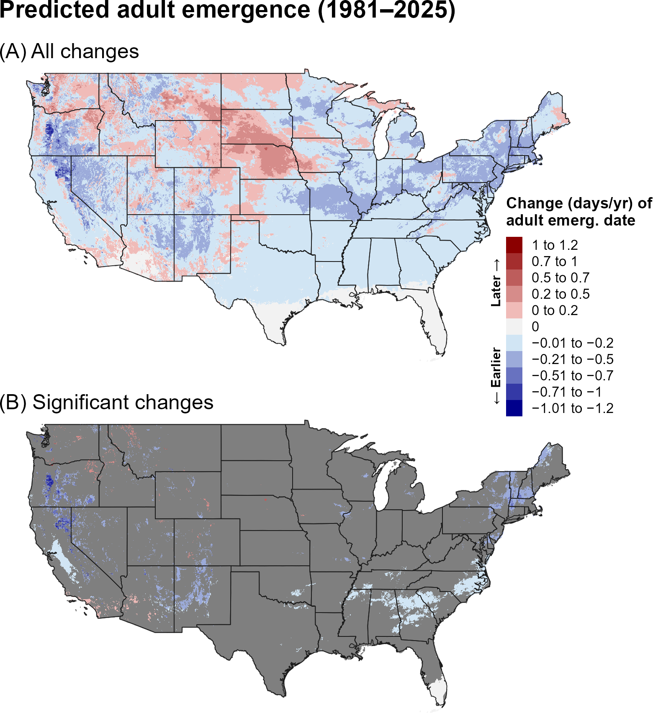
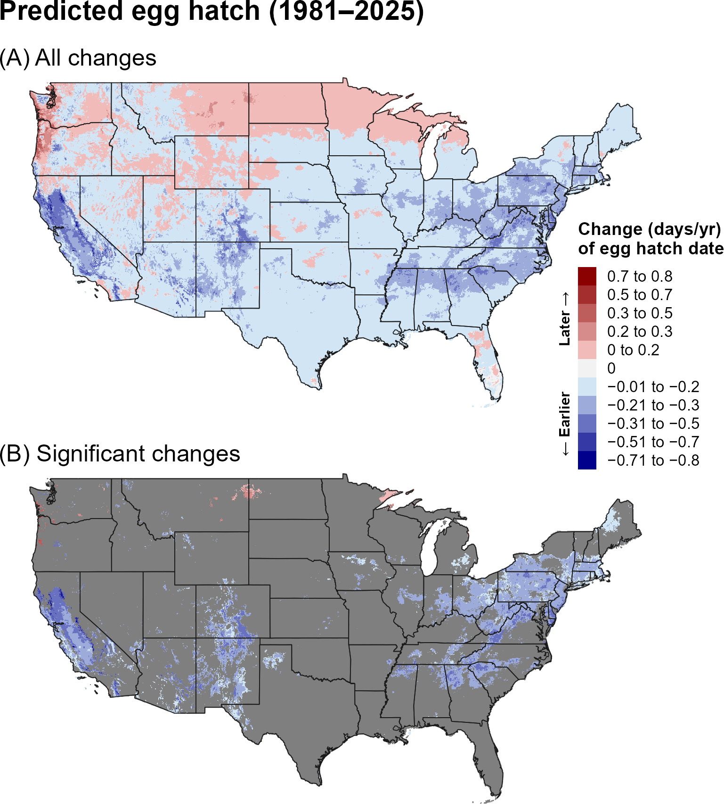
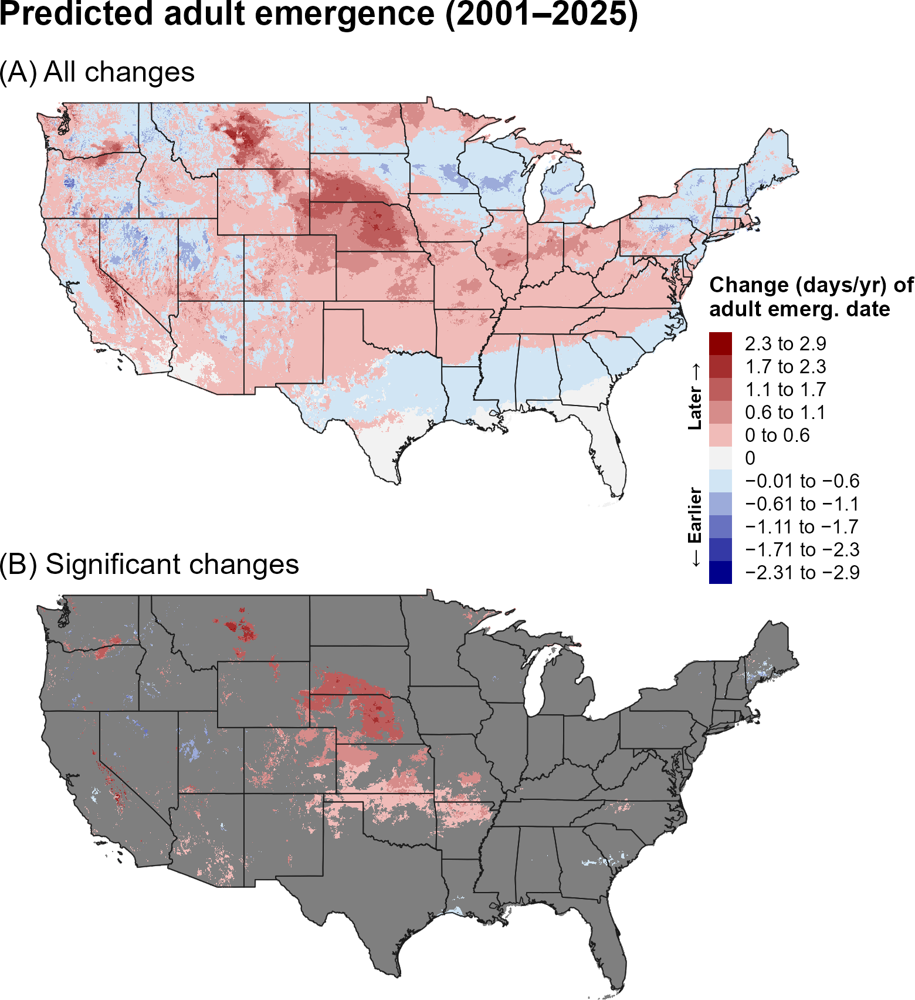
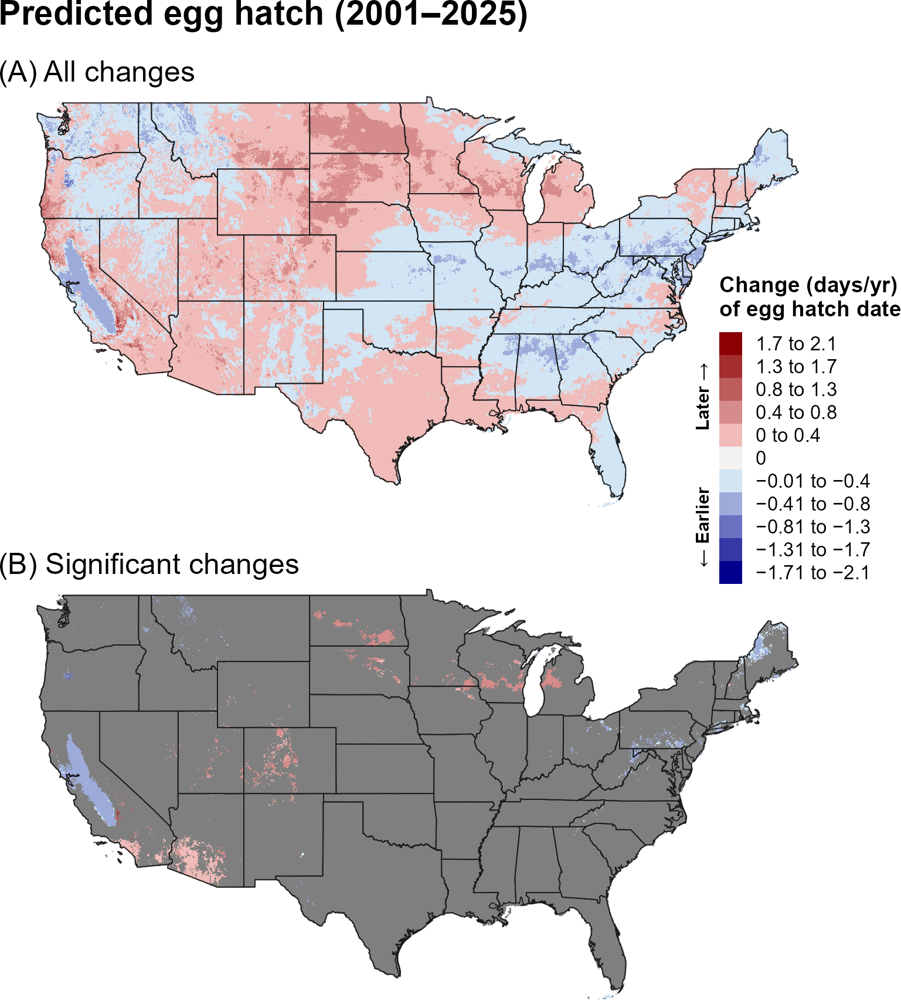
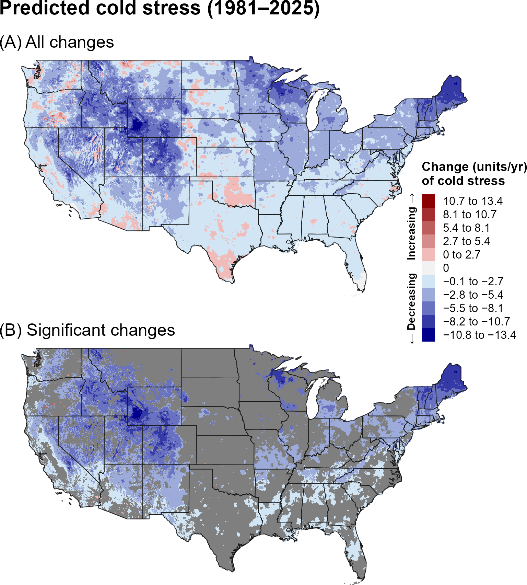
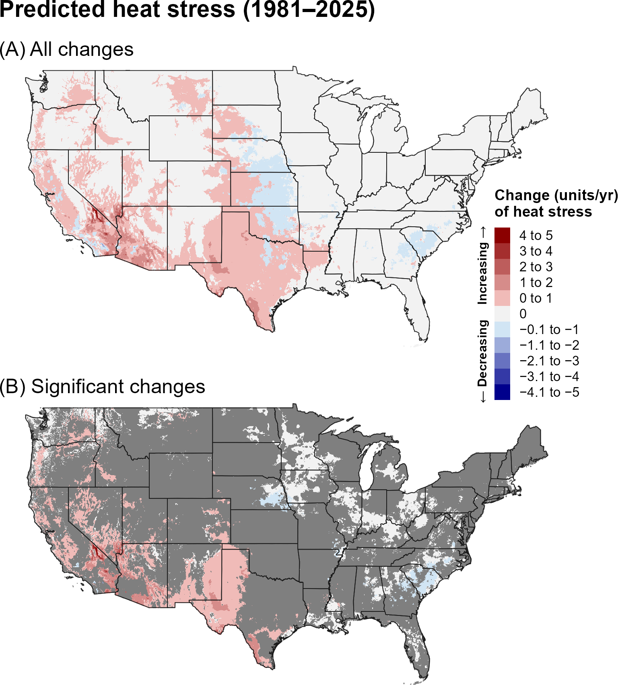
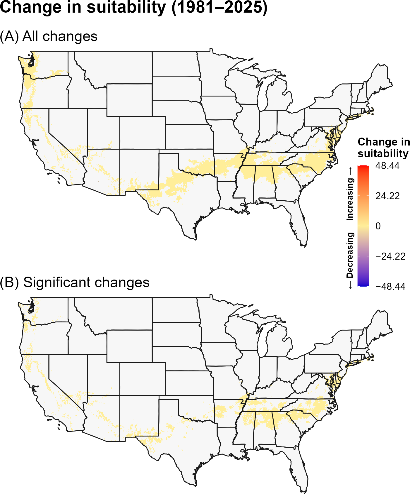
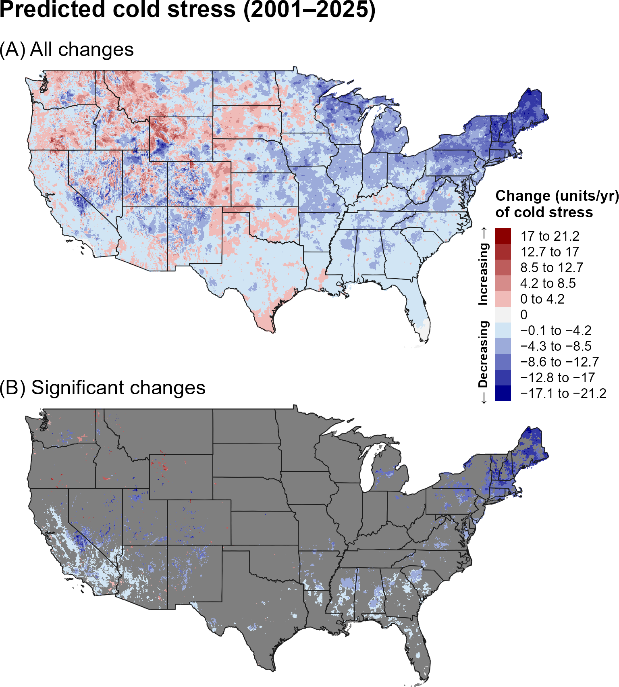
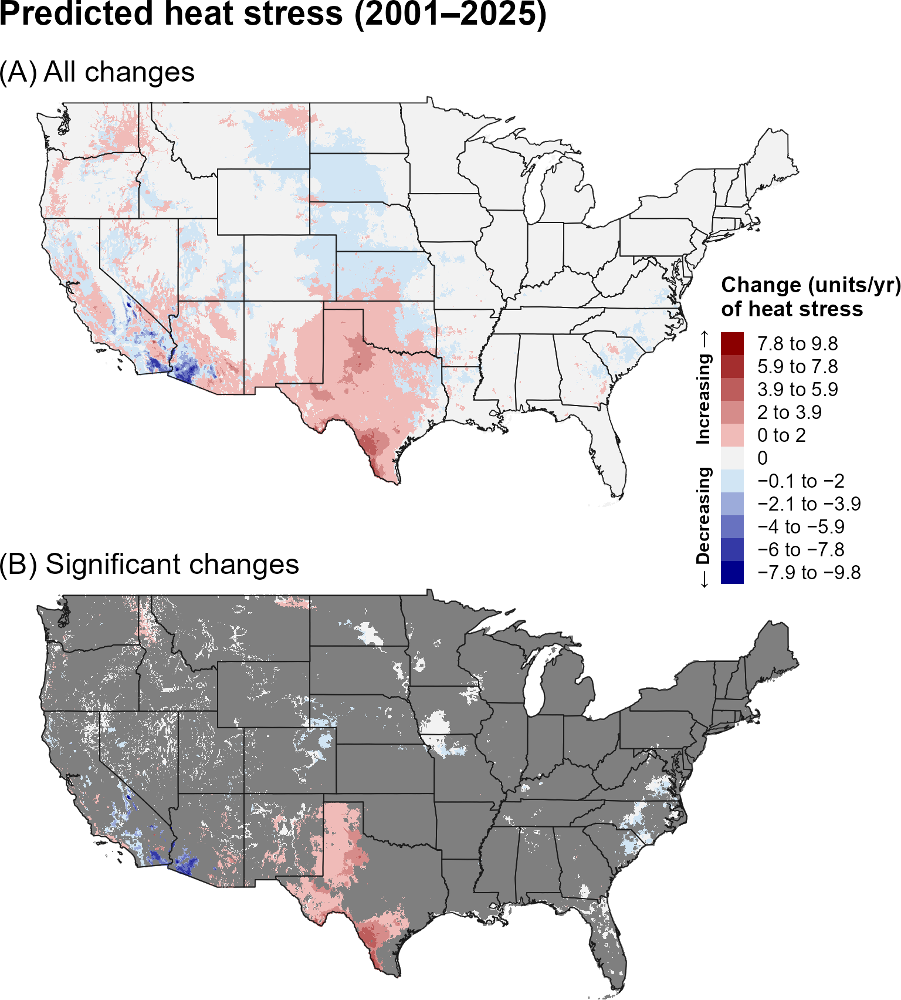
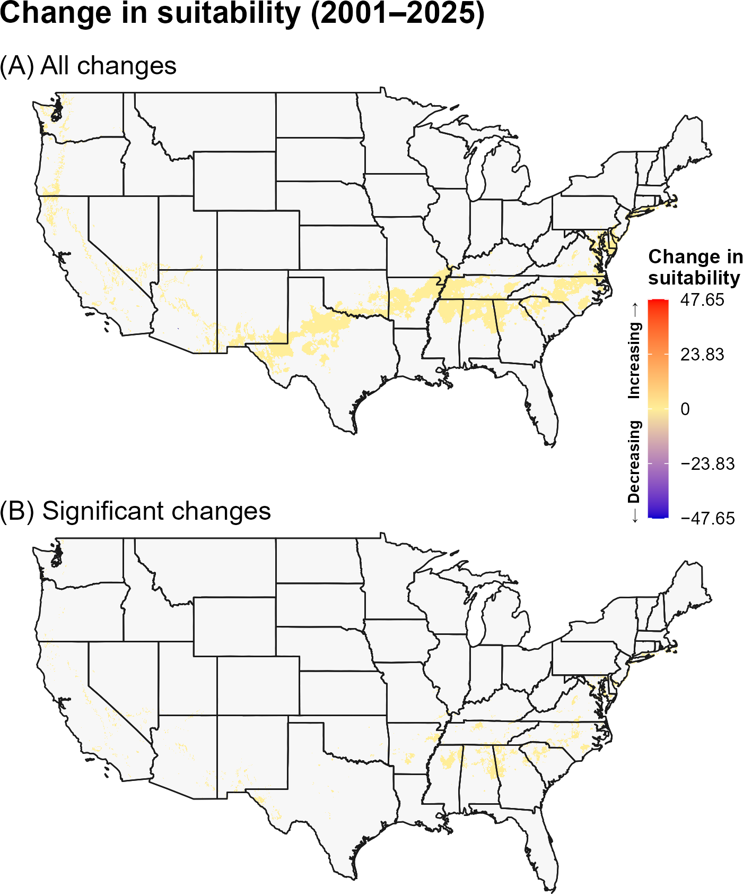

:::: {.content-visible when-format="html"}
::: {style="text-align: left;"}
[Download TABS report as PDF](TABS.pdf){.btn .btn-primary}
:::
::::

## **18A. Introduction** {.unlisted}

The tomato leaf miner (TABS), *Phthorimaea absoluta* (Meyrick) (formerly *Tuta absoluta*) (Lepidoptera: Gelechiidae), is a highly destructive pest of tomato and other solanaceous crops, native to Peru (`\hyperref[ref-biondi-2018]{Biondi et al. 2018}`{=latex}`<a href="#ref-biondi-2018">Biondi et al. 2018</a>`{=html}). It is now widely distributed across Central and South America and has invaded much of Europe, Africa, and Asia, reaching as far as South Korea (`\hyperref[ref-biondi-2018]{Biondi et al. 2018}`{=latex}`<a href="#ref-biondi-2018">Biondi et al. 2018</a>`{=html}, `\hyperref[ref-eppo-2025]{EPPO 2025}`{=latex}`<a href="#ref-eppo-2025">EPPO 2025</a>`{=html}). In China, the species has demonstrated an exceptionally rapid spread, with a median dispersal rate exceeding 1,000 km per day (`\hyperref[ref-xue-2025]{Xue et al. 2025}`{=latex}`<a href="#ref-xue-2025">Xue et al. 2025</a>`{=html}). In cooler regions, TABS can persist in protected environments such as greenhouses (`\hyperref[ref-desneux-2010]{Desneux et al. 2010}`{=latex}`<a href="#ref-desneux-2010">Desneux et al. 2010</a>`{=html}, `\hyperref[ref-gao-2025]{Gao et al. 2025}`{=latex}`<a href="#ref-gao-2025">Gao et al. 2025</a>`{=html}). Early infestations are difficult to detect, and if left unmanaged, the pest can cause complete crop loss (`\hyperref[ref-desneux-2010]{Desneux et al. 2010}`{=latex}`<a href="#ref-desneux-2010">Desneux et al. 2010</a>`{=html}, `\hyperref[ref-biondi-2018]{Biondi et al. 2018}`{=latex}`<a href="#ref-biondi-2018">Biondi et al. 2018</a>`{=html}). Its rapid global expansion has led to increased reliance on synthetic insecticides, with associated environmental and health concerns (`\hyperref[ref-desneux-2011]{Desneux et al. 2011}`{=latex}`<a href="#ref-desneux-2011">Desneux et al. 2011</a>`{=html}). Climate suitability models indicate that major tomato-producing countries, including the United States, Mexico, and Canada, are at high risk of invasion, which could lead to increased tomato prices (`\hyperref[ref-desneux-2011]{Desneux et al. 2011}`{=latex}`<a href="#ref-desneux-2011">Desneux et al. 2011</a>`{=html}, `\hyperref[ref-biondi-2018]{Biondi et al. 2018}`{=latex}`<a href="#ref-biondi-2018">Biondi et al. 2018</a>`{=html}).

Higher temperatures generally promote TABS development and abundance, while moisture availability can also influence its survival and population abundance (`\hyperref[ref-cherif-2019]{Cherif et al. 2019}`{=latex}`<a href="#ref-cherif-2019">Cherif et al. 2019</a>`{=html}, `\hyperref[ref-tonnang-2015]{Tonnang et al. 2015}`{=latex}`<a href="#ref-tonnang-2015">Tonnang et al. 2015</a>`{=html}, `\hyperref[ref-sylla-2018]{Sylla et al. 2018}`{=latex}`<a href="#ref-sylla-2018">Sylla et al. 2018</a>`{=html}, `\hyperref[ref-bacci-2021]{Bacci et al. 2021}`{=latex}`<a href="#ref-bacci-2021">Bacci et al. 2021</a>`{=html}). Occurrence records from Africa suggest that TABS can persist under relatively hot and dry conditions when host plants are available, although low soil moisture and cold winters may limit survival (`\hyperref[ref-tonnang-2015]{Tonnang et al. 2015}`{=latex}`<a href="#ref-tonnang-2015">Tonnang et al. 2015</a>`{=html}). In Brazil, low rainfall has been associated with higher pest abundance, whereas reduced abundance during the rainy season in Senegal was attributed primarily to limited host-plant availability, suggesting that relationships between moisture and TABS abundance may depend on host availability (`\hyperref[ref-sylla-2018]{Sylla et al. 2018}`{=latex}`<a href="#ref-sylla-2018">Sylla et al. 2018</a>`{=html}, `\hyperref[ref-bacci-2021]{Bacci et al. 2021}`{=latex}`<a href="#ref-bacci-2021">Bacci et al. 2021</a>`{=html}). Multiple species distribution models predict suitable conditions for TABS throughout the southeastern United States and along much of the Pacific Coast (`\hyperref[ref-santana-2019]{Santana et al. 2019}`{=latex}`<a href="#ref-santana-2019">Santana et al. 2019</a>`{=html}, `\hyperref[ref-barker-coop-2020]{Barker and Coop 2020}`{=latex}`<a href="#ref-barker-coop-2020">Barker and Coop 2020</a>`{=html}, `\hyperref[ref-ponti-2021]{Ponti et al. 2021}`{=latex}`<a href="#ref-ponti-2021">Ponti et al. 2021</a>`{=html}, `\hyperref[ref-marchioro-krechemer-2024]{Marchioro and Krechemer 2024}`{=latex}`<a href="#ref-marchioro-krechemer-2024">Marchioro and Krechemer 2024</a>`{=html}, `\hyperref[ref-gao-2025]{Gao et al. 2025}`{=latex}`<a href="#ref-gao-2025">Gao et al. 2025</a>`{=html}, `\hyperref[ref-nitta-2025]{Nitta et al. 2025}`{=latex}`<a href="#ref-nitta-2025">Nitta et al. 2025</a>`{=html}). TABS is multivoltine, with reported annual generation numbers ranging from 2–5 in Bulgaria and four in Turkey to 10–12 in South America and 13 overlapping generations in Spain, where year-round activity has been reported (`\hyperref[ref-desneux-2010]{Desneux et al. 2010}`{=latex}`<a href="#ref-desneux-2010">Desneux et al. 2010</a>`{=html}, `\hyperref[ref-mamay-yanik-2012]{Mamay and Yanik 2012}`{=latex}`<a href="#ref-mamay-yanik-2012">Mamay and Yanik 2012</a>`{=html}, `\hyperref[ref-karadjova-2013]{Karadjova et al. 2013}`{=latex}`<a href="#ref-karadjova-2013">Karadjova et al. 2013</a>`{=html}, `\hyperref[ref-vercher-aznar-2010]{Vercher Aznar et al. 2010}`{=latex}`<a href="#ref-vercher-aznar-2010">Vercher Aznar et al. 2010</a>`{=html}). In the contiguous United States, estimates of annual voltinism range from 3–9 generations under historical climate conditions, with up to 13 generations predicted under favorable conditions (`\hyperref[ref-barker-coop-2020]{Barker and Coop 2020}`{=latex}`<a href="#ref-barker-coop-2020">Barker and Coop 2020</a>`{=html}, `\hyperref[ref-azrag-2023]{Azrag et al. 2023}`{=latex}`<a href="#ref-azrag-2023">Azrag et al. 2023</a>`{=html}).

A model for TABS developed for the Degree-Day, establishment Risk, and Phenological event mapping system (DDRP) is operationalized to produce near real-time forecasts for the contiguous United States (CONUS) at <https://uspest.org/DDRP>. The phenology model applies a lower developmental threshold of 7.8 ºC and upper threshold of 35 ºC for all life stages (egg, larva, pupa, and adult) and assumes the adult is the overwintering stage. The climatic suitability model applies a lower cold stress threshold and upper heat stress threshold of 2 °C and 37 °C, respectively. The full set of model parameters for TABS, including degree-day requirements for individual life stages and climate stress limits, are presented in @tbl-tabs-parameters. Details on model parameterization are available at USPest.org (`\hyperref[ref-barker-coop-2020]{Barker and Coop 2020}`{=latex}`<a href="#ref-barker-coop-2020">Barker and Coop 2020</a>`{=html}). 

## **18B. Results** {.unlisted}

### **i. Phenology**

#### **Entire period: 1981--2025**

Over 1981–2025, predicted adult emergence and egg hatch showed mixed regional trends, with later events common across portions of the northern and central United States and earlier events in other regions (@fig-tabs-emergence, @fig-tabs-egg-hatch). Significant changes were concentrated in scattered areas of the central and eastern United States.

```{r}
#| echo: false
#| out-width: 70%
#| fig-align: center
#| fig-cap: "Changes (days/year) in predicted dates of first adult emergence for TABS across the CONUS over the entire 44-year period (1981–2025). Maps show (A) all changes and (B) statistically significant changes (P < 0.1); areas shown in gray are not statistically significant."
#| label: fig-tabs-emergence

```

```{r}
#| echo: false
#| out-width: 70%
#| fig-align: center
#| fig-cap: "Changes (days/year) in predicted dates of first egg hatch for TABS across the CONUS over the entire 44-year period (1981–2025). Maps show (A) all changes and (B) statistically significant changes (P < 0.1); areas shown in gray are not statistically significant."
#| label: fig-tabs-egg-hatch

```

#### **Recent period: 2001--2025**

During 2001–2025, later predicted adult emergence and egg hatch were prominent across portions of the northern and central United States, while earlier events occurred in scattered western and southern regions (@fig-tabs-emergence-recent, @fig-tabs-egg-hatch-recent). Significant changes were relatively limited but included localized areas in the central United States.

```{r}
#| echo: false
#| out-width: 70%
#| fig-align: center
#| fig-cap: "Changes (days/year) in predicted dates of first adult emergence for TABS across the CONUS over the recent 24-year period (2001–2025). Maps show (A) all changes and (B) statistically significant changes (P < 0.1); areas shown in gray are not statistically significant."
#| label: fig-tabs-emergence-recent

```

```{r}
#| echo: false
#| out-width: 70%
#| fig-align: center
#| fig-cap: "Changes (days/year) in predicted dates of first egg hatch for TABS across the CONUS over the recent 24-year period (2001–2025). Maps show (A) all changes and (B) statistically significant changes (P < 0.1); areas shown in gray are not statistically significant."
#| label: fig-tabs-egg-hatch-recent

```

### **ii. Climatic suitability**

#### **Entire period: 1981--2025**

Predicted cold stress decreased broadly across the northern United States over 1981–2025, while heat stress increased across the western and southern United States (@fig-tabs-cold-stress, @fig-tabs-heat-stress). Significant increases in climatic suitability were concentrated in portions of the southern and central United States, with additional localized areas along the Pacific Coast (@fig-tabs-suitability).

```{r}
#| echo: false
#| out-width: 70%
#| fig-align: center
#| fig-cap: "Changes (units/year) in predicted cold stress for TABS across the CONUS over the entire 44-year period (1981–2025). Maps show (A) all changes and (B) statistically significant changes (P < 0.1); areas shown in gray are not statistically significant. Areas shown as 0 in (B) had significant trends but very small changes."
#| label: fig-tabs-cold-stress

```

```{r}
#| echo: false
#| out-width: 70%
#| fig-align: center
#| fig-cap: "Changes (units/year) in predicted heat stress for TABS across the CONUS over the entire 44-year period (1981–2025). Maps show (A) all changes and (B) statistically significant changes (P < 0.1); areas shown in gray are not statistically significant. Areas shown as 0 in (B) had significant trends but very small changes."
#| label: fig-tabs-heat-stress

```

```{r}
#| echo: false
#| out-width: 70%
#| fig-align: center
#| fig-cap: "Changes in predicted climatic suitability for TABS across the CONUS over the 44-year period (1981–2025). Suitability is defined as areas not excluded by climate stress. Positive changes (warmer colors) indicate an increased likelihood of establishment, whereas negative changes (cooler colors) indicate a decreased likelihood of establishment."
#| label: fig-tabs-suitability

```

#### **Recent period: 2001--2025**

During 2001–2025, increases in predicted cold stress became more apparent across portions of the northern and central interior, while heat stress continued to increase across the Southwest and southern Great Plains (@fig-tabs-cold-stress-recent, @fig-tabs-heat-stress-recent). Climatic-suitability increases remained localized, particularly in the southern and central United States (@fig-tabs-suitability-recent).

```{r}
#| echo: false
#| out-width: 70%
#| fig-align: center
#| fig-cap: "Changes (units/year) in predicted cold stress for TABS across the CONUS over the recent 24-year period (2001–2025). Maps show (A) all changes and (B) statistically significant changes (P < 0.1); areas shown in gray are not statistically significant. Areas shown as 0 in (B) had significant trends but very small changes."
#| label: fig-tabs-cold-stress-recent

```

```{r}
#| echo: false
#| out-width: 70%
#| fig-align: center
#| fig-cap: "Changes (units/year) in predicted heat stress for TABS across the CONUS over the recent 24-year period (2001–2025). Maps show (A) all changes and (B) statistically significant changes (P < 0.1); areas shown in gray are not statistically significant. Areas shown as 0 in (B) had significant trends but very small changes."
#| label: fig-tabs-heat-stress-recent

```

```{r}
#| echo: false
#| out-width: 70%
#| fig-align: center
#| fig-cap: "Changes in predicted climatic suitability for TABS across the CONUS over the recent 24-year period (2001–2025). Suitability is defined as areas not excluded by climate stress. Positive changes (warmer colors) indicate an increased likelihood of establishment, whereas negative changes (cooler colors) indicate a decreased likelihood of establishment."
#| label: fig-tabs-suitability-recent

```

## **18C. Discussion** {.unlisted}

The TABS results show substantial regional variation in predicted phenological change, with the recent period characterized by later adult emergence and egg hatch in portions of the northern and central United States. In environmentally suitable regions, shifts in phenology could affect the timing and number of generations because TABS is multivoltine and its development is strongly temperature dependent. The maps therefore suggest that surveillance and management timing may need to account for regional differences in seasonal development.

The increase in predicted climatic suitability across portions of the southern and central United States is consistent with the species' modeled preference for warmer conditions and the long-term reduction in cold stress. At the same time, increasing heat stress in the Southwest could limit suitability in the warmest areas. The more localized recent-period suitability changes suggest that establishment risk has not increased uniformly across the CONUS.

The stronger and more spatially extensive trends in predicted phenology and climate stress over the full 44-year period may reflect both the larger sample size, which can reduce noise and improve detection of directional patterns, and differences in the underlying climate trends between the two time periods. In particular, the recent 24-year period may capture climate variability or regional trends that differ from those observed over the longer 44-year period. Thus, differences between the two periods should be interpreted as reflecting both long-term climate trends and shorter-term regional variability.

## **18D. References** {.unlisted}

\begingroup
\setlength{\parindent}{-0.5in}
\setlength{\leftskip}{0.5in}

\noindent

<span id="ref-azrag-2023"></span>
\phantomsection\label{ref-azrag-2023}

Azrag, A. G. A., F. Obala, H. E. Z. Tonnang, B. N. Hogg, S. Ndlela, and S. A. Mohamed. 2023. Predicting the impact of climate change on the potential distribution of the invasive tomato pinworm *Phthorimaea absoluta* (Meyrick) (Lepidoptera: Gelechiidae). Scientific Reports 13:16477.

<span id="ref-bacci-2021"></span>
\phantomsection\label{ref-bacci-2021}

Bacci, L., É. M. da Silva, J. C. Martins, R. S. da Silva, M. Chediak, C. C. Milagres, and M. C. Picanço. 2021. The seasonal dynamic of *Tuta absoluta* in Solanum lycopersicon cultivation: Contributions of climate, plant phenology, and insecticide spraying. Pest Management Science 77:3187–3197.

<span id="ref-barker-coop-2020"></span>
\phantomsection\label{ref-barker-coop-2020}

Barker, B. S., and L. Coop. 2020. TABS, *Tuta absoluta*. Phenology/degree-day and climate suitability white paper for USPEST.ORG. Prepared for United States Department of Agriculture (USDA) – Animal and Plant Health Inspection Service (APHIS) – Plant Protection and Quarantine (PPQ). Vs. 1.0 (1/23/2020). Online at: <https://uspest.org/CAPS/Tuta_absoluta_white_paper.pdf> (accessed 16 December 2025).

<span id="ref-biondi-2018"></span>
\phantomsection\label{ref-biondi-2018}

Biondi, A., R. Narciso, C. Guedes, F.-H. Wan, and N. Desneux. 2018. Ecology, worldwide spread, and management of the invasive South American tomato pinworm, *Tuta absoluta*: Past, present, and future. Annual Review of Entomology 63:239–258.

<span id="ref-cherif-2019"></span>
\phantomsection\label{ref-cherif-2019}

Cherif, A., S. Attia-Barhoumi, R. Mansour, L. Zappalà, and K. Grissa-Lebdi. 2019. Elucidating key biological parameters of *Tuta absoluta* on different host plants and under various temperature and relative humidity regimes. Entomologia Generalis 39:1–17.

<span id="ref-desneux-2011"></span>
\phantomsection\label{ref-desneux-2011}

Desneux, N., M. G. Luna, T. Guillemaud, and A. Urbaneja. 2011. The invasive South American tomato pinworm, *Tuta absoluta*, continues to spread in Afro-Eurasia and beyond: The new threat to tomato world production. Journal of Pest Science 84:403–408.

<span id="ref-desneux-2010"></span>
\phantomsection\label{ref-desneux-2010}

Desneux, N., E. Wajnberg, K. A. G. Wyckhuys, G. Burgio, S. Arpaia, C. A. Narváez-Vasquez, J. González-Cabrera, D. C. Ruescas, E. Tabone, J. Frandon, J. Pizzol, C. Poncet, T. Cabello, and A. Urbaneja. 2010. Biological invasion of European tomato crops by *Tuta absoluta*: Ecology, geographic expansion and prospects for biological control. Journal of Pest Science 83:197–215.

<span id="ref-eppo-2025"></span>
\phantomsection\label{ref-eppo-2025}

EPPO. 2025. *Tuta absoluta*. EPPO datasheets on pests recommended for regulation. Available at: https://gd.eppo.int/ (accessed 16 December 2025).

<span id="ref-gao-2025"></span>
\phantomsection\label{ref-gao-2025}

Gao, T., R. Feng, Z. Liu, and Z. Zhu. 2025. Modeling the potential climatic suitability and expansion risk of *Tuta absoluta* (Meyrick, 1917) (Lepidoptera: Gelechiidae) under future climate scenarios. Insects 16:185.

<span id="ref-karadjova-2013"></span>
\phantomsection\label{ref-karadjova-2013}

Karadjova, O., Z. Ilieva, V. Krumov, E. Petrova, V. Ventsislavov, and N. Poushkarov. 2013. *Tuta absoluta* (Meyrick) (Lepidoptera: Gelechiidae): Potential for entry, establishment and spread in Bulgaria. Bulgarian Journal of Agricultural Science 19:563–571.

<span id="ref-mamay-yanik-2012"></span>
\phantomsection\label{ref-mamay-yanik-2012}

Mamay, M., and E. Yanik. 2012. Determination of adult population development of Tomato leafminer [*Tuta absoluta* (Meyrick) (Lepidoptera: Gelechiidae)] in tomato growing areas in Şanlıurfa. Türkiye Entomoloji Bülteni 2:189–198.

<span id="ref-marchioro-krechemer-2024"></span>
\phantomsection\label{ref-marchioro-krechemer-2024}

Marchioro, C. A., and F. S. Krechemer. 2024. Reconstructing the biological invasion of *Tuta absoluta*: Evidence of niche shift and its consequences for invasion risk assessment. Journal of Pest Science 97:127–141.

<span id="ref-nitta-2025"></span>
\phantomsection\label{ref-nitta-2025}

Nitta, A., S. Vaddi, B. Venkatasamy, M. Marimuthu, Y. S. Johnson Thangaraj Edward, N. K. Satyamoorthy, M. Kavitha, and P. D. Sreekanth. 2025. Predicting the impact of climate change on the potential distribution of South American tomato moth, *Phthorimaea absoluta* (Meyrick) (Lepidoptera: Gelechiidae) using CLIMEX. Current Science 128:283–289.

<span id="ref-ponti-2021"></span>
\phantomsection\label{ref-ponti-2021}

Ponti, L., A. P. Gutierrez, M. R. de Campos, N. Desneux, A. Biondi, and M. Neteler. 2021. Biological invasion risk assessment of *Tuta absoluta*: Mechanistic versus correlative methods. Biological Invasions 23:3809–3829.

<span id="ref-santana-2019"></span>
\phantomsection\label{ref-santana-2019}

Santana, P. A., L. Kumar, R. S. Da Silva, and M. C. Picanço. 2019. Global geographic distribution of *Tuta absoluta* as affected by climate change. Journal of Pest Science 92:1373–1385.

<span id="ref-sylla-2018"></span>
\phantomsection\label{ref-sylla-2018}

Sylla, S., O. Seydi, K. Diarra, and T. Brévault. 2018. Seasonal decline of the tomato leafminer, *Tuta absoluta*, in the shifting landscape of a vegetable-growing area. Entomologia Experimentalis et Applicata 166:638–647.

<span id="ref-tonnang-2015"></span>
\phantomsection\label{ref-tonnang-2015}

Tonnang, H. E. Z., S. F. Mohamed, F. Khamis, and S. Ekesi. 2015. Identification and risk assessment for worldwide invasion and spread of *Tuta absoluta* with a focus on Sub-Saharan Africa: Implications for phytosanitary measures and management. PLoS ONE 10:e0135283.

<span id="ref-vercher-aznar-2010"></span>
\phantomsection\label{ref-vercher-aznar-2010}

Vercher Aznar, R., A. Calabuig, and C. Felipe. 2010. Ecología, muestreos y umbrales de *Tuta absoluta* (Meyrick). Phytoma España 217:23.

<span id="ref-xue-2025"></span>
\phantomsection\label{ref-xue-2025}

Xue, Y., C. Huang, X. Xian, W. Liu, F. Wan, N. Desneux, G. Zhang, and Y. Zhang. 2025. Modeling the spread patterns and climatic niche dynamics of the TABS *Tuta absoluta* following its invasion of China. Journal of Pest Science 98:2417–2426.

\par
\endgroup